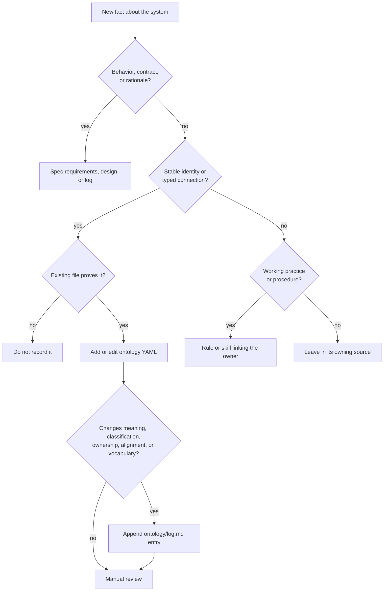

# Ontology Authoring

Read the [format spec](../../specs/ontology/spec.md) for fields, kinds, relation
types, bindings, and interpretation limits. Read [`ontology/AGENTS.md`](../../ontology/AGENTS.md)
for the topic index. This rule owns the division of roles and authoring practice.

**Purpose:** keep the documentation-only ontology a selective map of stable identifiers and
typed relations, without letting it duplicate specs, rules, or inventories.

## Ownership

| Artifact | Owns | MUST NOT own |
|----------|------|--------------|
| `specs/{topic}/` | Behavior, requirements, design, dependency-direction contracts, gaps, decisions (R/V/G/Q IDs, `log.md`) | Ontology IDs as normative identity |
| `ontology/*.yml` | Stable IDs, kinds, short definitions, typed edges, bindings to specs, packages, and files | Requirements, behavior, config values, version numbers, live state, inventories, credentials |
| `agents/rules/`, `agents/skills/` | How agents work: patterns, pitfalls, workflows | A second copy of topology; reference ontology IDs or specs instead |

## Where does X go

| Content | Goes in |
|---------|---------|
| What the system must do, or why a design was chosen | Spec |
| That something exists and how it connects | Ontology, bound to the owning spec |
| Definition and preferred term of a shared domain concept | Ontology `concept` node; its behavior stays in the bound spec |
| Coding pattern, pitfall, command, procedure | Rule or skill, linking the spec or ontology ID |
| Verified spec/implementation mismatch | The topic's `gap.md`; omit the edge instead of recording the divergence |
| Version, SDK constraint, enabled job, health, file inventory | Its owning manifest or runtime source |

## Authoring

- Use flat, topic-named `.yml` files. Add a topic only for source-backed definitions. Do
  not scaffold empty topics.
- Follow the spec's [format constraints](../../specs/ontology/spec.md#ontology-format):
  `version: 1`, `description`, non-empty sections, globally unique snake_case IDs, edges kept
  with their source node, and evidence limited to existing files in this repository.
- Use only the kinds, relation types, and bindings the spec defines.
- Reuse an ID from another repository's ontology only when the meaning matches, following the
  spec's [ID alignment policy](../../specs/ontology/spec.md#cross-repository-id-alignment).
  Otherwise choose a repository-native ID. Never cite paths outside this repository.
- Keep nodes selective. Do not enumerate every package, example, or test suite. Add a node
  only when it carries an edge or a binding that readers need.

## Decisions

When a concept's meaning, classification, ownership boundary, ID alignment, or vocabulary
changes, append an entry to [`ontology/log.md`](../../ontology/log.md) with the YAML change.
Use the [decision grammar](documentation_spec_decisions.rules.md#decision-entry-grammar) for the entry.
Typo fixes, evidence updates, and ordinary node additions need no entry.

## Vocabulary

- Put a domain word in the `identifiers` of its concept. Put a word with the ordinary meaning of
  Dart, Flutter, fpdart, or the diagnostics in the matching node of `vocabulary.yml`.
- List a word with two meanings in both nodes. Do not create a node only to hold one word.
- Use `avoid` only for a word with one sense, such as a removed API term. An ordinary English word
  in `avoid` makes the prose scan report its other senses.
- A new or renamed public identifier and its ontology edit go in the same change. Run
  `dart run agents/scripts/check_vocabulary.dart --prose` before handing it off.

## Manual review checklist

No validator reads the graph, so reviewers apply this checklist to every change. The vocabulary
script covers the words, the symbol bindings, and the paths:

1. Each changed YAML file parses and has `version: 1` and a `description`.
2. Domain and node IDs are unique across all files; no domain is unused.
3. Every edge endpoint, `domain`, relation type, and node kind is declared in the spec.
4. Every `evidence` and binding path is an existing file, or a workspace member directory, in
   this repository.
5. Edges respect the spec's source and target kinds and live with their source node.
6. Nothing in the change belongs to a spec, rule, or owning source per the tables above.
7. A meaning, classification, ownership, alignment, or vocabulary change has a decision entry.
8. Relative links in `ontology/` Markdown resolve; the spec validator does not read them.
9. `dart run agents/scripts/check_vocabulary.dart --prose` prints `OK`.

## Related

- [`documentation.rules.md`](documentation.rules.md) — ownership of folder `AGENTS.md`, rules, and specs.
- [`documentation_spec_decisions.rules.md`](documentation_spec_decisions.rules.md) — decision entry grammar and threshold.
