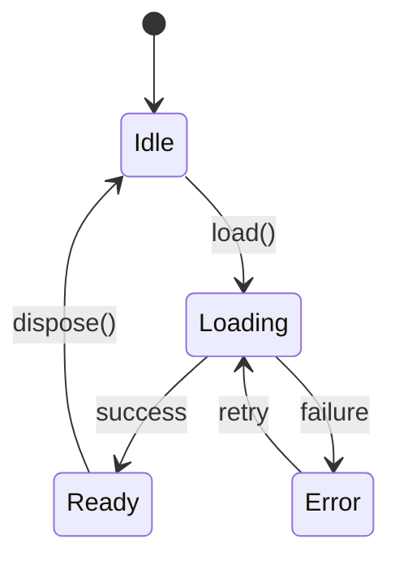
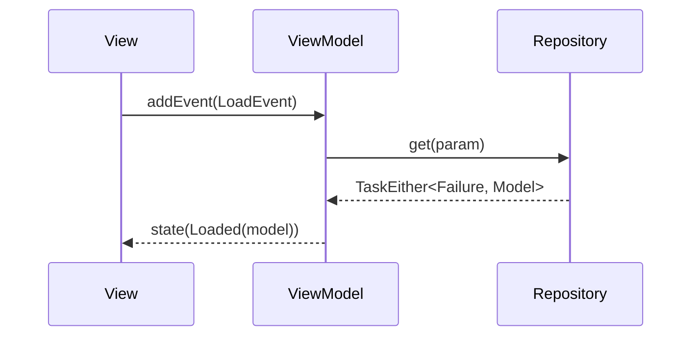
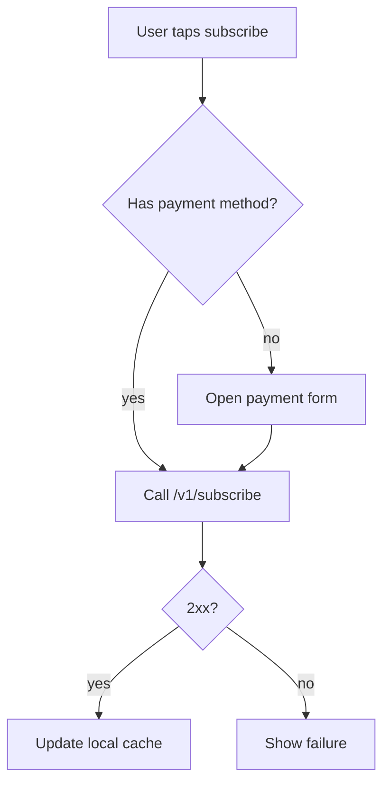

# spec.md

Read the [shared contract](documentation_spec_common.rules.md) and the [authoring router](documentation_spec.rules.md) with this reference. Read [traceability](documentation_spec_traceability.rules.md) when defining or mapping `R-*`, `V-*`, or `G-*` IDs.

**Purpose:** describe the implementation **design** for the requirements — not a project plan, not a checklist of steps.

**Workflow:** Author or update the canonical local document by inspecting code
and supplied authoritative sources. When an external issue or design source is
in scope, publish only the affected projection after updating local truth.

## Architecture documentation approach

Specs **SHOULD** use [arc42](https://arc42.org/overview/) to organize architecture
content, [C4](https://c4model.com/diagrams) to describe structural boundaries,
and ADR entries in `log.md` to preserve significant accepted decisions.
This structure is a tailored arc42 approach across the existing topic artifacts, not a
requirement to reproduce all twelve sections in every `spec.md`.

| arc42 concern | Canonical home |
|---------------|----------------|
| Introduction, goals, constraints, quality requirements | `requirements.md`; `spec.md` links the relevant `R-*` / `V-*` IDs and explains the design response |
| Context, solution strategy, building blocks, runtime, deployment, crosscutting concepts | `spec.md`, scoped to the topic |
| Architectural decisions | Current accepted design in `spec.md`; significant decision rationale and history in `log.md` |
| Risks and technical debt | Design risks and accepted trade-offs in `spec.md`; verified open spec/implementation mismatches in `gap.md`; delivery backlog in Jira |
| Glossary | Define topic-local terms where used; link shared terms to their ontology `concept` node instead of keeping a glossary table |

Keep the existing document ownership, YAML metadata, and stable IDs. Do not
duplicate requirements, quality acceptance criteria, or decision history to
fill an arc42 section. A risk is not automatically a verified gap.

## Required content

1. **Overview** — 2–4 sentences linking the design to the requirements doc and naming the dominant approach (e.g., "session-scoped facade over a CachedRepository repository").
2. **Design views** — explain relevant boundaries, responsibilities, contracts, and runtime behavior using the outline below. Use C4 structure views when they clarify ownership or dependencies. Retain at least one **dynamic** diagram via Mermaid.
3. **Verification** — bind the exact `V-*` criteria from `requirements.md` to the evidence specified in [Verification](#verification).
4. **Concrete artifacts** — link implementation entry points and interfaces as needed to make the design actionable. Use small examples only when they clarify a contract. Keep local implementation caveats in commit bodies.

## Recommended outline

Keep `## Overview` and `## Verification` as stable headings. Other sections
**MAY** be combined, renamed, or omitted when they add no useful information.
Do not create empty sections or diagrams merely to complete the outline.

| Section | Content |
|---------|---------|
| Overview | Design intent; links to requirements, decisions, known gaps when present, and parent architecture topics |
| Context & Boundaries | Topic boundary, consumers, external collaborators, and owned/external contracts; link broader context |
| Constraints & Solution Strategy | Design response to linked requirements and constraints; dominant approach |
| Building Blocks | Responsibilities, interfaces, dependency direction, and ownership; selected C4 view and code entry points |
| Runtime Behavior | Key scenarios, ordering, state transitions, lifecycle, concurrency, and failure behavior |
| Deployment | Relevant app/backend/device placement, native boundaries, or binary compatibility constraints |
| Cross-cutting Concepts | Topic-specific application of shared policies; link project rules instead of copying them |
| Verification | Existing exact `V-*` bindings, including checks for quality requirements |
| Risks & Trade-offs | Current design risks and accepted costs; link qualifying decisions and verified gaps |

Apply this approach to new topics and substantive design revisions. Existing
topics do not require a bulk heading migration. Preserve referenced anchors
or update their consumers when reorganizing a topic.

## C4 structure views

Choose the smallest useful level of detail. All four levels are not required.

| View | Use |
|------|-----|
| System Context | People, the system in scope, and external systems; normally owned by a broader architecture topic |
| Container | Applications and data stores that form runtime boundaries, with responsibilities and communication |
| Component | Related functionality behind interfaces within one container; the usual focus for a feature or service topic |
| Code | Selected types or interfaces only when necessary to explain a non-obvious contract; prefer source links for implementation detail |

- A [C4 container](https://c4model.com/abstractions/container) represents an
  application or data store. A Dart package, feature folder, DI scope, or native
  plugin **MUST NOT** be classified as a container merely because it is a module.
- A [C4 component](https://c4model.com/abstractions/component) groups related
  functionality behind an interface. It need not map one-to-one to a package,
  class, or Flutter widget.
- State the diagram's scope and abstraction level. Show relevant boundaries,
  responsibilities, and directed, labeled relationships. Identify technology
  or protocol when it helps explain a boundary.
- Link the owning topic's Context/Container view rather than repeating the
  whole system in every feature spec. Keep names consistent across structural
  and runtime views. Clearly identify any refinement to code-level participants.
- Mermaid `flowchart` with labeled nodes and boundary subgraphs **MAY** express
  a C4 view. Dedicated C4 syntax or tooling is not required. A package dependency
  graph may supplement the design. The graph is not automatically a C4 container view.

## Diagram catalog

C4 structure views explain boundaries and responsibilities. Complement them
with **dynamic** diagrams for runtime behavior, especially async ordering,
state, and lifecycle. A static structure flowchart does not satisfy the dynamic
diagram requirement merely because it uses Mermaid `flowchart` syntax.
The shared validator checks Mermaid syntax markers. Review the actual diagram
semantics separately to verify runtime coverage and C4 abstraction levels.

| UML diagram | Mermaid block | When to use |
|-------------|---------------|-------------|
| **Use Case** | `flowchart` with actor + ellipses | Map actors → goals at a glance |
| **Activity** | `flowchart TD` with decision diamonds | Multi-branch business flow with conditions |
| **State Machine** | `stateDiagram-v2` | Anything with an explicit `enum State` (player, auth, download) |
| **Sequence** | `sequenceDiagram` | Cross-component message ordering, async interactions |
| **Communication** | `flowchart LR` with numbered edges | Same intent as sequence but emphasizes participants over time |
| **Interaction Overview** | nested `flowchart` referring to sequence diagrams | Top-down view that wires sub-flows |
| **Timing** | Mermaid lacks native timing diagrams — use a labeled `gantt` or text timeline | Real-time / latency budgets |
| **Class** | `classDiagram` | Type relationships when interfaces and inheritance matter |
| **Object** | `flowchart` with snapshot nodes | Concrete instance graph at a moment in time |
| **Composite Structure** | `flowchart` with subgraphs as parts/ports | Internal structure of a complex component |
| **Package** | `flowchart` with subgraphs | Cross-module dependency layout |
| **Profile** | `classDiagram` with `<<stereotype>>` | Project-specific stereotype rules (e.g., `<<CachedRepository>>`) |

## Mermaid examples

**State machine** (most common in this codebase):



**Sequence**:



**Activity**:



## Naming conventions

When the design introduces a new pattern, document its naming convention inline.
Reference the applicable local code-style and package rules instead of
restating them.

## Trade-offs / Pros & Cons (optional)

Where `requirements.md` declares **Scope** and **Out of Scope** to bound *what* is built, `spec.md` may declare **Trade-offs** and **Pros & Cons** to bound *how* it's built. Include this section when the design picks one approach over plausible alternatives, and the reasoning would otherwise be lost.

Skip when the choice is obvious or there's only one reasonable path. Do not invent alternatives just to fill a section.

`spec.md` describes the **currently accepted design**, not its chronology. When a trade-off meets the [`log.md` decision threshold](documentation_spec_decisions.rules.md#decision-threshold), keep the current conclusion here and link the matching decision entry. Keep superseded rationale only in `log.md`.

**Format options:**

- **Trade-offs** — paragraph or bullets describing the dominant axis being traded ("we prioritize X at the cost of Y because…"). One per non-trivial decision.
- **Pros & Cons** — for chosen approach when alternatives were considered. Two-column or per-option:

  ```markdown
  #### Approach: session-scoped facade over CachedRepository

  **Pros**
  - Reuses existing scope lifecycle — no new disposal hooks
  - Cache invalidation already handled by the policy

  **Cons**
  - Couples the feature to session push/pop ordering
  - Failure semantics inherited from the facade, not customizable per-call

  **Considered alternatives**
  - App-scoped singleton — rejected: leaks user state across login switches
  - Per-screen ViewModel-owned — rejected: duplicates cache logic 3x

  **Why this won:** {one-sentence summary of the deciding factor}
  ```

**When to promote / demote:**

- An accepted trade-off that meets the decision threshold → append one entry to `log.md` and link it from the current design.
- A trade-off that becomes a hard rule across the project → move the current rule to `agents/rules/` and link its decision entry for rationale.
- A trade-off where the alternatives needed full investigation → move the comparison body to `researches/{target}.researches.md` and keep only the conclusion here.
- A trade-off the team is still debating → record it as a `Q-*` entry in `Open Questions` of `requirements.md` or `spec.md`. Mark the undecided part `TBD(Q-…)`. See [open questions and TBD markers](documentation_spec_traceability.rules.md#open-questions-and-tbd-markers).

## Verification

Every `[test]`- or `[lint]`-tagged criterion in `requirements.md#verification` **MUST** map to a concrete automated check designed here. Other tags (`[qa]`, `[telemetry]`, `[approval]`) only need a one-line note on how the check happens. The design is not responsible for executing them.

### Acceptance criterion vs. verification plan

The same `V-*` ID has two complementary representations. The ID is not two
different requirements.

| Location | Ownership | Answers | Contains |
|----------|-----------|---------|----------|
| `requirements.md` | Canonical acceptance criterion | **What must be true to be done?** | Observable outcome, artifact tag, and `Covers: R-*` |
| `spec.md` | Verification plan and evidence binding | **Where and how is it proven?** | Layer, target, file or evidence location, fixtures, and exact pass assertion |

**Rules:**

- `spec.md` **MUST** reuse the exact `V-*` ID defined by `requirements.md`. The file
  **MUST NOT** introduce an independent verification criterion. Add a newly
  discovered completion condition to `requirements.md` first.
- `spec.md` **SHOULD NOT** copy the full acceptance criterion as standalone
  prose. Keep the requirement as the source of truth. The pass field may
  reference or minimally restate its exact observable assertion.
- If implementation or test location changes while the observable outcome
  stays the same, preserve the `V-*` ID and update only `spec.md`.
- If the observable outcome changes, update `requirements.md` first and assess
  whether the change meets the `log.md` decision threshold.

**Checks that close verification items:**

- Package tests and `dart analyze` / `flutter test` — author and run the checks
  that close `[test]` and `[lint]` criteria. Follow
  [`verification.rules.md`](verification.rules.md) for lifecycle boundaries.
- QA or approval evidence — link the scenario, artifact, or sign-off directly
  from the criterion. This repository installs no dedicated verification skill.
- `[telemetry]` — no skill; hand-link the dashboard and threshold here.

For each `[test]` / `[lint]` criterion, specify:

| Field | Example |
|-------|---------|
| **Layer** | unit / widget / golden / integration / lint / static-analysis |
| **Test target** | `GetSubscribeRepository`, `SubscribeViewModel`, `SubscribeScreen` golden |
| **Test file location** | `packages/{package}/test/...` (or the package's documented test layout) |
| **Fixtures / fakes** | `FakeSubscribeUseCase`, `MembershipModelFixture`, `DioAdapter` mock |
| **Pass condition** | Executable assertion or evidence threshold; reference or minimally restate the criterion's observable outcome |
| **Evidence** | `present`, or `missing — <short reason>`. Link the gap when the implementation diverges; a conforming behavior without a committed test has no gap. Use no other status words. |

```markdown
#### <a id="v-t-sub-pay-002"></a>V-T-SUB-PAY-002 — `[test]` Token refresh on 401

- **Layer:** unit + integration
- **Target:** `AuthInterceptor`, `GetMeRepository` happy + retry path
- **Files:** `packages/{package}/test/auth_interceptor_test.dart`
- **Fakes:** `DioAdapter` (replies 401 once, then 200), `FakeAuthTokenDao`
- **Pass:** `expect(refreshCalls, equals(1))` on first 401; `expect(sessionPopped, isTrue)` on second 401.
```

**Rules:**

- Preserve the exact criterion ID from `requirements.md`: `V-T-*` for `[test]`, `V-L-*` for `[lint]`, `V-Q-*` for `[qa]`, `V-TEL-*` for `[telemetry]`, and `V-A-*` for `[approval]`. `spec.md` and `plan.md` **MUST NOT** shorten or remap it.
- Don't duplicate rule content from an applicable package test rule. Link to
  the relevant rule when one exists and only specify what's specific to *this*
  feature (target, fixtures, pass condition).
- Reuse existing fakes/fixtures when possible. New fakes are a code-change too. Identify them so nobody misses them.
- For `[qa]` / `[telemetry]` / `[approval]` items, a one-line note is enough (e.g., "QA checklist `qa_3.30.0.md#feed-onboarding`", "Datadog dashboard `feed-stability`", "Legal Slack thread `#legal-2026-04-29`").
- If a `[test]` / `[lint]` criterion cannot be automated economically, stop and route the artifact-kind change through the requirements workflow. An unreviewed draft may be replaced directly. A reviewed criterion receives the next unused ID for the new kind under the [criterion replacement rules](documentation_spec_traceability.rules.md#traceable-requirement-ids). Do not silently retag, renumber, or design verification that will not run.

## References (optional)

Sources that **inform** the design choice: prior implementations to benchmark against, existing conventions being extended, third-party patterns, library docs, blog posts, RFCs. Distinct from requirements `References` — those constrain *what* must be built; design References guide *how*.

- Internal benchmarks: link to `path:line` of an existing implementation that the design extends or mirrors.
- External benchmarks: link to the source (RFC, library README, video timestamp). Note the version/commit so future readers can find the same artifact.
- For substantive comparison ("we evaluated A vs. B vs. C"), move it to `researches/{target}.researches.md` and link from here.

## Anti-patterns

- A list of TODOs / checkboxes. Move to `agents/scratchpads/{topic}.md`.
- Status updates ("currently working on …"). Move to a scratchpad.
- Code that duplicates what exists in the codebase — link to the file with `path:line` instead.
- Static-only diagrams when the problem is dynamic (state, ordering, concurrency).
