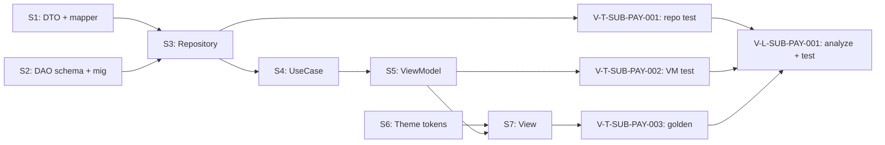

# Plan (`plan.md`)

Read the [shared contract](documentation_spec_common.rules.md) and the [authoring router](documentation_spec.rules.md) with this reference. Read [traceability](documentation_spec_traceability.rules.md) when defining or mapping `R-*`, `V-*`, or `G-*` IDs.

**Purpose:** the step-by-step implementation plan for the current `spec.md`. Local, ephemeral, **gitignored** — it captures *your* in-progress execution against the spec, not a shared artifact.

**Orchestration:** plan execution decisions (parallel agents, worktree, inline
vs delegated) follow the [root session workflow](../../AGENTS.md#session-workflow).
The dep graph below is the work breakdown. The session workflow does not redraw
it. The session workflow only decides how the breakdown is executed.

## Why gitignored

- Plans go stale fast and are noisy in PRs.
- Different developers may slice the same design differently. Committing one plan implies a single canonical sequence, which is rarely true.
- The committed truth is the **outcome** (code + updated `spec.md`), not the journey.

If a plan element is worth preserving across sessions/developers, promote it to the artifact that owns the information: ordering constraint → `spec.md`, verified spec/implementation divergence → `gap.md`, deferred work → an Open Questions entry or a Jira ticket. Then drop it from `plan.md`.

## Structure

Free-form for implementation phases, **but the plan MUST end with a Verification phase** that runs every check designed in `spec.md#verification`. The plan is not "done" until verification passes.

```markdown
# Plan — {topic}

Tracking against [spec.md](spec.md). Known current divergence is recorded in [gap.md](gap.md), when present.

## Phase 1 — foundation
- [ ] **S1** Add CachedGetableRepository skeleton
- [ ] **S2** Wire DI factory in SessionObserver
- [x] **S3** Generate DTOs via swagger_parser

## Phase 2 — view layer
- [ ] **S4** ViewModel with state machine (see spec.md#state)
- [ ] **S5** View bindings + AppSemantics

## Phase 3 — Verification (REQUIRED)
- [ ] **V-T-SUB-PAY-002** Token-refresh on 401 — `auth_interceptor_test.dart`
- [ ] **V-T-SUB-PAY-001** Subscribe-button widget test — `subscribe_screen_test.dart`
- [ ] **V-T-SUB-PAY-003** Goldens for empty / loading / loaded — `subscribe_screen_golden_test.dart`
- [ ] **V-L-SUB-PAY-001** `dart analyze` clean across changed files
- [ ] **V-L-SUB-PAY-002** `flutter test` for affected packages
- [ ] **V-Q-SUB-PAY-001** QA scenario from `qa_{version}.md` — link entry in `agents/scratchpads/`
- [ ] **V-TEL-SUB-PAY-001** Crash-free sessions dashboard — Datadog `subscription-stability` link
- [ ] **V-A-SUB-PAY-001** Legal review for subscription failure copy — Slack link

## Notes
- ...
```

Use checklists, status markers, "next:" prompts — anything that helps *you* drive the work.

## Verification phase rules

- Implementation tasks use `S*` (Step) prefixes. Verification tasks preserve the full `V-{kind}-{ID_PREFIX}-{NNN}` ID from `requirements.md` and `spec.md`. The same ID flows through `requirements.md` → `spec.md` → `plan.md` without shortening or remapping.
- Every `[test]` and `[lint]` criterion gets at least one task in this phase. Missing one means the plan is not ready to land.
- `[qa]` / `[telemetry]` / `[approval]` items can be checked off when the QA doc is filed / dashboard is wired / sign-off is recorded — not when the implementation is "probably fine."
- `dart analyze` and `flutter test` for the affected scope are **always** plan items (typically separate `V-L-*` criteria), even when the design doesn't mention them.

## Dependency graph (optional)

When tasks span multiple layers (data + VM + view + native) and some can run in parallel, include a Mermaid dependency graph. The graph lets you (or another agent) start independent branches without re-deriving the order. Skip for short, strictly-sequential plans.

Use a `flowchart LR` with one node per task ID. Tasks on the same column are independent and can be worked in parallel. Arrows encode hard ordering only.



Reference task IDs in your checklist so the graph and the checklist stay in sync:

```markdown
## Phase 1 — data
- [ ] **S1** DTO + mapper — see spec.md#mapper
- [ ] **S2** DAO schema + migration v22 → v23
- [ ] **S3** Repository (depends on S1, S2)

## Phase 2 — domain + view (S5 + S7 can run in parallel after S4)
- [ ] **S4** UseCase
- [ ] **S5** ViewModel
- [ ] **S6** Theme tokens (independent — start anytime)
- [ ] **S7** View (depends on S5, S6)
```

**Rules:**
- Only encode hard dependencies (compile / runtime ordering). Soft preferences belong in `Notes`.
- Keep node labels short — full task description stays in the checklist.
- One graph per plan. If you need more, the plan is too big — split the design or sequence into phases.

## Anti-patterns

- Committing `plan.md` (it must remain in `.gitignore`).
- Letting `plan.md` outlive the work — delete or archive when the spec lands.
- Duplicating `spec.md` content as plan items. The plan references the design, doesn't repeat it.
- Encoding soft preferences as graph edges — over-constrains parallelism.
- Skipping the Verification phase, or treating it as optional — every plan ends here.
- Listing tests as a single "write tests" item without mapping to the criterion IDs from `requirements.md#verification`.
