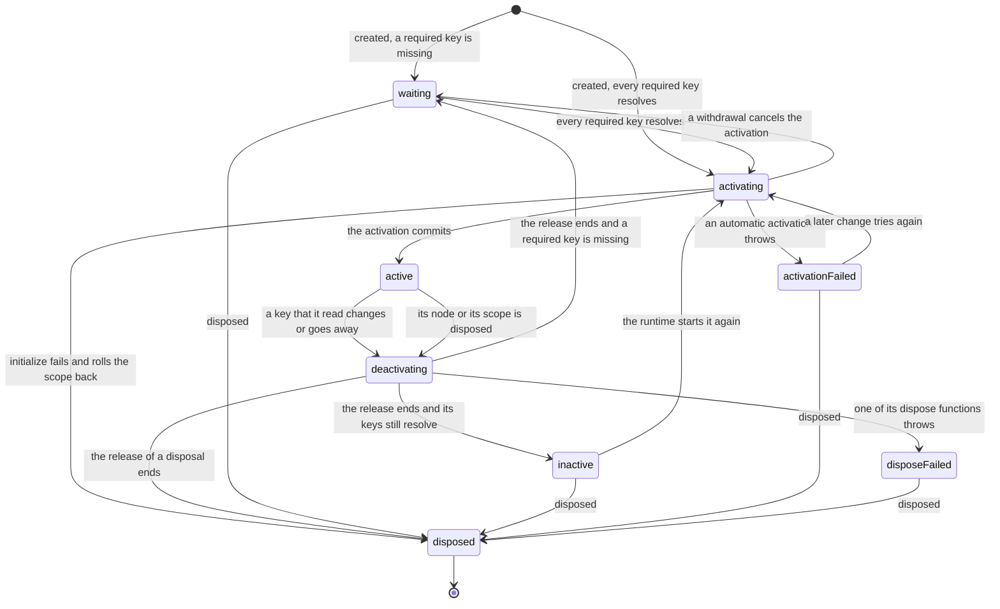
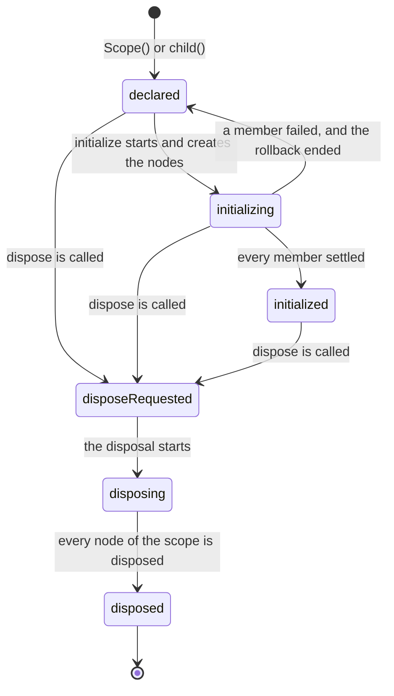

A node is the runtime form of one declared component. It has one owner scope, a
derived shape, a result value, staged publishers, a LIFO stack of dispose
functions, and publisher-identity dependency edges.

This page starts with two pictures: the states that a node moves through, and
the states of the scope that owns it. The sections after them explain each
rule in detail. GitHub draws the diagrams; the API reference shows their
source.

## The life of a node

A component is a description. When `initialize` runs, the scope turns each
component into a node, and the node then lives through the states below. You
can read the current state at any time as `node.state.phase`, a `NodePhase`,
or follow it in Flutter with `context.watchMaybeDiNode`.



Read the diagram as the answer to three questions.

**Why is my value not there yet?** A node in `waiting` lacks a required key.
`node.missing` lists those keys. Nothing has run: the `create` of its
`Dependency` runs only once every required key resolves, so a waiting node
holds no half-built value. When a publisher of the last missing key appears,
the node moves to `activating` without any call from you.

**What happens while it builds?** In `activating`, the steps of the
`Dependency` run one after another. The value becomes visible only when the
whole activation commits and the node is `active`. If a step throws, the
steps that already finished are released in reverse order, and nothing is
published. During `initialize`, that failure rolls the whole scope back. After
`initialize`, the node lands in `activationFailed`, `Scope.errors` reports the
error, and `node.activationException` keeps it. A later change, such as a new
publisher of one of its keys, tries again.

**What happens when something it read goes away?** An `active` node moves to
`deactivating` when a key that it read changes or disappears, and when it is
disposed. Its readers release first, so each release runs while the values
that it read are still alive. After its own release, the node waits again for
its keys, or starts again at once with the new publisher. If one of its own
dispose functions throws, the node stops in `disposeFailed`, and the runtime
does not activate it again. Dispose its scope and declare the component in a
new scope.

`disposed` is the end. A disposed node answers no read: `value` throws, and
`whenActive` fails with `InactiveNodeException`.

| `NodePhase` | What it means | What you can read |
|---|---|---|
| `waiting` | A required key does not resolve | `missing` lists the keys |
| `inactive` | Not active, and not waiting for a key; for example, after a withdrawal canceled its activation, or between a release and the next activation | `whenActive` completes at the next commit |
| `activating` | The steps of its `Dependency` run | `whenActive` completes when it commits |
| `active` | The activation committed | `value` returns the value |
| `deactivating` | Its release runs | No value; its readers release first |
| `activationFailed` | The last automatic activation threw | `activationException` holds the error |
| `disposeFailed` | One of its dispose functions threw | The runtime does not start it again |
| `disposed` | The node is gone | `value` throws `InactiveNodeException` |

## The life of a scope

A scope has states of its own. It takes its module when it is created and
creates nothing until `initialize`. A disposal starts the moment that you call
`dispose`: from then on the scope accepts no new `initialize`, even before the
disposal itself runs.



| `ScopePhase` | What it means | Lookups |
|---|---|---|
| `declared` | The scope holds its module and no node. `initialize` may run, also again after a failed one. | Answer, from the ancestors |
| `initializing` | `initialize` runs and the nodes exist | Answer |
| `initialized` | `initialize` completed | Answer |
| `disposeRequested` | `dispose` was called for this scope or an ancestor. Activations in flight are canceled. | Answer; `isDisposed` is true |
| `disposing` | The nodes release, readers before publishers | Throw `DisposedScopeError` |
| `disposed` | The disposal ended | Throw `DisposedScopeError` |

A failed `initialize` returns the scope to `declared`, so a retry is a plain
second call. When `dispose` is called while `initialize` runs, the scope goes
to `disposeRequested` and stays there: the running `initialize` ends, and the
disposal follows. `Scope.state` returns the phase of the scope together with
the state of each node, and `Scope.addListener` calls a function at each
transition, so a debugger or a UI can compare two values.

## The order of a scope

Both diagrams follow from one relation between members. Write `a ⇢ b` when
`b` reads a key that `a` provides: the key that `a` publishes, the set key
that `a` contributes to, or the map key of an entry that `a` publishes.

```text
a ⇢ b   ⇔   provides(a) ∩ reads(b) ≠ ∅

initialize:  b starts after each a with a ⇢ b has settled
dispose:     a releases after each b that read a value of a
             members without a path of ⇢ between them run at the same time
rollback:    when the steps e₁ … e_k of an activation completed,
             the release runs e_k⁻¹ … e₁⁻¹
```

The runtime computes `⇢` from the shapes before it creates anything. That is
why the list order of a module never matters, why independent members start
together, and why a release always runs while the values that it read are
alive. `e⁻¹` is the dispose function of a step that has one.

## Initialize and dispose

Each member stays its own node. A member that waits for a key does not block
its siblings, and each member reactivates on its own. Members can depend on
keys that a later member publishes.

`initialize()` activates members by dependency. A member starts when every
member that publishes a key it reads has settled, and a member
with no such dependency starts at once. Independent members therefore activate
at the same time, so a scope of slow members takes as long as its slowest
chain and not the sum. A member publishes its bindings as soon as its own
activation succeeds, and a dependent never starts before its publishers have.
The commit order of independent members follows completion order and is not
deterministic.

`dispose()` releases along the same reads in reverse: a member releases after
every member that read its value has finished, and members that do not read
each other release at the same time. The dispose functions of one member run
last first, and a `DisposeException` lists dispose failures in reverse declaration
order. Two members that share an external resource without a key between
them, such as one file that one flushes and the other closes, need a token key
so that their releases keep an order.

```dart
// Both probes run at the same time; `sync` starts when both are ready.
final app = Scope(module: Module(components: [connectivity, database, sync]));
await app.initialize();
```

A child can initialize before its parent. Its nodes wait, and they activate
when the parent initializes and publishes their keys. A scope that initializes
later between a node and its publisher shadows that publisher, so the node
rebinds. These are the only ways that a key appears for an existing node.

Dormancy is not failure. If the activation of any member throws, `initialize()`
is atomic, whatever the declaration order. No further member starts, and the
runtime waits for the members still in flight; a failure does not cancel
another member, because each member is its own failure region. Then
every node that the call created is deactivated and disposed in reverse
declaration order, and the error of the first failed member in declaration order
is rethrown. The scope stays uninitialized, and a later `initialize()` may
retry. Rollback dispose failures are attached to an `ActivationException`. A
node of a descendant scope that wakes because of the new bindings keeps the
usual rule: its failure is reported through `Scope.errors` and `initialize()`
succeeds. Of two members that publish the same key, the later one fails with
`DuplicateKeyError`. A second `initialize()` throws a `StateError`.

The atomicity covers failure, not visibility. Each member's bindings become
visible when that member commits, so other code can see some members before
`initialize()` returns. Publish a record under one key when several values
must become visible together.

`node(key: ...)` returns the node of the member that publishes the key,
typed as the key, so the code does not depend on the declaration order:
`value`, `isActive`, `whenActive`, `missing`, and `dispose()`. `nodes` lists
every node in declaration order, for an effect, which publishes no key.
Disposing one member withdraws its bindings, deactivates its dependents
first, and leaves the other members in the runtime. `dispose()` of the scope then
skips the members that are already disposed.

```dart
final database = app.node(key: DiKey<Database>());
await database.dispose();   // its dependents go dormant
```

The runtime runs one reconciliation at the end of `initialize`, which repeats
its passes until the targets settle. A member that first activates during that
closing reconciliation fails the call in the same way as a member that fails
earlier. The
[lifecycle spec](https://github.com/dfdgsdfg/fp_di/blob/main/specs/runtime/lifecycle/spec.md#scope-declaration-and-initialization)
owns the contract.

## Shape and eligibility

A component's shape is the sets of keys that it reads and the key that it
publishes: `requires`, `optional`, and `key`. A `Dependency` adds the keys it
reads, `Dependency(create:)` reads none, and the `key` argument adds the
published key. Every shape is derived.

A node runs only at a state satisfying `requires`:

```text
satisfied(n) ≔ ∀ k ∈ requires(n). k resolves in n's scope
```

An unsatisfied node is dormant — its `Dependency` never runs, so no
partial acquisition is ever staged.

## Activation

Setup runs inside one mutation. The `Dependency` reads its keys, then each
acquisition appends its release, and the published keys are staged last. The
steps of one component run one after another.

Successful setup publishes every staged binding together. Failure runs all
accumulated releases in reverse order and publishes nothing.

## Dependency withdrawal

For a publisher node `A`:

1. `A` leaves the available publisher set.
2. Every direct dependent leaves its publisher set in turn.
3. The resulting graph traversal deactivates transitive dependents deepest-first.
4. A dependent's releases run while its publishers' values are still alive.
5. `A` releases only after all of its dependents finish.

Cleanup failures do not stop this traversal. They are returned as one ordered
list of `DisposeFailure` values. Only a node's **own** dispose function failures
block its automatic reactivation; a dependent's failure is reported but charged
to that dependent alone.

## Reconciliation

The target of an active node is the tuple of publisher identities for every
key in its declared `reads`, `requires ∪ optional`. A changed, missing, or nearer scoped
publisher changes that target and causes a deactivation and a new activation. A key that resolved
to nothing is tracked as well, so a publisher appearing later is a target change
too.

Dormant nodes are retried in creation order whenever their eligibility
predicate turns true.

## Serialization

Every mutation runs on one queue per runtime. A mutation issued from inside a
running mutation — an `initialize` or `dispose` called from a
`create`, a `dispose`, or a `Dependency` function — would await a gate that only opens once it returns, so the
runtime raises `ReentrantMutationError` rather than deadlocking. A caller arriving
from outside simply queues.

A call does not depend on the zone of an earlier, finished call. A mutation
waits for the gate of the last mutation only while that gate is open. Otherwise
it waits one hop on a fresh future of its own zone. This holds when the earlier
zone no longer runs its microtasks, as the body of a Flutter `testWidgets` test.
An operation that is still in flight when its own zone stops cannot finish.

## Concurrency

A component runs its steps one after another. Independent work overlaps only
across the members of a scope. Separate `initialize` calls are activated one
at a time. Per-node inertia, which would let unrelated nodes transition
concurrently, is not implemented.

## Reactive lifecycle

A component is bound to the *identity* of the publishers its keys resolved to.
When one changes:

1. it becomes unavailable to new lookup;
2. transitive dependents deactivate deepest-first;
3. each dependent runs its `dispose` functions while its publishers' values
   are still alive, so a `dispose` can use the values its `Dependency` read;
4. the publisher is disposed last; and
5. everything whose requirements are satisfiable again activates, in
   creation order.

A key read through `Dependency.maybe` while unbound is tracked too, so the
component reloads when a publisher for it later appears.

If a component's own `dispose` fails, its automatic reactivation stops:
creating again on top of a partially disposed value could duplicate ownership.
A dependent's failure is reported but does not block anything else.

## Effects that overlap

Members that do not read each other activate at the same time, and a disposed
scope releases them at the same time. The keys are the only order the runtime
knows. It does not see what a `create` or a `dispose` does to state outside the
keys, such as a global setting, a file, or a table. Two such members must
therefore be *independent*: either order of their creations, and either order
of their releases, leaves the same state.

The runtime does not check this. The patterns below keep members independent.

| Do | Do not |
|---|---|
| Let a `dispose` remove only what its own `create` added | Restore shared state to a value that `create` saved |
| Give shared global state one owner component, and let others require its token key | Change one global setting from several members |
| Order two uses of one resource with a token key, such as a flush before a close | Leave two members that share a resource without a key between them |
| Change shared state with one call of an API that is safe for concurrent use | Read, `await`, and then write shared state |
| Document whether the operations of a published value commute | Assume that readers of one key never interfere |

**Remove your own contribution.** A `dispose` that restores a saved value
undoes the change of any member that ran in between. A `dispose` that removes
its own entry leaves the entries of other members alone.

```dart
// Interferes: another member may change the level between create and dispose.
Dependency<Level>(
  create: () { final saved = config.level; config.level = Level.debug; return saved; },
  dispose: (saved) => config.level = saved,
);

// Independent: each member adds its own handler and removes only that one.
Dependency<Registration>(
  create: () => registry.add(onEvent),      // returns a registration
  dispose: (registration) => registration.remove(),
);
```

**Do not split an update at an `await`.** Another member can run at each
`await`. A read before it and a write after it can overwrite that member's
write.

```dart
// Interferes: two members can both read 1 and both write 2.
final count = await store.read('count');
await store.write('count', count + 1);

// Independent: the store applies the change in one call.
await store.increment('count');
```

**State the contract of a shared value.** The publisher of a key knows whether
the operations of its value commute, such as additions to a set of listeners.
Document it on the value type. When they do not commute, such as edits of one
ordered chain, readers need an order between them: a token key, or one
component that does both changes in sequence.

The steps of one component need none of this. They release in reverse order,
so a later step may restore what an earlier step of the same component changed.
Independence matters only between members, and between scopes that run at the
same time.

**Place a lazy step last.** `lazy()` runs its effects at the first `force()`,
not at its position, but releases them at its position. A lazy step before
another step can therefore run after it and still release after it. Put a lazy
step after the steps whose state it shares, and keep it independent of the
components that read its owner.

To find an interference, test the module in more than one completion order.
Gate the slow members with a `Completer`, open the gates in different orders,
and compare the state after `initialize()` and after `dispose()`.

The effect independence research (`specs/runtime/lifecycle/researches/effect-independence.researches.md`)
gives the definition behind these patterns and the reasons that the runtime
does not check them.

## Failures and atomicity

Failures follow the Dart split between errors and exceptions:

| Kind | Meaning | Types |
|---|---|---|
| `DiError extends Error` | A wiring mistake: fix the code, do not catch it | `DuplicateKeyError`, `DependencyCycleError`, `UnreachableKeyError`, `UndeclaredKeyError`, `ReentrantMutationError`, `DisposedScopeError`, `OutsideActivationError` |
| `DiException implements Exception` | A failure while the program runs, which a caller may handle | `ActivationException`, `ActivationCanceledException`, `DisposeException`, `DiListenerException`, `UnavailableKeyException`, `InactiveNodeException`, `DisposedLazyException` |

Both bases are sealed. The runtime also throws Dart's own `ArgumentError` for
an invalid argument, such as a key of the wrong type, and `StateError` for a
call in the wrong state, such as a second `initialize`. `Scope.errors` is a
`Stream<DiException>`: a wiring error during an automatic activation, which no
caller receives, arrives as the `cause` of an `ActivationException`.

Activation is transactional. If a later step fails, completed steps are undone
in reverse order and no key is published. Disposal continues after individual
failures and reports every `DisposeFailure` in one `DisposeException`. Nodes and
scopes are safe to dispose more than once: a repeated `dispose()` completes
with the disposal in progress, so awaiting any call means the disposal finished.

## Long work and the queue

Every `initialize` and `dispose` of one root runs on one queue, so the cleanup
of a logout always finishes before the next login starts. The cost is that a
long setup delays every mutation behind it, and a `create` that ignores its
canceled token delays them until it returns. Keep setup short:

- Publish a handle and start the long work in it. A value that keeps the token
  from `Dependency.cancellation()` stops when its activation ends.
- Make a value that only some screens need a `Lazy` inside the service that
  uses it, so `force()` does the work outside the queue.
- Let every long `create` read its token, so a `dispose()` stops it.
- Give an independent subsystem its own root `Scope()`: each root has its
  own queue.

To find what blocks the queue, pass `onSlowMutation` to the root:

```dart
final app = Scope(
  module: appModule,
  onSlowMutation: (report) => log.warning('$report'),
  slowMutationThreshold: const Duration(seconds: 2), // the default
);
// SlowMutation(initialize, 2004 ms, running: Session, ignoring cancellation: Session, queued: 1)
```

A report names the activations in flight, those that ignore their canceled
token, and the owners whose dispose functions run. A dispose function has no
token, so one that never returns holds the queue; give its I/O a
`timeout`, so that it fails into a `DisposeException` instead:

```
SlowMutation(Scope.dispose, 2001 ms, running: none, disposing: Socket, queued: 1)
```

A report changes nothing, and without `onSlowMutation` no timer runs.

Mutations are serialized on one queue per runtime. Initializing or disposing a
scope from *inside* `create`, `dispose`, or a `Dependency` function would wait
on a mutation that cannot finish, so it raises `ReentrantMutationError`
instead of deadlocking, and changes nothing. A callback that a finished
mutation created, such as a stream listener that a `create` registered, may
initialize or dispose scopes later; its call queues like any other.
