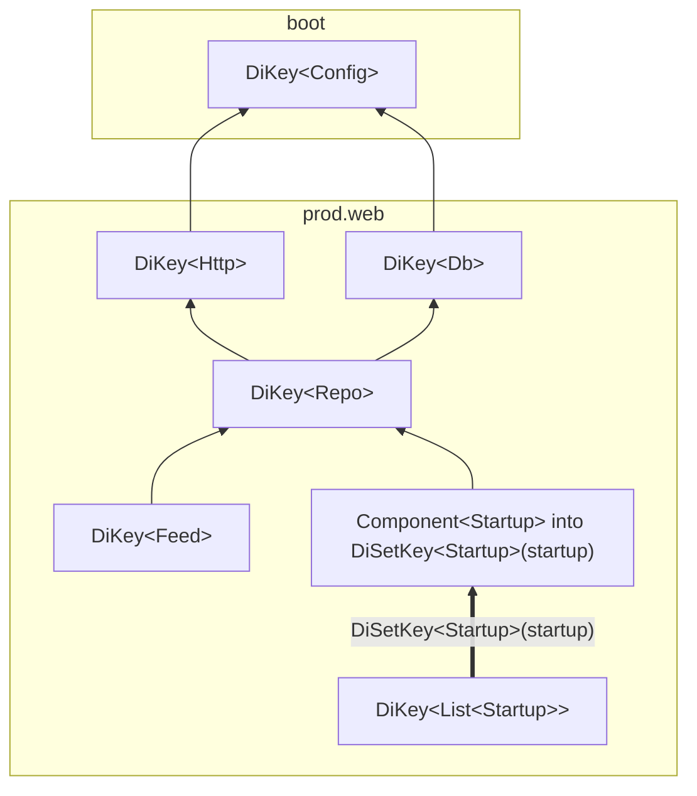
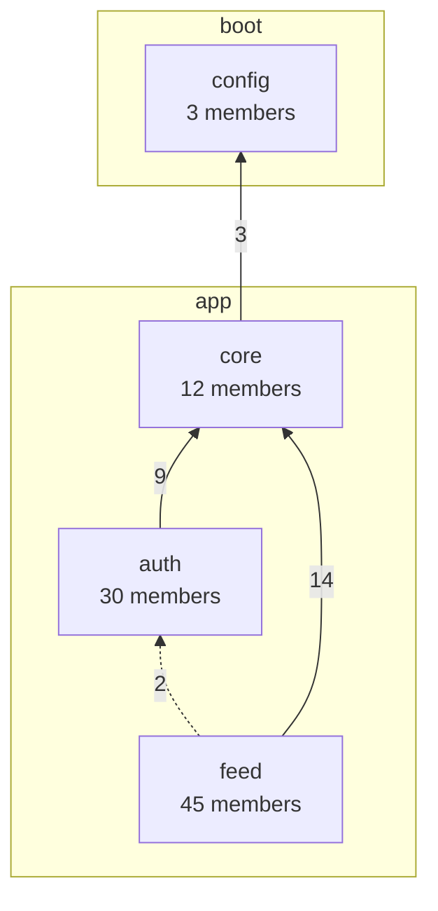

The observation types read the runtime and the declarations. A read starts no
mutation and changes no state.

- `Scope.state` returns a `ScopeState`, an immutable value with a
  `ScopePhase`, one `NodeState` for each node, and the states of the child
  scopes. `Scope.addListener` calls a function at each transition.
- A `NodeState` holds the `NodePhase` of a node, its missing keys, and the
  failure of its last activation. The Lifecycle topic draws the phases of a
  node and of a scope.
- A `SlowMutationListener` receives a `SlowMutation` when a mutation runs
  longer than the `slowMutationThreshold` of the root scope.
- `ShapeGraph`, from `package:fp_di/tooling.dart`, reads the shape of a
  module without a runtime: the waits between members, the cycles, and the
  keys that `initialize` would reject.

## The graph of a module

`ShapeGraph` turns the shapes of a module into a graph without running
anything. Its edges are one relation: write `a ⇢ b` when member `b` reads a key
that member `a` provides, that is, the key that `a` publishes, the set key
that `a` contributes to, or the map key of an entry that `a` publishes.

```text
a ⇢ b   ⇔   provides(a) ∩ reads(b) ≠ ∅

depth(b) = 1                                  when no a ⇢ b
depth(b) = 1 + max { depth(a) : a ⇢ b }       otherwise

undeclared = requires(m) \ ⋃ publishes(ancestor modules)
duplicates = { k : two members publish k }
```

Each edge carries the kind of the read: `require`, `optional`, `collection`,
or `optionalCollection`. Members of one depth can activate at the same time.
`longestChain` is one longest chain of members, and its length is the number
of activations that `initialize` runs one after another. Members of one cycle share a depth, and `cycles` lists them.
`undeclared` and `duplicates` are what `initialize` would reject, all at
once, before a scope exists.

## Observing a scope

A node and a scope report their state without a mutation. Reading `missing`
or `describe()` is safe anywhere, including inside `create` or `dispose`. Do
not await `whenActive` there: the future completes in a mutation, so the wait
can last forever.

```dart
final app = Scope(module: Module(components: [database]));
final feature = app.child(module: Module(components: [repository]));
print(feature.describe());
// scope (not initialized)
//   - repository: declared; publishes DiKey<UserRepository>

await feature.initialize();          // the app is not initialized yet
final node = feature.node(key: DiKey<UserRepository>());
print(node.missing);               // [DiKey<Database>] while it waits
print(feature.describe());
// scope
//   - repository: waiting; publishes DiKey<UserRepository>; missing DiKey<Database>

final ready = node.whenActive;     // pending until the database arrives
await app.initialize();
final repo = await ready;            // the repository, now active
```

`whenActive` completes at once for an active node and fails with
`InactiveNodeException` when the node is disposed first. A failed
automatic activation does not complete it; `Scope.errors` reports the failure.
`describe` lists the declared components of a scope that is not initialized, and
each node of an initialized scope and its descendants with one state:

| State | Meaning |
|---|---|
| `active` | The node has a value. |
| `activating` | Its activation runs now. |
| `deactivating` | The release of its last activation runs now. Its keys do not resolve to it. |
| `waiting` | A required key has no value yet. The entry lists the missing keys. |
| `activation failed` | Its last activation failed. `Scope.errors` reported it, and a later change can activate the node. |
| `dispose failed` | A `dispose` of its last activation failed, so it does not activate again. |
| `inactive` | It is not active for another reason, such as a canceled activation. |

While `initialize` runs, a component that has a node shows the state of the
node, not `declared`. The text is for people and can change.

Code reads the same state from `node.state`, a `NodeState` value. Its `phase`
is a `NodePhase`, and the value `disposed` names a node that is disposed.
`NodeState` also holds the `missing` keys, the `activationException`, and the
number of `commits`. `isActive`, `value`, and `whenActive` hold only in the
phase `active`. In the phase `deactivating`, `value` throws
`InactiveNodeException`. `isDisposed` of a scope is true from the `dispose`
call for that scope or an ancestor.

`get` throws `UnavailableKeyException` for every key without a value. Its
`message` states the case: no node publishes the key, the node waits for keys,
or the activation of a node failed. `failedNodeStates` holds the `NodeState`
of each failed node behind the key. Each state keeps the cause and the stack
trace in `activationException`.

`maybeGet` returns null for a key without a value, also when an activation
failed. A caller that must not hide a failure calls `get`. A caller that
accepts a missing key and rejects a failure catches the exception and checks
`failedNodeStates`:

```dart
try {
  final repository = feature.get<UserRepository>();
} on UnavailableKeyException catch (error) {
  if (error.failedNodeStates.isNotEmpty) {
    // An activation failed: error.failedNodeStates.first.activationException.
  } else {
    // No failure explains the lookup: no node publishes the key, or
    // the nodes behind it only wait.
  }
}
```

`findNode` remains for a caller that needs the node. It returns the node that
publishes the key for the scope or an ancestor, also when the node is not
active.

`Scope.errors` reports a failure once, to the listeners of that moment. The
node keeps it in `activationException` until its next activation starts.

A scope has nodes only from its `initialize` call, so `findNode` returns null
for a key that a scope declares and has not created. `scope.module` returns
the module that the scope was created with, in every phase:

```dart
if (feature.module.publishes.contains(const DiKey<UserRepository>())) {
  // The scope declares the key, with or without a node.
}
```

The module holds the declarations of that scope only. The component at a
position of `scope.module.components` belongs to the `NodeState` at that
position of `scope.state.nodeStates`.

A listener traces the lifecycle without code in `create` or `dispose`. The
runtime calls every listener of a root once at each transition of the state.
A listener that any scope of a root adds runs for a transition of every scope
of that root. The listener takes no argument. It reads `scope.state` and
compares it with the `ScopeState` that it kept.

`ScopeState.changedSince` returns the nodes that differ as (earlier, later)
pairs of `NodeState`. A created node has no earlier state, and a node that a
failed `initialize` or a disposal removes has no later state. A node
committed an activation when `later.commits` is greater than the earlier
count. A node ended a release when its earlier phase is `deactivating` and its
later phase is not. `NodeState.label` names the node, also an effect or a set
contribution that has no key. The label is the `debugLabel`, else the published
key, else `Component<T>#n`. The examples trace with a listener instead of a log
in `create`.

```dart
/// Returns a listener that prints each component that activates or
/// deactivates.
void Function() trace(Scope scope) {
  var last = scope.state;
  return () {
    final now = scope.state;
    for (final (earlier, later) in now.changedSince(last)) {
      if (later != null && later.commits > (earlier?.commits ?? 0)) {
        print('  + ${later.label}');
      }
      if (earlier != null &&
          earlier.phase == NodePhase.deactivating &&
          later?.phase != NodePhase.deactivating) {
        print('  - ${earlier.label}');
      }
    }
    last = now;
  };
}

final app = Scope(module: Module(components: [database]));
app.addListener(trace(app));
```

A listener that throws is removed, and `Scope.errors` reports a
`DiListenerException` after the calls. `addListener` throws
`DisposedScopeError` once the `dispose` call for the scope or an ancestor
happened. `Scope.revision` counts every transition.

## Exporting the shape

A module is a value, so its shape can leave the program as data.
`package:fp_di/tooling.dart` provides `ShapeGraph`. It reads the derived shape
of a module and creates nothing. `fp_di.dart` does not export it, so an
application loads it only in a tool script or a test. There is no code
generation: the script builds each variant with the same Dart code as the
application.

```dart
// tool/export_shape.dart in the application
import 'dart:io';
import 'package:fp_di/tooling.dart';
import 'package:my_app/locators/modules.dart';

void main() {
  for (final flavor in Flavor.values) {
    final graph = ShapeGraph.of(
      appModule(flavor),
      ancestorModules: [bootModule],
    );
    File('build/shape/${flavor.name}.json').writeAsStringSync(graph.toJson());
  }
}
```

The JSON (`format` `fp_di.shape`, `version` 1) lists:

- each member with its label, its `origin`, its published key or set key, and
  its reads;
- `edges`: member `from` waits for member `to` in `initialize`, with the key
  and the kind (`require`, `optional`, `collection`, `optionalCollection`);
- `depth` of each member and one `longestChain`: members of one depth can
  activate at the same time, and the chain is the number of activations that
  `initialize` runs one after another;
- `undeclared` and `duplicates`: what `initialize` would reject, all at once;
- `cycles`, and the module shape: `publishes`, `requires`, `reads`,
  `contributes`.

`graph.toMermaid()` returns the same members and edges as the text of a
Mermaid `flowchart`, which a Markdown host such as GitHub draws:



An arrow points from a member to a member that it waits for, so a member that
waits for nothing is at the top. A solid line is a `require`, a dotted line an
optional read, and a thick line a strict collection read; a collection read
carries its collection key.

With `ancestorModules`, each scope is one box. The box of an ancestor holds
only the members that answer a read of the module, so an arrow that leaves
the box of the module is a read that crosses the scope boundary. The arrow
goes to the nearest scope that declares a publisher. Without
`ancestorModules`, the chart has no box for a scope.

A module that `Module.all` composes from labeled modules shows its parts: the
members of one origin are one box with that label, inside the box of their
scope. Give the module of each package a `debugLabel` to get the boxes, and
label the composed module with `Module.all(modules: ..., debugLabel: 'app')`.
`Module(components: all.components, debugLabel: 'app')` lists the members
again, so it gives them the origin `app` and the chart has no part box.

The chart is a view for a reader: it has no version, and it does not show
`undeclared`, `duplicates`, or the depths. A tool reads the JSON.

The full chart does not filter a large module. Mermaid rejects a text over
its `maxTextSize` setting with `Maximum text size in diagram exceeded`, so a
module of several hundred members needs a renderer with raised `maxTextSize`
and `maxEdges` settings, and its chart is wide. For such a module, use
`graph.toMermaid(collapsed: true)`: one node for each origin with the number
of its members, and one arrow between two origins with the number of reads.



A dotted arrow means that every read between the two origins is optional. A
read inside one origin has no arrow. The members of a scope that have no
origin, or the label of the scope, are one node with the label of the scope.

The export states structure, not durations: a slow member on a short chain
still delays its readers. Diff the files of two commits to review a wiring
change, or read them with `jq`.
`example/shape_export.dart` is such a script.
