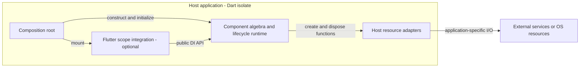
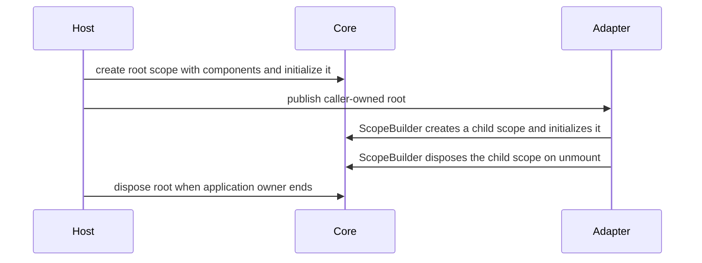
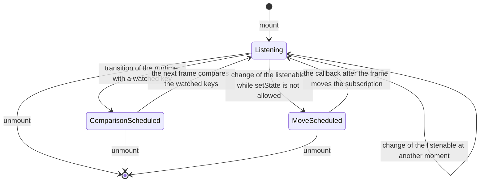

# Project Architecture Specification

[Requirements](requirements.md) · [Decisions](log.md) · [Known gaps](gap.md)

## Overview

`fp_di` is an embedded lifecycle library, not a service or application framework.
The Dart-only core interprets component descriptions; its Flutter adapter connects
that runtime to widget ownership and rebuilds. A host application supplies
concrete resources and owns the root scope. One architecture covers both
packages; the design is inspired by the supplied paper rather than a complete
implementation of its calculus.

## Why Two Packages

The split follows a platform dependency and ownership boundary, not two separate
products or independently deployed services.

- `fp_di` owns lifecycle semantics that also apply in a Dart CLI, server, or test:
  dependency resolution, activation, rollback, and release. Keeping Flutter out
  of this package makes that behavior usable and testable on the Dart VM.
- `fp_di_flutter` owns Flutter-specific adaptation: inherited context lookup,
  key-based rebuild subscriptions, and widget mount/replacement/unmount. It
  delegates lifecycle execution to the public core API instead of creating a
  second runtime policy.
- A Flutter host composes both; a plain Dart host only needs the core. Host
  resource adapters determine which concrete resources are acquired and what
  their releases mean. Widget-only objects stay under normal Flutter State
  ownership when they depend on State facilities.

Combining the packages would force a UI dependency onto non-UI consumers.
Duplicating lifecycle logic in the adapter would let rollback and dependency
ordering diverge. The cost of separation is a public API boundary and additional
widget integration tests. Neither package boundary requires another architecture
subdomain at the current project scale.

## Context & Building Blocks

C4 component view within a **host application / Dart isolate**. Packages are
source modules, not separately deployed containers. External resource adapters
belong to the host; their actual I/O is beyond the DI library's recovery boundary.



| Boundary | Owns | Public entry |
|---|---|---|
| `fp_di` | Component algebra, typed keys, scoped lookup, activation transactions, dependency graph, ownership of dispose functions, lifecycle errors | [fp_di.dart](../../packages/fp_di/lib/fp_di.dart) |
| `fp_di_flutter` | Caller-owned scope publication, the scope of one widget subtree, BuildContext lookup and observation | [fp_di_flutter.dart](../../packages/fp_di_flutter/lib/fp_di_flutter.dart) |
| `fp_di_fpdart` | The scope lifecycle, lookups, and `Dependency` steps as fpdart types; no lifecycle logic of its own | [fp_di_fpdart.dart](../../packages/fp_di_fpdart/lib/fp_di_fpdart.dart) |
| Host | Root scope, concrete services, truthful acquire/release adapters, application state | Host composition root; [examples](../../packages/fp_di/example) |
| Verification tooling | Checks and evidence about contracts; no production runtime dependencies | [Test specification](../verification/test/spec.md), [formal specification](../verification/formal/spec.md) |
| `fp_di_devtools` | The DevTools extension app, an experimental and unpublished Flutter web app; a local build puts it in `packages/fp_di/extension/devtools/`, and a release of `fp_di` does not ship it | [DevTools extension](../tooling/devtools/spec.md) |

Source dependency direction is `host -> fp_di_flutter -> fp_di` and
`host -> fp_di_fpdart -> fp_di, fpdart`; a host without either imports `fp_di`
directly. `fp_di_flutter` and `fp_di_fpdart` do not depend on each other.
`fp_di_devtools` reads a running app only through the inspector protocol of
the VM service. It does not depend on `fp_di`, and no package depends on it. Adapter imports MUST use `package:fp_di/fp_di.dart`,
not core `src/` internals. Tooling and tests MUST NOT become production imports.
The workspace includes Flutter for dependency resolution even though the core's
runtime and core unit tests are Dart-only. Manifests own exact SDK constraints;
[.mise.toml](../../.mise.toml) selects the development toolchain.

### Source folders of the core

The core keeps its implementation in two folders under
`packages/fp_di/lib/src/`.

| Folder | Holds | Rule |
|---|---|---|
| `model/` | The declarations and values: keys, `Dependency`, `Component`, `Module`, `DiContext`, changes, errors, exceptions, cancellation, and `ShapeGraph` | A file MUST NOT import a file of `runtime/` |
| `runtime/` | The scope library `scope.dart`, its part files, and the libraries that only the runtime and its tests import | A file other than `scope.dart` has a name that starts with `runtime` |

A type of `runtime/` starts with `Runtime`, or with `_Runtime` when it is
private to the scope library. `Scope` and the key type `_DiContributionKey`
are the exceptions. A test MAY import a library of `runtime/` that no public
library exports, such as `runtime_faults.dart`. The folder name `model/` is a
path; in prose, the word model still means a formal model.

## Runtime Ownership



A `Component` describes work; a `ComponentNode` denotes the node of a
component; a `Scope` denotes a visibility and ownership scope. These are
different boundaries. The [lifecycle
specification](../runtime/lifecycle/spec.md) owns activation, target
reconciliation, effect ordering, and cleanup semantics.

## Public API Namespaces

Each package library exports types only. A public operation MUST be a member
of the type that it creates or acts on, following the fpdart convention
(`Either.of`, `Option.none`). The libraries MUST NOT export top-level
functions or variables.

| Namespace | Members |
|---|---|
| `Component`, `ComponentBase` | The unnamed constructor `Component<A>(dependency:, key:, debugLabel:)` for a `Dependency` and the constructor `Component.value(value:, key:, debugLabel:)`; the key type must equal `A`. `ComponentBase` is the sealed, non-generic element type of a list of components |
| `Dependency1` to `Dependency8` | Classes that read N keys and create the value with `create` and an optional `dispose`, like Provider's `ProxyProvider2`; each is a `Dependency` of its value type |
| `Dependency` | The unnamed constructor `Dependency(create:, dispose:)` for zero inputs; the constructors `require`, `require2` to `require8`, and `maybe`; the instance methods `map(create, dispose:)` and `lazy()`; the `mapN(create, dispose:)` extension for record values, and a `zip` extension on records of 2 to 8 `Dependency` values |
| `Module` | Constructors `Module`, `Module.all`; operator `+`; edits `replacing`, `without`, and `where`; derived shape `publishes`, `requires`, and `reads`; `origins`, the label of the module that listed each member; independent members activate concurrently; the contents of a scope, created by `Scope.initialize` |
| `Scope` | The unnamed constructor `Scope({module})` for a root scope and `child({module})`, which declare the contents; `initialize`, `isInitialized`, `module`, `node`, `nodes`, `findNode`, `get`, `maybeGet`, `describe`, and `dispose`. A `ComponentNode` from `node` or `nodes` exposes `whenActive` and `missing` |
| `ScopeProvider` | The constructors `ScopeProvider.listenable(scope:)` for a `ValueListenable<Scope>` and `ScopeProvider.fixed(scope:)` for one `Scope`, and no unnamed constructor; `of` for the current scope of the closest provider, with `key:`, `nodeKey:`, or `listenToScope:` for the rebuild, and `maybeOf` with the same arguments, which returns null when no provider is above |
| `BuildContext` extension | `di`, `maybeDi`, `watchDi`, `watchMaybeDi`, `maybeDiNode`, `watchMaybeDiNode` |

The isolation keeps short names such as `require`, `maybe`, and `value` out of the
host namespace, so an import of `fp_di` does not collide with other functional
libraries.

### Type names

`package:flutter/widgets.dart` exports its own `Key`, so a public type with a
general name collides in a library that imports both. The prefix `Di` marks
such a type. `Scope`, `Module`, and `Component` are the units that a host
composes, and they have plain names. No type of Flutter or of the Dart SDK has
one of these three names. A new public type MUST follow the rule of its row.

| Rule | Names |
|---|---|
| A general word that stands alone takes the prefix `Di` | `DiKey`, `DiError`, `DiException`, `DiFailure` |
| A name that adds a word to a `Di` name keeps the prefix | `DiCollectionKey`, `DiSetKey`, `DiMapKey`, `DiMapEntryKey`, `DiListenerException` |
| A name that starts with a word of the library has no prefix | `Scope`, `ScopeProvider`, `ScopeState`, `ScopePhase`, `NodeState`, `NodePhase`, `Component`, `ComponentNode`, `Dependency`, `Module`, `Lazy`, `ShapeGraph`, `SlowMutation`, `SlowMutationListener`, `CancellationToken` |
| A concrete error, exception, or failure names its condition and has no prefix | `DuplicateKeyError`, `ReentrantMutationError`, `OutsideActivationError`, `ActivationException`, `ScopeFailure` |
| An extension names the type that it extends and the library that it adds | `DiBuildContext`, `ScopeFpdart`, `DependencyFpdart` |
| A supertype without a type argument adds the suffix `Base` to the name of its main type | `ComponentBase`, `DiKeyBase` |

`ComponentBase` is the supertype of every `Component<A>`, and `DiKeyBase` is
the supertype of every key. Each is the element type of a collection that
holds values of different type arguments. go_router names the supertype of
its routes [`RouteBase`](https://pub.dev/documentation/go_router/latest/go_router/RouteBase-class.html)
in the same way. A supertype whose name no other type has keeps the plain
name, such as `DiError`, `DiException`, `DiCollectionKey`, `CancellationToken`,
and `ScopeFailure`.

Another package can export a plain name of the library. sentry exports
[`Scope`](https://pub.dev/documentation/sentry/latest/sentry/Scope-class.html),
and injectable exports
[`Scope`](https://pub.dev/documentation/injectable/latest/injectable/Scope-class.html)
and
[`Module`](https://pub.dev/documentation/injectable/latest/injectable/Module-class.html).
A file that imports both libraries hides one name or gives one import a
prefix.

### Chaining and arguments

The public API has four layers. Each layer follows one style, and the
`dependency:` argument of `Component` is the boundary between the first two.

| Layer | Types | Style | Flutter counterpart |
|---|---|---|---|
| Dependency | `Dependency`, `Dependency1` to `Dependency8` | Immutable values: `Dependency(create:, dispose:)` and a `DependencyN` class for the common read-and-create case, and combinators (`map`, `mapN`, `lazy`, `zip`) | The expressions that compute values |
| Declaration | `Component<T>`, `Module`, `Scope` | Flutter declaration: the type argument first, named arguments, `initialize` and `dispose` | A widget and its constructor arguments |
| Instance | `ComponentNode`, the node tree of a scope | Lifecycle objects that the runtime creates | An element and its state |
| Observation | `ScopeState`, `NodeState`, `ScopePhase`, `NodePhase`, `SlowMutation`, `ShapeGraph`; the members `describe`, `missing`, `state`, `activationException`, `findNode`, `isDisposed`, and `addListener` | Read-only values and listeners; a read starts no mutation | A `Listenable`, and diagnostic output such as `toStringDeep` |

The dependency layer MUST stay immutable. A `Dependency` describes relations in
the dependency graph: the keys it reads and the steps from them to a value.
It is functional as a description, not as a computation: building or combining
one runs nothing, and the combinators return new values. Running it is
effectful. Each step, `map` included, may be asynchronous, may own its value
through `dispose`, and is a cancellation checkpoint, so `map` is sequential
composition of effects, like `Future.then`, and not a pure transform.
For the common case, `Dependency1` to `Dependency8` state the reads and the
value in one call, with the input types and then the output type, as
Provider's `ProxyProvider2<A, B, R>` does; Dart has no generic constructors,
so one class for each arity is the only way to name all of them together. A
chain adds steps, optional reads, and lazy values. The declaration layer MUST
follow Flutter conventions, and the instance layer is read-only for callers.
A `Scope` belongs to two layers. Its constructors declare its contents, and
after `initialize` it owns the nodes of the instance layer. The observation
layer reads the other layers and changes none of them. `ShapeGraph` reads
declarations, and the other members read the runtime. The lifecycle spec
states their contract under [Observation](../runtime/lifecycle/spec.md#observation).

The API reference of `fp_di` groups the public types in six categories:
Dependency, Declaration, Keys, Lifecycle, Observation, and Errors and
exceptions. Each public type names its category in its doc comment, and
[`dartdoc_options.yaml`](../../packages/fp_di/dartdoc_options.yaml) orders the
categories and gives each one a guide page under `packages/fp_di/doc/`. The
category Lifecycle holds the instance layer and the phases `NodePhase` and
`ScopePhase`, and it explains the states of a node and of a scope. The keys and the two kinds of failure cross the layers, so
each has a category of its own. Two more categories show the guides for
readers who know another library: Guides shows `doc/from_get_it.md`, and
Riverpod shows `doc/from_riverpod.md`. Each one tags `Scope` and `Module`,
because `dart doc` builds no topic page for a category without a type. The
guide of `fp_di` covers the Dart part of Riverpod. `fp_di_flutter` has one
category, Riverpod, for its guide of the widget part, and `ScopeProvider` and
`ScopeBuilder` carry it. The lint `public_member_api_docs` requires a doc comment on each public
member of each package.

A public method MUST chain only for an algebraic step. Every constructor and
configuration value, including the published key, MUST be a named argument.
Constructors and configuration take named arguments, as Flutter widgets do. A
combinator that takes one function keeps it positional, as `Iterable.map` and
`Future.then` do, and so do `ScopeProvider.of(context)` and `addListener(listener)`.
`DiMapKey.entryKey(id)` also takes its id positionally: the call selects one entry
of a map, as `map[id]` does.

| Form | Members | Reason |
|---|---|---|
| Algebraic chain | `Dependency.map`, `mapN`, `lazy`, `zip` | Each step builds a new value of the algebra |
| Named argument | Every constructor and configuration argument: `dependency`, `key`, and `debugLabel` of `Component`, `value` of `Component.value`, `components` and `debugLabel` of `Module`, `modules` and `debugLabel` of `Module.all`, `collapsed` of `ShapeGraph.toMermaid`, `key` and `component` of `replacing` and `without`, `module` of `Scope` and `child`, `name` of `DiKey`, `DiSetKey`, and `DiMapKey`, `key` of `Component.into` and of the collection reads `requireSet`, `maybeSet`, `requireMap`, and `maybeMap`, `key1` to `key8` of `Dependency.require2` to `require8` and of `Dependency1` to `Dependency8` | Dart and Flutter name configuration arguments; the explicit type argument of a constructor constrains each key |

Dart infers one type argument from all the arguments of a call. A call that
takes a value and a key can therefore widen the type to a common supertype,
such as `Object`, and a mismatch compiles. The `Component` constructors check
at run time that the key type equals the type argument, so the mismatch fails
where the component is built. A list of components MUST use the non-generic
element type `ComponentBase`: a generic element type such as
`Component<Object?>` becomes the inference context of each component in the
list and fixes its type argument to `Object?`. Provider's `SingleChildWidget`
does the same for `MultiProvider`.

## Flutter Integration

| Surface | Responsibility and ownership |
|---|---|
| `ScopeProvider` | Publish a caller-owned scope, subscribe to changes, and detach listeners on replacement/unmount. It does not create, initialize, or dispose a scope. `ScopeProvider.listenable` reads the scope from a `ValueListenable<Scope>` at each lookup; `ScopeProvider.fixed` publishes one scope that lives longer than the widget. |
| `ScopeBuilder` | Create a child of the scope of the closest provider, call `initialize`, publish the child, build from a `ScopeSnapshot` with the phase, the node states, and the failure of `initialize`, and dispose the child at the unmount. |
| `ScopeBoundary` | Hold the disposal of a caller-owned scope while mounted, publish the scope, and build from a `ScopeSnapshot`. It does not call `initialize` or `dispose`. |
| `di` / `maybeDi` | Read a required/optional binding without subscribing to publisher changes. |
| `watchDi` / `watchMaybeDi` | Subscribe by dependency key to publisher identity/availability changes; mutations inside a published object do not notify. |
| `maybeDiNode` / `watchMaybeDiNode` | Read the node that publishes a key, as `Scope.findNode` does. The watching read rebuilds when the state, the failure, or the missing keys of that node change, and when the publisher of the key changes. |

A widget tree publishes a scope one frame late: a parent that rebuilds a
provider with another scope replaces it only at the next frame. A scope
answers no read from the moment its disposal starts, not even for a key of its
parent. A host that replaces a scope and disposes it in one turn therefore
MUST supply the scope through a listenable and MUST change the value before it
calls `dispose`. A lookup reads the value at the moment of the call, so no
widget reads the disposed scope. `ScopeProvider.fixed` has no such
guarantee and is for a scope that is not disposed while the widget is mounted.

The disposal of a scope rebuilds no watching widget. A scope whose disposal
was requested starts no activation, and its lookups throw once the disposal
mutation starts, so the provider makes no comparison from that start on.
While a hold delays the disposal, the lookups answer and the watchers below
the provider keep the values of their last build, unless the withdrawal of a
publisher of an ancestor deactivates a member that a watched key resolves to.
That change notifies its watchers, as at any other time. The replacement of
the scope notifies every dependent, and the change of a key notifies its
watchers.

`ScopeProvider` creates, initializes, and disposes no scope. `ScopeBuilder`
owns the scope of one widget subtree
([R-UC-AR-UI-006](requirements.md#r-uc-ar-ui-006)). It calls `create` once for
each scope of the closest provider, calls `initialize`, and disposes the scope
in `State.dispose`. The code that calls `initialize` gets its failure, so the
widget keeps the failure in the snapshot. A failed `initialize` rolls the scope
back to `declared`, and the state of the scope does not show the failure. The
builder of the caller decides what a pending scope and a failure show, so the
widget takes no loading widget and no error widget.

`ScopeBuilder` publishes its scope through an inner
`ScopeProvider.listenable`, from the first build and above everything that the
builder returns. A replacement of the scope above therefore follows the rule of
a host: the widget changes the value of the listenable first and disposes the
old scope after that. The phase `initialized` does not mean that each node is
active, because a node can wait for a key of an ancestor. The widget listens to
its scope like the provider does. A transition schedules a build before the
next frame only when it changes the phase or a node state of the scope; a
transition of a child scope schedules nothing. In the phase `disposeRequested`
the lookups answer, so the builder runs. In the phases `disposing` and
`disposed` the lookups throw, so the widget calls no builder and keeps no
widget below it: a build returns an empty widget. The listeners of a scope run
when its disposal mutation starts, so the widget builds again at the next
frame. A widget below it that rebuilds by itself in that frame, such as an
animation, is removed first, because the framework builds an ancestor before
its descendants. A callback below it that runs before that frame and reads
the scope still throws. The failure of a disposal, the rollback failures of a canceled
`initialize`, and the failure of an `initialize` that the widget no longer
shows go to `FlutterError.reportError`.

`ScopeBoundary` borrows a caller-owned scope
([R-UC-AR-UI-007](requirements.md#r-uc-ar-ui-007)). At the mount it takes a
hold of the disposal of the scope
([holds of a disposal](../runtime/lifecycle/spec.md#scope-declaration-and-initialization)),
and at the unmount it closes the hold. The hold carries the `debugLabel` of the
widget, else the name of its route, else `ScopeBoundary`, so `describe` and
the slow report of a waiting disposal name the boundaries that it waits for.
The widget closes the hold in `State.dispose`, not in `deactivate`, so a move
with a `GlobalKey` keeps it. A route that another route covers stays mounted,
so its boundary keeps the disposal waiting until the route is removed. A host that disposes the scope then
moves the scope to `disposeRequested` at once, and the disposal starts when the
last boundary of the scope unmounts. In that time the lookups answer and no
activation starts, so a route that exits reads live values until Flutter
removes it after its exit transition. The widget publishes its scope through
an inner `ScopeProvider.listenable` above everything that its builder
returns, so the change of a listenable above does not reach the widgets below
it. Its snapshot has the phase and the node states and no failure, because the
widget calls no `initialize`. The rules of `ScopeBuilder` on transitions and on
the phases `disposing` and `disposed` apply to it. A boundary that mounts after
the request takes no hold.

The code that removes the routes below a boundary MUST NOT wait for the
`dispose` future of the scope: the disposal waits for those routes, so the two
would wait for each other. A test that disposes such a scope removes the
widgets first, or pumps the frames that remove them, before it awaits the
disposal. A call with `ignoreHolds` while a boundary is mounted leaves the
boundary with an empty subtree, as for `ScopeBuilder`.

A node can exist while it is inactive. A widget that reads a key whose
publisher can be withdrawn SHOULD read it with `watchMaybeDi`, or with
`watchMaybeDiNode` when it shows why the value is absent.

`ScopeProvider.of` and each read of the `BuildContext` extension throw a
`FlutterError` when no provider is above. In `maybeDi`, the word maybe names
a key that can be unavailable, not a provider that can be absent.
`ScopeProvider.maybeOf` takes the arguments of `of` and returns null when no
provider is above. A host that also keeps its scope outside the widget tree
reads it with `ScopeProvider.maybeOf(context) ?? fallback`. A listening call
that found no provider rebuilds the widget when the widget moves below a
provider.

The provider is a listener of the published scope. A call schedules one
comparison before the next frame
([state of the runtime](../runtime/lifecycle/spec.md#state-of-the-runtime)).
The comparison reads, for each watched key, the `state` of the node that
`findNode` returns, and compares that `NodeState` with the one that it kept.
It notifies the watchers of a value when the `id`, the `commits`, or the phase
`active` of that `NodeState` differs, and the watchers of a node when the
`NodeState` differs. A watched key is a `DiKey`: a collection key has no lookup from
a scope, so it has no watcher. The provider makes no comparison while
`isDisposed` of the published scope is true, so the disposal of the scope rebuilds no
watcher. The failure of an automatic activation changes no value of a key, so
a watcher of a value does not rebuild for it. A watcher of a node reads
`activating` and `deactivating` while an activation or a release runs. A widget treats
every phase except `active` and `activationFailed` as pending. The failure of `initialize` rolls the members
of the scope back and goes to the caller alone, so no node holds it.

The adapter imports only the public core API. Functional result conversion
follows [Fpdart Interoperability](#fpdart-interoperability); `fp_di_flutter`
does not depend on fpdart or on `fp_di_fpdart`.

### Lifecycles of the adapter

Four lifecycles meet in the adapter. `ScopeProvider` owns only its
subscription ([R-UC-AR-UI-005](requirements.md#r-uc-ar-ui-005)). A
`ScopeBuilder` also owns the scope that it created, from its mount to its
unmount, and a `ScopeBoundary` holds the disposal of its scope while it is
mounted.

| Lifecycle | Owner | What the adapter reads |
|---|---|---|
| Frame: transient callbacks, then build, layout, paint, and unmount, then the callbacks after the frame | Flutter | The scheduler phase, to know whether `setState` is allowed |
| Mount of a widget and of a route | Flutter and the `Navigator` of the host | The mount of the provider and the dependencies of the widgets below it |
| Published scope: the value of the listenable, or the scope of the widget | Host | The value at each lookup, and each change |
| Runtime: the phases of each scope and of each node | `fp_di` | `Scope.addListener`, `isDisposed`, and the `NodeState` of each watched key |

A mounted `ScopeProvider` listens to one scope. Two flags add to that state: a
scheduled comparison and a scheduled move. The diagram shows each flag alone;
both can be set at one time.



| Event | Reaction of the provider |
|---|---|
| Mount | Adds a listener to the published scope, unless `isDisposed` is true. |
| A lookup | Reads the value of the listenable at the call. A watching lookup also keeps the `NodeState` of its key. |
| A transition of the runtime | Schedules one comparison before the next frame. Schedules nothing while no key was watched since the mount. |
| The comparison | Reads the `NodeState` of each watched key and rebuilds the watchers of each key that changed. Does nothing for a scope whose `isDisposed` is true. |
| A change of the listenable, or a rebuild with another scope | Moves the listener to the new scope. Each listening widget rebuilds at the next frame. |
| A change of the listenable while `setState` is not allowed | Moves after the frame: a callback after the frame calls `setState`. The provider asks for a frame when none runs. A lookup reads the new scope at once. |
| Unmount | Removes the listener and cancels the scheduled comparison. A callback that runs later does nothing. |

`setState` is not allowed while the framework builds, and while it has locked
the tree. Both occur in the persistent callbacks of a frame, and
`State.dispose` runs there. A build can also run outside a frame, when a host
calls `BuildOwner.buildScope`. The debug flag of the build owner shows that
build, so the provider reads the flag in an assertion. A release build has no
assertion on `setState`. That statement comes from the source of Flutter, and
no test runs a release build.

The provider MUST keep four properties. The names are the names of the checks
of [V-T-AR-UI-011](requirements.md#v-t-ar-ui-011):

| Property | Statement |
|---|---|
| `NoFailedRead` | No build and no lookup of a mounted widget throws because of the adapter, while the host follows the host rule. |
| `WatcherCurrent` | After the frames that a change asked for, each mounted watcher shows the value, the node state, or the scope that its lookup returns at that moment. |
| `NoRebuildForDisposal` | The disposal of another scope rebuilds no watcher. |
| `NoWorkAfterUnmount` | An unmounted provider schedules no frame. `State.dispose` of the provider removes its listener; no check observes the listener. |

The adapter has no composition operator, so it has no algebra to prove. The
four properties are safety properties over the product of the lifecycles.
Random histories check them with the real framework. A model of the adapter
must assume the frame phases, the notification of an `InheritedModel`, and the
lock of the tree. The defect of a replacement from `State.dispose` was in such
an assumption. The
[decision](log.md#2026-11-13-decision--check-the-adapter-with-random-histories-of-the-framework)
records the alternative.

### Host rule for routes

The adapter has no router code. The host joins the lifecycle of a route and
the lifecycle of a scope with these rules:

1. A route is not below the widget that pushed it. A route that needs a scope
   publishes that scope with a `ScopeProvider` of its own, or it is a route of
   a `Navigator` that is below the provider.
2. A scope that a route owns belongs to a `State` of that route, usually the
   `State` of a `ScopeBuilder` in the route. The `State` creates the scope as
   a child of the ambient scope, calls `initialize`, publishes the scope, and
   calls `dispose` in `State.dispose`. Flutter calls `State.dispose` after the
   exit transition, so each read of an exiting route gets a value.
3. A host that publishes one scope for all routes through a listenable changes
   the value before it disposes the old scope. The change also reaches a route
   that exits. A widget of such a route that reads a key of the old scope MUST
   read it with `maybeDi` or `watchMaybeDi`, or the host MUST remove the
   widget in the frame of the change. A strict watching read rebuilds in that
   frame and throws `UnavailableKeyException`.
4. The host MAY change the listenable from any callback, also from
   `State.dispose`.
5. A popup is not below the widget that opens it. `showDialog` and
   `showCupertinoModalPopup` push a route on the root `Navigator` by
   default, and `showModalBottomSheet` on the nearest `Navigator`. A
   `ScaffoldMessenger` builds a snack bar in every root `Scaffold` below it.
   A popup that reads a scope MUST be a route of a `Navigator` below that
   scope, or MUST republish the scope with `ScopeProvider.fixed` and close
   before the scope is disposed. The content of a snack bar or a banner MUST
   NOT read a scope from its own context.
6. A host that disposes a scope outside the widget tree, such as a session at
   logout, while routes of a `Navigator` read that scope, SHOULD put each such
   route below a `ScopeBoundary` of the scope. The host MAY then change the
   listenable and call `dispose` in one turn: each boundary keeps its scope
   readable and delays the disposal until its route unmounts. The removal of
   the routes MUST NOT wait for the `dispose` future. A host that needs a
   bound on that wait calls `dispose(ignoreHolds: true)` after a time limit.

[`navigator_scope.dart`](../../packages/fp_di_flutter/example/navigator_scope.dart)
shows rules 1 and 2 with `ScopeBuilder`: a session scope above a nested
`Navigator`, and a page scope in a pushed route. Its test reads each scope in the middle of each exit
transition. [`session_scope.dart`](../../packages/fp_di_flutter/example/session_scope.dart)
shows rule 3 without a route transition.
[`popup_scope.dart`](../../packages/fp_di_flutter/example/popup_scope.dart)
shows rule 5 with a dialog of each `Navigator`, a modal bottom sheet, and a
snack bar. The random histories follow rules 2,
3, and 4 with the reads that do not throw. No committed test runs a strict
read of an exiting route after a replacement.

## Contract Ownership

| Topic | Canonical responsibility |
|---|---|
| This topic | Project boundaries, package separation, Flutter widget-scope ownership and lookup (AR-UI), paper adoption, and fpdart interoperability |
| [Runtime lifecycle](../runtime/lifecycle/spec.md) | Core runtime behavior, including core scope visibility and disposal, with verified runtime gaps |
| [Automated tests](../verification/test/spec.md) | Test layers, fixtures, selection, and evidence policy |
| [Formal verification](../verification/formal/spec.md) | Model scope, proof obligations, assumptions, and model-to-code correspondence |

`AGENTS.md` and `agents/rules/` provide operating guidance. They link to these
contracts. Models under `verification/` are designed verification artifacts,
not substitutes for the human-readable topics under `specs/`.

## Paper Adoption

The source is *A Programming Paradigm for Spatiotemporal Composability*. Its
[research mapping](../runtime/lifecycle/researches/spatiotemporal-composability.researches.md)
identifies the exact PDF by hash and explains each theorem's premises.

| Concept | Acceptance in fp_di | Owning detail / source |
|---|---|---|
| Revertible effects | Adopt acquisition plus owned dispose function and reverse-order release attempts. Successful restoration still depends on adapter correctness. | [Lifecycle ownership](../runtime/lifecycle/spec.md#activation-and-ownership); §3.1, Definitions 1/8, Theorem 16 |
| Reactive coeffects | Adopt satisfaction-gated declared activation and publisher-identity target changes. | [Reconciliation](../runtime/lifecycle/spec.md#reconciliation-and-stability); §3.2.2 and Definition 53 |
| Committed dependency views | Adopt dependent-first withdrawal, so a reader releases while the values it read are alive. | [Withdrawal](../runtime/lifecycle/spec.md#withdrawal-and-committed-views); §4.2.2 |
| Shapes and composition | Dart adaptation: derive requires/optional/key from the `Dependency` of a component and its published key. No shape is declared by hand. | [Shape algebra](../runtime/lifecycle/spec.md#shape-algebra); Definition 48 is inspiration, not identical metadata |
| Isolation / identity | Restricted adaptation: scope-chain shadowing and binding-record identity. General realms, interception, and custom observational equivalence are excluded. | §3.2.3 and §3.3.2; current lifecycle requirements |
| Asynchrony and independence | Restricted adaptation: global mutation serialization, sequential steps inside one component, concurrent activation of independent module members and concurrent release of the nodes of a disposed scope along their reads, explicit external-effect assumptions. No per-node inertial scheduler. | [Concurrency](../runtime/lifecycle/spec.md#composition-and-concurrency); Definition 42 and §4.4 (Asynchrony) |
| Failure | Dart adaptation: aggregate failed releases, block own-cleanup failures, retry automatic activation failures on later mutations. Not the paper's terminal error outcome. | §4.4 (Failure) and lifecycle runtime behavior |
| Whole-system results | No imported guarantee of progress/confluence for unrestricted callbacks, optional cycles, or conditional publications. | [Formal verification](../verification/formal/spec.md); Theorems 73/80 |
| Loader and extensions | Exclude HMR, declarative configuration loader, effect iterators, generated graph checking, and full Cordis API compatibility. | [Lifecycle exclusions](../runtime/lifecycle/requirements.md#out-of-scope); paper §5 |

This acceptance boundary is deliberate. Unimplemented excluded paper features
are not bugs. A violation of accepted behavior is recorded as a gap of its
topic. Adding a paper feature requires
an explicit contract extension and validation of its interaction with this profile.

## Fpdart Interoperability

`fp_dart` in the design request is interpreted as the Dart package `fpdart`.
It is a functional library, not a replacement interpreter or a core
dependency. The optional package
[`fp_di_fpdart`](../../packages/fp_di_fpdart/lib/fp_di_fpdart.dart) puts the
public core API into fpdart types, so a host that writes its programs with
fpdart gets one vocabulary on both sides of the boundary. It depends on
`fpdart: ^1.2.0`; the `2.0.0-dev.3` prerelease is not a compatibility target.
See the publisher's [version list](https://pub.dev/packages/fpdart/versions).

| Core operation | `fp_di_fpdart` form |
|---|---|
| `initialize`, `dispose` | `initializeTask()`, `disposeTask()`: lazy `TaskEither<DiFailure, _>` |
| initialize, use, dispose | `use(ReaderTaskEither<Scope, E, A>)`: a `TaskEither<ScopeFailure<E>, A>` that disposes on every path |
| `get`, `maybeGet` | `getEither()`: `Either<DiFailure, T>`; `getOption()`: `Option<T>` |
| `whenActive` | `whenActiveTask()`: `TaskEither<DiFailure, A>` |
| `Dependency.map` with an async effect | `mapTaskEither` (a `Left` fails the setup), `mapTaskEitherAsData` (a `Left` is the value), `mapTask` |
| `Dependency.maybe` | `toOption()`: `Dependency<Option<A>>` |
| `CancellationToken.whenCanceled` | `canceledTask`: `Task<Unit>` |

The package MUST NOT add lifecycle behavior: each form calls one public core
operation and converts its result or its error. `DiFailure` keeps the
original error and stack trace, so an `ActivationException` keeps its cause
and rollback failures. A `Dependency` step keeps the shape of its
`Dependency`: the package has no `flatMap` that chooses the next reads from a
value, because the runtime needs the reads before it runs. The contract below
applies to these forms and to a host that converts values itself.

| Host value/computation | Integration contract |
|---|---|
| `Option<T>` | A normal component result. Converting `maybeGet<T>()` with nullable-to-Option semantics is appropriate only when null is not itself a valid bound value; absence and a bound null are otherwise ambiguous. |
| `Either<L, A>` | A normal value. `Left` does not throw, roll back effects, or make a component inactive. The host explicitly chooses whether to keep a domain result or raise setup failure. |
| Lazy async task | Execute only at an explicit host initialization boundary or within tracked component setup. Re-running it in a new scope creates another set of nodes; it is not a memoized singleton. |
| Reader-style environment | Use a narrow application environment. Passing a Scope into a Reader does not derive requires/optional metadata or create tracked dependency edges. Component reads go through a `Dependency`. |
| Resource / node | Ownership remains with fp_di. Wrapping acquisition in a functional result container does not supply or execute its dispose function. The caller still disposes a successful handle. |

A successful `initialize` can leave member nodes dormant. A bridge
MUST NOT equate a successful async result with `node.isActive`. A `TaskEither`
error callback SHOULD retain both the original error and stack trace; restricting
its error type to domain failures MUST NOT erase cleanup/rollback diagnostics.

When `Left` is intended to abort setup, the conversion to an exception happens
inside a `Dependency` step or a resource acquire before commit. When `Left` is intentional business
data, keep it as the result and continue owning its acquired resources until
disposal. The host chooses the policy; `fp_di_fpdart` names it in the step
(`mapTaskEither` or `mapTaskEitherAsData`) instead of choosing one for the
host.

`initializeTask` runs `initialize` once per run, so a second run on the same
scope is a `Left`, not a cached `Right`. A `Right` scope is still owned by the
caller until disposal; `use` brackets the scope when the host does not keep
it. When the disposal after a use fails, `use` keeps the use's own `Left` in
the `DisposeFailed` result. The core's `map` vocabulary on `Dependency`
expresses lifecycle ownership; shared names do not establish equivalence to
fpdart's effects.

## Verification

`fp_di_fpdart` is a workspace member, so the workspace lock file resolves
fpdart. No other package depends on it, and the core MUST NOT depend on
fpdart.

### <a id="v-t-ar-di-001"></a>V-T-AR-DI-001 — `[test]` Core suite without Flutter

- **Layer:** Unit
- **Target:** core package
- **Files:** `packages/fp_di/test/`
- **Fixtures:** `dart run agents/scripts/test_core.dart`
- **Pass:** The existing core suite completes successfully on the Dart VM. This is not a claim that all lifecycle gaps are covered.
- **Evidence:** present

### <a id="v-l-ar-di-001"></a>V-L-AR-DI-001 — `[lint]` Package boundaries

- **Layer:** Static
- **Target:** package boundaries
- **Files:** manifests plus all production imports
- **Fixtures:** the boundary audit below and `dart analyze`
- **Pass:** No prohibited dependency, no private cross-package import, and no import of `runtime/` from `model/`.
- **Evidence:** present

### <a id="v-t-ar-di-002"></a>V-T-AR-DI-002 — `[test]` Fpdart host interoperability

- **Layer:** Unit + host integration
- **Target:** `fp_di_fpdart` and its example
- **Files:** [`fp_di_fpdart_test.dart`](../../packages/fp_di_fpdart/test/fp_di_fpdart_test.dart), with the example [`checkout.dart`](../../packages/fp_di_fpdart/example/checkout.dart)
- **Fixtures:** `dart run agents/scripts/test_core.dart packages/fp_di_fpdart/test` with fpdart from the workspace lock file; small scopes of `int` and `String` members with recorded and failing dispose functions; a parent and a dormant child. The example builds a checkout with configuration validation that keeps every problem, a State cart store, a ReaderTaskEither workflow, and an optional analytics read.
- **Pass:** Assert lazy execution, repeated-run behavior, `use` disposal on a Right, a use Left, a setup failure, a dispose failure, and a throwing use; active vs dormant nodes; Left-as-data versus Left-as-setup-failure with rollback; retained errors, stacks, and rollback failures; unchanged dependency shape; and optional null policy.
- **Evidence:** present

### <a id="v-l-ar-di-003"></a>V-L-AR-DI-003 — `[lint]` Paper adoption claims

- **Layer:** Static + semantic documentation review
- **Target:** paper adoption and source premises
- **Files:** `agents/scripts/validate_specs.dart`
- **Fixtures:** the Paper Adoption table above
- **Pass:** `dart run agents/scripts/validate_specs.dart --final` checks references; review paper adoption and source premises against the Paper Adoption table. No static analyzer proves those premises.
- **Evidence:** present

### <a id="v-l-ar-di-002"></a>V-L-AR-DI-002 — `[lint]` Documentation structure

- **Layer:** Static / docs
- **Target:** canonical topics
- **Files:** `agents/scripts/validate_specs.dart`
- **Fixtures:** the Contract Ownership table above for semantic ownership review
- **Pass:** `dart run agents/scripts/validate_specs.dart --final`; no invalid triads, IDs, or local links. Review semantic ownership against the Contract Ownership table.
- **Evidence:** present

### <a id="v-t-ar-ui-001"></a>V-T-AR-UI-001 — `[test]` Lookup modes

- **Layer:** Flutter widget
- **Target:** `ScopeProvider` with `di` and `watchDi` lookup
- **Files:** `packages/fp_di_flutter/test/fp_di_flutter_test.dart`
- **Fixtures:** Root/child scopes, watched and plain Builder counters, unrelated key.
- **Pass:** Plain builds remain unchanged; watched builds reflect only the relevant publisher change.
- **Evidence:** present

### <a id="v-t-ar-ui-004"></a>V-T-AR-UI-004 — `[test]` Scope replacement by the parent

- **Layer:** Flutter widget
- **Target:** `ScopeProvider.fixed` when its parent supplies another scope
- **Files:** `packages/fp_di_flutter/test/scope_regression_test.dart`
- **Fixtures:** Two root scopes that publish the same key, one child object for both trees, a lookup with `listenToScope`, a watched Builder, and a plain Builder counter.
- **Pass:** The listening lookup and the watcher read the replacement scope. The plain Builder does not rebuild. Both scopes answer a read after the provider is removed.
- **Evidence:** present

### <a id="v-t-ar-ui-006"></a>V-T-AR-UI-006 — `[test]` Scope from a listenable

- **Layer:** Flutter widget
- **Target:** `ScopeProvider` with a `ValueListenable<Scope>`
- **Files:** `packages/fp_di_flutter/test/scope_listenable_test.dart`
- **Fixtures:** A parent scope and a session child that publish the same key, a `ValueNotifier<Scope>`, plain and watched Builder counters, a parent that initializes late, and a lookup with `listenToScope`.
- **Pass:** After the value changes and the session scope is disposed with no frame between, a plain lookup reads the parent value, also while the release of a session member still runs. The watcher rebuilds once, follows a late key of the replacement scope, and no lookup exception occurs. The listening lookup rebuilds for the replacement and not for the change of a key, and a replaced listenable keeps no listener.
- **Evidence:** present

### <a id="v-t-ar-ui-007"></a>V-T-AR-UI-007 — `[test]` Scope disposal and watchers

- **Layer:** Flutter widget
- **Target:** `ScopeProvider` change handling
- **Files:** `packages/fp_di_flutter/test/scope_disposal_test.dart`
- **Fixtures:** A parent scope, a child scope, a watched Builder counter, and a member whose dispose function waits for a `Completer`.
- **Pass:** The disposal of the published scope, a disposal that has started and not finished, and the disposal of another scope of the same root leave the build count at one, with no lookup exception.
- **Evidence:** present

### <a id="v-t-ar-ui-008"></a>V-T-AR-UI-008 — `[test]` Adapter examples

- **Layer:** Flutter widget
- **Target:** the example applications of `fp_di_flutter`
- **Files:** `packages/fp_di_flutter/test/example_test.dart`, with the examples under `packages/fp_di_flutter/example/`
- **Fixtures:** The root widget and the module of each example; taps on the buttons of the example; explicit pump durations for the values that arrive asynchronously.
- **Pass:** `main.dart` shows a value of the one scope. `session_scope.dart` logs in, logs out, and logs in again; the holder gives the app scope before any frame after the logout tap; the home page, which reads a session key with `watchDi`, is removed before it rebuilds; the session value is disposed and the app value stays open. `watch.dart` rebuilds the watching widget only. `node_state.dart` shows loading for both values, then a value and a failure. `page_scope.dart` shows the loading text, then the page; the app scope does not see the store, the store closes after the unmount, and a page that goes away while its store opens leaves no error. `navigator_scope.dart` logs in, opens the editor route, closes it, opens it again, and logs out; in the middle of each exit transition the exiting routes are mounted, their values are open, and no error occurs; after each transition the value of each route that left is closed. `popup_scope.dart` reads the cart scope from a dialog of the nested `Navigator`, from a dialog of the root `Navigator` that republishes it, and from a modal bottom sheet; a dialog of the root `Navigator` without the republication reads the app scope; a snack bar is built in the `Scaffold` of the home page too, stays after the cart route leaves, and reads no scope; the cart closes after the exit transition.
- **Evidence:** present

### <a id="v-t-ar-ui-009"></a>V-T-AR-UI-009 — `[test]` Node state watchers

- **Layer:** Flutter widget
- **Target:** `watchMaybeDiNode` and `maybeDiNode`
- **Files:** `packages/fp_di_flutter/test/node_state_test.dart`
- **Fixtures:** A parent scope that initializes after its child; a child member that activates, a child member whose `create` throws, and a key that no node publishes; Builder counters; a `ValueNotifier<Scope>` for the replacement.
- **Pass:** Each watcher of a node reads pending before the parent initializes. After it, the watchers read the value and the failure with one rebuild each. The watcher of the key without a node and the non-listening read do not rebuild. After a replacement, the watcher reads the node of the new scope, and the disposal of that scope rebuilds nothing.
- **Evidence:** present

### <a id="v-t-ar-ui-010"></a>V-T-AR-UI-010 — `[test]` Lookup without a provider

- **Layer:** Flutter widget
- **Target:** `ScopeProvider.maybeOf`
- **Files:** `packages/fp_di_flutter/test/scope_maybe_of_test.dart`
- **Fixtures:** A widget tree with no provider and one with a fixed provider; a reader in `build` and a reader in `initState`; one `Builder` instance with a `GlobalKey` that moves below a provider.
- **Pass:** With no provider, `maybeOf` returns null in each lookup mode and in `initState`, and `of` throws a `FlutterError`. With a provider, each call returns the scope that `of` returns, and a call with `key:` rebuilds when the member is disposed. A call with `key:`, `nodeKey:`, or `listenToScope:` that found no provider rebuilds the moved widget, which then reads the published scope.
- **Evidence:** present

### <a id="v-t-ar-ui-011"></a>V-T-AR-UI-011 — `[test]` Random histories of the adapter

- **Layer:** Flutter widget
- **Target:** `ScopeProvider` and the reads of `DiBuildContext` in [Lifecycles of the adapter](#lifecycles-of-the-adapter)
- **Files:** `packages/fp_di_flutter/test/adapter_history_test.dart`
- **Fixtures:** A `Random` with the seed of the history. An app scope, session scopes that are its children, and a `ValueNotifier<Scope>`. A `MaterialApp` with a `Navigator` below a `ScopeProvider.listenable`. Watchers of a value, of a node, and of the scope; a widget that replaces the scope from `State.dispose`; a page whose `State` owns a child scope. One defect of the harness for each check: a watcher that reads without listening, a logout that disposes before it changes the value, a disposal step that also withdraws a watched member, and a history that ends with the provider mounted.
- **Pass:** 40 histories of 40 steps with the seeds 0 to 39 report no violation of `NoFailedRead`, `WatcherCurrent`, `NoRebuildForDisposal`, and `NoWorkAfterUnmount`, and each of the 11 kinds of step runs at least one time. Each control runs 10 histories with the seeds 0 to 9 and reports its check; a control that reports nothing fails and names the defect, the seeds, and the checks that reported.
- **Evidence:** present

### <a id="v-t-ar-ui-012"></a>V-T-AR-UI-012 — `[test]` Replacement in each phase of a frame

- **Layer:** Flutter widget
- **Target:** the move of `ScopeProvider` to a new scope, and the frame of a transition
- **Files:** `packages/fp_di_flutter/test/scope_replacement_phase_test.dart`
- **Fixtures:** An app scope and a session scope with different values of one key, and a `ValueNotifier<Scope>`. A widget that changes the value from `State.dispose`, one that changes it from a build inside a frame, and one that changes it from a build that the test starts with `BuildOwner.buildScope` in the scheduler phase `idle`. A `State.dispose` that changes the value and then calls `dispose` on the old scope. A watcher of the key, a widget that listens to the scope, and a widget that reads without listening.
- **Pass:** After each change, `takeException` is null, a lookup reads the new scope, and a frame is scheduled. After the frames that the provider asked for, the watcher shows the value of the new scope and the widget that listens to the scope has built two times. The change from a build outside a frame needs two frames: the end of the first one moves the provider. After the `State.dispose` that also disposes, no exception occurs, the watcher shows the value of the new scope, and the old scope has the phase `disposed`. The creation and the disposal of a child scope schedule no frame below a provider with no watched key, and one frame below a provider with a watched key.
- **Evidence:** present

### <a id="v-t-ar-ui-013"></a>V-T-AR-UI-013 — `[test]` Scope of a subtree

- **Layer:** Flutter widget
- **Target:** `ScopeBuilder`
- **Files:** `packages/fp_di_flutter/test/scope_builder_test.dart`
- **Fixtures:** App scopes with a name key, and a child module whose member reads it. A member whose `create` waits for a `Completer`, a member whose `create` throws, and a member whose release throws. A `ValueNotifier<Scope>` above the widget for the replacement, and a disposal of the old parent in the same turn for the logout. A widget whose `State.dispose` disposes a child of the scope of the `ScopeBuilder`, which notifies inside the call, and withdraws the name. A build counter, and a builder that reads a key, so a build after the disposal throws.
- **Pass:** The builder reads `initializing`, then `initialized`, and a lookup below reads the key of the parent from the first build. A throwing `create` gives an `ActivationException` in the snapshot while the phase is `declared`. An unmount during `initialize` disposes the scope and reports one `ActivationCanceledException` with one rollback failure; without a failed release, nothing is reported. An unmount after `initialize` reports the `DisposeException` of a failed release. A replacement above calls `create` again, disposes the old child, and shows the value of the new one; a rebuild with the same scope above calls no `create`. A child scope that initializes and leaves calls no builder. The transitions from `State.dispose` give no exception, and the withdrawal shows after the frames. A disposal of the scope by its owner, and a rebuild from above after it, call no builder. A logout that changes the listenable above and disposes the old parent in one turn, with the child initialized or still initializing, gives no exception, a new child of the new parent, and a snapshot without an error. `create` without a provider throws a `FlutterError`.
- **Evidence:** present

`ScopeBuilder` is not a step of the random histories of
[V-T-AR-UI-011](#v-t-ar-ui-011). Its publication is a
`ScopeProvider.listenable` whose value changes before the old scope is
disposed, which the histories already check. Its own rules, a build at a later
frame for a change of its own scope and no builder while the scope is disposed,
have the focused tests above. No public call of the core changes the phase or
a node state of a scope inside the call, except a disposal. A transition from
`State.dispose` therefore cannot show that the widget calls no `setState`
inside a transition; the build at a later frame is a defense.

### <a id="v-t-ar-ui-014"></a>V-T-AR-UI-014 — `[test]` Holds of a borrowed scope

- **Layer:** Flutter widget
- **Target:** `ScopeBoundary`
- **Files:** `packages/fp_di_flutter/test/scope_boundary_test.dart`
- **Fixtures:** An app scope and a session scope with a member that logs its release, a `ValueNotifier<Scope>` above a `MaterialApp`, two pushed routes that read a session key with `context.di` below a `ScopeBoundary`, one with a `debugLabel` and one in a named route, a boundary that mounts after the request, a widget below a boundary that rebuilds on each frame and reads a session key, a boundary under a `GlobalKey` that moves to another parent, a route covered by a pushed route, and a second session scope for the rebuild.
- **Pass:** After the change of the value and the request in one turn, and the pop of both routes, the reads in the middle of each exit transition return the session value and `takeException` is null; each builder reads `disposeRequested`; the release log stays empty until the second route unmounts, and the `dispose` future completes after it. A boundary that mounts after the request does not delay the disposal. A disposal with `ignoreHolds` and a mounted boundary calls no builder after `disposing`, removes the subtree at the next frame, and an animation below it that ticks in that frame gives no error. A rebuild with the second scope moves the hold. The move with the `GlobalKey` keeps the hold open. The covered route keeps the disposal waiting until it is removed. `describe` of the waiting scope lists the `debugLabel` and the route name. No `initialize` and no `dispose` call comes from the widget.
- **Evidence:** missing — not implemented, see [G-AR-UI-001](gap.md#g-ar-ui-001)

### <a id="v-l-ar-ui-001"></a>V-L-AR-UI-001 — `[lint]` Adapter imports

- **Layer:** Static + source review
- **Target:** adapter manifest and imports
- **Files:** adapter manifest and imports under `packages/fp_di_flutter/`
- **Fixtures:** the boundary audit below and `dart analyze`
- **Pass:** Confirm public core imports and no direct fpdart dependency.
- **Evidence:** present

The boundary audit uses the current core policy of zero package dependencies:

```sh
python3 - <<'PY'
from pathlib import Path
core = Path('packages/fp_di')
assert 'dependencies: {}' in (core / 'pubspec.yaml').read_text()
for p in (core / 'lib').rglob('*.dart'):
    for line in p.read_text().splitlines():
        if line.strip().startswith(('import ', 'export ')):
            for uri in line.replace(chr(34), chr(39)).split(chr(39))[1::2]:
                if uri.startswith('dart:'):
                    continue
                assert ':' not in uri, (p, uri)
                if '..' in uri:
                    # Only runtime/ may leave its folder, and only for model/.
                    assert p.parent.name == 'runtime', (p, uri)
                    assert uri.startswith('../model/'), (p, uri)
                    assert '..' not in uri[3:], (p, uri)
for adapter in ('packages/fp_di_flutter', 'packages/fp_di_fpdart'):
    for p in Path(adapter, 'lib').rglob('*.dart'):
        assert 'package:fp_di/src/' not in p.read_text(), p
PY
```

The audit lets only a file of `runtime/` leave its folder, and only for a file
of `model/`, so no file of `model/` imports the runtime.
If core dependencies become necessary, revise the policy and audit together;
this small source audit is not a general Dart import-graph analyzer.
