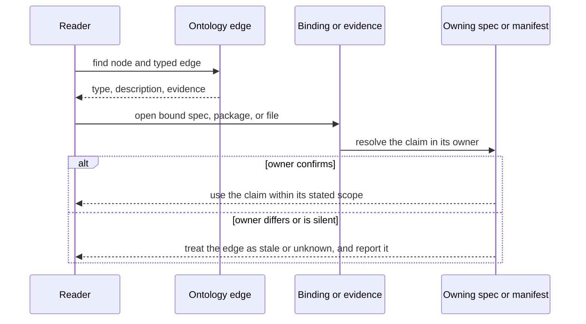

# Ontology Format Specification

[Requirements](requirements.md) · [Decisions](log.md)

## Overview

[`ontology/`](../../ontology/AGENTS.md) holds flat YAML topic files. The files
declare stable IDs and typed, evidence-cited relations between repositories,
workspace packages, platforms, and domain concepts. Concept nodes are the
canonical definitions of shared terms; specs link them instead of keeping a
glossary. The ontology is reviewed documentation. One script reads it:
the [vocabulary check](#vocabulary) compares the words of the public API with
the `identifiers` of the nodes. No schema file or CI step enforces the graph. This spec
defines its format and vocabulary in response to [`requirements.md`](requirements.md).
The selection of nodes stays small and source-backed. The ontology is not an inventory.

## Context & Boundaries

The ontology sits beside specs and agent rules. The
[ontology authoring rule](../../agents/rules/documentation_ontology.rules.md)
owns their ownership split, the routing of new information, authoring practice,
decision policy, and the manual review checklist. A verified difference between
a spec and the code stays in the `gap.md` of that topic. An edge records the
accepted topology only.

## Ontology Format

Each top-level `ontology/*.yml` file is a topic. File placement is an authoring
boundary, not classification or containment.

| Field | Meaning |
|---|---|
| `version` | Format version, currently `1` |
| `description` | Scope and interpretation of the file |
| `domains` | Optional map of snake_case domain ID to short description |
| `nodes` | Optional map of snake_case node ID to `kind`, `definition`, optional `domain`, `term`, `identifiers`, `avoid`, and `bindings`, and required `evidence` |
| `relations` | Optional list of `from`, `type`, `to`, `description`, and `evidence` |

- A file has at least one non-empty `domains`, `nodes`, or `relations` section. All files load together as one graph.
- Domain IDs and node IDs **MUST** be unique across files. An edge endpoint **MUST** exist in some file. A node's `domain` **MUST** be declared. A domain with no node is not declared.
- An edge **SHOULD** live in the file that defines its source node. Edges are unique by `(from, type, to)` and have distinct endpoints.
- `evidence` and binding paths **MUST** be existing files in this repository. A path outside this repository, including another repository's checkout, is not evidence.
- An ID **MUST NOT** change meaning in place. Introduce a new ID instead. A rename or removal of an ID updates every reference in the same change.

### Node kinds

| Kind | Meaning |
|---|---|
| `repository` | A source repository, this one or an external one, as a unit of maintenance responsibility |
| `component` | A buildable or composable unit defined here, such as a workspace package |
| `platform` | A host runtime or SDK that a component needs to build or run |
| `concept` | A domain term of the DI model with one meaning. The bound spec owns its behavior |
| `vocabulary` | A group of words that public identifiers take with their ordinary meaning from one source, such as the Dart SDK, Flutter, or fpdart |

The sibling ontology also uses `entity`, `activity`, and `data_asset`. This
repository does not adopt them. The `concept` kind is local, and no alignment
with those kinds is claimed. A new kind or relation type requires a spec
change and a `log.md` entry.

A `concept` node **MUST** have a `term`: the preferred English term that prose
uses for the concept. Prose **MUST NOT** use a synonym for that term. A
`concept` definition states identity only. Ordering, failure policy, and other
behavior stay in the bound spec. A node ID **SHOULD NOT** repeat a kind name.

A workspace `package` binding **MUST** be a member of the root `pubspec.yaml`
workspace. A package that a spec describes but that is not yet present is not a node.

### Relation types

| Type | Source → target | Meaning |
|---|---|---|
| `depends_on` | component → component, platform, or repository | The source requires the target to build, compose, or run. Edges between packages record only the accepted direction in [Project Architecture](../architecture/spec.md) |
| `derived_from` | component → repository | Lineage: content or design ported from the target. No runtime dependency is implied |
| `owned_by` | component → repository | Code maintenance responsibility. Record it only where ownership crosses repositories. Other members are implicitly owned by this repository |
| `runs_on` | component → platform | The host runtime that executes the source |
| `specializes` | concept → concept | Every instance of the source is an instance of the target |
| `part_of` | concept → concept | An instance of the source is a constituent or a step of an instance of the target |
| `belongs_to` | concept → concept | An instance of the target owns each instance of the source during the source's lifetime |
| `acts_on` | concept → concept | The source is a process that operates on instances of the target |

`depends_on` among components and `specializes` among concepts are expected
to be acyclic. The other types are not constrained. CI-workflow types and the `workflow` binding of the sibling
ontology are not adopted, because this repository has no CI workflow.

### Binding types

| Type | Path |
|---|---|
| `spec` | `specs/{topic}/spec.md` that owns the design of the node |
| `package` | Directory of a root `pubspec.yaml` workspace member that contains a `pubspec.yaml` |
| `file` | An existing source or documentation file that anchors the node. It **MAY** carry `symbol`, a public Dart identifier declared in that file that names the concept |

Bindings associate a node with an implementation surface. They do not
establish equivalence or copy contents. Do not restate versions, SDK
constraints, dependency lists, or package inventories.

## Vocabulary

A node **MAY** list `identifiers`: the lowercase words that public identifiers
use for it. A `concept` lists the words of its domain meaning, such as
`publishes` for the publisher. A `vocabulary` node lists words that keep the
meaning of their source, such as `message` in Dart or `child` in Flutter. A
word with two meanings is listed in both nodes; `map` names a step of a
`Dependency` and a map collection key. A node **MAY** list `avoid`: synonyms of
its `term` that no public identifier and no current prose uses.

[`check_vocabulary.dart`](../../agents/scripts/check_vocabulary.dart) resolves
the export namespaces of the public libraries of the workspace packages with
`package:analyzer`. It lists their types, members, enum values, and named
parameters, without private names and without overrides of SDK or Flutter
members. It splits each name at case changes, drops trailing digits and a
short list of function words, and lowercases the words.

| Finding | Meaning | Fails |
|---|---|---|
| unknown word | No node lists the word in `identifiers` | yes |
| avoided word | A node lists the word in `avoid` | yes |
| vocabulary conflict | One word is in `identifiers` and in `avoid` | yes |
| stale binding | A `symbol` is not a public declaration of its file, or a path does not exist | yes |
| unused vocabulary | No public identifier uses a listed word | no |
| avoided word in prose | With `--prose`, an avoided word in specs, READMEs, or package docs | with `--prose` |

The prose scan skips fenced code, inline code, decision logs, and research
notes: a log keeps the words of its time. `--list` prints the generated list of
public API members; the ontology does not keep it.

## Interpretation Limits

- An edge is a declared, selective relationship. It implies no cardinality, ordering, runtime wiring, version, or health.
- The absence of a node or edge means unknown, not prohibited or nonexistent. The graph is not the package dependency graph. The manifests and the architecture spec own that graph.
- The ontology is a reviewed model, not a live snapshot. Evidence gives traceability, not proof of a mechanical audit.

A reader follows one path from the graph to the owner of a claim:

## Cross-Repository ID Alignment

Another repository's ontology is not the source of truth for this one, and
this ontology is not the source of truth for another. An ID is shared only
when both repositories mean the same logical object. Wording and evidence may differ.

- No ID is shared yet. Record a shared ID in this section when one is adopted.
- A change to the meaning of a shared ID requires a new ID and a decision entry. No tool detects consumers in the other repository.
- Do not add edges to nodes that exist only in another repository's graph. Declare a local `repository` node when a relation is necessary.

## Verification

### V-L-ONT-FMT-001 — `[lint]` Spec topic validation

- **Layer:** static documentation check
- **Target:** this topic
- **Command:** `dart run agents/scripts/validate_specs.dart specs/ontology --final`
- **Pass:** the validator reports no errors and no warnings.
- **Evidence:** present

### V-L-ONT-FMT-002 — `[lint]` Vocabulary of the public API

- **Layer:** static analysis
- **Target:** the public libraries of `fp_di`, `fp_di_flutter`, and `fp_di_fpdart`, and `ontology/*.yml`
- **Command:** `dart run agents/scripts/check_vocabulary.dart --prose`
- **Pass:** the script prints `OK` and exits with 0: no unknown, avoided, or conflicting word, no stale binding, and no avoided word in prose.
- **Evidence:** present

### V-A-ONT-FMT-001 — `[approval]` Manual structural review

- The reviewer applies the [manual review checklist](../../agents/rules/documentation_ontology.rules.md#manual-review-checklist) to the change that edits `ontology/`.

### V-A-ONT-FMT-002 — `[approval]` Role-division review

- The reviewer confirms, per the [ownership tables](../../agents/rules/documentation_ontology.rules.md#ownership), that the change holds only identity and relations and cites no path outside this repository.

### V-A-ONT-FMT-003 — `[approval]` Aligned-ID review

- The reviewer confirms the meanings of shared IDs and the decision entry for any change to them.

### V-A-ONT-FMT-004 — `[approval]` Concept definition review

- The reviewer confirms that each changed `concept` node has a `term`, a definition without behavior, a `spec` binding, and a `symbol` that the bound file declares.

## Risks & Trade-offs

Without a validator of the graph, duplicate IDs and dangling endpoints can
merge and drift as files move. The vocabulary script catches stale symbols and
paths, but not a word listed under the wrong node. The project accepts this risk to keep
the ontology free of build and test cost. See [`ontology/log.md`](../../ontology/log.md).
A selective graph is cheap to review but cannot answer completeness questions.

## References

- [`ontology/AGENTS.md`](../../ontology/AGENTS.md)
- [Project Architecture](../architecture/spec.md)
- [Ontology authoring rule](../../agents/rules/documentation_ontology.rules.md)
- [`documentation.rules.md`](../../agents/rules/documentation.rules.md)
- [`documentation_spec_decisions.rules.md`](../../agents/rules/documentation_spec_decisions.rules.md)
