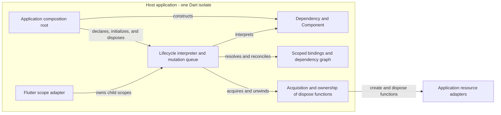
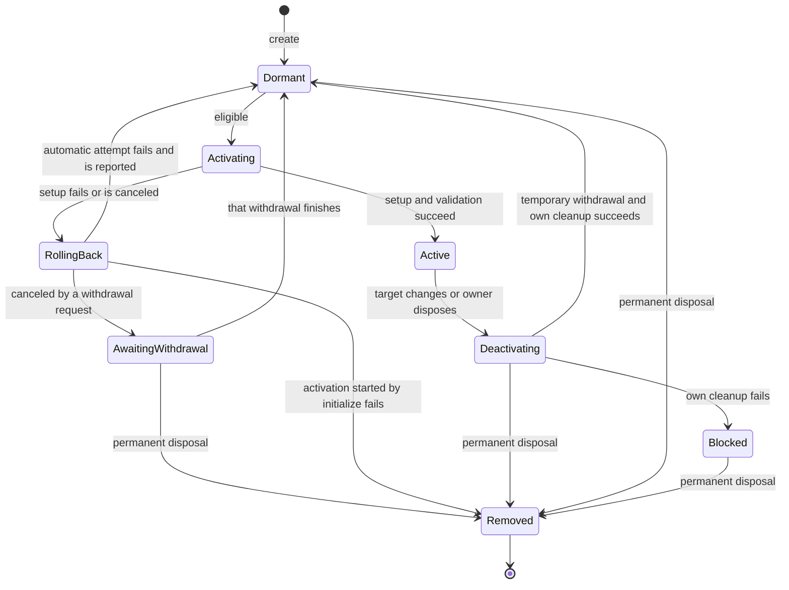
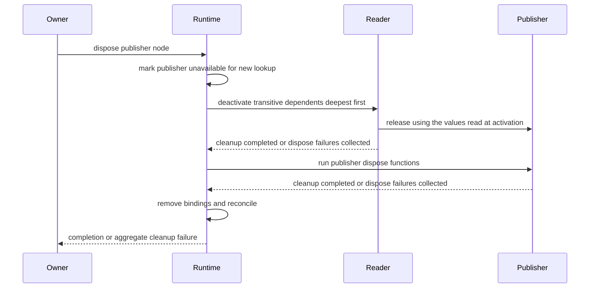
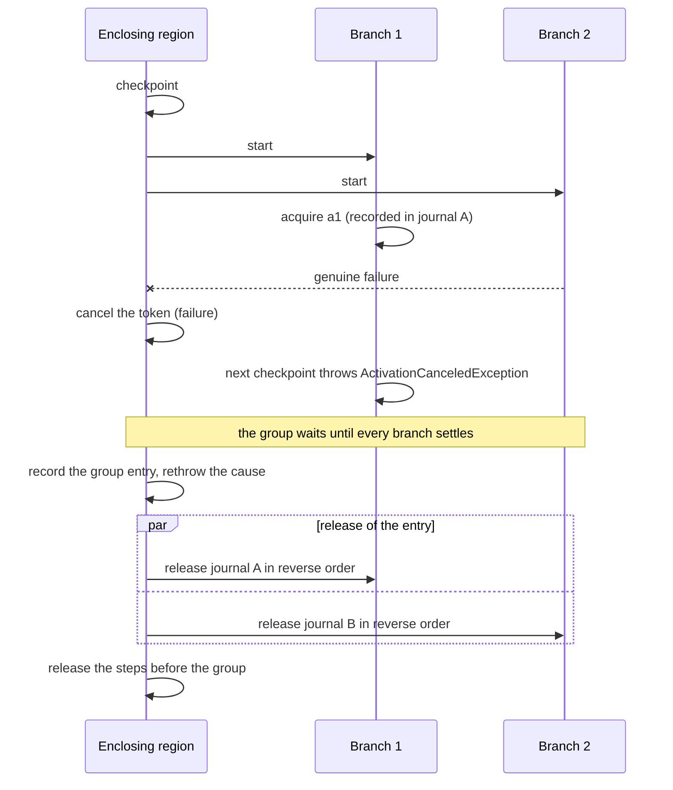
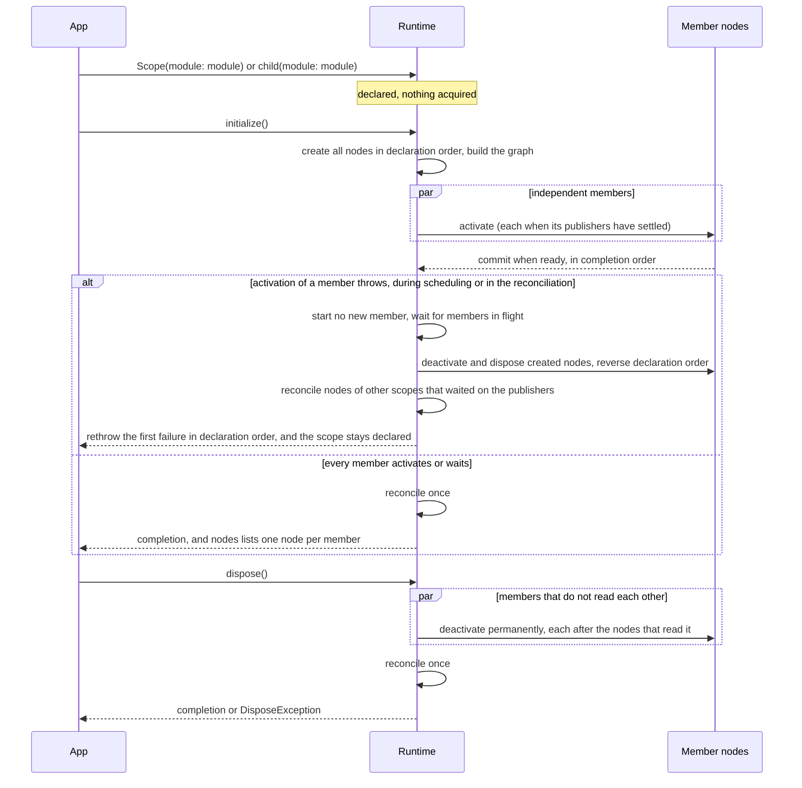
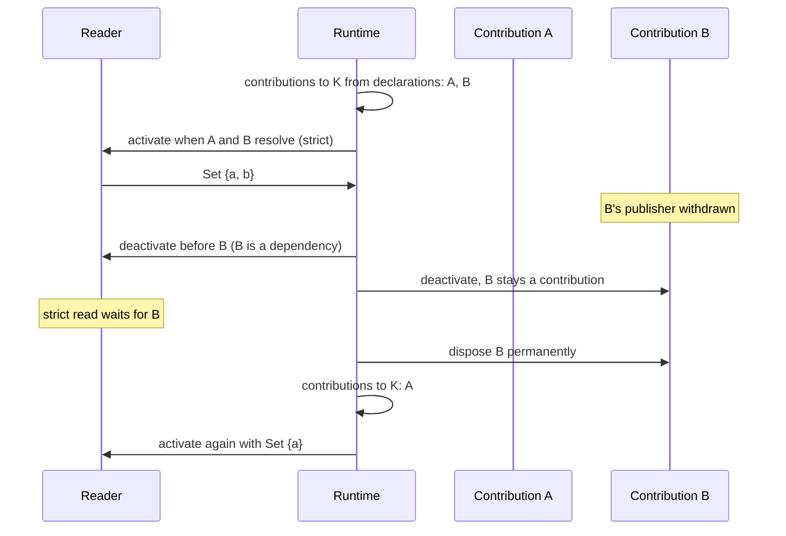
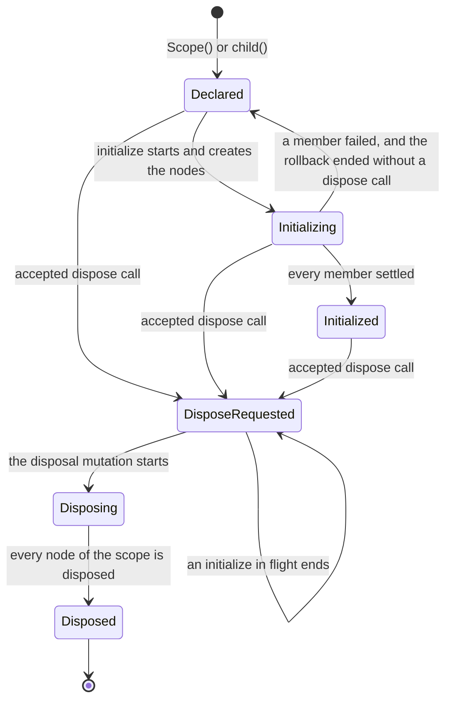
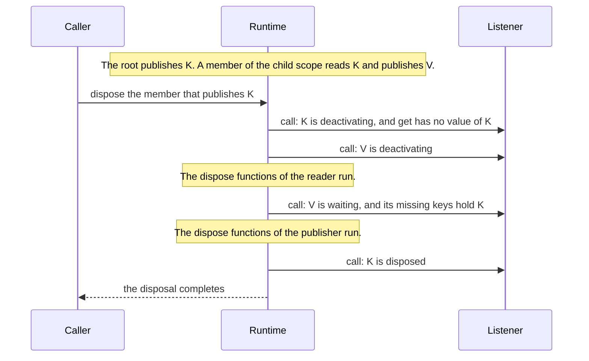

# Runtime Lifecycle Specification

[Requirements](requirements.md) · [Decision log](log.md) · [Known gaps](gap.md)

Architecture: [Project architecture](../../architecture/spec.md).

## Overview

The runtime interprets `Component<A>` descriptions as owned lifecycle nodes.
Tracked dispose functions publish the temporal mechanism; dependency satisfaction and
committed publisher identities publish the spatial mechanism. This Dart adaptation
uses serialized mutations and hierarchical scopes. It is an intended contract
with recorded implementation gaps, not a claim that the paper's proofs apply
to the implementation. The [source mapping](researches/spatiotemporal-composability.researches.md)
distinguishes paper definitions, Dart design choices, and excluded features.

## Glossary

The [lifecycle ontology](../../../ontology/lifecycle.yml) defines the terms
that this spec uses. Each concept node gives one preferred term, one meaning,
and the Dart symbol when a public type exists. This spec owns the behavior of
those concepts. Other topics link the ontology instead of redefining terms.

## Context & Boundaries

The runtime executes inside its host Dart isolate. Application code supplies
components and resource adapters; the runtime owns nodes, bindings,
dependency edges, and registered dispose functions. Flutter is an optional
caller of the Dart-only core.

Only effects whose adapters successfully return dispose functions enter the
ownership boundary. An adapter that allocates and throws before returning a
lease MUST unwind its partial acquisition itself. Releasing a socket does not
reverse messages already emitted. Restoration depends on correct, terminating
dispose functions; the runtime guarantees release attempts and failure
reporting, not reversal of arbitrary user code (paper §6.1, pp. 70–71).

## Constraints & Solution Strategy

- `DiKey<T>(name: name)` identifies bindings by Dart type and optional
  name. A key of a core value type MUST have a name ([Key names](#key-names)).
- A collection key is not a binding. A collection read reduces to plain reads
  of the contribution keys of the collection, so the rules of bindings below hold
  for collections too. [Collection keys](#collection-keys) states the reduction.
- A scope permits one committed binding per key. A child MAY shadow a parent;
  a second local binding fails. A dormant node does not reserve bindings.
  Every binding has a node as its publisher; a value that exists before
  activation enters through `Component.value`.
- A runtime-wide FIFO queue serializes initialization and disposal;
  a cancellation takes effect ahead of the queue but never reorders it.
  Awaiting a lifecycle mutation from inside a running mutation is prohibited.
  A later call does not depend on the zone of an earlier, finished call
  ([Zones of later calls](#zones-of-later-calls)).
- Public lookup sees committed bindings. A component reads only bindings that
  other components committed; it never reads its own staging.
- Publisher comparison uses binding-record identity, not value equality.
- A component publishes its key, `key` or `DiKey<A>()`, when its activation succeeds. An effect and a set contribution publish no key.

## Building Blocks

This **C4 component view** is scoped to one host application runtime. The host
application/isolate is the execution boundary; packages and DI scopes are not
independently deployed C4 containers. Boxes group responsibilities rather than
mapping one-to-one to Dart classes.



| Responsibility | Entry point |
|---|---|
| Typed binding identity, collection keys, and entry keys | [DiKey, DiMapEntryKey, DiSetKey, DiMapKey](../../../packages/fp_di/lib/src/model/key.dart) |
| Component, publication, and live nodes | [Component](../../../packages/fp_di/lib/src/model/component.dart) |
| Key reads and their shape | [Dependency](../../../packages/fp_di/lib/src/model/dependency.dart) |
| Scope API, interpreter, staging, graph | [Scope](../../../packages/fp_di/lib/src/runtime/scope.dart), [runtime](../../../packages/fp_di/lib/src/runtime/runtime.dart), [runtime mutation queue](../../../packages/fp_di/lib/src/runtime/runtime_mutation_queue.dart), [runtime change broadcaster](../../../packages/fp_di/lib/src/runtime/runtime_change_broadcaster.dart), [runtime state](../../../packages/fp_di/lib/src/runtime/runtime_state.dart), [runtime context](../../../packages/fp_di/lib/src/runtime/runtime_context.dart), [state values](../../../packages/fp_di/lib/src/model/state.dart), [slow-mutation report](../../../packages/fp_di/lib/src/model/change.dart) |
| Module value, edits, and shape | [Module](../../../packages/fp_di/lib/src/model/module.dart) |
| Shape export for tool scripts | [ShapeGraph](../../../packages/fp_di/lib/src/model/shape_graph.dart), through [tooling.dart](../../../packages/fp_di/lib/tooling.dart) |
| Acquisition, composition of dispose functions, and memoization (internal leases, `Lazy`) | [lease.dart](../../../packages/fp_di/lib/src/model/lease.dart) |
| Lifecycle errors | [Errors](../../../packages/fp_di/lib/src/model/error.dart) and [exceptions](../../../packages/fp_di/lib/src/model/exception.dart) |
| Caller-owned scope publication | [ScopeProvider](../../../packages/fp_di_flutter/lib/src/scope_provider.dart) |

A `Dependency` states the keys that a component reads and how it creates its
value from them, with an optional `dispose`; it never publishes.
`Dependency(create:, dispose:)` reads no key, `Dependency1` to `Dependency8`
read one to eight, and a chain adds steps. A `Component` is a `Dependency` plus
the key it publishes. A node is a component that a `Scope` declared and
initialized. A `dispose` argument of `Dependency(...)`, `DependencyN`, `map`,
or `mapN` is the only way to define a release, so a value that needs a release
is created on activation. The runtime records each release as an internal
lease; no lease or resource type is public. The activation context is
internal; no public API receives it.

The type name `Dependency` denotes all the reads of one component. A
`DiKeyBase` is one key that a component reads. In prose, a dependency of a
component is a publisher of a key that the component reads.

## Shape Algebra

Write `requires(c)` for required keys, `optional(c)` for optional reads, and
`publishes(c)` for publications. Write `reads(c) = requires(c) ∪ optional(c)` for
all plain reads. The collection reads below add the collection keys to
`reads`. `Component<A>(d)` abbreviates `Component<A>(dependency: d)`, `Component(d)` stands for a component of any
`A`, `Component.effect(d)` abbreviates `Component.effect(dependency: d)`, and `Module([…])` abbreviates `Module(components:
[…])`.

```text
requires(Dependency.require(k)) = {k}          optional(Dependency.require(k)) = ∅
requires(Dependency.maybe(k))   = ∅            optional(Dependency.maybe(k))   = {k}
requires(Dependency.requireN(k1, …, kn)) = {k1, …, kn}
shape(DependencyN(k1, …, kn, create, dispose)) = shape(Dependency.requireN(k1, …, kn))
requires(zip(d1, …, dn)) = requires(d1) ∪ … ∪ requires(dn)
optional(zip(d1, …, dn)) = optional(d1) ∪ … ∪ optional(dn)
shape(zipPar(d1, …, dn)) = shape(zip(d1, …, dn))
requires(Dependency(create, dispose)) = optional(Dependency(create, dispose)) = ∅
shape(map(d, f, dispose)) = shape(lazy(d)) = shape(d)
requires(Component(d)) = requires(d)    optional(Component(d)) = optional(d)
publishes(Component<A>(d)) = {DiKey<A>()}    publishes(Component<A>(d, key: k)) = {k}
publishes(Component.effect(d)) = ∅
requires(Component.effect(d)) = requires(d)    optional(Component.effect(d)) = optional(d)
publishes(m) = publishes(c1) ∪ … ∪ publishes(cn)        for m = Module([c1, …, cn])
requires(m) = ⋃i ( requires(ci) \ ⋃j≠i publishes(cj) )
reads(m)    = ⋃i ( reads(ci) \ ⋃j≠i publishes(cj) )     so requires(m) ⊆ reads(m)
```

An effect keeps the reads of its `Dependency`, so it waits for and reacts to
its keys like any component. A member that must wait for an effect needs a
component that publishes a token type, as a token key orders two members.
A `Dependency` never publishes, so no rule subtracts a publication from a
requirement. A component that requires a key and publishes the same key still
needs another publisher of that key.

A component of `Dependency(create:, dispose:)` reads no key, so it never waits
and is created again only when its own node activates again. The runtime runs
`create` on each activation and never when the component is built. A component
of a `Dependency` that reads keys waits until they resolve and activates again
when a publisher of those keys changes. `map` without `dispose` is a plain
step, and earlier steps keep what they own. `map` with `dispose` adds a
lifetime that is released before the earlier steps.

`Dependency1` to `Dependency8` read `{k1, …, kn}` and pass the values to
`create`, as Provider's `ProxyProvider2` does; each is a `Dependency` of its
value type. `create` is a `mapN` step, with the same `dispose`. They are the
common form; a chain covers several steps, optional reads, and lazy values.
`Dependency.require2` to `require8` read `{k1, …, kn}`. Each key defaults to
`DiKey<T>()`. `mapN` follows the rules of `map`, so it keeps the shape.
`Dependency.require` stays the one-key form; there is no `require1`. A record of
several values follows the functional convention of a product type with one
extension per arity. A record of 2 to 8 `Dependency` values has a `zip` getter
whose shape is the union of the shapes, and a `zipPar` getter with the same
shape. When each value is
`Dependency.require<Ti>()`, the shape equals that of `require_n`.

A `Component<A>` publishes its type argument: without `key`, it MUST publish
`DiKey<A>()`, as a reader's read defaults to `DiKey<T>()` of the required type
(R-UC-RT-LC-026). The type argument states the port, as `Provider<T>` does, so
`Component<Database>(dependency: Dependency(create: PgDatabase.new))`
publishes `DiKey<Database>()`. A `key` replaces the default, and the
constructor MUST throw an `ArgumentError` when its type is not exactly `A`, so
a key of an unrelated type, which inference widens to `Object`, fails where
the component is built.

A member whose value no other member reads is an effect:
`Component.effect(dependency: ...)` publishes nothing. `Component` and
`Component.value` of `void`, `dynamic`, or `Null` MUST throw an
`ArgumentError` that names `Component.effect`, because their default key
publishes nothing that a member can use. A set contribution also publishes no
key, through `Component.into`.

An omitted type argument is a risk. Dart then infers `A` from the
`Dependency`, so a component built from an implementation type publishes
`DiKey<PgDatabase>()`, and a reader of `Database` does not find it there.
`initialize` reports the mistake with `UndeclaredKeyError` only when no member
of the scope and no member declared by an ancestor publishes `Database`. When
an ancestor publishes `Database`, a required read in the child resolves to the
ancestor value without an error. An optional read finds the ancestor value or
gets `null`, also without an error. The initialization check therefore does
not catch every omitted type argument. The examples always write the port as
the type argument: `Component<Database>(dependency: Dependency(create:
PgDatabase.new))`.

`Dependency` values and components are immutable. Each `Dependency` step
computes its shape once when it is built, and `map` and `lazy` reuse
the sets of their source. Shape sets are unmodifiable because
callers share them. A `zip` or a `zipPar` builds the union as a new set. Shape derivation is
not a whole-graph satisfiability proof.

**Collection reads and contributions.** Write `collectionKeys(c)` for the strict
collection reads of a component, `optionalCollectionKeys(c)` for its optional
collection reads, and `contributesTo(c)` for the set key to which it
contributes, empty or one key. A map entry is a publication, so it is in
`publishes(c)`. The module derives `contributes` from `contributesTo`. Collection
reads add the collection keys to `reads(c)`.

```text
collectionKeys(Dependency.requireSet(K)) = collectionKeys(Dependency.requireMap(K)) = {K}
optionalCollectionKeys(Dependency.maybeSet(K)) = optionalCollectionKeys(Dependency.maybeMap(K)) = {K}
requires, optional of a collection read = ∅
collectionKeys(zip(d1, …, dn)) = collectionKeys(d1) ∪ … ∪ collectionKeys(dn)
optionalCollectionKeys(zip(d1, …, dn)) = optionalCollectionKeys(d1) ∪ … ∪ optionalCollectionKeys(dn)
collectionKeys, optionalCollectionKeys of zipPar(d1, …, dn) = those of zip(d1, …, dn)
shape(map(d, f, dispose)) = shape(lazy(d)) = shape(d)        including both collection sets
contributesTo(Component.into(K, d)) = {K}      publishes(Component.into(K, d)) = ∅
reads(c) = requires(c) ∪ optional(c) ∪ collectionKeys(c) ∪ optionalCollectionKeys(c)
requires(m) = ⋃i ( requires(ci) \ ⋃j≠i publishes(cj) )                        unchanged
reads(m)    = ⋃i ( (requires(ci) ∪ optional(ci)) \ ⋃j≠i publishes(cj) )
              ∪ ⋃i ( collectionKeys(ci) ∪ optionalCollectionKeys(ci) )
contributes(m) = { K ↦ |{ i : K ∈ contributesTo(ci) }| : K ∈ ⋃i contributesTo(ci) }
```

A collection read is never subtracted, because an ancestor can add
contributions that the module does not see. It is not in `requires`, because an empty
collection is valid. `Component.reads` and `Module.reads` contain collection
keys. The plain reads of the runtime stay `requires(c) ∪ optional(c)`. `Dependency.lazy`
MUST capture the value of a collection read in its snapshot, as it captures a
plain read.

**Laws.** The rules above give laws over `Dependency`, `Component`, and
`Module` values. Property tests check each law with generated values
([V-T-RT-LC-037](requirements.md#v-t-rt-lc-037)). A module has no `==`, so a
law about modules compares their members and origins.

| Law | Statement | Condition |
|---|---|---|
| Shape of a combination | The shape of `(d1, …, dn).zip` is the union of the shapes; `map`, `map` with `dispose`, and `lazy` keep the shape; the shapes of `((a, b).zip, c).zip` and `(a, (b, c).zip).zip` are equal | None |
| Shape of a module | `publishes(m)` and `requires(m)` follow the rules above, and `requires(m) ⊆ reads(m)` | None |
| Concatenation | `(m1 + m2) + m3`, `m1 + (m2 + m3)`, and `Module.all` of the three have the same members and origins; an empty module on either side of `+` keeps them | Members and origins; the result of `+` has no label |
| Composition | `publishes(m1 + m2) = publishes(m1) ∪ publishes(m2)`, and `requires(m1 + m2) ⊆ requires(m1) ∪ requires(m2)` | None |
| Selection | `requiring` and `withoutRequiring` divide the members in declaration order, no member of `withoutRequiring` requires a key of `keys`, and its `requires` is in `requires(m) ∪ ancestorKeys` | None |
| Functor | `d.map((x) => x)` publishes the value of `d`, and `d.map(f).map(g)` publishes the value of `d.map((x) => g(f(x)))` | The published value of an activation that no cancellation interrupts |
| Reassociation | `((a, b).zip, c).zip` and `(a, (b, c).zip).zip` publish the same values, as `((x, y), z)` and `(x, (y, z))` | As for Functor |
| Reverse release | A disposal runs the dispose functions of a chain of steps, or of a chain of components, in reverse creation order | As for Functor |
| Rollback | When step `j` of a chain throws, no later step runs, and the dispose functions of the earlier steps run in reverse order before `initialize` throws | As for Functor |

A `map` step is a cancellation checkpoint. When a cancellation arrives between
two steps, `d.map((x) => x)` stops where `d` completes, so the functor laws
compare published values and not the steps that run.

## Runtime Behavior

These states abstract runtime flags; they are not an existing Dart enum or the
paper's complete inertial transition system.



| State | Meaning |
|---|---|
| Dormant | The node is not active, and no activation of it runs. The runtime tries to activate it when its required keys resolve. |
| Activating | An activation of the node runs. |
| RollingBack | The activation failed or was canceled, and its dispose functions run. |
| AwaitingWithdrawal | A withdrawal canceled the activation of the node. The node cannot activate until that withdrawal finishes. |
| Active | The node committed an activation. |
| Deactivating | The cleanup of the committed activation runs. |
| Blocked | A dispose function of the node failed during its deactivation. The runtime does not activate the node again. |
| Removed | The node is disposed. |

### Activation and ownership

Activation MUST begin only with satisfied requirements. The steps of one
component run one after another: the `Dependency` reads its keys, then each
acquisition records its release, and the published keys are staged last. The
branches of a `zipPar` are the one exception; they overlap, as
[Composition and concurrency](#composition-and-concurrency) states. A
successful acquisition belongs to that activation until its dispose function
transfers to the committed node or is attempted during rollback. Every lease has one
release responsibility.

Commit publishes staging only after setup and duplicate-key validation.
Failure publishes none and attempts accumulated dispose functions in reverse
order. No public API receives the activation context, so no caller can use it
after the activation ends.

### Memoized resources

`Dependency.lazy()` reads the keys of the `Dependency` at activation, so they
stay tracked, and stages an ordinary owned lease for a `Lazy` holder; the steps
do not run during activation. On the first `force()`, the steps run against the
values read at activation, and what they create is owned by the holder. The
holder's release is the single owner of a later acquisition: it marks the holder
released, awaits any in-flight acquisition, then releases an acquired lease. Its
position in the composition therefore keeps dependent-first and reverse-order
cleanup. Acquisition happens outside the activation transaction, so its failure
belongs to the `force()` caller rather than to activation. The type
distinguishes constructed values (`A`), unowned factories (`A Function()`), and
memoized resources (`Lazy<A>`); lookup never acquires implicitly.

### Cancellation

Cancellation extends the interpreter and the effect layer, not the shape
algebra. Tokens are ambient to an episode and are not dependency keys. They
never enter `requires`, `optional`, or `publishes`. The names follow `package:async`
(`CancelableOperation`, `isCanceled`).

```dart
abstract interface class CancellationToken {
  bool get isCanceled;
  Future<void> get whenCanceled;   // completes once; never errors
}

// A Dependency that reads no key and yields the episode token.
Dependency<CancellationToken> Dependency.cancellation();

// Outside the runtime, such as in a test: a token that is never canceled,
// and a controller whose token its owner cancels.
CancellationToken.none;
CancellationController()..token..cancel();

// A step that stops cooperatively: combine the token with the reads.
(Dependency.require<Api>(), Dependency.cancellation())
    .zip
    .mapN((api, token) => api.open(token), dispose: (s) => s.close());
```

The token of an episode lives as long as the episode: the runtime cancels it
when the disposal of its owner is requested and when the active episode starts
to deactivate. A value that keeps the token, such as a background loop, can
therefore stop when its activation ends.

**Tokens outside the runtime.** A cancelable function that a `create` calls can
also run outside the runtime, for example in a unit test. The public API MUST
offer two tokens for that: `CancellationToken.none`, which is never canceled,
and the `token` of a `CancellationController`, which its owner cancels with
`cancel()`, as a `StreamController` owns its stream. Neither enters the
runtime: an activation always receives its own episode token. `whenCanceled`
never completes with an error, so it can serve as an abort trigger, such as the
`abortTrigger` of a `package:http` `AbortableRequest`.

**Token tree.** Every rollback site is a failure region. Each region has a
`CancellationToken`. The token of a child region is canceled when the token of
its parent is canceled. The token of a region is also canceled when an
unhandled failure occurs in that region.

| Failure region | Parent | Local failures |
|---|---|---|
| Episode root | — | A `create` or a `Dependency` step throws; commit validation fails (duplicate publication or unreachable key) |
| A `Lazy` creation | The episode root of its owner | A step of the deferred `Dependency` throws |

The steps of one activation share one rollback, and no combinator catches a
failure inside it, so these are the only regions. A failure in a `Lazy`
creation stays in that region: it does not cancel or deactivate the owner.
The branches of a `zipPar` are not regions. They run in the enclosing region
and share its token, so a branch failure is a local failure of that region.

A local failure cancels the token of the region **before** the first dispose
function of that region runs. Rollback starts after that. A failure cancels an
enclosing token only when it propagates to that enclosing region. A resource that
catches the failure of its own stage stops the propagation. Library
combinators follow the same rule as adapters.

| Access | Receives |
|---|---|
| Interpreter checkpoints | The token of the enclosing region at every combinator boundary; no API |
| `Dependency.cancellation()` | The enclosing region's token, also inside a `zipPar` branch; `Dependency(create:)` does not read it |
| `Dependency(...)`, `DependencyN`, `map` with `dispose` | Pass the token of the enclosing region to `create` |
| `Dependency.lazy` | A child token of the owning episode's root for each `Lazy.force` creation |

**Notification.** A token is state plus asynchronous notification.
`isCanceled` changes synchronously at the trigger, but `whenCanceled`
listeners run later, like any Dart future listener. The runtime does not
await listeners and does not order them against cleanup; a dispose function can start
before a listener runs. Ordering such as "cancel commands before releasing their dependencies" MUST be
expressed by composition order. Place the canceling dispose function later in the
composition, so LIFO cleanup runs it first.
Synchronous cancellation hooks are excluded until a separate decision.

**Checkpoints.** The interpreter MUST check the token of the enclosing region
before it runs each primitive. The interpreter MUST also check that token before the
next step of a `Dependency` chain, before each `Dependency` of a `zip`, and
before each branch of a `zipPar` starts. After
a token is canceled, no new forward step starts in that region or its descendant
regions. Work in other regions continues. Therefore an adapter that ignores the
token stops the activation at the next boundary after it settles; cooperative
adapters stop sooner. A `map` step is such a boundary: its function may be
asynchronous and, with `dispose`, owns its value, so the interpreter checks the
token before it runs, as for any other step.

**Laws.** Implementations and models MUST preserve:

| Law | Statement |
|---|---|
| Shape invariance | Cancellation does not change `requires`, `optional`, `publishes`, or dependency edges. |
| Monotonicity | The token changes from not canceled to canceled at most once. |
| Down-set | The completed work of a canceled or failed run is a down-set of the composition's precedence order. Rollback runs the dispose function of each completed effect only after the dispose functions of every completed effect that it precedes. Effects that the order leaves incomparable MAY revert in any order or at the same time, under the [independence contract](#independence-contract). Sequential composition is a chain, so its down-set is a prefix `e₁ … e_k` and rollback is `e_k⁻¹ … e₁⁻¹`. The branches of a `zipPar` are incomparable with each other, and each branch is a chain. Teardown follows the same rule. |
| Atomic primitive | A primitive either returns a lease or unwinds its own partial work; there is no half-acquired state. |
| Forward only | Dispose functions are never aborted by the token; release runs to completion. |
| Token before dispose function | Before any dispose function runs, the token of the failure region that acquired its lease is canceled. Workers stopped by that token can then terminate. |

| Trigger | Token canceled | When | Outcome |
|---|---|---|---|
| `ComponentNode.dispose`, `Scope.dispose` of its scope or an ancestor | Root of each owned in-flight episode | Synchronously at the call, before the disposal is enqueued | Rolls back without commit; `initialize` fails with `ActivationCanceledException` |
| Owner disposal requested before setup starts | — | At the request | Setup never runs; `initialize` fails with `ActivationCanceledException` |
| Publisher withdrawal requested: `ComponentNode.dispose` of a publisher | Root of every in-flight episode that reads (declared or already read) the withdrawn publisher or a publisher of one of its active dependents, which the withdrawal deactivates | Synchronously at the call; later reads of such a publisher before the withdrawal finishes complete the reader's root | Rolls back without commit; the reader enters `awaitingWithdrawal` and stays dormant, so an `initialize` that started it still succeeds |
| Local failure in a failure region | The token of that region, then enclosing regions as the failure propagates | At the failure, before any dispose function of the region | Siblings stop early; the original `ActivationException` is reported |
| Deactivation of an active episode (withdrawal, target change, disposal) | Root of the episode | When deactivation begins, before its first dispose function | Memoized acquisitions in flight can stop; cleanup proceeds as specified |

Cancellation is cooperative within a primitive and enforced between
primitives. The runtime does not abort adapter code. A returned lease stays owned. Rollback
waits for every acquisition to settle and then attempts each release once in
reverse order. An adapter that
ignores the token therefore delays settlement and, through the runtime-wide
queue, later mutations. Cancellation never publishes bindings or emits
`nodeActivated` for the canceled episode, so a logout during setup does
not briefly expose a session.

**Ordering.** Cancellation changes how long the canceled prefix is, not where
its dispose function runs. If `e₁ … e_k` completed, rollback applies `e_k⁻¹ … e₁⁻¹`. Activation failure
uses the same prefix inversion (paper Definition 1 and Theorem 16, under their
witness assumptions). The request cancels the token immediately,
but the disposal mutation keeps its FIFO queue position, so the total order
`old rollback ; new setup` holds and no commutation between old dispose functions and
new effects is assumed. Overlapping them would require Definition 42
independence, which shapes cannot establish; for example, a global
cookie-clearing dispose function does not commute with a new login's cookie writes.

**Host obligation.** The queue orders only work inside the runtime. Host
effects performed before `initialize`, such as a login request that stores tokens or
cookies, are outside it. An old session's dispose function can touch shared state that is not keyed by identity.
In that case, the host MUST do one of these:

- Await the old `dispose()` before it starts those external effects.
- Make the dispose function identity-keyed, so that it commutes. For example,
  unregister one session's registrant instead of clearing all registrants.

An activation canceled by owner disposal, publisher withdrawal, or
deactivation is not an activation failure. It does not enter retry
suppression. Owner disposal reports `ActivationCanceledException`.

**Awaiting withdrawal.** A node canceled by a withdrawal request enters
`awaitingWithdrawal(publisher)`. The node exists and stays inactive. The node
MUST NOT be eligible for activation until the mutation that withdraws that
publisher finishes. After that mutation, normal reconciliation decides
eligibility. Public lookup is unchanged: the publisher stays resolvable until
its withdrawal commits. A node that reads a withdrawal-requested publisher later
in the same mutation is also canceled and enters the same state. This state
is separate from retry suppression for activation failures. It prevents a
cancel–reactivate loop while the withdrawal waits in the queue. A failure after
a disposal request is still reported as `ActivationCanceledException` whose
cause preserves the adapter error and stack trace. Dispose failures from the
rollback remain attached, and hosts MUST report them even when they suppress the
cancellation itself.

### Withdrawal and committed views

For every external read, the committed view records the publisher
identity or optional absence at activation. A `Dependency` reads every key of
its shape, so every read is recorded. Required and optional reads
MUST remain distinct for eligibility.



A reader's release can use the values its `Dependency` read, because the
publisher releases only after its dependents. Publisher release MUST wait for
dependent release attempts. Cleanup failure MUST NOT skip other dispose
functions; only a node's own cleanup failure blocks its automatic reacquisition.
Permanent disposal disposes the owner even if cleanup reports failure.

### Reconciliation and stability

`resolve(scope, key)` selects the nearest available binding. A node's target is
absent if a required external key is missing; otherwise it is the tuple of
resolved identities for its declared external reads, including optional
absence. A missing required external key makes the node wait.

Reconciliation MUST include target changes caused by its own activations and
withdrawals. Each pass rebuilds the active nodes whose targets changed, then
activates the eligible dormant nodes, and the next pass starts only while an
activation of the previous pass changed the target of an active node. At
successful quiescence, active committed targets equal resolved targets;
eligible nonblocked dormant nodes activate or report activation failure.
Unchanged targets MUST NOT cause a deactivation or an activation. Progress assumes finite stable
structure, no obstructing cycle, and terminating callbacks.

An acyclic read graph settles within one pass per node. Optional reads that
feed back into each other are not guaranteed to converge, so a reconciliation
MUST stop after `nodes + 1` passes with a `DependencyCycleError.unsettled` of
the nodes that are still stale. When a stale node is a member of the
`initialize` call that runs the reconciliation, the call fails with that error
and rolls back, like a wiring mistake that `initialize` finds before it starts.
Otherwise the error is reported as the `cause` of an `ActivationException` on
`Scope.errors`, and the initiating mutation succeeds.

A failing activation started by `initialize` disposes the nodes of that call and fails it.
Automatic activation failures leave the node dormant, are suppressed for the
remainder of a reconciliation, and are reported through lifecycle errors without
failing the initiating mutation. The current Dart profile permits another
attempt during a later mutation. This differs from the paper's terminal inactive
error outcome (§4.4, p. 56); its failure-recovery results are not imported.

### Composition and concurrency

The steps of one component run in composition order and release in reverse
order. A `zip` runs its `Dependency` values left to right. No step of one
component overlaps another step of the same component, except the branches of
a `zipPar`. Other independent work overlaps only across nodes: the members of a
module activate along their reads, as
[Scope declaration and initialization](#scope-declaration-and-initialization)
states, and the nodes of a disposed scope release along the reverse of their
committed reads.

**Concurrent branches (`zipPar`).** A record of 2 to 8 `Dependency` values
has a `zipPar` getter beside `zip`. The two getters have the same shape and the
same result type. The interpreter starts the branches in record order and MUST
start each one before it awaits any branch. It checks the token of the
enclosing region before each start, as **Checkpoints** require. A started
branch can cancel the token synchronously: its first step can throw, or a
listener of a synchronous event can dispose the owner. Then no later branch
starts. A branch that does not start runs no step, owns an empty journal, and
yields no value; the group waits for the started branches and fails as
**Failure of a branch** states. Each branch runs its own steps in order. It records its releases in a branch journal, which is
a list of releases in acquisition order, like the cleanup list of an
activation. A
read in a branch is tracked on the node like any other read. The group waits
until every branch settles. Then it yields the values in record order, whatever
order the branches completed in. The branches share one Dart isolate, so they
overlap only at asynchronous gaps. Synchronous work in a `create` delays the
other branches.

```dart
// DependencyRecord2 to DependencyRecord8 add zipPar beside zip.
Dependency<(A, B)> get zipPar;

// One genuine failure of a zipPar branch.
final class BranchFailure {
  final Object error;
  final StackTrace stackTrace;
}

// ActivationException.branchFailures and
// ActivationCanceledException.branchFailures: List<BranchFailure>,
// empty unless more than one branch failed genuinely.

// Usage: two owned connections open at the same time.
(
  Dependency1(create: Database.open, dispose: (db) => db.close()),
  Dependency1(create: Search.connect, dispose: (s) => s.close()),
).zipPar.mapN(Storage.new);
```

**Ownership at the join.** The group records one entry in the journal of the
enclosing region, at the position where the group settles. The entry holds the
branch journals in record order. The steps before the group release after the
entry, and the steps after the group release before it. A release of the entry
MUST start the release of every branch at the same time. Each branch releases
its own journal in reverse order. The entry finishes when every branch release
finishes. Its dispose failures follow reverse record order, whatever order the branches
finished in. Inside one branch, the dispose failures follow its release order. The same
entry runs in a rollback, so a failed activation also releases the branches at
the same time. Inside `lazy()`, the entry is in the journal of the `Lazy`
creation. When the enclosing activation is already closed at the join, the
group releases its branches at once and reports the dispose failures as rollback failures,
as `acquire` does for a late lease.

**Failure of a branch.** A branch that throws a genuine failure MUST cancel
the token of the enclosing region at once, with the failure reason. The other
branches stop at their next checkpoint, and a cooperative `create` stops sooner.
The group MUST wait until every branch settles before it rethrows, so no dispose
function starts while a branch can still acquire. An acquisition that returns
after the cancellation is recorded in its branch journal and released once. The
group then records its entry and rethrows, and the rollback of the region runs
as usual.

The outcome MUST follow the reason of the cancellation, not only its state. A
genuine branch failure cancels the token with the failure reason, and the
activation then fails with `ActivationException`. Only the owner reason yields
`ActivationCanceledException`, and only the withdrawal reason makes the node
wait for the withdrawal. A runtime that reports every canceled token as a cancellation would
misreport a branch failure; [G-RT-LC-008](gap.md#g-rt-lc-008) records that the current
`activate` does so.

The reported cause is the first genuine failure in record order. An
`ActivationCanceledException` that a checkpoint raises because of the token is
not genuine. `branchFailures` lists the other genuine failures in record order.
A nested group lists its own failures at the place of its branch. When owner
disposal or a withdrawal canceled the token before any genuine failure, the
outcome stays `ActivationCanceledException`. Its `cause` is then the first
genuine failure in record order, if any, and its `branchFailures` lists the
others. A failure in the branches of a `Lazy` creation stays in that region,
as any other failure of the creation does.



The branches of a `zipPar` MUST be independent, as the
[independence contract](#independence-contract) states for every overlap.
Branch journals keep the order inside each branch, but they do not record the
interleaving of effects across branches. The
[research](researches/parallel-dependency-effects.researches.md) shows two
interfering branches that no branch-wise cleanup order restores. Branches whose
effects are not independent MUST use `zip`, or move into components connected
by a token key.

**Concurrent teardown.** `Scope.dispose` releases the nodes of the scope and
its descendants through `_Runtime._releaseOwned`. A node starts its release when
every node that read one of its values has finished, so a release MUST run
while the values it read are alive. Nodes that do not wait for each other
release at the same time. A reader of a node lives in its scope or a
descendant, so every dependent is in the disposed set. A read cycle leaves no
node ready; then the node created last starts alone, and `deactivate`
releases its live dependents depth first, as a sequential teardown does; the
scheduler checks readiness again only when that call returns, so nothing else
starts meanwhile. The scheduler is `RuntimeTeardownScheduler` in
[runtime_teardown.dart](../../../packages/fp_di/lib/src/runtime/runtime_teardown.dart). The
`DisposeException` lists dispose failures in reverse creation order, whatever order the
releases finished in; the dispose failures of a cycle fallback follow its depth-first
order at the place of the node that started it. A listener observes the
ends of the releases in completion order. The
rollback of a failed `initialize`, `ComponentNode.dispose`, and a withdrawal
deactivate dependents one after another. Paper basis: LIFO needs valid dispose
function witnesses but no additional independence hypothesis (Theorem 16).
Arbitrary release order needs pairwise independence (Theorem 43), which
concurrent activation already assumes; across nodes the reads carry the order
(p. 30, §4.2.2). Even the sequential teardown released concurrently activated
members out of their completion order, so it relied on the same independence.
[Teardown.tla](../../../verification/tla/teardown/Teardown.tla) checks the
ordering.

#### Independence contract

The key test that schedules module members is **not proof of effect
independence**. Definition 42 also requires commutation of an effect with a
dispose function and stability of the dispose function selected in another
effect's presence (§3.4.1, p. 27).
Three mechanisms overlap effects that have no order between them:

| Mechanism | Effects that overlap |
|---|---|
| `initialize` | Members without a read path between them |
| `Scope.dispose` | Nodes that do not wait for each other |
| `zipPar` | Steps of two different branches |

Every pair of such effects MUST be independent. The paper gives a sufficient
condition (Theorems 45 and 47, pp. 29–30). Write `K(e)` for the keys at which
effect `e` operates, `P(e)` for the keys that `e` provides, and `C` for the
keys whose published interface is commutative (Definition 44). Then:

```text
K(a) ∩ K(b) ⊆ C,   P(a) ∩ K(b) = P(b) ∩ K(a) = ∅,
and a, b reach shared state only through keys
  ⇒  a and b are independent                                 (Theorem 47)
  ⇒  their dispose functions restore the state in any order  (Theorem 43)
```

The second premise holds for each mechanism of the table above. A member
publishes its key when it commits, and a step of a `Dependency` publishes no
key. Two members of `initialize` without a read path do not read the key of
each other, and neither do two nodes of `Scope.dispose` that do not wait for
each other.

`K(e)` includes the keys that `e` reaches through a value that it read. An
effect that writes through a repository also operates at the database key that
the repository holds. The condition is sufficient, not necessary. An author MAY
show Definition 42 directly, for example for two effects that only query one
key.

The contract divides three roles. The roles name obligations; the runtime
computes no `K` and no `C`, and it checks neither.

| Role | Obligation |
|---|---|
| Publisher of a key | States whether the interface of its value commutes (p. 29). A set of listeners commutes; one ordered chain does not. |
| Author of an effect | Reaches shared state only through keys, gives each `create` a `dispose` that is its witness (Definition 8), and orders two effects that are not independent with a read edge, a token key, or `zip`. Two effects that share a key outside `C` count as not independent unless the author shows Definition 42 directly. |
| Runtime | Keeps every order that reads, token keys, `zip`, and the steps of one component express for the effects that run at activation, releases in reverse of that order, and overlaps only effects without an order |

Overlapping effects that meet the contract MAY activate and release in any
order. Effects that do not meet it MUST receive an order, and that order also
fixes their reverse release.

**Deferred effects.** `lazy()` places a holder in the step order, but the
effects of its `Dependency` run at the first `Lazy.force`. That call can come
from a later step of the same activation or at any time after the owner
commits. Reads, token keys, `zip`, and step order fix the position of the
holder, not of the deferred effects. The deferred effects release with the
holder: after the steps that follow the holder in the same component, and
after the dependents of the owner. Those effects can run before the deferred
effects, so the release order is then not the reverse of the actual order.
Two `dispose` functions that each restore a saved value of one key show it:

```text
(A.lazy(), B).zip      A and B each save the value of one key and restore it
B create   0 → 2       B saves 0
A force    2 → 1       A saves 2
B dispose  1 → 0       the holder of A releases after B
A dispose  0 → 2       the initial value 0 is not restored
```

A deferred effect MUST therefore be independent of the later steps of its
component and of the effects of the owner's dependents. `zip` alone does not
order it against them. Placing the holder after the steps that it interferes
with orders it inside the component, because no `force` can run before its
holder exists. No composition orders a deferred effect against the
dependents of its owner. The
[lifecycle notes](../../../packages/fp_di/doc/lifecycle.md#effects-that-overlap) of `fp_di` state the
contract as patterns. The
[decision](log.md#2026-11-09-decision--keep-effect-independence-an-author-obligation-stated-as-patterns)
records why the runtime does not check it. The
[effect independence research](researches/effect-independence.researches.md)
maps the theorems to fp_di.

Components of separately initialized scopes sharing mutable state also need
independent dispose functions or dependency ordering: queue serialization alone
does not prove safe selective removal. Serialization covers runtime mutations
only; see the host obligation under [Cancellation](#cancellation) for effects issued
outside the queue.

### Scope declaration and initialization

A scope takes its contents when it is created and creates them in one later
call. `Scope(module: module)` declares a root and `scope.child(module:
module)` declares a child. Nothing is acquired until `initialize()`. The
contents are fixed: no call adds a component to an initialized scope, and a new
set of components is a new child scope. Disposal releases the scope, its nodes,
and its descendants.

```text
declared ──initialize()──▶ initialized ──dispose()──▶ disposed
   │  ▲                                                  ▲
   │  └── failure: rollback, stays declared ─────────────┤
   └──────────────────────dispose()──────────────────────┘
```

A `Module` is an immutable list of components with an optional `debugLabel`.
`Module.all` and `+` concatenate modules and keep the order. `replacing`,
`without`, `where`, and `overriddenBy` return a new module and keep the
position of each remaining member. `overriddenBy` only replaces: an override
whose key no member publishes is rejected, so a fake for a moved or misspelled
key fails instead of being added. `publishes`, `requires`, and `reads` are the derived shape of
a module, as [Shape Algebra](#shape-algebra) states. `requires` is what an
ancestor scope must publish for the members that require those keys to activate.
The application chooses members with plain Dart conditionals; the runtime has no
profile concept.

**Members that require absent keys.** An application variant can have no
publisher for a key, for example a service of one platform. `initialize`
throws `UndeclaredKeyError` for a member that requires such a key. A module
without that member has no publisher for the key of that member, so the
members that require that key fail the same check.
`requiring(keys:, ancestorKeys:)` returns all of those members as one module,
and `withoutRequiring` returns the module without them
([R-UC-RT-LC-031](requirements.md#r-uc-rt-lc-031)). The caller names the keys,
so the runtime still has no profile concept.

```text
absent := keys
result := no member
repeat until no member joins:
  a member that requires a key of absent joins result
  the key that the member publishes joins absent,
    unless ancestorKeys holds that key
```

```dart
final absent = {const DiKey<Camera>()};
final root = Scope(module: all.withoutRequiring(keys: absent));
// A test compares the removed members with an expected list.
final removed = all.requiring(keys: absent).components;
```

An absent key is a key of `keys`, or a key that a member of the result
publishes and `ancestorKeys` does not hold. The term belongs to this search:
`initialize` names a required key without a declaration an undeclared key.
`keys` and `ancestorKeys` are each an `Iterable<DiKeyBase>`, as `components`
of `Module` is an `Iterable`. `ancestorKeys` is optional and holds no key by
default.

The result of `requiring` is the smallest set of members that these rules
give. The two results together hold each member of the source one time. Each
result keeps the declaration order, the origin of each position, and the
`debugLabel`, as `where` does.

The search reads `requires` of each member, the reads that the
[resolvability check](#scope-declaration-and-initialization) of `initialize`
reads. An optional read gets `null`, and a collection read gets a collection
without the removed contribution, so neither read puts a member in the
result. The key of a map entry is a published key, so a member that requires
that entry key joins the result with the entry.

`ancestorKeys` holds the keys that an ancestor scope also publishes. A
removed member that publishes such a key shadowed the ancestor, and the
readers of that key then read the value of the ancestor, so they stay.
`ancestorKeys` does not take a key out of `keys`. A member that requires the
key that it publishes reads that key from an ancestor. A caller that removes
such a member lists the key in `ancestorKeys` to keep the other readers of the
key.

A member that publishes a key of `keys` is not in the result for that reason,
and each member that requires that key is. A key that two members publish
becomes an absent key when one of them joins the result. A key that no member
requires and a collection key change no result. Neither call throws: one
set of absent keys serves the modules of several scopes, so a key that no
member of one module requires is not a mistake.

Two properties hold for the result of `withoutRequiring`. No member of that
result requires a key of `keys`. Each key in `requires` of that result is in
`requires` of the source or in `ancestorKeys`. `withoutRequiring` therefore
adds no required key that the caller did not name. The rule for a key that two
members publish keeps the second property: a remaining publisher that requires
its own key would otherwise add that key.

A child scope reads the keys of its ancestors. A member that a parent scope
removes therefore gives no key to the members of a child scope that require
its key. The call for the module of the child gets two sets. Its `keys` holds
the keys of the call for the parent and the keys that the removed members of
the parent publish. A key in `ancestorKeys` of the call for the parent is not
in that set. Its `ancestorKeys` holds the keys that the remaining members of
the parent publish, and the keys in `ancestorKeys` of the call for the parent.

```dart
// `all` is the module of the root, and `session` is the module of a child.
final removed = all.requiring(keys: absent);
final sessionModule = session.withoutRequiring(
  keys: {...absent, ...removed.publishes},
  ancestorKeys: all.withoutRequiring(keys: absent).publishes,
);
```

A key of `keys` removes its readers also when a member of the child publishes
that key. The rule removes a member of the child that requires the key that it
publishes, because that member reads the key of the removed member. The rule
also removes the readers of a key that a member of the child publishes and
does not require. A caller that keeps those readers leaves that key out of
`keys`. No member of `Module` computes the keys for a child scope.

`withoutRequiring` removes members. It does not state which members of a
scope wait: a member that stays in a scope and waits also keeps the strict
readers of its collection waiting, and `NodeState.missing` states those. The
search keeps an
index from each required key to the members that require it and reads each
absent key one time, so the time is near-linear in the members plus their
required keys.

`origins` states the origin of each member, by index: the `debugLabel` of the
module whose constructor listed the member, or null. `Module.all` and `+`
keep the origin of each member. `Module.all` takes an optional `debugLabel`,
which labels the result and is the origin of no member; the result of `+` has
no label. An edit keeps the origin of each position, so a replacement has
the origin of the member that it replaces. The unnamed constructor gives every member the label
of the new module, so `Module(components: other.components)` does not keep the
origins of `other`. Only the [shape export](#shape-export) reads an origin; the
runtime MUST NOT read it.

`Scope.module` returns the module that the scope was created with
([R-UC-RT-LC-029](requirements.md#r-uc-rt-lc-029)). Each read returns the same
object, and a scope that was created without a module returns an empty module.
The read answers in every phase, also after the disposal, and starts no
mutation. The module holds the declarations of that scope only. A scope gives
no handle of its parent, so a caller that needs the declarations of an
ancestor holds that scope. `publishes`, `requires`, and `reads` of the module
state declared keys, not the keys that resolve now. A required key that an
ancestor publishes is in `requires`, and it is not in the `missing` keys of
the member.

A scope refers to its module as a Flutter `Element` refers to its
[`widget`](https://api.flutter.dev/flutter/widgets/Element/widget.html): the
instance gives its declaration. A scope does not take a new module, so the
reference does not change. The `ScopeState` of a scope holds the same module,
as [State of the runtime](#state-of-the-runtime) states.

| | One `Component` | Members of a scope |
|---|---|---|
| Nodes | One node | One node for each member |
| Dormancy | All or nothing | Each member waits on its own `requires` |
| Reconciliation | The node reactivates as a unit | Each member reactivates by itself |
| Concurrency | Only the branches of a `zipPar`; other steps run in order | Independent members overlap |
| Visibility | Every published key at one commit | Each member's keys at its own commit |

`initialize()` runs one mutation. It MUST create a node for every member in
declaration order before it activates any member. It then activates the
members by dependency and MUST reconcile once at the end. Reconciliation
repeats until no dormant member can activate. A member that first activates
during that reconciliation and throws fails the call, as a member that throws
earlier does. A node of another scope keeps the reconciliation rules: its
failure is reported through lifecycle errors and the call succeeds.

`initialize()` completes with the scope, so a caller can declare and
initialize in one expression.

**Resolvability.** The declarations of a scope and its ancestors are fixed, so
`initialize()` can tell which required keys can never resolve. Before it creates
any node, it MUST throw `UndeclaredKeyError` when a member requires a
key that no other member and no member declared by an ancestor publishes. An
ancestor counts whether or not it is initialized, so a child may still
initialize first. A member that publishes the key itself does not count, because
a component never reads its own publication. Optional reads are not checked,
because they do not block activation. The error names each member and key; a
missing `key:` on the intended publisher is the usual cause. Dormancy therefore
means waiting for a declared publisher: an ancestor that has not initialized, or
a publisher that was withdrawn. `initialize()` on an initialized scope MUST
throw a `StateError`. On a disposed scope it MUST throw `DisposedScopeError`. A
child MAY initialize before its parent. Its nodes then wait, and they activate
when the parent initializes and publishes their keys. A scope that initializes
later between a node and its current publisher shadows that publisher, so the
node rebinds. These two orders are the only way that a publisher appears for an
existing node.

**Scheduling.** The runtime builds the dependency graph of the members from
their derived shapes. Member M depends on member P when P publishes a key that M
reads. A member starts when every member it depends on has
settled. A member settles when its activation returns, committed or dormant. A
dormant publisher cannot block a dependent, because the dependent is then
dormant when it requires the key, or runs without the key when it only reads
it optionally. A member with no dependency starts at once, so independent members overlap.
The declaration order does not change the schedule, so a member can depend on
a later member.

| Case | Rule |
|---|---|
| Members publish the same key | `initialize` throws `DuplicateKeyError` with the key and the member labels before it creates a node. |
| Dependencies form a cycle | When no member is in flight or ready, the runtime starts the first unstarted member in declaration order. The result equals a sequential activation of that part. |
| A member needs the effect of another | The other member publishes a token key, and the member requires it. The keys are the only order, so the need also holds on reactivation and teardown. |

**Commit order.** A member publishes its bindings when its own activation
succeeds. A dependent never starts before its publishers commit. The commit
order of independent members follows completion order and is not
deterministic. A listener observes the commits in commit order.

**Teardown order.** Three orders apply, and each has one owner:

| Teardown | Order of the releases | Order of the dispose failures |
|---|---|---|
| Rollback of a failed `initialize` | Sequential, reverse declaration order; each deactivation withdraws the dependents of a node before the node itself (R-UC-RT-LC-003), so a dependent declared before its publisher releases first | Release order |
| `Scope.dispose` | Along the reverse of the committed reads, as **Concurrent teardown** states: dependents first, unrelated nodes at the same time, a read cycle depth first from the node created last | Descending creation order of each started call; a call of the cycle fallback lists the nodes it released in their release order (R-UC-RT-LC-021) |
| `ComponentNode.dispose`, a withdrawal | Sequential: dependents first, in descending id | Release order |



**Failure policy.** Dormancy is not failure; an undeclared required key is, as
**Resolvability** states. A throw in the activation of any
member makes the call atomic, and the outcome MUST NOT depend on declaration
order. The throw can happen while the members activate or when a member first
activates during the closing reconciliation. After a throw during activation,
the runtime MUST start no further member. It MUST wait for every member in
flight to settle before it rolls back, because a late commit into an
disposed node would leak its bindings. A sibling in flight is not
canceled: it finishes and then the rollback deactivates it. Each member is
its own failure region, so the failure of one member cancels no other; only a
disposal or withdrawal request does. The runtime captures the reconciliation failure of its
own members instead of reporting it through lifecycle errors. If several
members fail, the first in declaration order is rethrown, even when another
member failed earlier in time. The runtime MUST deactivate and dispose every
node that this call created, including dormant ones, in reverse declaration
order, and MUST then rethrow the original error. If releases of the rollback
fail, the runtime MUST throw an `ActivationException` whose `rollbackFailures`
contain those dispose failures after the member's own rollback failures. No node stays
in the runtime, the scope stays declared, and a later `initialize` MAY retry.
A disposal that was requested before the rollback ended is the exception: the
scope is disposed, as [State of the runtime](#state-of-the-runtime) states. After
the rollback the runtime reconciles again. A node of a descendant scope that the
bindings woke has released with them, so it is dormant. Failures of nodes of
other scopes keep the [reconciliation](#reconciliation-and-stability) rules: they are
reported and the call succeeds. Listeners have observed the transitions of the
members that the call created, also of the members that activated before the
failure. [State of the runtime](#state-of-the-runtime) lists them.

**Rollback failures of several members.** When several members fail, the
first in declaration order is the error, and the rollback failures of every
failed member are attached to it, so no rollback failure is lost. A failed
`Lazy` creation likewise keeps its cause with the failures of its own
rollback; when it settles after its owner's release began, the caller of
`force` gets `DisposedLazyException` and the rollback failures join the owner's
`DisposeException`.

**Keys.** Two members of one scope that publish the same key make
`initialize` throw `DuplicateKeyError` before it creates a node, and the error
lists the labels of those members. The scope contents are fixed, so no later
binding can conflict. Commit still checks a second binding as a guard. A child
scope MAY shadow a parent binding.

**Member nodes.** `Scope.nodes` MUST list one `ComponentNode` for each
declared member in declaration order after `initialize`, and MUST be empty
before it. `Scope.node(key:)` MUST return the node of the member that
publishes the key, typed as the key, so a caller does not depend on the
declaration order. It MUST throw a `StateError` before `initialize` and an
`ArgumentError` when no member publishes the key. `Scope.node(key:)` reads the
members of the scope only. `Scope.findNode(key:)` reads the scope and its
ancestors, as `get` does, so the two names differ. The list is unmodifiable. A
member node reads the member value, reports whether the member is active, waits
for it, and disposes the member alone. An inactive member node throws
`InactiveNodeException` with the missing keys while the member is dormant,
and with no keys after disposal. Disposing one member MUST withdraw its
bindings, MUST deactivate its dependents first, including dependents in the same
scope, and MUST reconcile once. A dependent that went dormant activates again
only when a scope that initializes later publishes the key. The other members
and the scope stay valid.

**Disposal.** `Scope.dispose` MUST dispose the nodes of the scope and its
descendants that are not disposed yet, inside one mutation, in
the teardown order of **Concurrent teardown** (R-UC-RT-LC-021). The runtime MUST skip a member that its own node
already disposed. It MUST NOT deactivate that member again. Dependents in other
scopes deactivate before their publishers, as for any withdrawal. The runtime
MUST then reconcile once and aggregate dispose failures in one `DisposeException`.
A second disposal MUST NOT release anything again. While the disposal runs,
until its whole mutation finishes, including after the scope is marked
disposed, a second call MUST complete with its result, including its
`DisposeException`, so a host that awaits any `dispose()` call knows that the
cleanup finished. A call after the disposal finished completes at once. A call while an
ancestor disposes the scope completes with the ancestor's disposal. A call from
inside a running mutation fails with `ReentrantMutationError` before it
shares a disposal in progress, cancels anything, or marks the scope: the
disposal in progress can be the mutation the call runs in, so sharing it
would wait for itself.

### Key names

Dart erases an extension type to its representation type at run time. The
type argument of `DiKey<PoolSize>` is therefore `int`, and the key equals
`DiKey<int>()`. Two extension types over `int` would publish one key, and a
single one would serve every reader of `int` without an error. No runtime
check can tell the types apart, so the name carries the identity.

The core value types are `bool`, `int`, `double`, `num`, `String`, `BigInt`,
`DateTime`, `Duration`, `Uri`, `Symbol`, and `Object`, each also in its
nullable form. The `Component` constructor checks its key and every `DiKey`
in `requires` and `optional` (R-UC-RT-LC-025). A `DiKey` without a name of a
core value type MUST fail there with an `ArgumentError`, as a key of the wrong
type does. Collection keys and map entries always have a name, so the check
skips them. An extension type over another type, such as a `Map` or a class,
still aliases its representation type; the core set holds the types that
extension types wrap most often.

An extension type states its named key once, next to its type:

```dart
extension type const PoolSize(int value) implements int {
  static const key = DiKey<PoolSize>(name: 'PoolSize');
}
```

### Collection keys

A collection key collects the values of many contributions into one read value.
[R-UC-RT-LC-018](requirements.md#r-uc-rt-lc-018) and R-UC-RT-LC-019 state the contract. The
runtime implements it as a reduction to plain keys, so bindings, resolution,
withdrawal, and scheduling do not change their rules.

**Keys.** `DiSetKey<T>(name: ...)` and `DiMapKey<T>(name: ...)` implement
`DiKeyBase`. Their `type` is `T`, and their `name` is required.
Equality MUST compare the kind, `T`, and the name, so a set key, a map key, and
a `DiKey` of one type and name are three keys. `DiMapKey.entryKey(id)` returns a
`DiMapEntryKey<T>`, a subtype of `DiKey<T>` that carries its map key and its
id. The equality of a `DiMapEntryKey` MUST compare the map key, and the
equality of a plain `DiKey` MUST reject a `DiMapEntryKey`. An entry therefore
equals no plain `DiKey` and no entry of another map key.
`DiKey.==` MUST accept only a `DiKey`: a structural match against another
`DiKeyBase` would make a collection key equal a plain key.

**Contributions.** `Component<T>.into(key: setKey, dependency: d)` builds a
component that publishes no key and contributes its value to `setKey`. The runtime gives
each declared contribution an internal contribution key that is unique to that
declaration. A contribution publishes under its contribution key when its
activation succeeds. A map entry is an ordinary component with
`key: map.entryKey(id)`. Both kinds are therefore one binding of one key in one
scope.

**Membership.** For a reader in scope `s`, the membership of `K` is the set of
declared contributions to `K`, or declared entries of `K`, in `s` and its
ancestors that are not disposed. The scope contents are fixed, so membership MUST be
computed from declarations, including those of an ancestor that is not yet
initialized. Membership only shrinks: a contribution that is disposed by itself
leaves it. The disposal of a scope also disposes every reader that can see the
contributions of that scope, so it changes no remaining reader. A component's own
contribution MUST NOT be in the membership of its own read, because a component never
reads its own publication.

**Reduction.** A read of `K` expands to plain reads of contribution keys:

| Read | Expands to |
|---|---|
| `requireSet(K)` | `require` of the contribution key of each set contribution |
| `maybeSet(K)` | `maybe` of the contribution key of each set contribution |
| `requireMap(K)` | `require` of `K.entryKey(id)` for each declared id |
| `maybeMap(K)` | `maybe` of `K.entryKey(id)` for each declared id |

A map id resolves as `Dependency.require(K.entryKey(id))` does: the nearest
available entry. A shadowed entry is never awaited, and a dormant nearer entry
falls back to an available ancestor entry. The value is built from the
resolved publishers: a `Set<T>` or a `Map<String, T>` in the order of the
contributions, ancestors first, then declaration order. A set element keeps the
position of its first contribution, and an id keeps the position of its first
declaration.



**Target and edges.** The expansion MUST use the current membership each
time the runtime computes the satisfaction or the target of a reader. A node
MUST NOT capture the contribution keys when it is created, because a disposal
removes a contribution key that a strict read would otherwise wait for forever. The
committed view of a reader records the resolved
publisher of each contribution key that it read, as for a plain read. The target of
a collection read is the membership with the resolution of each contribution key.
Reconciliation MUST rebuild the reader when the membership or a resolved
identity changes. Each resolved contribution publisher becomes a dependency of the
reader, so withdrawal deactivates the reader before the contribution, and the
release of the reader can use the values that it read. A strict read is
satisfied when every contribution key resolves. Otherwise the reader waits, and an
active reader deactivates, as for a missing required key. The check that
cancels an activation in flight when a withdrawal is requested MUST use the
current expansion too. A reader that has not yet read its collection MUST
therefore be canceled when the disposal of one of its contributions is requested,
as a plain reader of the key of that contribution is.

**Initialization.** The scheduling graph treats a contribution key like any other
key: a reader of `K` starts after every other contribution to `K` in its own scope
settles. Its own contribution is not in its membership, so the reader does not wait for
itself. The duplicate check covers entry keys, so two entries of one id in
one scope throw `DuplicateKeyError`. A contribution key is unique by construction.
The resolvability check MUST skip collection reads, so `UndeclaredKeyError`
never names a collection key.

**Observation.** `missing` lists a strict collection key while one of its
contribution keys does not resolve. `describe` states that a set contribution
contributes to its set key. The `NodeState` of a contribution has no key, and
its label names the contribution, so no internal key leaves the runtime.
Public lookup reads plain keys only; a component reads a collection.

### Shape export

`ShapeGraph.of(module, ancestorModules:)` reads module values and creates nothing,
as [R-UC-RT-LC-020](requirements.md#r-uc-rt-lc-020) requires. It lives in
`package:fp_di/tooling.dart`, which `fp_di.dart` does not export, so an
application loads it only in a tool script or a test. The package does not
generate code: a script imports the application modules, builds each variant
with plain Dart, and writes `toJson()` or `toMermaid()`.

An edge `from → to` states that `initialize` makes member `from` wait for
member `to`. It uses the scheduling rule of
[Scope declaration and initialization](#scope-declaration-and-initialization):
a read of a key that `to` publishes, a collection read of a set key that `to`
contributes to, or of a map key whose entry `to` publishes. Optional reads
count, because the schedule waits for them too. A member never waits for
itself. An ancestor member gets no edge, because `initialize` of the module
does not wait for it.

The depth of a member is 1 without an edge, and otherwise one more than the
deepest member that it waits for. The export computes it over the strongly
connected components, so the members of a cycle share one depth and appear in
`cycles`. `longestChain` is one deepest path, first to activate first.
Members of one depth can overlap in `initialize`; the chain bounds the number
of activations that run one after another. The export states no durations.

`undeclared` lists the keys of `Module.requires` that no ancestor publishes,
and `duplicates` the keys that two members publish, so a check script reports
every problem of a variant before `initialize` throws for the first. The JSON
names its `format` and `version`. A new field keeps the version; a changed or
removed field changes it. Keys appear as their `toString`.

`toMermaid()` returns the members and the edges as the text of a Mermaid
`flowchart`, for a reader. Each member is one node. The
node of member `i` has the id `m<i>` and the label of the member, so two
members of one label stay two nodes. An arrow points from a member to a member
that it waits for, as an edge of the JSON does. The chart grows upward, so a
member that waits for nothing is at the top.

| Kind of the edge | Line | Text on the line |
|---|---|---|
| `require` | `-->` | none |
| `optional` | `-.->` | none |
| `collection` | `==>` | the collection key |
| `optionalCollection` | `-.->` | the collection key |

A label is quoted. The characters `"`, `#`, `&`, `<`, `>`, and the backtick
become Mermaid character references, and a line break becomes `<br/>`, so a
key such as `DiKey<int>` appears with its type argument.

With `ancestorModules`, each scope is one `subgraph` with the label of its module,
or `scope <n>` without a label, where the root is scope 0. The subgraph of the
module holds every member. The subgraph of an ancestor holds only the members
that answer a read of the module, with the id `s<n>m<i>`, and an ancestor
without such a member has no subgraph. An arrow into the subgraph of an
ancestor is a read that crosses the scope boundary. `initialize` of the module
does not wait for that member, so the JSON lists no edge for the arrow.

| Read | Ancestor members that the arrow reaches |
|---|---|
| A plain key that the module does not publish | The publishers in the nearest ancestor that declares one |
| A set key | The contributors in every ancestor |
| A map key | For each entry key that the module does not publish, the publishers in the nearest ancestor that declares one |

The chart states declarations. At run time, `resolve` selects the nearest
available binding, so a farther binding answers while a nearer publisher is
dormant.

The members of one origin are one `subgraph` with that label, inside the
subgraph of their scope or at the top of a chart without `ancestorModules`. The
subgraph has the id `g<k>`, or `s<n>g<k>` in an ancestor, where `k` counts the
origins in the order in which they first appear. A member without an origin is
outside such a subgraph. So is a member whose origin is the label of its
module, because the subgraph of the scope already has that label. The members
outside come first in declaration order, and each subgraph follows. The JSON
states the origin of each member as `origin`.

`toMermaid(collapsed: true)` draws one node for each origin instead of one
for each member. The node of an origin has the id of its subgraph, `g<k>` or
`s<n>g<k>`. The members of a scope outside such a subgraph are one node with
the id `r` or `s<n>r` and the label of the scope. The text of a node is its
label and the number of its members. A node of an ancestor counts every member
of its origin in that ancestor, and an origin without a member that answers a
read has no node.

| Reads between two nodes | Line |
|---|---|
| At least one `require` or `collection` read | `-->`, with the number of reads |
| Only `optional` and `optionalCollection` reads | `-.->`, with the number of reads |
| Reads between members of one node | none |

The number counts each edge of the module and each read that crosses a scope
boundary once. The lines follow the order of the first read between two nodes.
A module of a thousand members with twenty origins gives twenty nodes, so the
collapsed text stays below the default limits of a Mermaid renderer.

The Mermaid text is a view, not a format. It has no version, and a later release MAY draw it
differently. It leaves out `undeclared`, `duplicates`, `cycles`, the depths,
and `longestChain`. The JSON stays the export with a version, and a tool reads it.

### Scope ownership

Child scopes own local nodes and inherit parent lookup. Scope disposal
permanently disposes descendants. A component is one node; a scope can
own many nodes: the members that it declared.

The Flutter adapter publishes a scope and owns none.
[Flutter Integration](../../architecture/spec.md#flutter-integration) owns
the publication of a scope to a widget tree and its replacement. Because a
node can be dormant, callers MUST
handle publisher absence when withdrawal is possible.

### Observation

A node and a scope expose the state of the runtime without a mutation. A read
of `missing`, `state`, `activationException`, `findNode`, `isDisposed`,
`module`, or `describe`, and the call that returns the `whenActive` future,
MUST NOT enter the mutation queue, so they are safe inside an acquire or a release. A read
MUST NOT change `revision`. Code inside an activation MUST NOT
await `whenActive`: the future completes in a mutation, so the wait can last
forever.

| API | Result |
|---|---|
| `ComponentNode.whenActive` | A `Future<A>` that completes with the value at once for a node in the state `active`, and otherwise when the node next commits an activation. It fails with `InactiveNodeException` when the node is disposed first. |
| `Scope.getWhenAvailable(key:)` | A `Future<T>` that completes with the value that `get` returns, at once or when a node of the scope or of an ancestor commits the key. It waits while a scope of the chain can still publish the key, also a scope that is not initialized. It fails with the `UnavailableKeyException` of `get` when an activation failure is behind the key or no scope can publish the key any more, and with `DisposedScopeError` when the disposal is requested first ([R-UC-RT-LC-032](requirements.md#r-uc-rt-lc-032)). |
| `ComponentNode.missing` | The required keys of the node that do not resolve now, in declaration order. Empty in the states `active` and `disposed`. |
| `ComponentNode.state` | The `NodeState` of the node, as [State of the runtime](#state-of-the-runtime) defines it. Its `phase` is a `NodePhase`: the state that `describe` states for the node, or `disposed` for a disposed node. |
| `ComponentNode.activationException` | The `ActivationException` of the last activation while the state is `activationFailed`, and null in every other state. Its cause is the error that the activation threw, with the stack trace of that error. For a thrown error that is neither a `DiError` nor a `DiException`, the result is the object that `Scope.errors` reported. For a thrown `DiError` or `DiException`, the result is another object with the same cause. |
| `Scope.findNode(key:)` | The node that publishes the key for the scope, or null. When `get` returns a value, the result is the node that published it. Otherwise the result is the nearest node whose component publishes the key, from the scope to the root. A scope without nodes and a member that was disposed alone do not count. Without `key`, the key is `DiKey<T>()`. It throws `DisposedScopeError` for a disposed scope. |
| `Scope.isDisposed` | True from a `dispose` call that the runtime accepts for the scope or an ancestor, before the disposal runs. It does not become false again, and the read does not throw. |
| `Scope.describe()` | A text with one entry for each node of the scope and its descendants, in creation order, indented by scope depth. A scope that is not initialized marks its title `(not initialized)` and lists each declared component that has no node with the state `declared`. While `initialize` runs, the nodes exist, so each entry states the state of its node. |
| `Scope.state`, `Scope.addListener` | The immutable state of the scope, and a function that the runtime calls at each transition. See [State of the runtime](#state-of-the-runtime). |

The label of a node is its `debugLabel`, otherwise its published key,
otherwise its type followed by `#` and the node number. Errors that name a
member, such as `UndeclaredKeyError`, use the same label. The `label` of a
component change is this label too, so a listener can name an effect or a set
contribution, which has no key.

A node entry in `describe` states one of seven states. The first row whose
condition holds gives the state:

| State | Condition |
|---|---|
| `active` | The node committed an activation, and its release has not started. |
| `deactivating` | The release of its committed activation runs, from the withdrawal of its keys until its last dispose function returns. Its keys do not resolve to it. |
| `activating` | An activation of the node runs. The state includes the rollback of that activation. A member of a running `initialize` whose activation failed, or whose activation a disposal request canceled, keeps the state until the rollback of the call disposes it. |
| `dispose failed` | A `dispose` of its last activation failed, so the runtime does not activate it again. Dispose its scope and declare the component in a new scope. |
| `waiting` | A required key does not resolve. The entry lists the missing keys. |
| `activation failed` | The last automatic activation of the node failed and was not canceled. `Scope.errors` reported the failure. A later mutation can activate the node. |
| `inactive` | The node is not active, and no row above applies. An example is a node whose activation was canceled and that waits for a withdrawal or for its removal. |

The `phase` of `ComponentNode.state` is the same state as a `NodePhase` value.
Its value `disposed` names a disposed node, which has no entry in `describe`.
`ComponentNode.isActive` is true only in the state `active`, and the node
returns its value only in that state, as `get` does for its key. In the state
`deactivating` the value object is still alive, because the dependents of the
node release first, but no read returns it.

**Reads of a node in each phase.** A read of a node does not throw
`DisposedScopeError`, in any phase of the node or of its scope. `state`
answers and `dispose` accepts a call in every phase, so the table has no
column for them.

| `NodePhase` | `value` | `isActive` | `whenActive` | `missing` | `activationException` |
|---|---|---|---|---|---|
| `waiting` | Throws `InactiveNodeException` | false | Completes at the next commit | Not empty | null |
| `inactive` | Throws `InactiveNodeException` | false | Completes at the next commit | Empty | null |
| `activating` | Throws `InactiveNodeException` | false | Completes at the next commit | The required keys that do not resolve now | null |
| `active` | The value | true | Completes at once with the value | Empty | null |
| `deactivating` | Throws `InactiveNodeException` | false | Completes at the next commit | The required keys that do not resolve now | null |
| `activationFailed` | Throws `InactiveNodeException` | false | Completes at the next commit | Empty | The failure |
| `disposeFailed` | Throws `InactiveNodeException` | false | Does not complete before the disposal | The required keys that do not resolve now | null |
| `disposed` | Throws `InactiveNodeException` | false | Fails with `InactiveNodeException` | Empty | null |

A `whenActive` future that waits fails with `InactiveNodeException` when the
node is disposed before the next commit. The `InactiveNodeException` of
`value` holds the keys of `missing`. The states `activating`, `deactivating`,
and `dispose failed` come before `waiting` in the table of `describe` above,
so `missing` can hold keys in those phases.

**The cause of an unavailable key.** `Scope.get` throws an
`UnavailableKeyException` for a key without a value, and the exception states
the cause ([R-UC-RT-LC-030](requirements.md#r-uc-rt-lc-030)).
`Scope.errors` is a broadcast stream, so a failure reaches only the listeners
of that moment. The node keeps the failure in `activationException`, and `get`
reads the nodes behind the key on the path that throws.

| Member of the exception | Content |
|---|---|
| `key` | The key of the call. |
| `failedNodeStates` | The `NodeState` of each failed node behind the key, each one time, in the order in which a depth-first search reaches them. Each value has the phase `activationFailed`. Its `activationException` holds the cause and the stack trace, and its `label` and `key` name the node. Empty when no activation failure explains the lookup. |
| `message` | The case of the search for the first node. For `failedNodeStates` that is not empty, also the label and the cause of the first failed node and the number of the other failed nodes. |

The search starts at the node that `findNode` returns for the key. Each row
gives one step, and the case that the message states when the row applies to
the first node:

| Node | Step | Case in the message |
|---|---|---|
| None. A scope in the phase `declared`, from the scope of the call to the root, declares the key. | The search ends. | A scope declares the key and is not initialized. |
| None, and no such scope. | The search ends. | No node publishes the key. |
| Phase `activationFailed` | The node is a failed node. The search does not continue behind it. | The activation of the node failed. |
| Phase `waiting` | The search continues at the nodes of each key in `missing`, in the order of `missing`. | The node waits for the keys in `missing`. |
| Another phase | The search does not continue behind the node. | The phase of the node. |

The node of a `DiKey` in `missing` is the nearest node whose component
publishes the key, from the scope of the waiting node to the root. The waiting
node itself does not count. The nodes of a collection key in `missing` are the
contributing nodes of that collection for the waiting node whose contribution
does not resolve, in the order of the collection. A contribution of a scope
that has no nodes gives no node. The search visits each node at most one time.
A scope finds the node of a key with an index, so a waiting node costs one
step for each required key in `missing`. For a collection key in `missing`,
the search reads each component of the scope of the waiting node and of its
ancestors one time. The search runs only when `get` has no value, starts no
mutation, and changes no state.

`failedNodeStates` holds activation failures only. A node in the phase
`disposeFailed` is not a failed node of the list: the caller of the disposal
or `Scope.errors` received its `DisposeException`. No node holds the failure
of `initialize`, because the caller of `initialize` received it and the
rollback disposed the nodes. After that rollback the scope is in the phase
`declared`, and the message states the first row.

`maybeGet` returns null in each case. A later change can activate a failed
node, so for a lookup a failed node is a key without a value, as a waiting
node is. A caller that must not hide a failure calls `get`. A caller that
accepts a key without a publisher and rejects a failure catches the exception
and reads `failedNodeStates`.

`Context.require` and a strict collection read throw the same type inside an
activation. That exception has empty `failedNodeStates`, and its message states
only that the key has no value.

A scope has nodes from the start of its `initialize` mutation. A failed
`initialize` disposes them, so a scope that only declares a key has no node of
it. The node that `findNode` returns can belong to an ancestor, and its
`dispose` then disposes a member of that ancestor. A set contribution
publishes no key, so `findNode` does not find it. The search of `get` reaches
a contributing node through the collection key of the reader.

`inactive` is also the word for every node that is not active, as in
`InactiveNodeException`. `describe` writes it only when no narrower state
applies. No decision of the runtime reads the record of a failed activation:
`get` throws for the same keys with and without the record, and only the
content of its exception reads it.

The words of `describe` are for a person who reads the state of a node. The
[state diagram](#runtime-behavior) names the states that the runtime and the
formal models distinguish. Each state of the diagram maps to these words:

| State of the diagram | Word of `describe` |
|---|---|
| Before creation | `declared`, in a scope that is not initialized |
| Dormant | `waiting` when a required key does not resolve; `activation failed` after a reported failure; otherwise `inactive` |
| Activating, RollingBack | `activating` |
| AwaitingWithdrawal | `waiting` when a required key does not resolve; otherwise `inactive` |
| Active | `active` |
| Deactivating | `deactivating` |
| Blocked | `dispose failed` |
| Removed | No entry. `describe` does not list the node. The phase is `disposed`. |

**Slow mutations.** Every mutation of a root runs on one queue, so a long
activation delays the mutations behind it, and a `create` that ignores its
canceled token delays them until it settles. A dispose function has no token,
so a release that does not return holds the queue until it returns. A root `Scope` created with
`onSlowMutation` reports each mutation that runs longer than
`slowMutationThreshold` (default two seconds), and again after each further
threshold while it runs. A `SlowMutation` names the operation, the elapsed
time, the labels of the activations in flight, those among them whose token is
canceled, the owners whose dispose functions run (`disposing`, with
`<label> activation rollback` for a rollback), and the number of queued
mutations. The report changes no state and
does not shorten the mutation. Its timer runs in the zone of the caller of the
mutation, outside the mutation, so the listener MAY request a mutation,
which queues. Without `onSlowMutation`, the runtime starts no timer.

`whenActive` completes at the commit of the activation, inside the mutation that
activates the node. A caller that resumes reads a committed value. A later step
of the same mutation can still deactivate the node, as for any lookup. A failed
automatic activation does not complete `whenActive`, because a later mutation
can activate the node again; `Scope.errors` reports the failure.
`InactiveNodeException.missing` and `ComponentNode.missing` use the same
computation. The text of `describe` is diagnostic. Callers MUST NOT parse it.

### State of the runtime

The runtime is a state machine. Its state is an immutable value, and a
mutation moves the runtime through transitions
([R-UC-RT-LC-028](requirements.md#r-uc-rt-lc-028)). A caller reads the value
with `Scope.state`. The runtime calls each listener at each transition, and
the listener reads the new value. The runtime has no change event: a listener
compares two values.

**Machines.** Three machines have one state each:

| Machine | State | Public value |
|---|---|---|
| Node | A state of the [node diagram](#runtime-behavior) | `NodeState`, with a `NodePhase` |
| Scope | A state of the scope diagram below | `ScopeState`, with a `ScopePhase` |
| Runtime | The state of each scope of one root and of each of their nodes | The `ScopeState` of the root, which holds every scope that is not disposed; `revision` counts the transitions |



Each state of the scope has one phase, because each state differs from the
others in a read:

| State and `ScopePhase` | Meaning | Lookups | `isDisposed` |
|---|---|---|---|
| Declared, `declared` | The scope has a module and no node. An `initialize` call MAY run. | Answer | false |
| Initializing, `initializing` | The `initialize` mutation runs, and the runtime accepted no `dispose` call. The scope has one node for each declared component. | Answer | false |
| Initialized, `initialized` | `initialize` completed. | Answer | false |
| DisposeRequested, `disposeRequested` | The runtime accepted a `dispose` call for the scope or an ancestor. The activations in flight are canceled. A new `initialize` call is rejected. An `initialize` in flight ends in this phase, with its rollback or with success. | Answer | true |
| Disposing, `disposing` | The disposal mutation releases the nodes. | Throw `DisposedScopeError` | true |
| Disposed, `disposed` | The disposal ended. | Throw `DisposedScopeError` | true |

A lookup is `get`, `maybeGet`, `findNode`, `node`, `child`, or `describe`.
`Scope.state`, `isDisposed`, `isInitialized`, and the reads of a node that a
caller holds answer in every phase. `isInitialized` is true from the
completion of an `initialize` call with success and stays true afterward, so
the phase alone does not give it.

**Reads of a scope in each phase.** In the table above, a lookup answers when
it does not throw `DisposedScopeError`. The next table states the result of
each read. A lookup reads the ancestors of the scope, so a scope without a
value for a key gives the value or the node of an ancestor. `child` and
`describe` answer in the phases in which `findNode` answers.

| `ScopePhase` | `get`, `maybeGet` | `findNode` | `node(key:)` | `nodes` | `initialize` | `addListener` |
|---|---|---|---|---|---|---|
| `declared` | No value of the scope: `UnavailableKeyException`, null | No node of the scope: null | Throws `StateError` | Empty | Starts | Adds the listener |
| `initializing` | The value of each active node, otherwise as `declared` | The node that publishes the key, otherwise as `declared` | Throws `StateError` | Empty | Waits for the call that runs | Adds the listener |
| `initialized` | The value of each active node, otherwise as `declared` | The node that publishes the key, otherwise as `declared` | The node, or `ArgumentError` for a key that no member publishes | One node for each member | Fails with `StateError` | Adds the listener |
| `disposeRequested` | The value of each active node, otherwise as `declared` | The node that publishes the key, otherwise as `declared` | As `initialized` when `isInitialized` is true, otherwise `StateError` | As `initialized` when `isInitialized` is true, otherwise empty | Throws `DisposedScopeError` | Throws `DisposedScopeError` |
| `disposing` | Throws `DisposedScopeError` | Throws `DisposedScopeError` | Throws `DisposedScopeError` | As `disposeRequested` | Throws `DisposedScopeError` | Throws `DisposedScopeError` |
| `disposed` | Throws `DisposedScopeError` | Throws `DisposedScopeError` | Throws `DisposedScopeError` | As `disposeRequested` | Throws `DisposedScopeError` | Throws `DisposedScopeError` |

An `initialize` call that waits for a running call fails with `StateError`
when that call completes with success, and starts when that call failed.
`nodes` is empty until `initialize` completes with success, and it keeps its
nodes after the disposal. An `initialize` in flight can end in the phase
`disposeRequested`. After its rollback, the scope has no node that publishes a
key, and `nodes` stays empty. After its success, `isInitialized` is true, so
`node(key:)` and `nodes` answer as in the phase `initialized`. `module`,
`state`, `isInitialized`, `isDisposed`, `revision`, `errors`,
`removeListener`, and `dispose` answer in every phase.

**A failed `initialize`.** The scope returns to Declared, and a later call MAY
retry, only when the phase is still `initializing` at the end of the rollback.
An accepted `dispose` call for the scope or an ancestor moves the scope to
DisposeRequested at once, also while `initialize` or its rollback runs. The
rollback then ends in DisposeRequested: the phase does not change, the value
keeps each `NodeState` of the call with the phase `disposed`, and a later
`initialize` throws `DisposedScopeError`. The queued disposal mutation then
moves the scope to Disposing. So no scope leaves a phase of the disposal, and
`isDisposed` does not return to false. The rule reads the accepted call, not
the failure: the scope stays in DisposeRequested also when a member failed
before the `dispose` call and `initialize` rethrows that failure. A queued
`initialize` of a scope in DisposeRequested does not start.

**A successful `initialize` after a `dispose` call.** The accepted call
cancels the activations in flight. When the call cancels no activation of a
member, no member fails, and `initialize` completes with success. `isInitialized`
is then true and `Scope.nodes` lists the nodes, but the phase stays
`disposeRequested`: the scope does not have the phase `initialized`. A caller
that needs to tell the two reads `isInitialized`.

A `NodePhase` is one of the state words of [Observation](#observation):
`waiting`, `inactive`, `activating`, `active`, `deactivating`,
`activationFailed`, `disposeFailed`, and `disposed`. That section maps each
state of the node diagram to its word.

**The value.** `Scope.state` returns the `ScopeState` of the scope in the
current state of the runtime. The value is a tree: it holds the scope and its
descendants, and no ancestor.

| Type | Member | Content |
|---|---|---|
| `ScopeState` | `phase` | The `ScopePhase` of the scope |
| | `module` | The module of the scope: the object that `Scope.module` returns |
| | `nodeStates` | One `NodeState` for each node of the scope, in declaration order. Empty in the phase `declared`. |
| | `childStates` | The `ScopeState` of each child scope that is not disposed, in creation order |
| | `changedSince(earlier)` | For an earlier value of the same scope, a pair of the earlier and the later `NodeState` for each node of the scope and its descendants whose two values are not equal. A created node has no earlier value. A node that this value does not hold, after a failed `initialize` or the disposal of its scope, has no later value. |
| `NodeState` | `id` | The node number, which no other node of the root has |
| | `label` | The label of the node |
| | `key` | The published key, or null for a node without one |
| | `phase` | The `NodePhase` |
| | `missing` | The required keys that do not resolve in this state. Empty in the phases `active` and `disposed`. |
| | `activationException` | The failure of the last activation in the phase `activationFailed`, otherwise null |
| | `commits` | The number of activations that the node committed |

The value has these properties:

- A `ScopeState` and a `NodeState` do not change. A later transition gives a
  new value and leaves each earlier value as it was.
- Two `NodeState` values with equal members are equal. The comparison of
  `activationException` is by identity. Two `ScopeState` values are equal when
  their phases, their nodes, and their children are equal and their modules
  are the same object.
- A transition keeps the `NodeState` object of each node that it does not
  change, and the `ScopeState` object of each scope whose value it does not
  change. So `identical` tells that a scope did not change, and two
  reads of `Scope.state` without a transition between them return the same
  object.
- The value of the root holds the value of every scope that is not disposed,
  also of a scope whose parent is `declared`. A child scope can initialize
  before its parent.
- `commits` increases by one at each commit. Two values with the same `id` and
  the same `commits` state the same published value. When the answer of a key
  moves to a node of another scope, the `NodeState` of that answer has another
  `id`.
- A read of `Scope.state` does not throw in any phase, and it starts no
  mutation.

Each read agrees with the value:

| Read | Agreement |
|---|---|
| `ComponentNode.state`, `missing`, `activationException` | The `NodeState` of that node in the value of its scope, and its members |
| `ComponentNode.isActive`, the value of a node | True, and readable, only in the phase `active` |
| `Scope.module` | The object that `module` of the value of that scope returns, in every phase |
| `Scope.nodes[i]` | The node of `ScopeState.nodeStates[i]` while `isInitialized` is true. `Scope.nodes` is empty while `isInitialized` is false, and `ScopeState.nodeStates` holds the states of the nodes from `initializing`. |
| `get`, `maybeGet` | In a phase in which lookups answer, a value exists only while the node that `findNode` returns for the key has the phase `active`, and it is the value of that node. |
| `isDisposed`, the lookups | The columns of the phase table above |
| `describe` | States the phase of each node of the scope and its descendants as a text |

A value holds no ancestor, so a scope reads the node of an ancestor with
`findNode(key)` and keeps its `state`. That `NodeState` is a value as well.

The runtime MAY hold the value, or it MAY compute the value when a caller
reads it. In both cases a value that the runtime returned is complete: no
later transition changes the value, its nodes, or its children. A read after a
transition SHOULD cost time linear in the nodes of the scopes that the
transition changed, which the kept objects of the other scopes allow.

**Declarations.** The module of a scope is a constant of the machine: no
transition changes it. The state therefore copies no shape. Each `ScopeState`
refers to the module of its scope with `module`, and `nodeStates[i]` is the
state of the node of `module.components[i]`. A tool that holds only the root reads `childStates` and
joins the state of each scope with the `ShapeGraph` of its module by position.
The reference does not change, so no transition replaces a value for its
module. The value does not hold the module yet
([G-RT-LC-011](gap.md#g-rt-lc-011)). A `NodeState` holds the two facts that
need both the shape and the state: the published `key`, and the `missing`
keys, which are the required keys of the shape that do not resolve in this
state.
The state does not hold the publisher that each read resolved to.

**Transitions.** A transition replaces the state of the runtime once. The
table states the transitions of the two diagrams and what each one changes in
the value:

| Transition | Change of the value |
|---|---|
| Scope: creation by `child()` | `childStates` of the parent holds the new scope, with the phase `declared`. Under a scope in the phase `disposeRequested`, the new scope has that phase. |
| Scope: Declared to Initializing | The phase is `initializing`. `nodeStates` holds one `NodeState` for each component, with the phase `waiting` or `inactive`. |
| Node: Dormant to Activating | The phase is `activating`, and `activationException` is null. |
| Node: Activating to Active | The phase is `active`, `commits` increases by one, and the keys of the node resolve to it. |
| Node: Activating to RollingBack | None. The phase stays `activating`. |
| Node: RollingBack to Dormant or AwaitingWithdrawal | The phase is `activationFailed` with its `activationException` after a failed automatic activation, or `waiting` or `inactive` after a cancellation. |
| Node: RollingBack to Removed | The phase is `disposed`. A member of a running `initialize` whose activation failed, or whose activation a disposal request canceled, keeps the phase `activating` until this transition. |
| Node: AwaitingWithdrawal to Dormant | None. |
| Node: Active to Deactivating | The phase is `deactivating`, and the keys of the node do not resolve to it. |
| Node: Deactivating to Dormant, Blocked, or Removed | The phase is `inactive` or `waiting`, `disposeFailed`, or `disposed`. |
| Node: Dormant, AwaitingWithdrawal, or Blocked to Removed | The phase is `disposed`. |
| Scope: Initializing to Initialized | The phase is `initialized`. |
| Scope: Initializing to Declared | The phase is `declared`, and `nodeStates` is empty. The transition occurs only from the phase `initializing`. |
| Scope: an `initialize` ends in DisposeRequested | None. The phase stays `disposeRequested`. After a rollback, `nodeStates` keeps the `disposed` values. After a success, `isInitialized` is true. |
| Scope: to DisposeRequested | The phase of the scope, and of each descendant in an earlier phase, is `disposeRequested`. |
| Scope: DisposeRequested to Disposing | The phase of the scope, and of each descendant in an earlier phase, is `disposing`. |
| Scope: Disposing to Disposed | The phase is `disposed`, and the value of the parent does not hold the scope. |

A row with the change None is not a transition of the value: it does not
increase `revision` and calls no listener. A transition of one node can change
the `NodeState` of other nodes. A commit or the start of a release changes the
phase and the `missing` keys of each node that waits for a key of that node,
and the same value shows each such change.

The failure of a member in `initialize` goes to the caller of the call, and
the rollback of the call disposes the member. No node holds that failure, and
the phase `activationFailed` belongs to an automatic activation only.

Each transition has three steps in one synchronous run: the runtime replaces
the state, increases `revision` by one, and calls each listener of the root.
The runtime completes the calls of one transition before the calls of the
next. When a listener starts a transition, the runtime replaces the state at
once, and the calls of that transition follow the calls in progress. A
listener later in the first round then reads the later state, and it is
called again for the later transition. The
runtime reports a failure to `Scope.errors` after the calls of the transition
that shows the failure, so a subscriber of that stream does not run between
the replacement and the calls. A subscriber of that stream can start a
transition, such as the creation of a child scope. The runtime reports a
failure of that transition after the report in progress, because the stream
cannot take an event while it delivers one. Two reads of `revision` that
return the same value therefore read the same state.



**Listeners.** `addListener` adds a function without an argument as a listener
of one scope. The runtime calls each listener of every scope of the root at
each transition, after it replaced the state. The runtime has one state, so a
listener selects what it needs: it reads `Scope.state`, compares the values
that it shows, and returns. `changedSince` gives a trace the nodes that
differ between two values.

| Call | Result |
|---|---|
| `addListener` while `isDisposed` is true | Throws `DisposedScopeError` |
| `addListener` of one function on a second scope | The function is a listener of each scope, and the runtime calls it once for each |
| `addListener` of one function on one scope again | No second listener |
| `removeListener` | Removes the function from that scope. It does not throw in any phase. |
| The transition that makes a scope `disposed` | The runtime calls the listeners of that scope and then removes them |
| A listener throws | The runtime removes it, calls the other listeners, and reports a `DiListenerException` to `Scope.errors` after the calls |

A listener runs inside the transition. Most transitions run inside a mutation,
and a mutation that a listener requests there fails with
`ReentrantMutationError`, also from a microtask that the listener schedules.
Two transitions can run outside a mutation: the creation of a child scope and
the accepted `dispose` call. The `dispose` call records its disposal before it
calls the listeners. A `dispose` call for that scope from such a listener
therefore completes with that disposal and starts no second one, and a
mutation that the listener requests runs after the disposal.

**Failures.** The state holds the failure of an automatic activation in
`activationException`. `Scope.errors` reports each failure that no caller
receives: that activation failure, and a dispose failure of a node that the
runtime rebuilds. `whenActive` waits for one commit of one node.

### Zones of later calls

A Dart future completes by a microtask of the zone that created it. A listener
that a caller adds to a completed future also runs by a microtask of that zone.
The body of a Flutter `testWidgets` test runs in a fake-async zone. The test
binding runs the microtasks of that zone only while the body runs. After the
body, the zone is stopped, and a microtask that it holds never runs.

The runtime assumes that a later call does not depend on the zone of an earlier
call that has finished. The runtime does not assume that the earlier zone still
runs. An operation that is still in flight when its own zone stops cannot
finish, because its microtasks never run. The runtime does not repair that case
and does not schedule work on the root zone (R-UC-RT-LC-027).

The runtime keeps this assumption at four places:

- **Mutation queue.** `_RuntimeMutationQueue.run` counts the mutations whose gate is open.
  A mutation leaves the count before it completes its gate. A mutation that
  arrives at a count of zero does not wait for the last gate. It waits for one
  hop on a fresh complete future of its own zone. Otherwise it waits for the
  gate that is open. A gate that is complete, or whose completion microtask is
  still queued, is never awaited. The action still starts after one hop and
  never inside the call, and the queue keeps the order of the calls.
- **Lazy values.** `Lazy.force` shares one future only while the acquisition
  runs. After the acquisition, `force` returns a fresh future that holds the
  value. The release waits only for an acquisition in flight.
- **Waiters.** `ComponentNode.whenActive` and `CancellationToken.whenCanceled`
  keep one completer for each zone of a caller, because a completer completes by
  a microtask of its own zone. A token that is already canceled returns a fresh
  complete future. A `CancellationController` uses the same token.
- **Shared disposal.** A call after a finished disposal returns a fresh
  future, and a call during a disposal joins the future of that disposal.

The adapters keep no future across calls. `fp_di_flutter` calls neither
`initialize` nor `dispose`.

### Self-checks and runtime cost

The runtime keeps two kinds of checks. A public check rejects a misuse by the
caller, such as a call on a disposed scope, a reentrant mutation, a duplicate
key, an undeclared key, or a read that closes a cycle. Public checks run in
every build, because their removal would turn an error into a leak, a hang,
or a corrupt state. A self-check confirms an internal invariant that holds
whenever the runtime is correct. Self-checks run only inside `assert`
(R-UC-RT-LC-024), so a release build pays nothing for them.

| Self-check | Assertion at the state change | Formal property |
|---|---|---|
| `ReleaseAtMostOnce` | a journal entry starts its release at most once | `ReleaseAtMostOnce` |
| `DependentFirst` | when a node starts its release, no node that read one of its values is active or releasing, except in the read-cycle fallback | `DependentFirst`, `DependentsFirst` |
| `ClosedActivation` | an acquisition that lands after its activation closed is released and never joins the node | `ClosedActivation` |
| `AtomicPublication` | after a failed activation, no staged publisher of it is in a scope binding | `AtomicPublication` |
| `ReadsWithinShape` | each key that an activation reads is in the shape of its `Dependency`: `requires`, `optional`, `collectionKeys`, or `optionalCollectionKeys` | none; R-UC-RT-LC-001 |
| `SerialMutations` | at most one mutation of a runtime runs at a time | none; R-UC-RT-LC-002 |
| `StateCurrent` | at each transition and at the end of each mutation, the `NodeState` of each node is the value that the fields of the node give, and the phase of each scope is the phase that its fields give. No index of the state holds an entry without a node, or a disposed node. A runtime of more than 512 nodes skips the check. | none; R-UC-RT-LC-028 |

A self-check MUST NOT change runtime state, call user code, or complete a
future. Bookkeeping that only a self-check reads, such as the release starts
of a journal, MAY change inside an `assert`. A self-check that fails inside an
activation reaches the caller as the `cause` of an `ActivationException`, as
any error of a step does.

A test sets a fault through `RuntimeFaults` in
[`runtime_faults.dart`](../../../packages/fp_di/lib/src/runtime/runtime_faults.dart),
which no public library exports. The runtime reads the fault only through
`RuntimeFaults.breaks`, which reads it inside an `assert`, so a build without
assertions never sees a fault. Each self-check has one fault as a negative
control. Five faults make the runtime break its invariant. The public API
cannot break `ReadsWithinShape` or `ClosedActivation` today, so the fault of
`ReadsWithinShape` compares a read with an empty shape, and the fault of
`ClosedActivation` closes the activation and removes its guard.

The same library holds the deliberate defects of the runtime. A deliberate
defect implements a formal defect where one exists, such as `ParallelSteps` or
`DropLease`, so a test can confirm that a check of the random lifecycle
histories detects it ([traceability
chain](../../verification/test/spec.md#traceability-chain)). A defect is not a
self-check fault: a fault breaks the invariant of a self-check, and a defect
breaks a property that only a test observes. A test can also mute the
self-checks, so the check of the histories meets a fault before the self-check
does. The runtime reads a defect through `RuntimeFaults.injects` and the mute
inside an `assert`, as it reads a fault. A build without assertions therefore runs no
defect and no mute. A default path MUST NOT gain an `await` or another step
for a defect.

The cycle check of a read is a public check with a cost. The runtime walks the
committed reads from the publisher to look for the reading node. A walk can
find the reading node only when another node reads one of its values. The
check therefore skips the walk when no node reads a value of the reading node
(R-UC-RT-LC-023). Each node counts the entries of committed `dependencies`
that hold a publisher it owns. The commit and the clear of `dependencies` are
the only places that change the count, and the walk runs only when it is
above zero. During a first `initialize`, a node that activates has no
readers yet, so every check of that `initialize` skips its walk.

## Formal Verification Boundary

The [formal verification specification](../../verification/formal/spec.md) owns
model state, actions, bounds, safety/liveness properties, negative controls,
and evidence requirements. This lifecycle topic owns the runtime contract and
its RT-LC IDs. The action-to-code mapping links those responsibilities. Eight
bounded models are executable through `verification/check.dart`; no
machine-checked refinement of this Dart implementation is available.

No model covers the branches of a `zipPar`. `Cancellation.tla` runs the steps
of one episode in order, and `Teardown.tla` runs the dispose functions of one
node one at a time (`OneStepPerNode`). Both properties hold for a node without
a `zipPar`. V-T-RT-LC-024 owns the evidence for the branches until a model
extension covers them.

`Reconcile.tla` models collection reads. A contributor publishes a unique
contribution key, and a reader has strict and optional collection reads. The model
computes the membership from the current state at every use: the contributors
in the reader's scope or an ancestor, without the reader, that are not
disposed. The contribution of a dormant or withdrawn contributor stays in the membership. A disposal that
shrinks the membership makes the reader deactivate before the contributor and
activate again with fewer contributions (`ReconcileCollection`,
`ReconcileCollectionProgress`); the negative controls `CaptureMembership`,
`OwnMember`, and `ChildVisible` check the membership definition. The model
does not cover the set and map values, their order, set collapse, key
identity, or the rebuild of a reader whose departing contribution key was
unresolved; V-T-RT-LC-018 to V-T-RT-LC-021 cover them. `Init*` fixes one
membership state, where a collection read reduces to plain reads.

No model covers `Scope.state` or the listeners. The value is a function of
the state that the models hold, and no decision of the runtime reads the
value, a listener, or `revision`. A listener is a new place from which a
caller reaches the runtime. Inside a mutation, its mutation requests fail as
the requests of `Reentrancy.tla` do. In the accepted `dispose` call, the
disposal is recorded before the listener runs, so its `dispose` call is a
joining caller of `Disposal.tla`. The models do not state these two cases
for a listener. V-T-RT-LC-031 and V-T-RT-LC-032 own the evidence for the
[state of the runtime](#state-of-the-runtime).

## Verification

[Test methodology](../../verification/test/spec.md) owns fixtures and execution policy.
Paths are repository-relative. Blocks specify required checks, not a claim that
all cases already exist. [Known gaps](gap.md) lists the open gaps. A block whose Evidence is
`missing` names a regression not yet committed even where current behavior
conforms.

### <a id="v-t-rt-lc-001"></a>V-T-RT-LC-001 — `[test]` Activation and shape

- **Layer:** Unit
- **Target:** activation and shape
- **Files:** `packages/fp_di/test/algebra_test.dart`, `packages/fp_di/test/core_test.dart`
- **Fixtures:** a reader scope initialized before its publisher scope; duplicate publication; a `FutureOr` key; throwing acquisition with satisfied requirements; an acquisition that fails on the first call only; a second `initialize`; `initialize` after `dispose`.
- **Pass:** Reader before publisher: zero early acquisitions, then one result. Duplicate publication and an unreachable key leave no partial binding. Throwing acquisition with satisfied requirements: `initialize` throws ActivationException, no binding remains, and `isInitialized` is false; a retry succeeds when the acquisition no longer fails. A second `initialize` throws a `StateError`, and `initialize` after `dispose` throws `DisposedScopeError`. Before `initialize`, `Scope.nodes` is empty and `get` throws `UnavailableKeyException`. A required key that nothing declares throws `UndeclaredKeyError` with the member and key and an empty log, and the scope stays uninitialized; a member that only publishes the key itself is reported while its reader is not; a key declared by an uninitialized ancestor passes and resolves when the ancestor initializes; a `maybe` read is not checked.
- **Evidence:** present

### <a id="v-t-rt-lc-002"></a>V-T-RT-LC-002 — `[test]` Ownership of dispose functions

- **Layer:** Unit
- **Target:** ownership of dispose functions
- **Files:** `packages/fp_di/test/core_test.dart`, `packages/fp_di/test/regression_test.dart`
- **Fixtures:** Counter-based leases in one `Dependency` chain, throwing later acquisition, generated acquisition sequences.
- **Pass:** Assert reverse order and one release attempt each, on failure and on disposal.
- **Evidence:** present

### <a id="v-t-rt-lc-003"></a>V-T-RT-LC-003 — `[test]` Publisher withdrawal

- **Layer:** Unit
- **Target:** withdrawal
- **Files:** `packages/fp_di/test/core_test.dart`, `packages/fp_di/test/regression_test.dart`
- **Fixtures:** Publisher-reader chain, releases that use the values their `Dependency` read, one throwing dispose function.
- **Pass:** Assert deepest-first order, publisher values not yet released when a dependent releases, and healthy publisher reactivation. Disposed reader, publisher removed and re-added: acquisition count unchanged.
- **Evidence:** present

### <a id="v-t-rt-lc-004"></a>V-T-RT-LC-004 — `[test]` Reconciliation

- **Layer:** Unit
- **Target:** reconciliation
- **Files:** `packages/fp_di/test/algebra_test.dart`, `packages/fp_di/test/regression_test.dart`
- **Fixtures:** Waiting String publisher gated by int, `Dependency.maybe` String reader, `Dependency.maybe` int reader (empty `requires`, `optional` int), a reader that throws on its first automatic activation, and two members whose optional reads feed back.
- **Pass:** Assert propagated String, active null reader, and one activation despite unrelated scope initializations. Gated throwing reader: one attempt per reconciliation, initiating mutation succeeds, another attempt only on a later mutation.
- **Evidence:** present. `regression_test.dart` covers an optional reader of a publisher that the same reconciliation activates, a throwing automatic activation, and optional feedback; the [reconcile model](../../verification/formal/spec.md#artifact-and-runner-contract) checks `StableTargets`.

### <a id="v-t-rt-lc-005"></a>V-T-RT-LC-005 — `[test]` Ordered steps of one component

- **Layer:** Unit
- **Target:** the steps of a `Dependency` chain
- **Files:** `packages/fp_di/test/core_test.dart`, `packages/fp_di/test/algebra_test.dart`
- **Fixtures:** A `Dependency` chain of `map` steps, with and without `dispose`, and a trace list; a chain whose second step throws.
- **Pass:** Creations follow the chain order and releases the reverse order. The throwing chain rolls back the first owned step, publishes nothing, and fails with `ActivationException`.
- **Evidence:** present

### <a id="v-t-rt-lc-007"></a>V-T-RT-LC-007 — `[test]` Lazy values

- **Layer:** Unit
- **Target:** `Dependency.lazy()`, `Lazy`
- **Files:** `packages/fp_di/test/lazy_test.dart`
- **Fixtures:** A counter and a Completer-gated `Dependency` made lazy, an eager owned step zipped with a lazy one, toggled failure, a lazy `map` step over a required key, a root, a pending nearer scope, and a leaf whose lazy owner reads a key.
- **Pass:** Assert zero creations at activation, one shared creation, retry after failure with the owner active, no release when uncreated, DisposedLazyException after disposal, and the lazy release before the zipped eager step for an in-flight creation. A lazy step keeps the source shape, waits for the required key, and releases before it. When the nearer scope initializes, the owner logs the old release, the old `Lazy` throws `DisposedLazyException`, and the new `Lazy` creates from the new value.
- **Evidence:** present

### <a id="v-t-rt-lc-008"></a>V-T-RT-LC-008 — `[test]` Cancellation

- **Layer:** Unit
- **Target:** cancellation
- **Files:** `packages/fp_di/test/cancellation_test.dart`
- **Fixtures:** Completer-gated acquisitions observing and ignoring the token, a queued `initialize` on the disposed scope, a memoized acquisition, a step whose `dispose` reads the token, a failing `Lazy` creation, `CancellationToken.none` and a `CancellationController` passed to a cancelable function outside the runtime, a listener recording `nodeActivated`.
- **Pass:** Assert token cancellation before the disposal mutation, no published binding or commit, one release per settled lease, no setup for the queued `initialize`, `ActivationCanceledException` with preserved cause, a following `initialize` requested during rollback whose first acquisition is traced after the last canceled release, zero acquisitions of steps after the checkpoint following an uncooperative acquisition, `Dependency.cancellation()` yielding the token, unchanged shapes, dispose functions completing after cancellation, a P→C fixture where disposing P (or the child scope that holds P) cancels C's in-flight setup and leaves C dormant, an owned `map` chain whose first release awaits a worker stopped by the token completing after the second stage fails, and a listener on `whenCanceled` not assumed to run before cleanup, a `Dependency` step that throws after acquiring a worker stopped by the token, a commit validation failure, a throwing `map` transform, a P→C cancellation where C stays inactive until P's withdrawal finishes and is activated at most once, and an owned-step failure caught by a step whose fallback stage then succeeds while the token of the parent stays not canceled, `CancellationToken.none` never completing `whenCanceled`, and a `CancellationController` canceling its token once.
- **Evidence:** present

### <a id="v-t-rt-lc-006"></a>V-T-RT-LC-006 — `[test]` Scopes

- **Layer:** Unit
- **Target:** scopes
- **Files:** `packages/fp_di/test/core_test.dart`
- **Fixtures:** Parent and child bindings, siblings, recursive child disposal.
- **Pass:** Assert local visibility, sibling isolation, descendant cleanup, and parent retention. Scopes in a widget tree: [V-T-AR-UI-004](../../architecture/requirements.md#v-t-ar-ui-004).
- **Evidence:** present

### <a id="v-t-rt-lc-009"></a>V-T-RT-LC-009 — `[test]` Scope initialization

- **Layer:** Unit
- **Target:** `Module`, `Scope(module: module)`, `Scope.child`, `Scope.initialize`, `Scope.dispose`
- **Files:** `packages/fp_di/test/module_test.dart`
- **Fixtures:** `Dependency` members with a shared log, a member that throws, members whose release throws, a duplicate key, a seeded shuffle of 2000 members with random acyclic dependencies.
- **Pass:** Reverse chains of 4 and 300 levels are active after one `initialize`. A member that needs an absent key waits while its sibling runs. A throwing member leaves no binding and no live dormant member, the log shows reverse cleanup, and a retry repeats the same schedule. A forward-referenced member that throws fails `initialize` with no node left, in either member order, and `Scope.errors` stays empty. A node of a child scope initialized first, which wakes in the closing reconciliation, is dormant again after a cycle member throws there. A descendant node that fails when woken reaches `Scope.errors` while `initialize` succeeds. Rollback dispose failures appear on the `ActivationException`. A second `initialize` throws a `StateError`, and a disposed scope throws `DisposedScopeError`. Disposal logs reverse order and aggregates failures, and a second disposal logs nothing. A member that initializes another scope raises `ReentrantMutationError`. The 2000-member `initialize` and disposal each finish within 1 s.
- **Evidence:** present

### <a id="v-t-rt-lc-014"></a>V-T-RT-LC-014 — `[test]` Concurrent module activation

- **Layer:** Unit
- **Target:** `Module`, `Scope.initialize`
- **Files:** `packages/fp_di/test/module_concurrency_test.dart`
- **Fixtures:** Members that wait on `Completer` gates or delays and log `start`, `end`, `fail`, and `down`; chains and a diamond in all declaration orders; a member that requires a token key of a gated member; a failing member with a gated sibling and a dependent of that sibling; two failing members; a duplicate key; a two-member cycle of optional reads; a dormant publisher with a member that reads its key optionally; a seeded random graph of 150 members; a listener that reads `Scope.state`.
- **Pass:** Five members with a 100 ms delay initialize in under 350 ms. All independent members log `start` before any logs `end`. A dependent logs `start` after the `end` of its publishers in every declaration order, and in the random graph. A fast member and its dependent are readable while a slow sibling is in flight, and the events list them first. A member that requires a token logs `start` after the `end` of the token publisher and `down` before its `down`. After a failure, the log shows no new `start`, no `down` before the sibling `end`, and then `down` in reverse declaration order. The first failure in declaration order is rethrown. A duplicate key fails `initialize` with both labels, and no member logs `start`. The cycle and the dormant publisher initialize without deadlock. A mutation after an await in a member raises `ReentrantMutationError`.
- **Evidence:** present

### <a id="v-t-rt-lc-010"></a>V-T-RT-LC-010 — `[test]` requireN derived shape

- **Layer:** Unit
- **Target:** `Dependency.require2` to `require8`, `mapN`, `Dependency1` to `Dependency8`
- **Files:** `packages/fp_di/test/require_n_test.dart`, `packages/fp_di/test/dependency_n_test.dart`
- **Fixtures:** Default and named keys of equal and different types, a counter in the `mapN` function, a release log, a `mapN` step with `dispose` before the publisher, a `zip` of `Dependency.require2` with another `Dependency`.
- **Pass:** `requires` equals the keys, `optional` is empty, and `key` is null, and the `zip` shape is the union. The `mapN` function never runs on a partial key set. `InactiveNodeException.missing` names the absent key. Values keep key order for arities 2, 5, and 8. `mapN` with `dispose` releases once on node disposal and before its publisher on withdrawal. `DependencyN` shapes equal the `requireN` keys, a tear-off gives `Dependency2<Api, Clock, Repository>`, `create` without `dispose` logs no release, `create` with `dispose` logs the value's release before its publisher's, a throwing `create` leaves the scope uninitialized with nothing published, `Dependency8` yields `[1, …, 8]`, and a `map` after `Dependency1` applies.
- **Evidence:** present

### <a id="v-t-rt-lc-015"></a>V-T-RT-LC-015 — `[test]` Record zip of `Dependency` values

- **Layer:** Unit
- **Target:** `DependencyRecord2` to `DependencyRecord8` (`zip`)
- **Files:** `packages/fp_di/test/zip_test.dart`
- **Fixtures:** `Dependency` values of arities 2, 3, and 8, a record of requires and a maybe, two gated resources, three `Dependency` values with logged releases, and two steps whose later release waits on a gate.
- **Pass:** Values equal the record in order and `mapN` composes. `requires` equals `require2` with the same keys, and the maybe key lands in `optional`. The node is inactive until both keys are published. The right resource starts only after the left one completes. Disposal logs `c-`, `b-`, `a-`. While the later release waits on its gate, the log is `[b start]`; after the gate opens it is `[b start, b end, a start, a end]`. This fixture bridges the formal counterexample `ParallelSteps`.
- **Evidence:** present

### <a id="v-t-rt-lc-024"></a>V-T-RT-LC-024 — `[test]` Concurrent branches of `zipPar`

- **Layer:** Unit
- **Target:** `DependencyRecord2` to `DependencyRecord8` (`zipPar`), `BranchFailure`, `branchFailures`
- **Files:** `packages/fp_di/test/zip_par_test.dart`
- **Fixtures:** Completer-gated owned branches of arities 2 and 8, a branch of two owned steps, owned steps before and after the group, a trace of starts and releases, a nested `zipPar`, a `zipPar` inside `lazy()`, a branch that throws while a gated sibling is in flight, a sibling whose gate opens after the cancellation, two branches that throw genuinely, throwing branch releases, owner disposal while both branches wait, and a first branch whose synchronous `create` emits an event whose listener disposes the owner.
- **Pass:** Both branch starts precede the first gate. Values keep record order for every gate order. The shape equals the `zip` shape. The trace shows each branch in its own order. Disposal releases the later step, then both branches with overlapping gated releases, each in reverse order, then the earlier step. The token is canceled before the first release. The late sibling acquisition is released once. No release starts before every branch settles. A genuine failure fails with `ActivationException`, never `ActivationCanceledException`; its cause is the first genuine failure in record order, and `branchFailures` holds the other one. `DisposeException.disposeFailures` follow reverse record order in both completion orders. Owner disposal yields `ActivationCanceledException`. After the synchronous owner disposal, the second branch never runs and owns nothing, the first branch is released once, and the outcome is `ActivationCanceledException`. A failure inside `lazy()` leaves the owner active. A failed activation publishes nothing.
- **Evidence:** missing — not implemented; see G-RT-LC-008.

### <a id="v-t-rt-lc-012"></a>V-T-RT-LC-012 — `[test]` Scope member nodes

- **Layer:** Unit
- **Target:** `Scope.nodes`, `Scope.dispose`, `ComponentNode`
- **Files:** `packages/fp_di/test/module_test.dart`
- **Fixtures:** `Dependency` members with a shared log, a dormant member and a pending parent scope, a publisher member with dependents in the same scope and in a child scope, members whose release throws.
- **Pass:** `Scope.nodes` is empty before `initialize`, then has one node for each member in declaration order and rejects mutation. Dormant, active, and disposed member nodes report `isActive`, value, `missing`, and `InactiveNodeException.missing`. Disposing one member logs only that cleanup and leaves siblings active. Scope disposal after individual disposals logs only the remaining members in reverse order, with no second cleanup. Disposing a publisher member logs dependents first. The dependents wake after a scope that initializes later publishes the key. A repeated member disposal logs nothing. Failures of remaining members stay aggregated in one `DisposeException`. `Scope.node(key:)` returns a typed node that shares the node with the `Scope.nodes` entry, throws `StateError` before `initialize` and `ArgumentError` for an absent key, and disposing it logs the dependent first.
- **Evidence:** present

### <a id="v-t-rt-lc-013"></a>V-T-RT-LC-013 — `[test]` A Dependency without inputs

- **Layer:** Unit
- **Target:** `Dependency(create:, dispose:)` as the dependency of a component, `map` without `dispose`
- **Files:** `packages/fp_di/test/component_constructor_test.dart`
- **Fixtures:** A call counter in `create`, a gated asynchronous `create`, a throwing asynchronous `create`, a release log, a plain `Dependency`, a `map` step without and with `dispose`, a dormant outer component whose key comes and goes.
- **Pass:** The counter stays zero after construction, a shape read, module construction, and scope declaration. `initialize` creates once. An asynchronous `create` blocks `initialize` until it completes. A throwing `create` fails `initialize` with `ActivationException` and leaves no node. A deactivation and reactivation create again, and the withdrawal of an unrelated sibling does not. Two sibling child scopes of the same component, the first disposed before the second initializes, log the release, then a new value. A plain `Dependency` and a `map` step without `dispose` log nothing at disposal, and a `map` step with `dispose` logs only its own dispose. `requires`, `optional`, `key`, and `reads` are empty, and a `key` adds that key.
- **Evidence:** present

### <a id="v-t-rt-lc-017"></a>V-T-RT-LC-017 — `[test]` Module edits and module shape

- **Layer:** Unit
- **Target:** `Module.replacing`, `Module.without`, `Module.where`, `Module.overriddenBy`, `Module.publishes`, `Module.requires`, `Module.reads`, `Module.origins`, `Scope.initialize` result
- **Files:** `packages/fp_di/test/module_test.dart`
- **Fixtures:** Members over named `int` keys with a shared log; a member that requires its own key; a labeled module of three members; two modules joined with `+`; fakes that publish replaced keys; an override without a key; a labeled module, an unlabeled module, and a second labeled module, joined with `Module.all` and `+`.
- **Pass:** `publishes`, `requires`, and `reads` equal the hand-computed sets and reject mutation. `replacing` yields the fake at the same index and leaves the source unchanged. `without` and `where` keep the declaration order and the `debugLabel`. `origins` of the concatenation is `['core', 'core', null, 'feature']`, rejects mutation, stays the same under a label of `Module.all`, which is the `debugLabel` of the result, and keeps its positions through `where`, `without`, `replacing`, and `overriddenBy` with labeled fakes; a module built again from the members has its own label, or null, as every origin. `overriddenBy` puts each fake at the index of the member of its key, and its dependent reads the fake. An absent key, a key that two members publish, a replacement that does not publish the key, an override without a key, and two overrides of one key throw `ArgumentError`. A scope of the edited module logs the fake, then its dependent. `initialize` completes with the same scope.
- **Evidence:** present

### <a id="v-t-rt-lc-011"></a>V-T-RT-LC-011 — `[test]` Shape cost bound

- **Layer:** Unit
- **Target:** shape getters of `Dependency` values and components
- **Files:** `packages/fp_di/test/shape_cost_test.dart`
- **Fixtures:** A 5000-deep `Dependency.map` chain, a 5000-deep chain of `map` steps with `dispose`, a left-nested `Dependency` record `zip` of 2000 requires, and a small tree with a hand-computed shape.
- **Pass:** Each fixture completes within 1 s, which separates linear or quadratic growth from cubic or exponential growth. The small tree returns the sets of the shape algebra and a repeated read returns the same unmodifiable set.
- **Evidence:** present

### <a id="v-t-rt-lc-016"></a>V-T-RT-LC-016 — `[test]` Observation of a node and a scope

- **Layer:** Unit
- **Target:** `ComponentNode.whenActive`, `ComponentNode.missing`, `ComponentNode.state`, `ComponentNode.activationException`, `Scope.findNode`, `Scope.isDisposed`, `Scope.describe`, `Scope(onSlowMutation:)`
- **Files:** `packages/fp_di/test/observation_test.dart`, `packages/fp_di/test/slow_mutation_test.dart`
- **Fixtures:** A scope before `initialize`; a reader in a child scope initialized before its parent, alone and as a member; an active publisher; a reader whose activation throws once its key appears; a dormant node that is disposed; a node whose release throws; a child scope.
- **Pass:** `describe` of a scope before `initialize` shows `scope (not initialized)` and each component as `declared` under its label, with its key when the label is not the key, then the node states after `initialize`. `describe` during a gated `initialize` shows each component once, with the state of its node. The `phase` of `ComponentNode.state` equals the state of `describe` for a waiting, an activating, an active, a failed, a blocked, and a canceled node, and is `disposed` after the node or its scope is disposed. `isDisposed` is true for a scope and its child from the `dispose` call, while a release waits on a gate, and after the disposal; it is false for the parent of a disposed child. `activationException` of a reader whose automatic activation failed is the object that `errors` reported, with the thrown error as its cause; it holds the failure when `errors` had no listener; for a thrown `DiException` it holds that exception as the cause with the stack trace of the throw; for a thrown `DiError` it holds the cause that `errors` reported in another object; it is null before the failure, after a later successful activation, while the publisher is disposed, and after the node is disposed. `findNode` is null for a key that no node publishes, and for a declared key until the scope initializes; it returns the waiting node of a child while `maybeGet` is null, and the parent does not see that node; with an active publisher in the root and a waiting publisher of the same key in a child, it returns the root node, and the child node after the root member is disposed; from the missing key of a waiting reader it returns the failed node with its `activationException`; it skips a member that was disposed alone; during a gated `initialize` it returns the active and the activating node; it throws `DisposedScopeError` for a disposed scope. `whenActive` of the dormant reader is pending, then completes with the value after the parent initializes; an active node completes at once; the disposed dormant node fails with `InactiveNodeException`; the failing reader stays pending while `errors` reports the failure. `missing` lists the unresolved key, then is empty when active and after disposal. `describe` names each node with its state, its published and missing keys, and the child scope indented below its parent. A reader whose activation waits on a gate is `activating`, then `active`. A reader whose automatic activation failed is `activation failed`; it is `active` after a later mutation in which the activation succeeds, and `waiting` with the missing key after its publisher is disposed. A blocked node is `dispose failed`. A reader whose activation a withdrawal cancels is `activating` during its rollback, `inactive` until the withdrawal finishes, then `active`, with no error reported. `revision` is equal before and after each read. A gated `initialize` with a 40 ms threshold is reported at least twice with the gated member as running and one queued mutation; a disposed setup whose `create` ignores the token is named in `ignoringCancellation`; a `Scope.dispose` whose release waits on a gate names that owner in `disposing` with no activation running, and a failed step whose rollback release waits names `<label> activation rollback`; reports stop after the mutation; a listener's `initialize` completes.
- **Evidence:** present

### <a id="v-t-rt-lc-018"></a>V-T-RT-LC-018 — `[test]` Collection membership, order, and value

- **Layer:** Unit
- **Target:** `DiSetKey`, `DiMapKey`, `Component.into`, `Dependency.requireSet`, `Dependency.requireMap`, `Scope.initialize`
- **Files:** `packages/fp_di/test/collection_test.dart`
- **Fixtures:** an `AppScope` interface; set and map contributors in two modules of a parent and a child scope; two set contributors with equal values; a child entry with the id of a parent entry; an entry that requires another entry; two entries of one id in one scope; an empty collection; the only contributor of a set key that also reads it strictly; a member that implements `AppScope` without a contribution; a strict set read and an optional map read under `lazy().lazy()`; one contribution, one entry, and one reader that contributes, each declared twice; a logged release for each node.
- **Pass:** the child read yields the parent elements first in declaration order and the parent read has no child element; equal values give one element at the first position; the child entry is selected at the parent entry's position; the entry reads the other entry; the reader starts after its scope's contributors and releases before them; two entries of one id throw `DuplicateKeyError` before any creation; the empty read is empty without `UndeclaredKeyError`; the only contributor reads an empty set and activates; the non-contributing member is absent; the nested lazy steps create once on the second `force` with the activation values, and after a contribution disposal both old holders throw `DisposedLazyException` and a new holder yields the smaller set; a contribution declared twice gives two elements, equal values one, an entry declared twice in one scope throws `DuplicateKeyError`, a child entry shadows the parent entry until it is disposed, and each node of a reused reader excludes only its own declaration.
- **Evidence:** present

### <a id="v-t-rt-lc-020"></a>V-T-RT-LC-020 — `[test]` Strict and optional collection reads over time

- **Layer:** Unit
- **Target:** reconciliation of collection readers
- **Files:** `packages/fp_di/test/collection_test.dart`
- **Fixtures:** a strict and an optional reader of a set key and a map key; a contributor that reads a key of a parent initialized later; a contributor whose publisher is withdrawn and returns; a map entry disposed through `Scope.node(key:)` and a set contribution disposed through `Scope.nodes`; a contributing child scope with its own reader that is disposed; a gated reader whose activation is in flight before its collection read; a dormant child entry over an active parent entry; an active child entry over a dormant parent entry.
- **Pass:** at each step the strict reader is active exactly when every contribution resolves, deactivates while a contribution is dormant, and activates again with fewer elements after a contribution disposal; the child disposal disposes the child reader and the parent reader logs no release or activation; a contribution disposal requested during the gated activation cancels the reader before its collection read, and the reader activates at most once after the withdrawal; the optional reader holds the active contributions and never waits; each map read equals `Dependency.require` of each entry key.
- **Evidence:** present

### <a id="v-t-rt-lc-021"></a>V-T-RT-LC-021 — `[test]` Collection key identity

- **Layer:** Unit
- **Target:** `DiKey.==`, `DiMapEntryKey.==`, `DiSetKey.==`, `DiMapKey.==`, `DiMapKey.entryKey`
- **Files:** `packages/fp_di/test/collection_test.dart`
- **Fixtures:** two map keys of one type with an entry `'default'` each; `DiKey<T>(name: 'default')`; a set key and a map key named like a `DiKey` of their value type.
- **Pass:** no two of these keys are equal in either direction and their hash codes do not force equality; both entries and the `DiKey` publish in one scope without `DuplicateKeyError`; each map read sees only its own entry; `overriddenBy` of one entry leaves the other map unchanged.
- **Evidence:** present

### <a id="v-t-rt-lc-019"></a>V-T-RT-LC-019 — `[test]` Collection shape of a module

- **Layer:** Unit
- **Target:** `Dependency.collectionKeys`, `Dependency.optionalCollectionKeys`, `Component.contributesTo`, `Module.contributes`, `Module.reads`, `Module.requires`, `Module.overriddenBy`, `Module.where`
- **Files:** `packages/fp_di/test/module_test.dart`
- **Fixtures:** mobile, web, and test modules whose members contribute to a set key, publish map entries, and read both strictly and optionally.
- **Pass:** strict and optional collection reads are in separate sets; entry keys are in `publishes`; `contributes` maps each set key to its number of contributors; collection keys are in `reads` and not in `requires`; `overriddenBy` replaces one entry; `replacing`, `without`, and `overriddenBy` select no set contribution, and `where` selects it; the sets reject mutation.
- **Evidence:** present

### <a id="v-t-rt-lc-022"></a>V-T-RT-LC-022 — `[test]` Shape export

- **Layer:** Unit
- **Target:** `ShapeGraph.of`, `ShapeGraph.toJsonObject`, `ShapeGraph.toJson`, `ShapeGraph.toMermaid`
- **Files:** `packages/fp_di/test/shape_graph_test.dart`
- **Fixtures:** one module of sixteen members with a creation log: a chain `a → b → c`, an independent member and its optional reader, two set contributors and a strict set reader, a map entry and an optional map reader, a member that requires a key of a `boot` ancestor module, two members of one key, a member of an undeclared key, and two members that read each other optionally; an empty module; a module of one member whose label has a quote, angle brackets, `#`, `&`, backticks, and a line break; a child module below a root, an ancestor that it does not read, and a parent, where the parent shadows a root key, the child shadows a root key, all three contribute to one set key, and the root and the parent publish entries of one map key; a root and a child that `Module.all` composes from labeled and unlabeled modules, with one label on two modules and one label with angle brackets; a labeled composition of four labeled modules, one with the label of the composition, with required and optional reads between them.
- **Pass:** the log stays empty; members, reads, and `contributes` match; the edge set equals the expected eight edges with keys and kinds, and the ancestor reader has none; depths are `[1, 2, 3, 1, 2, 1, 1, 2, 1, 2]` for the first ten members and the chain is `[0, 1, 2]`; `undeclared` is the undeclared key with the ancestor and both keys without it; `duplicates` names the shared key; `cycles` is `[[14, 15]]` with one depth; the JSON text decodes to the object with `format` `fp_di.shape` and `version` 1; without an ancestor, the Mermaid text equals `flowchart BT`, sixteen node lines in declaration order, and eight edge lines with the line of each kind, and the log stays empty; with the `boot` ancestor, the text has the subgraphs `s0` and `s1` and the line `m10 --> s0m0`; the child module has three subgraphs and none for the unread ancestor, the shadowed key goes to the parent, the set read goes to both ancestors, the `home` entry goes to the parent and the `about` entry to the root, and `edges` keeps two edges; the JSON origins of the composed child are `auth`, null, `feed`, `auth`, its chart has the member without an origin first and then the subgraphs `g0` and `g1`, the chart with the root nests `s0g0` and `s0g1` in `s0`, and a member with the label of its own module is in no subgraph; the collapsed chart of the child has the nodes `r`, `g0`, and `g1`, and with the root the node `s0r` counts two members; the collapsed chart of the labeled composition has two optional reads on a dotted line, a required and an optional read on a solid line with the number 2, no line for the read inside `core`, and the part with the label of the composition in the node `r`; a module without origins collapses to one node and an empty module to none; the label with markup characters is one quoted label of character references; the empty module has no member, edge, or chain, and its Mermaid text is the header alone.
- **Evidence:** present

### <a id="v-t-rt-lc-023"></a>V-T-RT-LC-023 — `[test]` Concurrent teardown

- **Layer:** Unit
- **Target:** `Scope.dispose` through `_Runtime._releaseOwned`
- **Files:** `packages/fp_di/test/concurrent_teardown_test.dart`, `packages/fp_di/test/teardown_scheduler_test.dart` (the scheduler on a committed read cycle, which the public API cannot keep)
- **Fixtures:** members whose dispose functions log start and end and wait on a delay or a gate; five independent members with 100 ms; publishers `p1`, `p2` and a dependent `d`; a chain `a ← b ← c`; a reader declared before its publisher; a child reader of a root member; two failing members with swapped delays; a slow-mutation listener with a 30 ms threshold; a feedback pair woken in a child, whose committed reads form no cycle; fake nodes of the `Teardown.tla` Cycle and Diamond graphs, whose release walks dependents depth first like `deactivate`.
- **Pass:** five releases finish in under 350 ms and all start before any ends; while `d` waits, the log is `[start d]`; the chain logs `c`, `b`, `a`; the reader ends before the publisher starts; the child ends before the root member starts; the dispose failure owners are `[second, first]` in both timings; the last report has `releasing` `{a, b}`; each node of the feedback pair releases once; the Cycle graph releases `[3, 2, 1, 4]` and reports the dispose failures of 1 and 4 as `[1, 4]`, and it and a three-node cycle time out without the fallback.
- **Evidence:** present

### <a id="v-t-rt-lc-025"></a>V-T-RT-LC-025 — `[test]` Cost of the cycle check

- **Layer:** Unit
- **Target:** `initialize` of large acyclic modules, and the cycle check of a read
- **Files:** `packages/fp_di/test/module_test.dart`, group `initialize cost`
- **Fixtures:** a 4000-member chain, a 4000-member module whose members each read the two members before them, a 4000-member star, and the existing cycle fixtures.
- **Pass:** each module initializes within 1 s, which separates near-linear growth from the quadratic walk; the cycle fixtures still fail with `DependencyCycleError`.
- **Evidence:** present

### <a id="v-t-rt-lc-028"></a>V-T-RT-LC-028 — `[test]` Default key and effects

- **Layer:** Unit
- **Target:** the default key and `Component.effect` of [Shape Algebra](#shape-algebra)
- **Files:** [`component_constructor_test.dart`](../../../packages/fp_di/test/component_constructor_test.dart)
- **Fixtures:** a port `Database` with an implementation, components with and without a key, an effect with a logged `create` and `dispose`, a parent member and a child effect of one value type, and components of `void`, `dynamic`, and `Null`.
- **Pass:** a component without a key publishes `DiKey<Database>()`, and its reader activates; an explicit key is published; the effect publishes nothing, logs its `create` at activation and its `dispose` at teardown, and does not shadow the parent value; module edits by key cannot select the effect; the `void`, `dynamic`, and `Null` components throw an `ArgumentError` that names `Component.effect`.
- **Evidence:** present

### <a id="v-t-rt-lc-030"></a>V-T-RT-LC-030 — `[test]` Calls from a zone other than the zone of an earlier call

- **Layer:** Unit + Flutter widget
- **Target:** [Zones of later calls](#zones-of-later-calls)
- **Files:** [`dead_zone_test.dart`](../../../packages/fp_di/test/dead_zone_test.dart), [`test_zone_regression_test.dart`](../../../packages/fp_di_flutter/test/test_zone_regression_test.dart)
- **Fixtures:** a zone whose `scheduleMicrotask` fills a manual queue. The queue drains while a body runs and stops at the moment the body completes, so queued microtasks never run. A scope, a child scope, a member node, a `Dependency.lazy()` value, a lazy creation that ends on cancellation, a waiter for activation, a `CancellationController`, an `errors` subscriber, and a mutation that fails. In Flutter, a `setUp` that creates a scope, a `testWidgets` body, and a `tearDown` that disposes with a five-second timeout.
- **Pass:** operation A in the stopped zone and operation B from the real zone: the second `dispose`, a child `initialize`, a node `dispose`, a lazy `force` and release, a waiter, a retry after a failed `initialize`, and a controller `cancel` all complete within two seconds. Queued mutations run in call order. The action of `initialize` does not start inside the call. Operation A in the real zone and operation B in the drained zone: the body completes by the drain alone. The `tearDown` of the Flutter test disposes the scope that the body used.
- **Evidence:** present

### <a id="v-t-rt-lc-031"></a>V-T-RT-LC-031 — `[test]` State of the runtime

- **Layer:** Unit
- **Target:** `Scope.state`, `ScopeState`, `NodeState`, `ScopePhase`, `NodePhase`, `ScopeState.changedSince`, `Scope.addListener`, `Scope.removeListener`, and `Scope.revision` of [State of the runtime](#state-of-the-runtime)
- **Files:** [`runtime_state_test.dart`](../../../packages/fp_di/test/runtime_state_test.dart)
- **Fixtures:** A root scope, a child, a child of that child that initializes before its parent, and a sibling of the child. A listener on each scope that keeps the `ScopeState` of the root and `revision` at each call, with a copy of the members of the value. Completer-gated `create` and `dispose` functions. A reader whose `create` throws when its optional key appears. A member whose `create` throws in `initialize` while a sibling waits on a gate. A scope whose `initialize` waits on a gated `create` when the test calls `dispose` of that scope. A scope with a member whose `create` throws and a committed sibling with a gated release, so the rollback of its `initialize` waits when the test calls `dispose` of the parent. A scope with one member and a child scope whose node reads that member through a gated `create`, so the last reconciliation of its `initialize` waits when the test calls `dispose` of the scope. A scope with three contributors to a set and a strict reader of the set, below three scopes that each publish the source of one contributor. A module of 1000 set contributors and 20 strict readers of the set, with a chain that fixes the commit order. A reader whose `create` throws when its key appears, with a subscriber of `errors` that adds a throwing listener and calls `child()` at that report. A root with 20 child scopes, one after another, each with a set contribution, a strict reader of the set, and a reader of a key of that scope. A component under its default key, a component with a `debugLabel`, a `Component.effect`, and a set contribution. A key that a scope and its parent both publish. A node that requires two keys, in a scope whose child publishes one of those keys itself. A listener that throws. A listener that calls `dispose` of the scope, `initialize` of another scope, and `child` from its call. One function added to two scopes. A module of 4000 members, each of which reads the member before it, with a listener that reads `Scope.state` at each call.
- **Pass:** Each listener is called once at each transition, and the kept `revision` values increase by one while no listener starts a transition. When a listener starts one, a listener later in that round keeps the later `revision` at both of its calls. Two reads of `Scope.state` without a transition between them are `identical`. Each kept value equals its copy at the end of the test. `child()` is a transition, and the value of the root holds the new scope with the phase `declared`; it holds the child of a `declared` scope with the phase `initialized`. After a commit, each other `NodeState` of the scope that does not wait for a key of that node is `identical` to the one of the value before, and the `ScopeState` of the sibling is `identical`. `ComponentNode.state` of each held node equals its `NodeState`. In the phases `declared`, `initializing`, `initialized`, and `disposeRequested`, `maybeGet` of each key is not null only when `findNode(key).state` is `active`; in the phases `disposing` and `disposed`, `get`, `maybeGet`, `findNode`, and `describe` throw `DisposedScopeError`. The phases of a scope are `declared`, `initializing` with one `NodeState` for each component, and `initialized`; after the failing `initialize` they are `declared`, `initializing`, and `declared` with empty `nodeStates`. The phases of a node are `waiting` or `inactive`, `activating`, `active`, `deactivating`, and the phase after the release. The member that throws in `initialize` is `activating` until its gated sibling settles, then `disposed`, and its `activationException` is null in each value. For each of the two scopes that are disposed during `initialize`, the kept phases are `declared`, `initializing`, `disposeRequested`, `disposing`, and `disposed`, and no value after `initializing` has the phase `declared`. `isDisposed` is true from the `dispose` call in each later read. The gated member of the first scope and the failed member of the second are `activating` and then `disposed`. The value that a listener keeps when the last node of the call becomes `disposed` has the phase `disposeRequested` for the scope, and each `NodeState` of the call is `disposed`. The next kept value in which the `ScopeState` of the scope differs has the phase `disposing`. The first `initialize` fails with `ActivationCanceledException`, and the second fails with the `ActivationException` of its member. A later `initialize` of each scope throws `DisposedScopeError`, and each dispose function runs once. The `initialize` of the third scope completes with the scope, `isInitialized` is true, `Scope.nodes` has one node whose `state` is `ScopeState.nodeStates[0]`, and the kept phases are `declared`, `initializing`, `disposeRequested`, `disposing`, and `disposed`. The reader that throws is `activationFailed`, and its `activationException` is the object that `errors` reports; the subscriber of `errors` runs after every listener of that transition. The failed member that is disposed alone becomes `disposed` in one transition, and `findNode` of its key is null afterward. While the release of the publisher waits on its gate, its phase is `deactivating`, `isActive` is false, its value read throws `InactiveNodeException`, a `whenActive` of that time does not complete, `describe` writes `deactivating` for it, `maybeGet` of its key is null, and the same value shows the withdrawn key in the `missing` keys of the waiting node. For the key that a scope and its parent both publish, `findNode(key).state` of the child has the `id` of the node of the child while that node is `active` and the `id` of the node of the parent from the start of its release, and `get` returns the value of the parent. `commits` of a node is 0 before its first commit, increases by one at each commit, and does not change at another transition. The labels of the `NodeState` values are the key, the `debugLabel`, and the two labels with a node number, and `describe` contains each of them. `changedSince` of the values before and after the withdrawal returns the pairs of the publisher, the reader, and the waiting node, and no other pair. A created node has a pair without an earlier value, and each node of a disposed scope has a pair without a later value. Before the accepted `dispose` call returns, the phase of the scope and of each descendant is `disposeRequested`, and a lookup still answers. The `dispose` call of the listener completes with the result of the first call, and each dispose function runs once. The `initialize` that the listener requests for the sibling starts after the disposal completes. The calls for the `child()` of the listener come after the calls in progress. The phase is `disposing` from the first transition of the disposal mutation and `disposed` at its end, each `NodeState` is `disposed`, `childStates` of the parent does not hold the scope, and `Scope.state` of the scope returns without an error. `addListener` throws `DisposedScopeError` from the phase `disposeRequested`, and `removeListener` does not throw. The listeners of a disposed scope are called for that transition and for no later transition of the root. The function on two scopes is called twice at each transition, and once after `removeListener` on one scope. The listener that throws is not called again, `errors` reports a `DiListenerException`, and the other listeners are called. The subscriber of `errors` receives the `ActivationException` and then the `DiListenerException` of the listener that it added, and it is not called while one of its calls runs. Each of the 20 child scopes initializes and is disposed without a failed self-check, so the self-check `StateCurrent` finds no index entry of a disposed scope. An `initialize` that a listener requests inside a mutation fails with `ReentrantMutationError`. The strict reader of the set is `waiting` with the set key in `missing` after each of these steps: the third source appears, the second source appears, the member of the third source is disposed alone, and the first source appears. After the third contributor is disposed alone, the reader is `active` with two elements, and `errors` reported nothing. The module of 4000 members initializes within a generous bound, and the module of 1000 set contributors does so in declaration order and in reverse order.
- **Evidence:** present

### <a id="v-t-rt-lc-032"></a>V-T-RT-LC-032 — `[test]` State of the runtime over random histories

- **Layer:** Unit, random histories
- **Target:** the properties of [State of the runtime](#state-of-the-runtime) over the commands of the [random lifecycle histories](../../verification/test/spec.md#random-lifecycle-histories)
- **Files:** [`lifecycle_fuzz_test.dart`](../../../packages/fp_di/test/lifecycle_fuzz_test.dart), [`lifecycle_fuzz_defect_test.dart`](../../../packages/fp_di/test/lifecycle_fuzz_defect_test.dart), and the check `RuntimeState` of [`lifecycle_fuzz_harness.dart`](../../../packages/fp_di/test/support/lifecycle_fuzz_harness.dart)
- **Fixtures:** the harness and the graphs of the random histories; a listener on each scope that keeps `Scope.state` of its scope at each call, with a copy of the members of the value; the deliberate defect `silentReleaseStart`, which omits the listener calls of the start of a release; the fault `stateCurrent` of the self-check of that name, with the self-checks muted. The runtime reads both only inside `assert`.
- **Pass:** After each command, `Scope.state` of each scope is `identical` to the value that its listener kept last. When `revision` equals its value after the command before, `Scope.state` of each scope is `identical` to the earlier read. For an initialized scope, `Scope.nodes[i].state` equals `ScopeState.nodeStates[i]`. In a phase other than `disposing` and `disposed`, `maybeGet` of each key of the graph is not null only when `findNode(key).state` is `active`; in those two phases the lookups throw `DisposedScopeError`. For each node of a scope whose lookups answer, the `missing` keys are the required plain keys of its descriptor for which `maybeGet` of its scope returns null, and each strict collection key of its descriptor with a visible contribution that does not resolve: a set contribution whose node is not `active`, or a map id without an `active` entry from the scope of the node to the root; the lookup reads the bindings and not the state. Each kept value equals its copy. With the defect, and with the fault, a run with a fixed seed and small bounds reports a violation of this check, and a control whose check reports nothing fails.
- **Evidence:** present

### <a id="v-t-rt-lc-033"></a>V-T-RT-LC-033 — `[test]` Module of a scope

- **Layer:** Unit
- **Target:** `Scope.module` of [Scope declaration and initialization](#scope-declaration-and-initialization)
- **Files:** [`module_test.dart`](../../../packages/fp_di/test/module_test.dart), group `Scope.module (V-T-RT-LC-033)`
- **Fixtures:** A root scope with a module of a publisher with a gated `create`. A child scope with another module, whose member requires the key of that publisher. A scope and a child scope without a module. A scope whose member throws in `initialize`.
- **Pass:** `Scope.module` is `identical` to the module of the constructor before `initialize`, while the gated `initialize` runs, after it completes, after the failed `initialize`, before the accepted `dispose` call returns, and after the disposal; no read throws. A scope without a module returns a module with no component, and two reads are `identical`. No component of the root is in `module.components` of the child. `revision` is equal before and after each read. For each position, `module.components[i].key` equals `state.nodeStates[i].key`. `requires` of the module of the child holds the key of the publisher while the member of the child is `active` with empty `missing` keys. A second scope of `module.replacing` has its own module, and `module` of the first scope is still `identical` to the first module.
- **Evidence:** present

### <a id="v-t-rt-lc-034"></a>V-T-RT-LC-034 — `[test]` Module in the state of a scope

- **Layer:** Unit
- **Target:** `ScopeState.module` of [State of the runtime](#state-of-the-runtime)
- **Files:** [`runtime_state_test.dart`](../../../packages/fp_di/test/runtime_state_test.dart), group `ScopeState.module (V-T-RT-LC-034)`
- **Fixtures:** A root scope with a module. A child scope with another module, and a child of that child. A child scope without a module. Two child scopes that stay `declared`, each with its own module. A listener on the root that keeps `Scope.state` of the root at each call. A map from each scope to its `ScopeState`, which the test finds by the position in `childStates`.
- **Pass:** At each call, `module` of each value in the tree is `identical` to `Scope.module` of its scope, from the phase `declared` to the phase `disposing`. For each value and each position, `module.components[i].key` equals `nodeStates[i].key`. A walk of `childStates` from the kept value of the root collects `module.publishes` of every scope that is not disposed, with no scope handle. The values of the two `declared` children are not equal, and the value of each in a later call equals its value in the earlier call. After the disposal of a member of one child, the value of its sibling is `identical` to the one of the earlier call. The kept value of the disposed child still returns its module.
- **Evidence:** missing — not implemented; see G-RT-LC-011.

### <a id="v-t-rt-lc-035"></a>V-T-RT-LC-035 — `[test]` Cause of an unavailable key

- **Layer:** Unit
- **Target:** `UnavailableKeyException` of `Scope.get` in [Observation](#observation)
- **Files:** [`observation_test.dart`](../../../packages/fp_di/test/observation_test.dart), group `cause of an unavailable key (V-T-RT-LC-035)`
- **Fixtures:** Each test builds a root scope that publishes a gate key and a second key, and a child scope that initializes before the root. A member that requires the gate key waits and then activates automatically when the root initializes, and each member that throws requires the gate key. The child of each test holds one of these sets of members. A member whose `create` throws, a member that requires the key of that member, and a member that requires the key of that second member. Two members that throw different errors and a member that requires the keys of both. A set key with a contributor whose `create` throws, and a strict reader of that set key. A map key with an entry whose `create` throws, and a strict reader of that map key. A member that requires only the second key of the root, where the test disposes the root member of that key alone. A member whose `create` throws while a flag of the test is set, with two members behind it. A chain of 2000 members behind one member whose `create` throws. One test adds a second child that declares a key and stays in the phase `declared`, and one test adds a child of the child.
- **Pass:** Before the root initializes, `get` for each key of the child throws an `UnavailableKeyException` with empty `failedNodeStates`, and the message lists the `missing` keys. After the root initializes, `get` for the key of the failed member throws with one `NodeState` in `failedNodeStates`: its phase is `activationFailed`, its `key` is the key of the call, and its `activationException` is `identical` to `findNode(key).activationException`. `get` for each key behind that member holds the same one `NodeState`. The member behind two failures gives two values in the order of its `missing` keys. The strict reader of the set key gives the `NodeState` of the failed contributor, which has no key and which `findNode` does not find. The strict reader of the map key gives the `NodeState` of the failed entry. The message of each exception states the case of the first node and the cause of the first failed node. `failedNodeStates` is empty for a key that no node publishes and for the key of the `declared` scope, and the two messages differ. A `get` call from a child of the child gives the same `failedNodeStates` as the call from the child. `maybeGet` returns null for each key, and `revision` is equal before and after each call. The member that requires only the second key of the root gives empty `failedNodeStates` after the disposal of that root member. After the test clears the flag and another child scope initializes, the runtime activates the failed member again, and `get` returns the value of each of the three members behind the flag. 100 `get` calls for the last key of the chain complete within 2 seconds.
- **Evidence:** present

### <a id="v-t-rt-lc-036"></a>V-T-RT-LC-036 — `[test]` Members that require absent keys

- **Layer:** Unit
- **Target:** `Module.requiring` and `Module.withoutRequiring` in [Scope declaration and initialization](#scope-declaration-and-initialization)
- **Files:** [`module_test.dart`](../../../packages/fp_di/test/module_test.dart), group `members that require absent keys (V-T-RT-LC-036)`
- **Fixtures:** Members over named keys of one type. A module labeled `variant` with these members in this order: `a` that requires nothing, `b` that requires `a`, `c` that requires `b`, `d` that requires the key `gone`, which no member publishes, `e` that requires `d`, `f` that requires `gone`, and `g` that reads `gone` optionally. A second module with a set contribution and a map entry that each require `gone`, a strict reader of the set key, a strict reader of the map key, and a member that requires the entry key. A third module with a member that requires `gone` and requires the key that it publishes, and a reader of that key. A fourth module in which two members publish one key, one of them requires `gone`, and a third member requires the key. A module of a child scope with these members in this order: `h` that requires `d`, `i` that requires `a`, `j` that publishes the key of `e`, `k` that requires `e`, and `m` that publishes the key of `f` and requires `f`. A composition of a labeled and an unlabeled module with `Module.all`. A chain of 2000 members in reverse declaration order, whose last declared member requires `gone`.
- **Pass:** For `{gone}`, `requiring` of the first module holds `d`, `e`, and `f` in that order, with the origins and the `debugLabel` `variant`, and `withoutRequiring` holds `a`, `b`, `c`, and `g`. For `{a}`, `requiring` holds `b` and `c` and not `a`. With `ancestorKeys: {d}`, `requiring` for `{gone}` holds `d` and `f` and not `e`. With `ancestorKeys: {gone}`, the result for `{gone}` is the same as without `ancestorKeys`. A key that no member requires, the set key, and the map key each give an empty `requiring` and a `withoutRequiring` equal to the source in its members. In the second module, the contribution, the entry, and the reader of the entry key are in the result, and the two strict readers are not. In the third module, the reader of the key is in the result without `ancestorKeys` and is not in the result with that key in `ancestorKeys`. In the fourth module, the member that requires the key is in the result. The composition keeps the origin of each remaining position. Each source has the same members after each call, and each result is another object. For each module and each argument of these cases, no member of the result of `withoutRequiring` requires a key of `keys`, and each key in its `requires` is in `requires` of the source or in `ancestorKeys`. A scope of the first module throws `UndeclaredKeyError` at `initialize`, and a scope of its `withoutRequiring` for `{gone}` initializes and activates `a`, `b`, `c`, and `g`. For the module of the child, `keys` is `{gone}` with `publishes` of `requiring` of the first module for `{gone}`, and `ancestorKeys` is `publishes` of `withoutRequiring` of the first module for `{gone}`: `requiring` holds `h`, `k`, and `m` in that order, and `withoutRequiring` holds `i` and `j`. A child scope of that `withoutRequiring` of the child, below the initialized scope of the first module, initializes and activates `i` and `j`. Without `e` in `keys`, `requiring` of the child holds `h` and `m`. A child scope of the source of the child throws `UndeclaredKeyError` at `initialize`. `requiring` of the chain of 2000 members holds every member, and 100 calls complete within 2 seconds.
- **Evidence:** present

### <a id="v-t-rt-lc-038"></a>V-T-RT-LC-038 — `[test]` Wait until a key has a value

- **Layer:** Unit
- **Target:** `Scope.getWhenAvailable` in [Observation](#observation)
- **Files:** [`get_when_available_test.dart`](../../../packages/fp_di/test/get_when_available_test.dart), group `Scope.getWhenAvailable (V-T-RT-LC-038)`
- **Fixtures:** Named `String` keys `a`, `b`, and `gone`. Value components and readers that add a suffix, with an optional step before the value and an optional `dispose`. A child initialized before its parent. A reader whose step throws. A reader whose step throws only at the first attempt. A child without a module whose disposal is requested. A node disposed alone through `node(key:).dispose()`. A reader whose `dispose` throws, released by the disposal of the node that it reads.
- **Pass:** each case completes or fails as V-T-RT-LC-038 states. With the failure rule of `getWhenAvailable` disabled, the four failure cases do not complete within a timeout of 3 seconds, which the change of the implementation and a run with `--timeout 3s` showed once.
- **Evidence:** present

### <a id="v-t-rt-lc-037"></a>V-T-RT-LC-037 — `[test]` Laws of the algebra

- **Layer:** Unit, property-based
- **Target:** the derived shapes of `Dependency`, `Component`, and `Module`, `Module.+`, `Module.all`, `requiring`, `withoutRequiring`, and the values and releases of `map`, `zip`, and chains of components, in [Laws](#shape-algebra)
- **Files:** [`laws_test.dart`](../../../packages/fp_di/test/laws_test.dart)
- **Fixtures:** `kiri_check` generators over six named `DiKey<int>` keys and one set key: a `Dependency<int>` built from a chosen required and optional set by folding two-record `zip` steps, components with and without a key and effects, modules of up to six members with optional labels, sets of absent and ancestor keys, chains of one to eight steps with random dispose flags and a failing index, and affine functions for `map`. Value laws run each `Dependency` in a scope with value components that publish its keys.
- **Pass:** each law holds for 200 generated cases of each pure law and 50 of each value law, and the file completes within the default timeout. The name of each test states its law. A failing case is shrunk and printed by `kiri_check`.
- **Evidence:** present

### <a id="v-t-rt-lc-027"></a>V-T-RT-LC-027 — `[test]` Key names

- **Layer:** Unit
- **Target:** the check of [Key names](#key-names)
- **Files:** [`key_name_test.dart`](../../../packages/fp_di/test/key_name_test.dart)
- **Fixtures:** keys without a name of each core value type and its nullable form in four positions; named keys; two extension types over `int`; a set key, a map entry, and a class key without a name.
- **Pass:** each key without a name of a core value type throws an `ArgumentError` whose message names the key and shows `name`; the other components build; the two extension-type members initialize in one scope.
- **Evidence:** present

### <a id="v-t-rt-lc-026"></a>V-T-RT-LC-026 — `[test]` Self-checks

- **Layer:** Unit, with assertions enabled; example run with assertions disabled
- **Target:** the self-checks of [Self-checks and runtime cost](#self-checks-and-runtime-cost)
- **Files:** [`self_check_test.dart`](../../../packages/fp_di/test/self_check_test.dart), the core suite, `packages/fp_di/test/lifecycle_fuzz_test.dart`, and the runtime examples under `packages/fp_di/example/`
- **Fixtures:** one test-only fault for each self-check, the deliberate defects, and the self-check mute, set through a library under `src/`.
- **Pass:** the core suite and the random histories pass with every self-check active; each fault makes its scenario throw an `AssertionError` that names the self-check; `dart run` of each example, which runs without assertions, completes with its documented output. The runtime reads `RuntimeFaults.defect` only inside `RuntimeFaults.injects`, and `RuntimeFaults.selfChecksMuted` only inside an `assert`.
- **Evidence:** present

### <a id="v-l-rt-lc-001"></a>V-L-RT-LC-001 — `[lint]` Static analysis

- **Layer:** Static analysis
- **Target:** workspace
- **Files:** `analysis_options.yaml`
- **Fixtures:** the repository SDK.
- **Pass:** Run `dart analyze`; require zero diagnostics.
- **Evidence:** present

```sh
flutter pub get
dart analyze
dart run agents/scripts/test_core.dart
flutter test packages/fp_di_flutter/test
```

Documentation validation checks structure, links, and criterion mapping; it does
not close runtime criteria. Use the command in
[the documentation rules](../../../agents/rules/documentation_spec.rules.md).

## Risks & Trade-offs

Global serialization simplifies each mutation but a stalled callback blocks
unrelated ones; cancellation shortens this only for adapters that check
the token. Identity comparison can reload readers for semantically
equivalent values. One component runs its steps in order, so independent
acquisitions and releases overlap only across nodes or inside a `zipPar`, and a
module commits its members one by one. A `zipPar` trades a deterministic order
of effects for latency. The runtime cannot check the independence of its
branches, so an interfering pair can leave external state unrestored after a
release. The decision to accept that author obligation is
[recorded](log.md#2026-11-09-decision--overlap-the-branches-of-an-explicit-zippar-inside-one-component). Shadowing, optional reads, and retry behavior extend or restrict the paper's calculus, so its progress
and confluence results need new arguments for this profile. There is no
whole-graph cycle preflight, although dependency-edge insertion checks cycles.

A collection read costs a membership computation over the declarations of the
scope chain and one plain read for each contribution. The runtime does not detect a
contribution to a wrong collection key; a wiring test compares `contributes`
of every variant. A set read collapses equal values, so two contributors of
equal values count as one element. The decision to add collection keys and
not a lookup by type is
[recorded](log.md#2026-11-09-decision--add-set-and-map-collection-keys-that-reduce-to-plain-keys).

A listener runs inside the transition, so a slow listener delays the mutation,
and a listener cannot start a mutation there. Every listener of a root is
called at every transition of that root, and an `initialize` has two
transitions for each member that activates. A listener that reads `Scope.state`
at each call makes the runtime give a value for each transition, so a view
reads it once for each frame. The state holds no value of a node, no shape,
no ancestor, and no resolved read, so a tool that draws the reads of a running
scope has no source. A node gives no value in the phase `deactivating`,
although its value object is alive until its release ends. The decisions are
recorded:
[the immutable state](log.md#2026-11-12-decision--hold-the-state-of-the-runtime-as-an-immutable-value-and-call-listeners-at-each-transition),
[the phases of a scope](log.md#2026-11-12-decision--give-a-scope-one-phase-for-each-state-of-its-machine),
[the phase `deactivating`](log.md#2026-11-12-decision--give-a-node-whose-release-runs-the-phase-deactivating),
and [the names](log.md#2026-11-12-decision--name-the-state-values-scopestate-and-nodestate-and-the-enums-scopephase-and-nodephase).

`Scope.module` returns the declarations of one scope, and the value of a scope
holds the module of each descendant. A holder of a child scope cannot read the
declarations of an ancestor: a value holds no ancestor, and a scope gives no
handle of its parent. A `ScopeState` that a caller keeps holds the modules of
its tree and the functions of their components. The decisions are recorded:
[the read of a scope](log.md#2026-11-12-decision--read-the-module-of-a-scope-with-scopemodule)
and [the module in the value](log.md#2026-11-12-decision--hold-the-module-of-each-scope-in-its-scopestate).

## References

- [Paper research](researches/spatiotemporal-composability.researches.md).
- [Parallel dependency effects research and candidate contracts](researches/parallel-dependency-effects.researches.md).
- [Effect independence and key commutativity](researches/effect-independence.researches.md): the obligation behind concurrent members, concurrent teardown, and `zipPar`, and a candidate check derived from shapes.
- [Implementation lifecycle guide](../../../packages/fp_di/doc/lifecycle.md).
