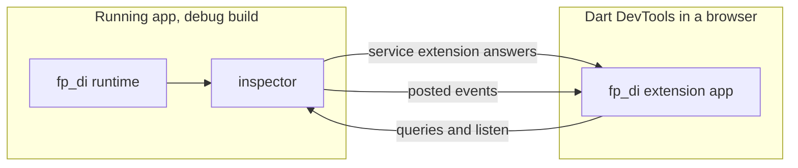
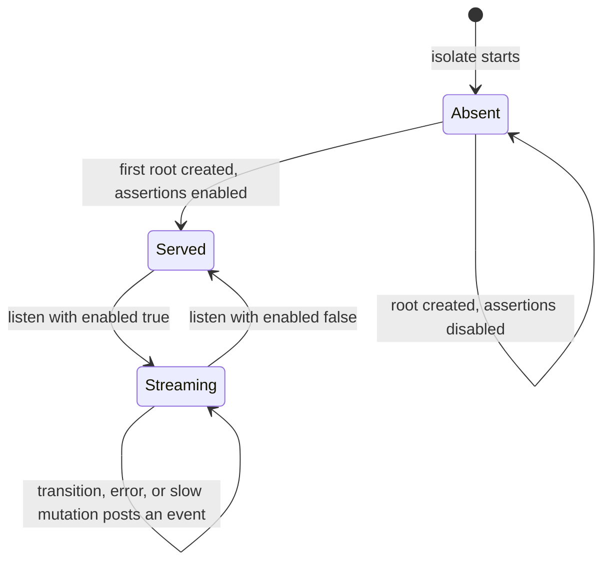
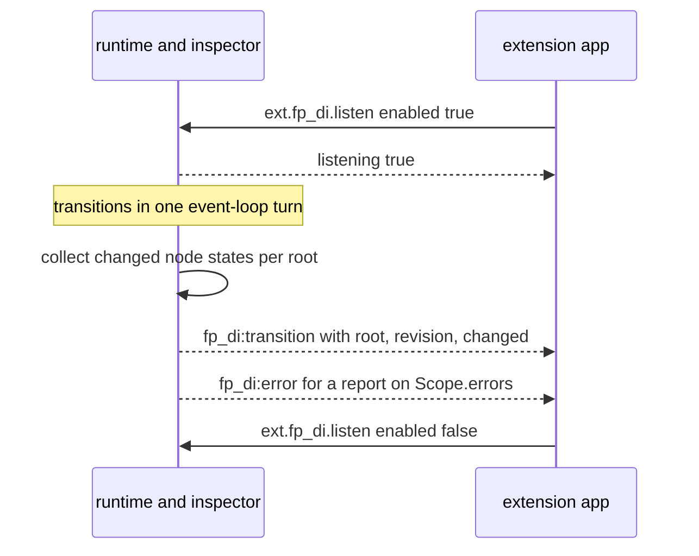

# DevTools Extension Specification

[Requirements](requirements.md) · [Decision log](log.md)

Architecture: [Project architecture](../../architecture/spec.md). Observation
contract: [Runtime lifecycle, Observation](../../runtime/lifecycle/spec.md#observation).

## Overview

A debug build of an app that uses `fp_di` serves an **inspector** to Dart
DevTools: a set of service extensions that answer queries in JSON, and events
for each change. A DevTools **extension app** reads them through the VM
service and shows the scopes, the nodes, the transitions, and the shape graph
of the running app ([requirements](requirements.md)). The inspector reads the
same state as the observation layer of the runtime and changes nothing. It
exists only when Dart assertions are enabled, so a release build carries no
inspector work. The extension is experimental, and a release of `fp_di` does
not ship it. The inspector is
[`runtime_inspector.dart`](../../../packages/fp_di/lib/src/runtime/runtime_inspector.dart),
and the extension app is [`fp_di_devtools`](../../../packages/fp_di_devtools/).

## Context & Boundaries



| Part | Owner | Responsibility |
|---|---|---|
| Inspector | `packages/fp_di/lib/src/runtime/` | Registers the service extensions, keeps the registry of live roots, builds answers and events from the runtime state |
| Protocol | This topic | The names of the service extensions, the JSON of each answer and event, and its `version` |
| Extension app | A new package `packages/fp_di_devtools/`, a Flutter web app that is not published | The views of R-UC-TL-DT-005 |
| Built extension | `packages/fp_di/extension/devtools/` | The `config.yaml` and the built web app that DevTools loads |

The inspector uses `dart:developer` only, so the core package still imports no
Flutter library. The extension app depends on Flutter and on
`devtools_extensions`; it is a separate package, and `fp_di` does not depend
on it. DevTools loads the built app from the `extension/devtools/` folder of a
package that the connected app depends on.

The inspector is part of the runtime library, because it reads internal state
that no public API gives: the id of each scope, the nodes that read a node,
and the stack trace of a failure.

## Runtime Behavior

### Registration



The constructor of a root runs the registration inside an `assert`. The first
registration in an isolate registers each service extension with
`registerExtension` of `dart:developer`. Later roots only join the registry. A
name can be registered one time in an isolate, so the inspector keeps one flag
for the isolate.

The registry holds each root through a `WeakReference`, and the end of the
disposal of a root removes it. Ids come from counters of the inspector: a root
id, and a scope id for each scope that the inspector has listed. Node ids are
the `NodeState.id` values of the runtime. Each root counts its own node ids,
so a node query names the root and the node.

### Queries

| Service extension | Arguments | Answer |
|---|---|---|
| `ext.fp_di.roots` | none | `roots`: for each live root, `id`, `label`, `revision` |
| `ext.fp_di.state` | `root`, optional `values` | `scope`: a tree; each scope has `id`, `phase`, `module`, `children`, `holds` (the labels of its open holds of a disposal), and `nodes`; each node has `id`, `label`, `key`, `phase`, `missing`, `failure`, `commits`, the `origin` of its component, and `value` when `values` is true |
| `ext.fp_di.node` | `root`, `node`, optional `values` | `reads`: for each key, `kind`, `resolves`, and the `publisher` id; `readers`: the ids of the nodes that read this node; `failure`: `cause`, `stackTrace`; `cause`: the steps of the search for an unavailable key |
| `ext.fp_di.shape` | `scope` | `shape`: the `ShapeGraph` JSON of the scope, with the modules of its ancestors |
| `ext.fp_di.listen` | `enabled`, optional `values` | `listening`: the new setting |

Each answer is a JSON object with `format: "fp_di.devtools"` and
`version: 1`. An error answer has `error` with a message that names the
argument, and the handler returns it instead of throwing. A key is its
`toString()`, such as `DiKey<Api>(timeout)`. A phase is the name of its
`NodePhase` or `ScopePhase` value.

A query reads `Scope.state`, `NodeState`, and the internal tables of the
runtime, and it starts no mutation, as the reads of the observation layer do.
The `cause` steps follow the search of
[R-UC-RT-LC-030](../../runtime/lifecycle/requirements.md#r-uc-rt-lc-030):
each step names a node, its phase, and the keys that it waits for.

| Field | Content |
|---|---|
| `label` of a root | The `debugLabel` of its module, or `root <id>` |
| `failure` of a node in `state` | `type` and `message` of the cause of `NodeState.activationException`, or null |
| `kind` of a read | `require`, `optional`, `collection`, or `optionalCollection` |
| `publisher` of a read | The node that gives the value. For a key without a value, the nearest node that publishes the key, from the scope of the reader to the root, as the `cause` search follows it; null when no node publishes the key |
| A collection read | `publisher` is null; `members` lists a read of kind `member` for each contribution |
| `readers` | The nodes whose committed reads hold a value of the node; a waiting reader is not listed |
| `failure` in `node` | `cause` and `stackTrace` of `NodeState.activationException`, or null |
| `cause` | Null when the node is `active` or publishes no key. Otherwise the steps start at the node: `node`, `phase`, `waitsFor` |
| `truncated` | `true` on the object that holds a cut text: the answer, a `failure`, a node with its `value`, or an event |

### Events



The inspector adds one listener of the runtime for each root while the
extension listens. The listener keeps the registry entry of the root, which
holds the root through its weak reference. The first
transition of a turn starts a timer of zero duration in the root zone. The
timer runs after the microtasks of the turn, also of an awaited `initialize`,
and posts one `fp_di:transition` event for each root that changed. Each event
holds `root`, `revision`, `changed`, and `omitted`. Each entry of `changed`
is `node`, `before`, and `after`, built by `ScopeState.changedSince` from the
value of the last event. `before` is null for a created node, and `after` is
null for a node that left the value. A change of a scope without a node
change, such as a new child, gives an event with an empty `changed`.
`fp_di:error` carries the `root`, the type, the message, and a cut stack
trace of each report. `fp_di:slowMutation` carries the `root` and the fields
of `SlowMutation`, with `elapsedMs` in whole milliseconds. A root measures its mutations only when it
was created with `onSlowMutation`. The inspector wraps that listener and
starts no timer to measure a mutation, so a root without it posts no such
event.

A text longer than 4 KiB is cut and marked with `truncated: true`, and an event
lists at most 500 changed nodes and states the rest as a count. The bounds keep
one event far below the size that the VM service accepts.

### Values

A value appears only when the extension asks for it, in the query or with
`listen`. The inspector calls `toString()` of the value, cuts the text at
4 KiB, and gives the text `<toString threw>` when the call throws. A value can
hold a secret, so the default is off.

## Extension App

| View | Content | Source |
|---|---|---|
| Scope tree | Roots and their scopes, with the phase of each scope | `roots`, `state` |
| Nodes | The nodes of the selected scope: label, key, phase, missing keys, commits, origin; a filter by phase and a search by key | `state` |
| Details | The reads of the selected node with their publishers, its readers, its failure, and the cause of an unavailable key. A key or a reader opens its node. | `node` |
| Timeline | Transitions, errors, and slow mutations since the extension connected, newest last | events |
| Graph | The shape graph of the selected scope in depth order, with each member colored by phase, and the cycles, the longest chain, and the undeclared and duplicate keys | `shape`, `state` |

The extension app starts with the `DevToolsExtension` widget of
`devtools_extensions` and reaches the app through the service manager that
the framework gives. It calls `listen` when it opens and when the app
restarts, and reloads `state` after each transition event of the selected
root. It reads the protocol `version` first and shows a message instead of
the views when the version differs.

## Packaging

```text
packages/fp_di_devtools/
  pubspec.yaml     publish_to: none; depends on devtools_extensions
  config.yaml      name: fp_di, issueTracker, version, materialIconCodePoint
  lib/             the views
packages/fp_di/extension/devtools/    local build only; not tracked, not released
  config.yaml      a copy of the config of the app
  build/           output of build_and_copy
```

The extension is experimental, so a release of `fp_di` does not ship it
([decision](log.md)). The repository tracks the config in the app package. The
root `.gitignore` excludes `packages/fp_di/extension/`, so `dart pub publish`
leaves the folder out. A local build makes the folder:

1. From `packages/fp_di_devtools`, `dart run devtools_extensions build_and_copy
   --source=. --dest=../fp_di/extension/devtools` builds the app and copies it.
2. Copy `packages/fp_di_devtools/config.yaml` into the folder.
3. From the workspace root, `dart run devtools_extensions validate
   --package=packages/fp_di` checks the folder.

DevTools then finds the extension for an app that depends on `fp_di` by a path
to the workspace.

## Verification

### <a id="v-t-tl-dt-001"></a>V-T-TL-DT-001 — `[test]` Registration only in debug builds

- **Layer:** Unit, Dart VM
- **Target:** the registration of the inspector in [Registration](#registration)
- **Files:** [`devtools_inspector_test.dart`](../../../packages/fp_di/test/devtools_inspector_test.dart), and the subprocess [`devtools_inspector_probe.dart`](../../../packages/fp_di/test/support/devtools_inspector_probe.dart), which the test runs with and without `--enable-asserts`
- **Fixtures:** the recorder of [`devtools_fixture.dart`](../../../packages/fp_di/test/support/devtools_fixture.dart), installed through `RuntimeInspectorHooks` of [`runtime_inspector_hooks.dart`](../../../packages/fp_di/lib/src/runtime/runtime_inspector_hooks.dart); two roots, one disposed
- **Pass:** with assertions, each service extension is registered one time and `roots` lists only the live root; without assertions, the hook records nothing
- **Evidence:** present

### <a id="v-t-tl-dt-002"></a>V-T-TL-DT-002 — `[test]` Query answers

- **Layer:** Unit, Dart VM
- **Target:** the handlers of [Queries](#queries)
- **Files:** [`devtools_inspector_test.dart`](../../../packages/fp_di/test/devtools_inspector_test.dart)
- **Fixtures:** a root with a child initialized before its parent, a waiting node, a failed automatic activation, a collection reader, and a node disposed alone
- **Pass:** each answer has `format` and `version`; the tree, the reads, the readers, the failure, and the `cause` steps equal the values that the runtime gives; an unknown id gives an error answer; `revision` is unchanged
- **Evidence:** present

### <a id="v-t-tl-dt-003"></a>V-T-TL-DT-003 — `[test]` Events

- **Layer:** Unit, Dart VM
- **Target:** [Events](#events)
- **Files:** [`devtools_inspector_test.dart`](../../../packages/fp_di/test/devtools_inspector_test.dart)
- **Fixtures:** the recording hook; transitions in one turn and in two turns; an error; a slow mutation of a root created with `onSlowMutation` and a short threshold; a stack trace over 4 KiB
- **Pass:** no event before `listen`; one transition event for each turn and root; the error and the slow mutation are posted; the long text is cut and marked; `listen` with `enabled: false` stops the events
- **Evidence:** present

### <a id="v-t-tl-dt-004"></a>V-T-TL-DT-004 — `[test]` Values on request

- **Layer:** Unit, Dart VM
- **Target:** [Values](#values)
- **Files:** [`devtools_inspector_test.dart`](../../../packages/fp_di/test/devtools_inspector_test.dart)
- **Fixtures:** values whose `toString` returns a secret, a text over 4 KiB, and a throw
- **Pass:** no value text without the request; the long text is cut; the throwing value gives `<toString threw>`
- **Evidence:** present

### <a id="v-t-tl-dt-005"></a>V-T-TL-DT-005 — `[test]` Extension views

- **Layer:** Flutter widget
- **Target:** the views of [Extension App](#extension-app)
- **Files:** [`inspector_views_test.dart`](../../../packages/fp_di_devtools/test/inspector_views_test.dart), with the fake client [`fake_client.dart`](../../../packages/fp_di_devtools/test/support/fake_client.dart)
- **Fixtures:** the fake client serves the answers and events that [`dump_devtools_fixtures.dart`](../../../packages/fp_di/test/support/dump_devtools_fixtures.dart) recorded from the inspector, read from `packages/fp_di/test/support/devtools_fixtures/`, so the app and the protocol cannot drift; an answer with another `version`; no connected app
- **Pass:** each view shows the recorded data; a key opens its publisher; the filter and the search narrow the nodes; the two messages appear
- **Evidence:** present

### <a id="v-t-tl-dt-006"></a>V-T-TL-DT-006 — `[test]` Holds in the state answer

- **Layer:** Unit, Dart VM
- **Target:** the `holds` of a scope in the `state` answer of [Queries](#queries)
- **Files:** [`devtools_inspector_test.dart`](../../../packages/fp_di/test/devtools_inspector_test.dart)
- **Fixtures:** a root with a child scope, two holds of the child, one with a `debugLabel`, and a disposal of the child that waits for them
- **Pass:** the child lists the label and `hold`; the root lists none; after both holds close and the disposal ends, the child is gone from the tree
- **Evidence:** present

### <a id="v-l-tl-dt-001"></a>V-L-TL-DT-001 — `[lint]` Packaging and the core boundary

- **Layer:** Static
- **Target:** [Packaging](#packaging)
- **Command:** `dart run devtools_extensions validate --package=packages/fp_di`, and the import check of [V-L-AR-DI-001](../../architecture/requirements.md#v-l-ar-di-001)
- **Pass:** after the local build, the validation passes; no file of `packages/fp_di/lib` imports Flutter; and `dart pub publish --dry-run` in `packages/fp_di` lists no file of `extension/`
- **Evidence:** present

### <a id="v-q-tl-dt-001"></a>V-Q-TL-DT-001 — `[qa]` DevTools with a running app

A manual run of `packages/fp_di/example/session_scope.dart` and of the Flutter
example `packages/fp_di_flutter/example/session_scope.dart` in debug mode,
with DevTools in a browser, following V-Q-TL-DT-001 of the requirements. The
checklist is in the [README of the extension app](../../../packages/fp_di_devtools/README.md).

## Risks & Trade-offs

- **Automatic registration.** The inspector needs no call in the app, so it is
  there whenever DevTools is. The cost is one registration and a weak registry
  in each debug isolate; events cost nothing until the extension listens. An
  opt-in call was rejected: an author forgets it exactly when debugging needs
  it. See the [decision](log.md).
- **Internal access.** The inspector reads internal tables, so a change of the
  runtime can break it. Its tests live with the core tests and run on each
  change.
- **Protocol drift.** The extension and the inspector ship in one package
  version, and the extension refuses another `version`, so a mismatch shows a
  message instead of wrong data.
- **Local build only.** The built web app is about 43 MB, 36 MB of it
  CanvasKit. A release does not ship it, so only an author with a path
  dependency on the workspace sees the tab. A later decision can ship it.
- **Unverified framework API.** The design relies on `registerExtension` and
  `postEvent` of `dart:developer`, and on the service manager of
  `devtools_extensions`. The exact calls are checked against their
  documentation when the work starts.
