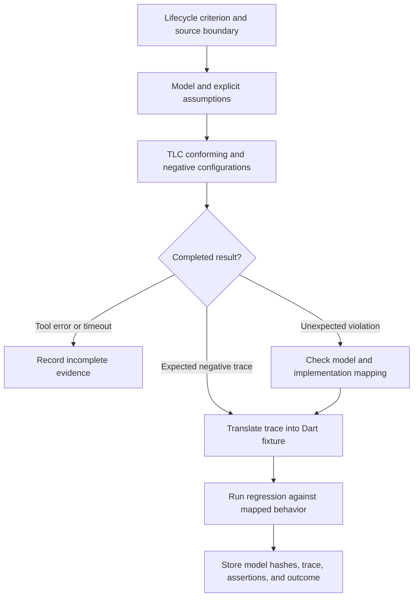

# Formal Verification Specification

[Requirements](requirements.md) · [Decisions](log.md)

## Overview

TLA+ with TLC is the primary model-checking approach for the selected serialized
Dart lifecycle. Lean remains optional for algebraic laws with explicit witnesses.
This document designs the verification system. Eight focused models, one
integration model, and their runner are executable: `Lazy.tla` (memoized resources), `Teardown.tla`
(concurrent release of a disposed scope), `Disposal.tla`
(callers of `dispose`), `Reentrancy.tla` (mutation identity in callback
zones), `Reporting.tla` (delivery of failures), `Reconcile.tla`
(reconciliation and withdrawal), `Initialize.tla` (one `initialize` call), and
`Cancellation.tla` (the planned cancellation design), and `Integration.tla`
(histories that cross the cancellation, disposal, and reporting models). Each
focused model owns a part of
the lifecycle instead of one whole-runtime model, so each stays small enough
to explore exhaustively. `verification/evidence.dart` holds the pure evidence
rules of the runner, and its tests check them. Lean proofs remain absent. The topic
has no open gap; the model boundaries below state what each model leaves to
tests. Runtime semantics remain owned
by [lifecycle](../../runtime/lifecycle/spec.md), package placement by
[architecture](../../architecture/spec.md), and concrete test methods
by [automated tests](../test/spec.md).

## Verification Boundary

Model one runtime, a finite scope tree, fixed component shapes, distinct publisher
node identities, and opaque acquire/release outcomes. Preserve the split
between acquiring, committing, withdrawing availability, and releasing. Treat
application callbacks as nondeterministic success/failure completions, not Dart
programs. A returned lease is modeled; unregistered effects are outside the model.

The mutation queue serializes distinct initializations and disposals. External
requests MAY enqueue while a callback is pending; they MUST NOT mutate bindings
until their mutation runs. The steps of one activation run in order. The
branches of a `zipPar` overlap, and no model covers them yet; [V-T-RT-LC-024](../../runtime/lifecycle/requirements.md#v-t-rt-lc-024)
owns their evidence. Two
independent members of one module MAY complete in either order. Every member in
flight MUST settle before a module rollback.
Do not introduce per-node parallel transitions merely because TLA+ permits them.

The paper's witnesses, independence, and confluence hypotheses are not inferred
from Dart shape metadata. See the [source mapping](../../runtime/lifecycle/researches/spatiotemporal-composability.researches.md).

## State and Actions

| Model state | Meaning / implementation correspondence |
|---|---|
| `scopeParent`, `scopeState` | Scope ancestry and live/disposing/disposed status; `_RuntimeScope`, `disposeScope` |
| `phase`, `registered`, `epoch` | States of the [lifecycle state diagram](../../runtime/lifecycle/spec.md#runtime-behavior): Dormant, Activating, Active, RollingBack, Deactivating, Blocked, AwaitingWithdrawal, Removed; `_RuntimeNode` flags and each activation episode |
| `required`, `observed`, `allowedPublishes` | Required reads, optional reads, publication bounds; descriptor shape |
| `bindings`, `available` | Nearest scoped resolution by publisher node identity; `_RuntimePublisher`, `resolve` |
| `committed` | Identities of the external reads, including explicit absence; node's committed view |
| `leases`, `leaseOwner`, `releaseAttempts` | Acquired tokens, activation/node/cleanup ownership, and one attempted release per token |
| `staged`, `activationOpen` | Transaction staging and activation validity |
| `queue`, `transaction`, `failedThisPass` | Mutation serialization and automatic retry suppression |

Publisher and lease identity MUST include an episode or fresh bounded token.
Reusing a value MUST NOT make a new node identical to an old one.
A failed dispose function records a completed attempt with a dispose failure,
not successful recovery.

| Action | Guard / effect | Code boundary |
|---|---|---|
| Enqueue / StartTransaction | Reject same-mutation reentrancy; otherwise queue; one running mutation | `_RuntimeMutationQueue.run` |
| Register / Begin | Live scope; required keys satisfied before beginning declared setup | `initialize`, `activate`, `satisfied` |
| Acquire | Allocate owned lease, stage publication, or record failure; no public publication | `acquire` |
| Commit | Successful setup and valid publication; transfer ownership and snapshot the reads | `activate` |
| RejectClosedMutation | Closed epoch rejects further activation work; a lease completing after closure stays owned by that epoch and is released once | `_ensureActivating`, post-acquire guard |
| Rollback | Release completed acquisitions in reverse composition order without publishing | `activate` error path, `runCleanups` |
| Withdraw / Release | Withdraw availability; retain committed reads; finish dependent cleanup before publisher release | `deactivate` |
| Reconcile / FinishTransaction | Include internally produced binding changes; report failure or reach stable targets | `reconcile` |
| DisposeScope | Mark subtree disposing; permanently dispose nodes and release bindings | `disposeScope` |
| LazyForce / LazySettle | First force starts one shared acquisition; settlement publishes to waiting callers; failure is not cached | `Lazy.force`, `Lazy._acquire` |
| RequestDispose | Cancels the episode token at the host request, before the disposal mutation; marks commit forbidden; closes the `Lazy` holders to new creations; queues the disposal mutation when no hold of the subtree is open | `ComponentNode.dispose`, `Scope.dispose` |
| OpenHold / CloseHold | Opens a hold of a scope whose disposal was not requested; closes it, and queues a waiting disposal when the last hold of its subtree closes | `Scope.disposeHold`, `DisposeHold.close` |
| IgnoreHolds | Queues the disposal at once, whatever holds are open | `Scope.dispose(ignoreHolds: true)` |
| CancelledSettle | Activation with a forbidden commit rolls back once acquisitions settle; queued setup for a disposed owner never starts | `activate`, `_RuntimeMutationQueue.run` |
| LazyRelease | Mark the holder released, await in-flight acquisition, release an acquired lease, then continue left in the composition | `Lazy._release`, `runCleanups` |
| RequestOwner (Lazy) | The disposal of the owner is requested; the holder takes no new acquisition, an acquisition in flight goes on, and the release comes later | `Lazy.force`, `DiContext.ownerDisposalRequested` |
| HoldWait / ReleaseHolds (Cancellation) | A disposal request of a held target cancels its episodes at once and stays outside the queue; setups of other owners enqueue and run meanwhile; the disposal enters the queue when the holds close | `Scope.dispose`, `DisposeHold.close` |
| HeldRequest / ReleaseHolds (Reconcile) | The disposal of a scope is requested and waits; withdrawals and returns of publishers of an ancestor run during the wait; the scope disposal follows when the holds close | `Scope.dispose`, `DisposeHold.close`, `reconcile` |

This table is an abstraction map, not a proved refinement mapping. Any transition
change MUST trigger review of its source boundary and concrete test mapping.
The model uses the name `signal` for the `CancellationToken` of a failure region,
as in `rsig`, `csig`, `SignalBeforeInverse`, and `NoSignal`. The model identifiers keep that name.
The model identifiers also keep the word `Inverse` for a dispose function, as in
`SignalBeforeInverse`.
The model identifiers also keep the word `transaction`, as in `transaction` and
`StartTransaction`. The prose says mutation.

## Properties

Names below designate planned model operators; they are not new runtime requirement IDs.

| Property | Assertion | Runtime obligation |
|---|---|---|
| `TypeOK` | State values stay within their declared finite domains | Model validity |
| `UniqueBinding` | At most one committed publisher per scope/key | [R-UC-RT-LC-001](../../runtime/lifecycle/requirements.md#r-uc-rt-lc-001) |
| `VisibleBinding` | A committed publisher of a node lives in the node's scope or an ancestor; a contribution of a child scope never reaches a reader of the parent | [R-UC-RT-LC-018](../../runtime/lifecycle/requirements.md#r-uc-rt-lc-018) |
| `LeaseAccounted` | Every acquired, not-yet-attempted lease has exactly one live cleanup owner | [R-UC-RT-LC-002](../../runtime/lifecycle/requirements.md#r-uc-rt-lc-002) |
| `ReleaseAtMostOnce` | Each lease has at most one release attempt | [R-UC-RT-LC-002](../../runtime/lifecycle/requirements.md#r-uc-rt-lc-002) |
| `ClosedActivation` | Staged work exists only in the open episode of a node; a lease that lands after its episode closed (committed, failed, rolled back, or replaced by a rebuild) is released once by that episode and never joins the node | [R-UC-RT-LC-002](../../runtime/lifecycle/requirements.md#r-uc-rt-lc-002) |
| `DependentFirst` | Publisher release begins only after dependent cleanup attempts finish; their committed reads remain valid meanwhile | [R-UC-RT-LC-003](../../runtime/lifecycle/requirements.md#r-uc-rt-lc-003) |
| `NoResurrection` | Permanently removed nodes cannot start another episode | [R-UC-RT-LC-003](../../runtime/lifecycle/requirements.md#r-uc-rt-lc-003) |
| `OptionalEligibility` | Missing optional reads alone do not disable activation | [R-UC-RT-LC-004](../../runtime/lifecycle/requirements.md#r-uc-rt-lc-004) |
| `StableTargets` | At successful quiescence, active committed identities equal resolved targets and eligible unfailed nodes are active | [R-UC-RT-LC-004](../../runtime/lifecycle/requirements.md#r-uc-rt-lc-004) |
| `NoNeutralReload` | Reexecution requires a relevant target change or explicit creation/retry trigger | [R-UC-RT-LC-004](../../runtime/lifecycle/requirements.md#r-uc-rt-lc-004) |
| `UnsettledFailsInit` | At the pass bound, a stale member of the `initialize` that runs the reconciliation fails that call instead of letting it succeed | [R-UC-RT-LC-004](../../runtime/lifecycle/requirements.md#r-uc-rt-lc-004), [R-UC-RT-LC-009](../../runtime/lifecycle/requirements.md#r-uc-rt-lc-009) |
| `AtomicPublication` | Failed activation leaves no staged publication publicly visible; sibling settlement precedes rollback | [R-UC-RT-LC-001](../../runtime/lifecycle/requirements.md#r-uc-rt-lc-001), [R-UC-RT-LC-005](../../runtime/lifecycle/requirements.md#r-uc-rt-lc-005) |
| `CancelPrompt` | A disposal request cancels the episode token in the same step, independent of queue position | [R-UC-RT-LC-008](../../runtime/lifecycle/requirements.md#r-uc-rt-lc-008) |
| `NoCommitAfterCancel` | An episode whose owner disposal was requested never commits or publishes | [R-UC-RT-LC-008](../../runtime/lifecycle/requirements.md#r-uc-rt-lc-008) |
| `NoSetupAfterCancel` | Setup never starts for an owner whose disposal was already requested | [R-UC-RT-LC-008](../../runtime/lifecycle/requirements.md#r-uc-rt-lc-008) |
| `CancelPropagatesToDependents` | A withdrawal request cancels the root token of every in-flight episode that reads the withdrawn publisher, transitively | [R-UC-RT-LC-008](../../runtime/lifecycle/requirements.md#r-uc-rt-lc-008) |
| `SignalBeforeInverse` | No dispose function starts before the token of the failure region that acquired its lease is canceled | [R-UC-RT-LC-008](../../runtime/lifecycle/requirements.md#r-uc-rt-lc-008) |
| `NoStepAfterCancel` | After the token of a region is canceled, no new primitive or composition step starts in that region or its descendants | [R-UC-RT-LC-008](../../runtime/lifecycle/requirements.md#r-uc-rt-lc-008) |
| `NoCancelLivelock` | For each withdrawal request, each node is canceled at most once before that withdrawal finishes | [R-UC-RT-LC-008](../../runtime/lifecycle/requirements.md#r-uc-rt-lc-008) |
| `CaughtFailureIsolated` | A caught region failure does not cancel the parent token; a fallback in the parent can commit. A failure of the fallback step itself may cancel the parent token | [R-UC-RT-LC-008](../../runtime/lifecycle/requirements.md#r-uc-rt-lc-008) |
| `CleanupBeforeNextSetup` | A setup that enters the queue after a disposal mutation starts only after that disposal's rollback and release attempts finish; a setup of another scope MAY run while a disposal waits for holds outside the queue | [R-UC-RT-LC-008](../../runtime/lifecycle/requirements.md#r-uc-rt-lc-008) |
| `AcquireOnlyOnUse`, `SingleFlight`, `AtMostOneSuccess` | A memoized resource is acquired only after a get, with at most one acquisition in flight and one success | [R-UC-RT-LC-007](../../runtime/lifecycle/requirements.md#r-uc-rt-lc-007) |
| `NoAcquireAfterRelease` | A released holder never starts an acquisition | [R-UC-RT-LC-007](../../runtime/lifecycle/requirements.md#r-uc-rt-lc-007) |
| `NoCreationAfterRequest` (Lazy) | A holder whose owner disposal was requested never starts an acquisition | [R-UC-RT-LC-034](../../runtime/lifecycle/requirements.md#r-uc-rt-lc-034) |
| `NoActivationWhileRequested` (Reconcile) | No node of a scope whose disposal was requested commits an activation, also while a hold delays that disposal and publishers of an ancestor come and go | [R-UC-RT-LC-034](../../runtime/lifecycle/requirements.md#r-uc-rt-lc-034) |
| `HeldDisposalCompletes` (Cancellation, Reconcile) | A held disposal request finishes once its holds close, under fairness that includes the close | [R-UC-RT-LC-034](../../runtime/lifecycle/requirements.md#r-uc-rt-lc-034) |
| `ReleaseAfterRequest` (Lazy) | The release of a holder whose owner disposal was requested follows, under fairness that includes the request | [R-UC-RT-LC-034](../../runtime/lifecycle/requirements.md#r-uc-rt-lc-034) |
| `DependentFirst` (Lazy) | Left-composed dependencies are released only after the holder has no live or in-flight lease | [R-UC-RT-LC-003](../../runtime/lifecycle/requirements.md#r-uc-rt-lc-003), [R-UC-RT-LC-007](../../runtime/lifecycle/requirements.md#r-uc-rt-lc-007) |
| `RecipientsExact` (Integration) | A late dispose failure of a canceled activation reaches the caller of that activation (`initialize`, or `Scope.errors` for an automatic activation or a withdrawal); dispose callers receive only the dispose failures of the disposal itself | [R-UC-RT-LC-008](../../runtime/lifecycle/requirements.md#r-uc-rt-lc-008) |
| `NoLostDisposeFailure` (Integration) | Every release that ran and failed reaches one recipient | [R-UC-RT-LC-002](../../runtime/lifecycle/requirements.md#r-uc-rt-lc-002) |
| `CallersAgree` | All callers of one disposal receive the same result | [R-UC-RT-LC-002](../../runtime/lifecycle/requirements.md#r-uc-rt-lc-002) |
| `SharedResult`, `CallersAgreeD` (Disposal) | The callers of one disposal that waited for holds receive its result, and a waiting caller of a child receives the result of the disposal that released the child | [R-UC-RT-LC-034](../../runtime/lifecycle/requirements.md#r-uc-rt-lc-034) |
| `NoDisposalWhileHeld` | The disposal mutation of a scope does not start while a hold of the scope or of a descendant is open, unless a call ignored the holds. A deactivation that the withdrawal of a publisher of an ancestor causes is not part of that disposal and may run | [R-UC-RT-LC-034](../../runtime/lifecycle/requirements.md#r-uc-rt-lc-034) |
| `HeldDisposalProgress` | A requested disposal finishes its release attempts when every hold of its subtree closes or a call ignores the holds, under the assumption that one of the two comes | [R-UC-RT-LC-034](../../runtime/lifecycle/requirements.md#r-uc-rt-lc-034) |
| `DisposalAfterRollback` | A disposal mutation never overlaps the mutation of the activation that it canceled | [R-UC-RT-LC-003](../../runtime/lifecycle/requirements.md#r-uc-rt-lc-003), [R-UC-RT-LC-008](../../runtime/lifecycle/requirements.md#r-uc-rt-lc-008) |
| `NoReactivateBeforeWithdrawal` | A reader that a withdrawal canceled activates again only after the publisher's release and the end of the withdrawal | [R-UC-RT-LC-008](../../runtime/lifecycle/requirements.md#r-uc-rt-lc-008) |
| `DependentsFirst`, `ValuesAlive` (Teardown) | A node of a disposed scope starts its release only after every dependent outside its read cycle finished, so its release runs while the values it read are alive | [R-UC-RT-LC-021](../../runtime/lifecycle/requirements.md#r-uc-rt-lc-021), [R-UC-RT-LC-003](../../runtime/lifecycle/requirements.md#r-uc-rt-lc-003) |
| `OneStepPerNode`, `EachStepOnce` (Teardown) | The dispose functions of one node without a `zipPar` run one at a time, and a released node finished as many as it registered. The model counts them and has no identity of a dispose function, so it checks neither their order nor that each one runs once; `ReverseAcquisition` of `Initialize.tla` and the Dart tests check the order | [R-UC-RT-LC-021](../../runtime/lifecycle/requirements.md#r-uc-rt-lc-021) |
| `ReportOrder`, `CycleSchedule` (Teardown) | The dispose failures list the started calls in descending id, each with the nodes it released in release order, whatever order concurrent releases finished in; the Cycle graph releases 3, 2, 1, 4 and reports the dispose failures of 1 and 4 as 1, 4 | [R-UC-RT-LC-021](../../runtime/lifecycle/requirements.md#r-uc-rt-lc-021) |
| `TeardownCompletes` (Teardown) | Every node releases under fairness, also with a read cycle | [R-UC-RT-LC-021](../../runtime/lifecycle/requirements.md#r-uc-rt-lc-021) |
| `LeaseAccounted` (Lazy), `ReleaseCompletes` | A finished release attempted every acquired lease exactly once; a started release finishes under fairness | [R-UC-RT-LC-002](../../runtime/lifecycle/requirements.md#r-uc-rt-lc-002), [R-UC-RT-LC-007](../../runtime/lifecycle/requirements.md#r-uc-rt-lc-007) |

Quiescence MUST be defined independently as an empty request queue, no in-flight
work, and no enabled non-stuttering lifecycle action. Defining it as target
agreement would make `StableTargets` circular. Explicit activation failures and
cleanup-blocked nodes are excluded from the successful-activation obligation,
but their errors and release responsibility remain observable.

Safety checks MUST NOT require fairness to hide violating states. For liveness,
use a separate configuration: after a finite host request sequence ends,
callbacks eventually settle and continuously enabled runtime actions receive
weak fairness. Restrict the precedence graph to an acyclic required-publisher
structure with no oscillating optional feedback. Under those assumptions check
that reconciliation eventually becomes quiescent and requested disposal eventually
finishes release attempts, once every hold of its subtree closes or a call
ignores the holds. The fairness assumptions do not prove Dart callbacks
terminate. [Lamport's safety/liveness/fairness definitions](https://lamport.azurewebsites.net/tla/safety-liveness.pdf)
provide the terminology.

## Bounds and Scenario Matrix

The initial profile has at most two scopes (root/child), two dependency keys,
three component nodes, two activation episodes per node, and two leases per
episode. Thus lease history is bounded to twelve tokens. Publisher
records include owner/epoch/key. Host commands
and queue length are bounded by each scenario's configuration. Bounds MUST NOT
be enforced by silently discarding an enabled cleanup or reconciliation step.
Scenarios that exhaust a required episode/token budget are incomplete for liveness;
report the limit and rerun with a sufficient larger bound.

| Scenarios | Model | Required exercised history |
|---|---|---|
| `Reconcile{G002,Shadow,Chain,Feedback,Collection}` | `reconcile/Reconcile.tla` | Scope initialization in either order, missing required and optional keys, a nearer child publisher and its fallback, member and recursive scope disposal, dependents-first withdrawal, a release failure that blocks reactivation, an automatic activation failure, and optional feedback that stops at the pass bound and fails the `initialize` of its members; a collection read whose membership shrinks: the disposal of a contributor, a dormant contributor that stays a member, the strict reader that deactivates before the contributor and activates again with fewer members, an optional reader, a reader that also contributes, and a root reader that does not see a child contribution |
| `Init{Conforming,ConformingWake,ConformingRebuild}` and their `Retry` and `Wide` variants, `InitConformingRebuildLate`, `InitConformingClosed` | `initialize/Initialize.tla` | Either independent member commits first, a forward reference, a failed member with a sibling in flight, settlement before rollback, reverse declaration rollback with dependents first, the closing reconcile waking a descendant node, and a retry after failure; a stale descendant node rebuilt in the closing reconcile, rolled back by a failing member, and restored against the ancestor; escaped acquire and publish requests after commit, failure, rollback, and rebuild |
| `Integration{Own,Withdraw}{Initialize,Reconcile}`, `IntegrationWitness*` | `integration/Integration.tla` | A disposal request with two callers during an uncooperative activation whose late lease release fails; the same during a withdrawal whose publisher release also fails, with the reader reactivating after the withdrawal; each through `initialize` and through an automatic activation |
| `Reporting{Members,Lazy}` and their `Progress` variants | `reporting/Reporting.tla` | Three independent members that may each fail and whose releases may each fail; a `Lazy` creation that may fail while its owner's release begins at any time. Each recipient's record must equal the expected one for the fixed outcome (`RecipientsExact`), and every result is eventually delivered (`ReportingCompletes`) |
| `ReentrancyConforming`, `ReentrancyWitnessDuring` | `reentrancy/Reentrancy.tla` | Three mutations; a callback that fires in its own mutation, after it while the queue is idle, and during a later mutation; a mutation that awaits the request of its own callback |
| `Teardown{Diamond,Cycle,LowReadsHigh}`, `TeardownProgress{Diamond,Cycle}`, `TeardownWitness{Overlap,CycleDisposeFailures}` | `teardown/Teardown.tla` | Committed read graphs of a disposed scope: a diamond with an independent node (28,633 distinct states, depth 31), an optional-read cycle that reads a publisher (178, depth 28), and a reader created before its publisher (1,161, depth 19); two dispose functions per node, each a begin and an end step, and up to two failures. The fallback walks dependents depth first from the node created last, as `deactivate` does, and collects their dispose failures under that call. The witnesses reach two overlapping releases and a Cycle run with the dispose failures of 1 and 4 |
| `Disposal{Conforming,Progress,HeldIgnoreProgress}` | `disposal/Disposal.tla` | Two host callers of one disposal, repeated calls, a dispose function that calls `dispose()` on its own target and on another target; two open holds of the target and one of its child, a call that ignores the holds, a waiting disposal of the child, and a call of the child that joins the disposal of the target. `Progress` assumes that each hold closes; `HeldIgnoreProgress` assumes only that a call ignores the holds |
| `CancelHeld{Conforming,Progress}` | `cancellation/Cancellation.tla` | A disposal request of a held target during its setup, a setup of another owner that enqueues and runs during the wait, and the close of the hold; `NoSetupAfterCancel`, `NoCommitAfterCancel`, `CancelPrompt`, and `CleanupBeforeNextSetup` for the setups that enter the queue after the disposal |
| `LazyRequest{Conforming,Progress}` | `lifecycle/Lazy.tla` | A force before and after the request of the owner disposal, an acquisition in flight at the request, and the release after it |
| `ReconcileHeld{Conforming,Progress}` | `reconcile/Reconcile.tla` | A held disposal request of a child scope, the withdrawal and the return of a publisher of its parent during the wait, and the scope disposal after the close |
| `CancelConforming*` | `cancellation/Cancellation.tla` | A disposal request during setup, cooperative and uncooperative acquisitions, caught and propagated composite failures, withdrawal reaching in-flight dependents transitively, and the next queued setup |
| `LazyProgress`, `ReconcileProgress`, `ReconcileFeedbackProgress`, `ReconcileCollectionProgress`, `InitProgress*`, `CancelProgress*`, `Integration*Progress`, `TeardownProgress*` | each model | Finite host input, then draining under the fairness assumptions of each `FairSpec`; each lists exactly one property |
| `*Neg*` | each model | One deliberate defect per property, in the table below |
| `CancelWitness*`, `IntegrationWitness*`, `TeardownWitness*` | `cancellation/Cancellation.tla`, `integration/Integration.tla`, `teardown/Teardown.tla` | Reachability witnesses: each invariant states that a behavior never happens, and the expected violation shows that a conforming configuration reaches it |

**Model boundaries.** `Disposal.tla` takes the reentrancy decision as given
(a host call or a call inside the running mutation); `Reentrancy.tla`
checks that decision from the mutation identity that a callback keeps.
It models the holds as counts that close in any order and the disposal of the
child as one step. A hold that closes inside a mutation, the zone that queues
the waiting disposal, and the closing of `Lazy` holders at the request are
outside it; [V-T-RT-LC-041](../../runtime/lifecycle/requirements.md#v-t-rt-lc-041) covers them. `Cancellation.tla` gives a held request its transaction id when its holds
close, so the queue order and `CleanupBeforeNextSetup` hold for the setups
that enter the queue after it, and it reserves the ids of the waiting requests.
`Reconcile.tla` takes a held request only between transactions and has no
request of the root while a hold of the child is open; `Cancellation.tla`
owns a request inside a transaction, and `Disposal.tla` owns the join of an
ancestor.
Release attempts and their order are checked by
`Lazy.tla`, `Initialize.tla`, and `Cancellation.tla`, whose releases succeed;
`Teardown.tla` checks the order of the concurrent releases of a disposed
scope and of the dispose failures it reports, with releases as steps that interleave,
and treats the read graph as fixed. A committed read cycle is not reachable
through the public API, so its Dart counterpart drives the scheduler of
`runtime_teardown.dart` directly; what each node read comes from `Reconcile.tla`, which keeps one release
as one atomic step;
the delivery of release failures is checked by `Reporting.tla`, which tracks
dispose failure identities, causes, and the errors that reach each caller.
`Reconcile.tla` treats the activations inside an
`initialize` call as successful; `Initialize.tla` owns their failure and
rollback. `Initialize.tla` rebuilds a stale descendant node in the closing
reconcile and in the reconcile after a rollback, and combines that rebuild with
the rollback. It does not rebuild stale members; their feedback belongs to
`Reconcile.tla`. It also models an escaped activation context as environment
requests that the runtime must reject (`ClosedActivation`). `Reconcile.tla`
computes collection membership from the current state at every use, so a
disposal that shrinks a membership changes the reads of its readers; the set
and map values, their order, and key identity stay with the Dart tests.
`Integration.tla` composes `Cancellation.tla`, `Disposal.tla`, and
`Reporting.tla` for two histories: a late release that fails after a disposal
request and reaches the caller of the activation, and a withdrawal whose
publisher release fails and reaches every dispose caller while the reader's
dispose failure goes to `Scope.errors`. Its releases may fail; it does not model `Lazy`
or reentrancy. `Cancellation.tla` checks
the accepted design, which is more general than the runtime: fp_di has no
combinator that catches a failure inside one activation, so its failure
regions are the episode root and each `Lazy` creation. Its `NoSignal` defect is
the behavior before cancellation. Its releases never fail, its dispose mutations do not
reconcile, and it leaves the publisher-release order (`DependentFirst`) to the
other models.

No model represents the wait of a mutation for the gate of the previous mutation,
or the zone of a future. `Disposal.tla` and `Reentrancy.tla` take the queue as a
FIFO. The zone assumption of the runtime has test evidence only ([V-T-RT-LC-030](../../runtime/lifecycle/requirements.md#v-t-rt-lc-030)).

A single configuration need not combine the whole product state space. Each
report MUST disclose which dimensions were fixed and which were explored.
Increase one material bound at a time; a small finite pass is not an unbounded theorem.

## Counterexamples and Negative Controls

| Deliberate defect | Expected violation | Concrete bridge |
|---|---|---|
| Initialize: let a lease that lands after closure join the node (`MutateAfterClose`), or stage after closure (`StageAfterClose`) | `ClosedActivation` | Internal guard (`_activating` checks the open episode); no public API reaches a closed activation, so no Dart bridge exists |
| Initialize: drop a lease that lands after closure (`LateLeak`) | `LeaseAccounted` | model only |
| Skip rechecking active targets after dormant publication | `StableTargets` | [V-T-RT-LC-004](../../runtime/lifecycle/requirements.md#v-t-rt-lc-004) (`regression_test.dart`) |
| Treat optional reads as required | `OptionalEligibility` | [V-T-RT-LC-004](../../runtime/lifecycle/requirements.md#v-t-rt-lc-004) |
| Omit a read from the committed view | `NoNeutralReload` or `StableTargets` | [V-T-RT-LC-004](../../runtime/lifecycle/requirements.md#v-t-rt-lc-004) |
| Release publisher before its readers | `DependentFirst` | [V-T-RT-LC-003](../../runtime/lifecycle/requirements.md#v-t-rt-lc-003) |
| Cancel the token only when the disposal mutation runs | `CancelPrompt` | [V-T-RT-LC-008](../../runtime/lifecycle/requirements.md#v-t-rt-lc-008) (`cancellation_test.dart`) |
| Start the setup of a held owner during the wait (`SetupWhileHeld`) | `NoSetupAfterCancel` | [V-T-RT-LC-041](../../runtime/lifecycle/requirements.md#v-t-rt-lc-041) (`dispose_hold_test.dart`) |
| Commit an activation that settles after a disposal request | `NoCommitAfterCancel` | [V-T-RT-LC-008](../../runtime/lifecycle/requirements.md#v-t-rt-lc-008) (`cancellation_test.dart`) |
| Start queued setup for a disposed owner | `NoSetupAfterCancel` | [V-T-RT-LC-008](../../runtime/lifecycle/requirements.md#v-t-rt-lc-008) |
| Cancel the token of only the withdrawn publisher's own episode | `CancelPropagatesToDependents` | [V-T-RT-LC-008](../../runtime/lifecycle/requirements.md#v-t-rt-lc-008) (`cancellation_test.dart`) |
| Roll back a composite stage before canceling the token of its region | `SignalBeforeInverse` | [V-T-RT-LC-008](../../runtime/lifecycle/requirements.md#v-t-rt-lc-008) (`cancellation_test.dart`) |
| Keep a withdrawal-canceled node eligible | `NoCancelLivelock` | [V-T-RT-LC-008](../../runtime/lifecycle/requirements.md#v-t-rt-lc-008) |
| Cancel the parent token on a caught child failure | `CaughtFailureIsolated` | [V-T-RT-LC-008](../../runtime/lifecycle/requirements.md#v-t-rt-lc-008) |
| Roll back the episode root before canceling its token | `SignalBeforeInverse` | [V-T-RT-LC-008](../../runtime/lifecycle/requirements.md#v-t-rt-lc-008) |
| Skip the checkpoint between composition steps | `NoStepAfterCancel` | [V-T-RT-LC-008](../../runtime/lifecycle/requirements.md#v-t-rt-lc-008) |
| Let the next setup overlap a canceled rollback | `CleanupBeforeNextSetup` | [V-T-RT-LC-008](../../runtime/lifecycle/requirements.md#v-t-rt-lc-008) |
| Abandon an uncooperative lease on cancellation | `LeaseAccounted` | [V-T-RT-LC-008](../../runtime/lifecycle/requirements.md#v-t-rt-lc-008) |
| Reporting: only the first failed member's rollback failures are kept (`DropLater`) | `NoLostDisposeFailure` | `review_regression_test.dart` 4 |
| Reporting: a dispose failure replaces the cause of a `Lazy` creation (`DisposeFailureReplacesCause`) | `CausePreserved` | `review_regression_test.dart` 2a |
| Reporting: the dispose failures of a creation that settles after the owner's release began are dropped (`SwallowShutdown`) | `NoLostDisposeFailure` | `review_regression_test.dart` 2b |
| Reporting: the rollback failures of a late creation go to `force` instead of `dispose` (`MisrouteShutdown`) | `RecipientsExact` | model only |
| Reporting: a failure before the owner's release is reported as `DisposedLazyException` (`DisposedEarly`) | `CausePreserved` | model only |
| Reporting: the members' result is never delivered (`NoDeliver`) | `ReportingCompletes` under fairness | model only |
| Reentrancy: the zone marks the runtime, so every callback is reentrant (`RuntimeIdentity`) | `FinishedMayMutate` | `review_regression_test.dart` 5 |
| Reentrancy: no callback is reentrant, even in its own mutation (`NoCheck`) | `NoSelfWait` | `review_regression_test.dart` 3, 6 |
| Reentrancy: a callback's mutation starts at once instead of queuing (`RunNow`) | `OneRunning` | model only |
| Teardown: a node starts once its dependents have only started (`NoWait`) | `DependentsFirst` | [V-T-RT-LC-023](../../runtime/lifecycle/requirements.md#v-t-rt-lc-023) (`concurrent_teardown_test.dart`, a publisher waits for every dependent) |
| Teardown: the cycle fallback begins a stuck node without the walk, such as a publisher that a live cycle reads (`AnyFallback`) | `DependentsFirst` | [V-T-RT-LC-023](../../runtime/lifecycle/requirements.md#v-t-rt-lc-023) (`teardown_scheduler_test.dart`, Cycle graph) |
| Teardown: no cycle fallback (`NoFallback`) | `TeardownCompletes` under fairness | [V-T-RT-LC-023](../../runtime/lifecycle/requirements.md#v-t-rt-lc-023) (`teardown_scheduler_test.dart` times out without the fallback) |
| Teardown: the dispose functions of one node overlap (`ParallelSteps`) | `OneStepPerNode` | [V-T-RT-LC-015](../../runtime/lifecycle/requirements.md#v-t-rt-lc-015) (`zip_test.dart`, a later release held on a gate); fuzz `StepSerial` ([V-T-VR-TEST-006](../test/requirements.md#v-t-vr-test-006)) |
| Teardown: dispose failures in the order they occurred (`CompletionOrder`) | `ReportOrder` | [V-T-RT-LC-023](../../runtime/lifecycle/requirements.md#v-t-rt-lc-023) (the dispose failures follow node order) |
| Disposal: a repeated call completes before the cleanup ends (`CompleteEarly`) | `CompleteAfterCleanup` | `review_regression_test.dart` 1 |
| Disposal: a call after the scope is marked disposed completes before the disposal's future (`DisposedShortcut`) | `NoopAfterEnd` | `review_regression_test.dart` 7 |
| Disposal: a call from inside a mutation shares the disposal before the reentrancy check (`ShareFirst`) | `NoSelfWait`, and `DisposalCompletes` under fairness | `review_regression_test.dart` 6 |
| Disposal: a rejected call marks its target first (`MarkFirst`) | `NoMarkWithoutDisposal` | `review_regression_test.dart` 3 |
| Disposal: a request queues the disposal with a hold open (`NoWait`) | `NoDisposalWhileHeld` | `dispose_hold_test.dart`, the release log stays empty until the last hold closes |
| Disposal: the disposal of the target leaves a waiting caller of its child (`LoseDescendant`) | `HeldDisposalProgress` under fairness | `dispose_hold_test.dart`, an ancestor that ignores the holds ends the wait of a descendant |
| Reconcile: rebuild a node whose target is unchanged (`RebuildUnchanged`) | `NoNeutralReload` | [V-T-RT-LC-004](../../runtime/lifecycle/requirements.md#v-t-rt-lc-004) |
| Reconcile: activate a node of a scope whose held disposal waits, when a publisher returns (`ActivateWhileHeld`) | `NoActivationWhileRequested` | [V-T-RT-LC-041](../../runtime/lifecycle/requirements.md#v-t-rt-lc-041) |
| Reconcile: activate a disposed member again (`ResurrectRemoved`) | `NoResurrection` | [V-T-RT-LC-003](../../runtime/lifecycle/requirements.md#v-t-rt-lc-003) |
| Reconcile: let `initialize` succeed with its own members stale at the pass bound (`UnsettledSucceeds`) | `UnsettledFailsInit` | [V-T-RT-LC-004](../../runtime/lifecycle/requirements.md#v-t-rt-lc-004) (`regression_test.dart`) |
| Reconcile: keep a disposed contributor in the membership, so a strict reader waits for it (`CaptureMembership`) | `StableTargets` | [V-T-RT-LC-020](../../runtime/lifecycle/requirements.md#v-t-rt-lc-020) (`collection_test.dart`, a contributor disposed by itself) |
| Reconcile: count a reader's own contribution in its membership (`OwnMember`) | `StableTargets` | [V-T-RT-LC-018](../../runtime/lifecycle/requirements.md#v-t-rt-lc-018) (`collection_test.dart`, a reused reader that contributes) |
| Reconcile: count and resolve a contribution of a child scope (`ChildVisible`) | `VisibleBinding` | [V-T-RT-LC-018](../../runtime/lifecycle/requirements.md#v-t-rt-lc-018), [V-T-RT-LC-020](../../runtime/lifecycle/requirements.md#v-t-rt-lc-020) (`collection_test.dart`) |
| Initialize: skip the rebuild of a stale descendant node (`SkipRebuild`) | `ScopeOutcome` | model only |
| Initialize: release the old leases of a rebuilt node again in the rollback (`ReleaseRebuilt`) | `ReleaseAtMostOnce` | model only |
| Initialize: lose the dependency edge of a rebuilt node (`RebuildLosesEdge`) | `DependentFirst` | model only |
| Integration: the late dispose failure joins the dispose result (`MisrouteLate`) | `RecipientsExact` | [V-T-RT-LC-008](../../runtime/lifecycle/requirements.md#v-t-rt-lc-008) (`cancellation_test.dart`, integration histories) |
| Integration: the late dispose failure reaches no recipient (`DropLate`) | `NoLostDisposeFailure` | [V-T-RT-LC-008](../../runtime/lifecycle/requirements.md#v-t-rt-lc-008) (`cancellation_test.dart`, integration histories) |
| Integration: a later dispose caller observes success (`SecondCallerOk`) | `CallersAgree` | [V-T-RT-LC-008](../../runtime/lifecycle/requirements.md#v-t-rt-lc-008) (`cancellation_test.dart`, integration histories) |
| Integration: the disposal starts during the activation mutation (`OverlapDispose`) | `DisposalAfterRollback` | model only |
| Integration: roll back at the cancellation, before the late acquisition settles (`RollbackAtSignal`) | `SettleBeforeRollback` | [V-T-RT-LC-008](../../runtime/lifecycle/requirements.md#v-t-rt-lc-008) |
| Integration: the canceled reader activates while it awaits the withdrawal (`ReactivateEarly`) | `NoReactivateBeforeWithdrawal` | [V-T-RT-LC-008](../../runtime/lifecycle/requirements.md#v-t-rt-lc-008) (`cancellation_test.dart`, integration histories) |
| Integration: the rollback waits for the disposal that waits for it (`RollbackAwaitsDispose`) | `IntegrationCompletes` under fairness | model only |
| Initialize: start rollback before an in-flight sibling settles (`EarlyRollback`) | `SettleBeforeRollback` | [V-T-RT-LC-009](../../runtime/lifecycle/requirements.md#v-t-rt-lc-009), [V-T-RT-LC-014](../../runtime/lifecycle/requirements.md#v-t-rt-lc-014) |
| Initialize: publish a binding before the activation completes (`PublishEarly`) | `AtomicPublication` | [V-T-RT-LC-009](../../runtime/lifecycle/requirements.md#v-t-rt-lc-009), [V-T-RT-LC-014](../../runtime/lifecycle/requirements.md#v-t-rt-lc-014) |
| Initialize: release leases in acquisition order (`AcqOrder`) | `ReverseAcquisition` | [V-T-RT-LC-009](../../runtime/lifecycle/requirements.md#v-t-rt-lc-009), [V-T-RT-LC-014](../../runtime/lifecycle/requirements.md#v-t-rt-lc-014) |
| Initialize: start a member before its publisher settles (`EarlyStart`) | `PublishersFirst` | [V-T-RT-LC-009](../../runtime/lifecycle/requirements.md#v-t-rt-lc-009), [V-T-RT-LC-014](../../runtime/lifecycle/requirements.md#v-t-rt-lc-014) |
| Initialize: start a member after a failure (`StartAfterFailure`) | `NoStartAfterFailure` | [V-T-RT-LC-009](../../runtime/lifecycle/requirements.md#v-t-rt-lc-009), [V-T-RT-LC-014](../../runtime/lifecycle/requirements.md#v-t-rt-lc-014) |
| Initialize: roll back a publisher before its dependents (`SkipDependents`) | `DependentFirst` | [V-T-RT-LC-009](../../runtime/lifecycle/requirements.md#v-t-rt-lc-009), [V-T-RT-LC-014](../../runtime/lifecycle/requirements.md#v-t-rt-lc-014) |
| Initialize: roll back a publisher before its dependents, with a woken descendant (`SkipDependentsWake`) | `WokenDormantAfterRollback` | [V-T-RT-LC-009](../../runtime/lifecycle/requirements.md#v-t-rt-lc-009), [V-T-RT-LC-014](../../runtime/lifecycle/requirements.md#v-t-rt-lc-014) |
| Initialize: release a failed member's leases again in rollback (`DoubleRelease`) | `ReleaseAtMostOnce` | [V-T-RT-LC-009](../../runtime/lifecycle/requirements.md#v-t-rt-lc-009), [V-T-RT-LC-014](../../runtime/lifecycle/requirements.md#v-t-rt-lc-014) |
| Initialize: drop a lease on failure (`DropLease`) | `LeaseAccounted` | [V-T-RT-LC-009](../../runtime/lifecycle/requirements.md#v-t-rt-lc-009), [V-T-RT-LC-014](../../runtime/lifecycle/requirements.md#v-t-rt-lc-014) |
| Initialize: roll back in declaration order (`DeclOrder`) | `ReverseDeclaration` | [V-T-RT-LC-009](../../runtime/lifecycle/requirements.md#v-t-rt-lc-009), [V-T-RT-LC-014](../../runtime/lifecycle/requirements.md#v-t-rt-lc-014) |
| Initialize: rethrow the first failure in time (`RethrowEarliest`) | `RethrowFirstDeclared` | [V-T-RT-LC-009](../../runtime/lifecycle/requirements.md#v-t-rt-lc-009), [V-T-RT-LC-014](../../runtime/lifecycle/requirements.md#v-t-rt-lc-014) |
| Lazy: acquire during activation (`EagerAcquire`) | `AcquireOnlyOnUse` | [V-T-RT-LC-007](../../runtime/lifecycle/requirements.md#v-t-rt-lc-007) |
| Lazy: reacquire after success (`NoMemo`) | `AtMostOneSuccess` | [V-T-RT-LC-007](../../runtime/lifecycle/requirements.md#v-t-rt-lc-007) |
| Lazy: concurrent first forces each acquire (`NoSingleFlight`) | `SingleFlight` | [V-T-RT-LC-007](../../runtime/lifecycle/requirements.md#v-t-rt-lc-007) |
| Lazy: acquire after the request of the owner disposal (`ForceAfterRequest`) | `NoCreationAfterRequest` | [V-T-RT-LC-041](../../runtime/lifecycle/requirements.md#v-t-rt-lc-041) |
| Lazy: acquire after release (`AcquireAfterRelease`) | `NoAcquireAfterRelease` | [V-T-RT-LC-007](../../runtime/lifecycle/requirements.md#v-t-rt-lc-007) |
| Lazy: late acquisition also releases itself (`SelfRelease`) | `ReleaseAtMostOnce` | [V-T-RT-LC-007](../../runtime/lifecycle/requirements.md#v-t-rt-lc-007) |
| Lazy: release forgets an acquired lease (`DropLease`) | `LeaseAccounted` | [V-T-RT-LC-007](../../runtime/lifecycle/requirements.md#v-t-rt-lc-007) |
| Lazy: release does not await in-flight work (`NoSettleWait`) | `DependentFirst` | [V-T-RT-LC-007](../../runtime/lifecycle/requirements.md#v-t-rt-lc-007) |
| Lazy: release waits for callers to stop observing (`WaitForCallers`) | `ReleaseCompletes` | [V-T-RT-LC-007](../../runtime/lifecycle/requirements.md#v-t-rt-lc-007) |

The [traceability chain](../test/spec.md#traceability-chain) of the test
topic links each check of the random lifecycle histories to its requirement,
formal property, deliberate defect, fixed regression, and detection evidence.
A bridge cell names a Dart fixture only when that fixture fails under the
defect; a fixture that passes under the defect is not a bridge.

The harness MUST match the expected violated property and a trace, not merely a
nonzero process exit. A run counts only when TLC finished it normally: a tool failure
anywhere in the log (a Java exception, an out-of-memory error, an evaluation
error) makes it incomplete, and the exit code MUST match the outcome (0 for a
pass, 12 for an invariant violation, 13 for a temporal violation). A
violation counts only with its whole counterexample: every state of the trace
has a body, a temporal trace closes its lasso with `Stuttering` or `Back to
state`, and TLC printed its `Finished in` line after the trace. A cut trace
is incomplete. Paired conforming runs exercise the same scenario. Retain
minimal host inputs, completions, and assertions in Dart regressions; a trace
is evidence about the model until this mapping is checked. TLC's
[error and trace documentation](https://tla.msr-inria.inria.fr/tlatoolbox/doc/model/executing-tlc.html)
distinguishes property violations from evaluation/tool failures.

## Artifact and Runner Contract

| Path | Status | Responsibility |
|---|---|---|
| `verification/tla/lifecycle/Lazy.tla` | present | Memoized-resource holder, owner release, `Fault` switch for negative controls |
| `verification/tla/lifecycle/*.cfg`, `scenarios.json` | present | Lazy conforming, liveness, and negative configurations with expected outcomes |
| `verification/tla/reconcile/Reconcile.tla`, `*.cfg`, `scenarios.json` | present | Reconciliation and withdrawal over five topologies, one with collection membership; the `SkipRecheck` defect reproduced G-RT-LC-002 |
| `verification/tla/initialize/Initialize.tla`, `*.cfg`, `scenarios.json` | present | One `initialize` call: scheduling by keys, failure, settlement, rollback, the closing reconcile with a rebuild of a stale descendant node, escaped activation contexts, and retry |
| `verification/tla/integration/Integration.tla`, `*.cfg`, `scenarios.json` | present | Cross-model histories: a canceled activation whose late release fails, several dispose callers, a withdrawal whose publisher release fails, and the recipient of each dispose failure |
| `verification/tla/reporting/Reporting.tla`, `*.cfg`, `scenarios.json` | present | Delivery of failures: each failed release as a dispose failure with an identity, each failure with its cause, and the errors that reach the `initialize`, `force`, and `dispose` callers |
| `verification/tla/reentrancy/Reentrancy.tla`, `*.cfg`, `scenarios.json` | present | Several mutations, callbacks that keep the identity of the mutation they were registered in, and the reentrancy decision of `_Runtime.inTransaction` |
| `verification/tla/teardown/Teardown.tla`, `*.cfg`, `scenarios.json` | present | Concurrent teardown of a disposed scope along the reverse of its committed reads: readiness, the cycle fallback, LIFO dispose functions per node, and the order of the reported dispose failures |
| `verification/tla/disposal/Disposal.tla`, `*.cfg`, `scenarios.json` | present | Host callers of `dispose()` and callers of `dispose()` inside a mutation: the disposed mark, the completion of the shared future, and each caller's result, including a failed cleanup; an early completion; a reentrant call that shares or marks before its check |
| `verification/tla/cancellation/Cancellation.tla`, `*.cfg`, `scenarios.json` | present | Disposal request, episode token, cooperative and uncooperative acquisitions, tree of tokens with failure regions, `awaitingWithdrawal`, withdrawal propagation to in-flight dependents, checkpoints between steps, rollback without commit, and the next queued setup |
| `verification/toolchain.lock.json` | present | TLC 1.7.4 source URL and SHA-256, minimum Java; no floating latest download |
| `verification/check.dart` | present | Verifies the pinned jar, runs named scenarios, classifies pass/violation/incomplete, writes evidence; nonzero on incomplete or unexpected outcome |
| `verification/evidence.dart` | present | Pure evidence rules: log classification, configuration sections, scenario status, and report completeness, which `check.dart` applies to its own report before it writes it |
| `verification/test/evidence_test.dart` | present | Complete, missing-field, interrupted, inconsistent, and unexpected-negative report fixtures; run with `dart run agents/scripts/test_core.dart verification/test` |
| `output/verification/<run>/` | generated | Logs, model/config/source hashes, bounds, enabled properties, state counts, status |

The `source` list of each `scenarios.json` MUST name every file that
implements an action of its model, so the source hashes in a report change
whenever that code changes. A model header MUST name the code it maps to and
MUST say whether it checks the current code or a design.

The entry command is `dart run verification/check.dart` (`--fetch` downloads the
pinned jar; `--scenario NAME` selects). It exits 2 when a requested scenario does not exist, or when the toolchain is missing
or its checksum differs, and 1 when any scenario is incomplete or unexpected.
TLC does not name a violated temporal property, so a temporal expectation is
attributed only when the configuration checks exactly one property. CI MAY call the same runner; it MUST NOT
replace a full run with syntax-only validation while retaining a passed status.
Retained evidence MUST include model/config checksums, Dart revision or source
hashes, tool versions, assumptions, scenario bounds, enabled properties, completion
and exploration statistics, expected negative outcomes, and trace-to-test mapping.
Generated reports belong in output artifacts, not chronological entries in the spec.

## Lean Boundary

Lean MAY be introduced for reverse-order composition of dispose functions,
shape-set laws, or a restricted independence theorem. Each theorem MUST state
its effect model, witness obligations, and equality/observational equivalence
explicitly. Successful kernel checking is evidence for that theorem under its
hypotheses, not for the
Dart callback or interpreter. Proof artifacts MUST pin their toolchain, report
used axioms, and exclude `sorry`/`admit`-backed obligations from passed results.
The [Lean reference](https://lean-lang.org/doc/reference/latest/The-Type-System/Propositions/)
describes the proposition/proof framework. No Lean artifact is required for the
initial lifecycle model or current package tests.

## Verification

### V-T-VR-FORM-001 — `[test]` Conforming model checks

- **Layer:** Model
- **Target:** the nine models via the runner
- **Files:** `verification/tla/*/*.tla`
- **Fixtures:** Conforming safety configs plus separate Progress configs, with the bounds in each cfg.
- **Pass:** Completed checks with all named properties passing and disclosed bounds: Lazy 5, Reconcile 10, Initialize 15, Cancellation 14, Disposal 3, Teardown 5, Reentrancy 1, Reporting 4, and Integration 6 conforming or progress scenarios.
- **Evidence:** present

### V-T-VR-FORM-002 — `[test]` Negative controls

- **Layer:** Model harness
- **Target:** negative configs
- **Files:** `verification/tla/*/*.cfg`, `verification/tla/*/scenarios.json`
- **Fixtures:** Each fault scenario above, with paired positive configs.
- **Pass:** Each fault scenario above produces its expected property violation, paired positive passes, tool errors fail: Lazy 9, Reconcile 11, Initialize 17, Cancellation 12, Disposal 7, Teardown 5, Reentrancy 3, Reporting 6, and Integration 7 negative configurations, plus 9 Cancellation, 2 Teardown, 1 Reentrancy, and 3 Integration reachability witnesses; 155 scenarios in all.
- **Evidence:** present

### V-T-VR-FORM-003 — `[test]` Counterexample regressions

- **Layer:** Dart unit
- **Target:** retained counterexample cases
- **Files:** `packages/fp_di/test/regression_test.dart`, `packages/fp_di/test/cancellation_test.dart`
- **Fixtures:** Translate retained cases using controlled completions and release counters.
- **Pass:** Exact domain assertions from [V-T-RT-LC-002](../../runtime/lifecycle/requirements.md#v-t-rt-lc-002), [V-T-RT-LC-003](../../runtime/lifecycle/requirements.md#v-t-rt-lc-003), [V-T-RT-LC-004](../../runtime/lifecycle/requirements.md#v-t-rt-lc-004), and [V-T-RT-LC-008](../../runtime/lifecycle/requirements.md#v-t-rt-lc-008). `regression_test.dart` bridges the `SkipRecheck` counterexample of `Reconcile.tla`; `cancellation_test.dart` bridges the owner-disposal (`NoSignal`, `CommitAfterCancel`, `SetupAfterCancel`, `SkipCheckpoint`, `OverlapSetup`, `AbandonUncoop`), withdrawal (`OnlyOwnEpisode`, `KeepEligible`), and failure-region (`RootRollbackFirst`, `CaughtLeaksParent`) counterexamples of `Cancellation.tla`.
- **Evidence:** present

### V-T-VR-FORM-004 — `[test]` Evidence harness

- **Layer:** Runner unit
- **Target:** `verification/evidence.dart` (`classify`, `section`, `scenarioStatus`, `reportProblems`), which `verification/check.dart` uses
- **Files:** `verification/test/evidence_test.dart`
- **Fixtures:** Synthetic TLC logs (completed, invariant and temporal violations, parse error, timeout, empty) and reports (complete, missing field, interrupted scenario, negative control that passes, status that disagrees with the outcomes, missing state counts, empty, failed).
- **Pass:** Only complete valid expected outcomes count as passed: `reportProblems` is empty only for the complete report, and the runner marks a run failed when its own report has problems.
- **Evidence:** present

The documentation validator checks this topic's shape and references only. It
cannot close any model-checking criterion in this section.
