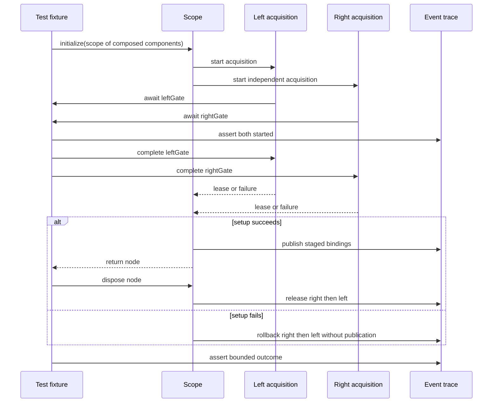
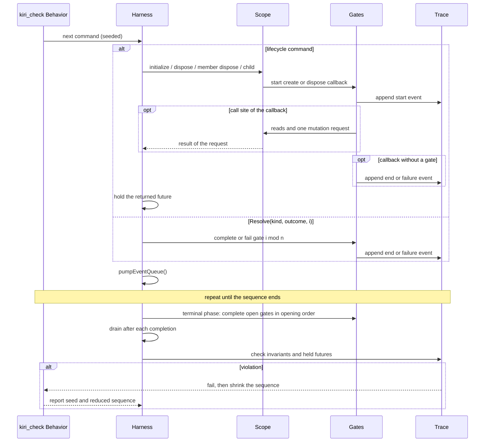

# Verification Test Strategy Specification

[Requirements](requirements.md) · [Canonical lifecycle specification](../../runtime/lifecycle/spec.md) · [Decision log](log.md)

## Overview

This topic turns the test-policy requirements into a repeatable evidence plan
for the two package boundaries. The core suite observes mutations through
fresh contexts, event traces, and explicit futures; the Flutter suite observes
widget ownership through `WidgetTester` pumps and controlled asynchronous
completion. [Formal verification](../formal/spec.md) owns model bounds and counterexample evidence.
The canonical lifecycle topic remains the source of the exact
runtime contract and `RT-LC` IDs.

## Context & Boundaries

The runtime tests target `packages/fp_di/lib/src/` through the public API in
`package:fp_di/fp_di.dart`. The adapter tests target
`packages/fp_di_flutter/lib/src/` through `package:fp_di_flutter/fp_di_flutter.dart`
and a real `WidgetTester`. No test fixture crosses the core/Flutter ownership
boundary by reaching into private implementation state.

The test boundary observes committed lookup, node state, cleanup event
traces, thrown lifecycle errors, widget output, and cleanup counters. It does
not observe or prove arbitrary external effect reversal, unbounded schedules,
or a formal refinement of the Dart implementation.

## Constraints & Test Strategy

- Each lifecycle test creates a fresh `Scope()` and disposes it after assertions, including after expected failures.
- Ordering tests use an append-only event list and explicit `Completer<void>` gates. A delay can make a sibling slow, but elapsed time is not the pass condition.
- Failure fixtures assert both the reported error and the cleanup/publication consequence: dispose functions are counted, ordering is compared, and `maybeGet` confirms that failed staging is not published.
- Reconciliation fixtures distinguish publisher identity changes from value equality and record activation counts. Tests that are absent or known to expose a lifecycle gap remain incomplete evidence.
- Flutter fixtures use `WidgetTester.pump` to drive mount, rebuild, unmount, and late-future completion. They assert rendered text or error output and cleanup counters rather than private state.
- Random histories run seeded command sequences over gated callbacks and check invariants over the recorded trace. They complement the gated fixtures and do not replace them.
- The smallest relevant package command runs first for an implementation change; shared lifecycle changes require both package test suites and analysis as described in the verification table.

## Building Blocks

| Test layer | Boundary and fixture | Existing evidence location |
|---|---|---|
| Core unit | component and `Dependency` shapes, waiting publishers, optional reads, and publication | [`algebra_test.dart`](../../../packages/fp_di/test/algebra_test.dart) |
| Core lifecycle unit | scopes, rollback, cleanup aggregation, dependent-first withdrawal, publisher identity, and serialized mutations | [`core_test.dart`](../../../packages/fp_di/test/core_test.dart) and [`regression_test.dart`](../../../packages/fp_di/test/regression_test.dart) |
| Core observation unit | `whenActive`, `missing`, and `describe` across dormant, activating, active, failed, canceled, blocked, and disposed nodes | [`observation_test.dart`](../../../packages/fp_di/test/observation_test.dart) |
| Core arity unit | `Dependency1` to `Dependency8` shapes, tear-off inference, `create` with and without `dispose` | [`dependency_n_test.dart`](../../../packages/fp_di/test/dependency_n_test.dart) |
| Core teardown unit | overlapping releases of a disposed scope, a publisher that waits for a gated dependent, read order against creation order, and dispose failure order under swapped timings; the scheduler on a committed read cycle that the public API cannot keep | [`concurrent_teardown_test.dart`](../../../packages/fp_di/test/concurrent_teardown_test.dart) and [`teardown_scheduler_test.dart`](../../../packages/fp_di/test/teardown_scheduler_test.dart) |
| Core composition unit | `Completer`-gated independent module members and token keys, failing members with a sibling in flight, and trace-based release order | [`module_concurrency_test.dart`](../../../packages/fp_di/test/module_concurrency_test.dart) |
| Core holds of a disposal | open holds of a scope and of its child, a waiting member, another scope of the root, a listener that closes a hold inside a mutation, an ancestor that ignores the holds, a slow wait, `IgnoredHoldsException`, a lazy creation in flight, and the stack trace of a hold with and without assertions | [`dispose_hold_test.dart`](../../../packages/fp_di/test/dispose_hold_test.dart) |
| Core laws | property-based generators over dependencies, components, modules, and chains; the laws of the shape algebra, concatenation, selection, and the values and releases of a run without cancellation | [`laws_test.dart`](../../../packages/fp_di/test/laws_test.dart) |
| Core random history | seeded command sequences over a small graph with gated create and dispose callbacks; invariants over the event trace | [`lifecycle_fuzz_test.dart`](../../../packages/fp_di/test/lifecycle_fuzz_test.dart) |
| Core zone unit | a call from the real zone after a call in a zone that stopped, and the reverse, with a manual microtask queue | [`dead_zone_test.dart`](../../../packages/fp_di/test/dead_zone_test.dart) |
| Flutter widget | lookup/watch behavior, component mount/unmount, late activation, error rendering, sibling isolation, and context swap | [`fp_di_flutter_test.dart`](../../../packages/fp_di_flutter/test/fp_di_flutter_test.dart) and [`scope_regression_test.dart`](../../../packages/fp_di_flutter/test/scope_regression_test.dart) |
| Flutter random history | seeded step sequences over frames, route transitions, replacements of the published scope, and transitions of the runtime; four checks after each step, and one harness defect for each check | [`adapter_history_test.dart`](../../../packages/fp_di_flutter/test/adapter_history_test.dart) |
| Flutter frame phase | a replacement of the scope from `State.dispose`, from a build inside a frame, and from a build outside a frame; the frame of a transition with and without a watched key | [`scope_replacement_phase_test.dart`](../../../packages/fp_di_flutter/test/scope_replacement_phase_test.dart) |
| Flutter scope of a subtree | `ScopeBuilder`: phases, the failure of `initialize`, a replacement above, a transition from `State.dispose`, the disposal of its scope, the reports of a canceled rollback and a failed release, and the value constructor | [`scope_builder_test.dart`](../../../packages/fp_di_flutter/test/scope_builder_test.dart) |
| Flutter borrowed scope | `ScopeBoundary`: a logout with exiting routes, a boundary that mounts after the request, a disposal that ignores the holds with a ticking descendant, a rebuild with another scope, a move with a `GlobalKey`, a covered route, and no `initialize` or `dispose` | [`scope_boundary_test.dart`](../../../packages/fp_di_flutter/test/scope_boundary_test.dart) |
| Static analysis | analyzer diagnostics at workspace/package boundary | [`analysis_options.yaml`](../../../analysis_options.yaml) |

## Runtime Behavior and Dynamic View

The test-controlled sequence below shows the evidence flow for a bounded
asynchronous mutation. It is a test method diagram, not a new runtime
contract.

For Flutter, `fp_di_flutter_test.dart` uses the same principle at the widget
boundary: pump the mounted tree, hold an activation future with a
`Completer`, remove the tree, complete the future, and then pump again to
assert that the abandoned owned scope was released.

### Random lifecycle histories

A random history drives a root `Scope` and up to three descendant scopes
through a sequence of commands. The harness uses the stateful testing of
[`kiri_check`](https://pub.dev/packages/kiri_check) `^1.4.0`: a `Behavior`
generates the commands, `runBehavior` runs them with a seed, and a failing
sequence shrinks by dropping steps and shrinking step values. Version 1.4.0
added the dropping of a step from the middle of a sequence.

**Fixture graph.** A graph descriptor fixes a tree of scopes: the root, a
first child of the root, and, where the descriptor draws them, a second child
of the root and a child of the first child. Each scope has a module. The root
module has three to five components, and each other module has one to three.
A component publishes one key, contributes to a set key, or publishes one
entry of a map key. It reads zero to two keys of components that come earlier
in a dependency order, in its own scope or in an ancestor scope, so the reads
form no cycle. A read is one of these kinds:

| Read | Call |
|---|---|
| plain | `Dependency.require` of a published key or of a map entry key |
| optional | `Dependency.maybe` of a published key |
| strict collection | `Dependency.requireSet` or `Dependency.requireMap` |
| optional collection | `Dependency.maybeSet` or `Dependency.maybeMap` |

A component of a descendant scope MAY publish a key or a map entry id that an
ancestor also publishes, so the nearer scope shadows the ancestor. The
descriptor then shuffles the declaration order of each module, so a module can
declare a reader before its publisher. Release in reverse declaration order
then violates `DependentFirst` for some graphs, and only a release along the
reads passes. Some components chain two steps, so one node also has an
internal release order. The scopes use a large `slowMutationThreshold`, so its
timer does not fire in a run.

The descriptor steers the graph toward the cases that a uniform draw
reaches rarely. It gives up to three members of a descendant scope that read
a key of an ancestor a `create` that fails at its first invocation, and adds
such a read where no member has one. It MAY add two contributions to one set
of a descendant scope that read ancestor keys and fail at their first
invocation, with a strict reader of that set. It turns one plain read of a
key of the same scope into an optional read when the graph has no such
optional read. A graph for a fixed history, whose callbacks all wait on
gates, skips these choices.

The descriptor also fixes the keys of the `requiring` check: for each module,
one or two keys that the module or an ancestor publishes as `keys`, and zero
or one published key as `ancestorKeys`.

**Shape check.** At the start of each case, the harness compares the shape of
each module with the descriptor. For the root, `ShapeGraph.of(rootModule)`
is used; for another scope, `ShapeGraph.of(module, ancestorModules:)` with
the modules of its ancestors, root first. The edges of each shape MUST equal
the reads of the descriptor between members of that module, with the kind
that the read table gives (`require`, `optional`, `collection`, or
`optionalCollection`), mapped through the shuffled declaration order. A shape
lists no edge to a member of an ancestor. Each shape MUST have no
`undeclared` key, no `duplicates`, and no `cycles`. A mismatch fails the
case. The invariants still read the descriptor, not the shape, so the runtime
is not checked against its own shape derivation.

**Cases.** `kiri_check` calls `initialState()` twice in each cycle, once to
generate and once to run, and once for each shrink candidate. The harness therefore runs one `runBehavior`
for each graph descriptor. The descriptor derives from the run seed and the
graph index with a fresh `Random`. The `initialState()` of that behavior
returns the same descriptor on every call and consumes no shared random
source. A failure reports the run seed and the graph index. The harness MUST
NOT rely on the shrinking of the graph; the graph stays small instead.

**Callbacks.** The descriptor fixes a mode for each `create` and each
`dispose` callback of each step:

| Mode | Behavior |
|---|---|
| gate | appends a start event, registers a gate, and waits on it; a `Resolve` completes the gate with a value or a tagged error |
| synchronous | appends a start event and returns or throws at once |
| microtask | appends a start event and returns a future that completes in a microtask |

For a callback without a gate, the descriptor fixes the invocations that
fail, by the number of the invocation of that callback. Such an invocation
throws or completes with a tagged error. A callback therefore draws no random
value. Every callback appends its end or failure event when it settles. The
harness owns every gate, and no other source completes a gated callback.

The value of a step is the number of its acquisition. The `create` of a first
step receives the values that its component read, and the harness records
them before it settles: an acquisition number for a plain read, an
acquisition number or `null` for an optional read, a set of numbers for a set
read, and a map from ids to numbers for a map read. The `create` of a second
step receives the value of the first step.

**Calls from callbacks.** The descriptor fixes the call sites. Each site makes
reads and then requests one mutation:

| Site | Reads | Mutation request |
|---|---|---|
| start of a `create` | `revision`, `state`, and `maybeGet`, `findNode`, and `get` of each plain key that the graph declares for the scope chain | `dispose()` of its own scope, or of a held member handle |
| start of a `dispose` callback | the same reads | `dispose()` of a scope or member whose disposal or withdrawal a command requested |
| listener of a scope | the same reads | the same as a `dispose` callback |
| subscriber of `Scope.errors` | none | the same as a `dispose` callback |

A `create` starts inside a running mutation, so each of its requests MUST be
rejected. A `dispose` callback can start after its mutation finished, for
example the release of an acquisition that completes after a cancellation.
A listener runs outside a mutation at a child creation and at an accepted
`dispose` call. These sites therefore call only into a disposal that a
command already requested, so a call that the runtime accepts starts nothing
that the model of the preconditions does not know. The harness catches the
synchronous throw of each read, and it attaches a handler to each returned
future at once. Each scope has two listeners: one keeps its state for `RuntimeState`, and
the other holds the call site of the scope. The descriptor names one listener
of the second kind that throws a tagged error at a fixed call. The subscriber does not throw. No
site calls `initialize` or `child`.

The preconditions read only a model of the flags that the command sequence
fixes by itself: for each scope, whether it exists, `initializeCalled`, and
`disposeRequested`. A request on a scope also counts as a request on each of
its descendants. `kiri_check` replays the model through `nextState`, so a
precondition gives the same answer at generation, at run, and in each shrink
candidate. The flags that depend on callback completions, `initialized` and
`disposeCompleted`, stay in the harness, and no precondition reads them. Each
command names its scope by its index in the tree of the descriptor, and a
precondition reads the flags of that scope and of its ancestors only.

| Command | Action | Precondition (harness state only) |
|---|---|---|
| `CreateChild(s)` | call `child(module:)` on the parent of scope `s` | `s` is not the root and does not exist; its parent exists; neither the parent nor an ancestor has `disposeRequested` |
| `InitializeScope(s)` | call `initialize()` on `s` and hold the future | `s` exists; `initializeCalled` of `s` is false; neither `s` nor an ancestor has `disposeRequested` |
| `InitializeBeforeParent(s)` | create `s` when it does not exist, then call `initialize()` on it and hold the future | `s` is not the root; its parent exists and has not called `initialize`; `initializeCalled` of `s` is false; neither `s` nor an ancestor has `disposeRequested` |
| `RetryInitialize(s)` | call `initialize()` on `s` again and hold the future, when the last `initialize()` future of `s` completed with an error and `s` is not initialized; otherwise do nothing | `s` exists; `initializeCalled` of `s` is true; neither `s` nor an ancestor has `disposeRequested` |
| `StartDispose(s)` | call `dispose()` on `s` and hold the future | `s` exists; neither `s` nor an ancestor has `disposeRequested` |
| `DisposeAgain(s)` | call `dispose()` again on `s` and hold the future | `s` exists; `s` or an ancestor has `disposeRequested` |
| `DisposeMember(s, i)` | call `dispose()` on the handle of member `i` of `s`, which withdraws its publication, and hold the future | none; see below |
| `Resolve(kind, outcome, i)` | complete or fail open gate `i mod n` of `kind` (`create` or `dispose`); do nothing when `n` is 0 | none |
| `OpenHold(s, labeled)` | call `disposeHold` on `s`, with a `debugLabel` when `labeled`, and keep the hold | `s` exists; neither `s` nor an ancestor has `disposeRequested` |
| `CloseHold(i)` | call `close()` on kept hold `i mod n`, open or already closed; do nothing when `n` is 0 | none |
| `DisposeIgnoringHolds(s)` | call `dispose(ignoreHolds: true)` on `s` and hold the future | `s` exists |

`DisposeMember(s, i)` needs a handle from `node(key:)`, or from `nodes` for a
member without a key. That call throws before `initialize` completes and once
the teardown of the scope runs. The harness gets the handles of `s` when `s`
is initialized and neither `s` nor an ancestor has `disposeRequested`, and
keeps them. Without a held handle, the command does nothing. With a held
handle, the command also runs after the scope disposal started, because a
handle `dispose()` does not check the scope.

`Resolve` covers the four completions `CompleteCreate`, `FailCreate`,
`CompleteCleanup`, and `FailCleanup`. A `Resolve` names a gate by index, so
the generator does not predict which callbacks the runtime started. The
preconditions read only the harness state and are synchronous. They exclude
every call that throws `DisposedScopeError` synchronously. Such a throw is a
harness defect, not a runtime violation. All runtime
calls of a command happen in the asynchronous `run` of the command.

**Determinism.** The runtime runs on one Dart isolate. Gates are the only
external completions, and a callback without a gate settles at a point that
its mode fixes. Each command ends with `pumpEventQueue()`, so the runtime
reaches its next wait on a gate before the next command starts. The runtime
schedules no delayed future; its only timer is the slow-mutation warning.
Under these assumptions, one seed gives one command sequence and one trace. A random
history explores the order of gate completions. It does not explore the order
of Dart microtasks between two commands.

**Terminal phase.** After the last command, the harness disposes the root scope
if no disposal started. Then it closes every open hold in the order that the
holds opened, and it drains the event queue after each close, because a
disposal waits for its holds. Then it completes every open gate in the order that
the gates opened, and it drains the event queue after each completion. It
repeats until no gate is open. Then it checks each held future synchronously
through a flag that the future sets when it completes. The check uses no
timeout. An incomplete held future fails the run as a lost completion.

**Recipients.** The harness records the result of every held future, of every
call from a call site, and every event of `Scope.errors`. A
`DisposeException` or `ActivationException` lists the tagged errors that it
reports. For each `dispose()` call, the harness also records whether the
first disposal future of its owner was complete when the call ran. A call
before that completion joins the disposal in progress. A call after it is a
late call. The owner of a call is the scope itself, or the nearest ancestor
whose disposal was requested first. The harness classifies the calls of a
member `dispose()` the same way. The teardown of a scope starts at the first
release of a node that was active when the disposal was requested. Rollback
of an activation that the disposal canceled happens before the teardown and
is not part of it. For a disposal that waits for holds, the harness takes the
nodes of the teardown when the listener of the scope reads `disposing`,
because a withdrawal can release nodes during the wait, and those releases
are not part of the teardown. A waiting call of a descendant completes with
the result of the disposal of an ancestor; `NoLostDisposeFailure` counts that
shared result once, by its identity.

The owner of a disposal that waits is the scope whose `dispose` call started
it: the scope itself or the nearest ancestor whose disposal was requested
first. A `DisposeIgnoringHolds` ends the wait of the owner of its scope, so it
can start the disposal of an ancestor whose request came first. A hold of a
scope that the runtime already disposed no longer delays an ancestor.

An acquisition reads another acquisition when its `create` received the value
of the other, or when an earlier step of its node did. A reader of an
acquisition is an acquisition that reads it. A visible contribution of a
reader is a contribution of a member of the scope of the reader, other than
the reader, or of an ancestor of that scope, unless a `dispose()` of the
handle of that member withdrew it. A member that the rollback of a failed
`initialize` removed stays visible, because its scope still declares it, as
a contribution of a scope that is not initialized does.

An invariant below reuses the name of a
[formal property](../formal/spec.md#properties) where one exists. Here each
name denotes a check over the recorded trace and results, not the TLA+
operator.

| Invariant | Check over the trace and results | Lifecycle obligation |
|---|---|---|
| `ReleaseAtMostOnce` | each completed `create` has at most one `dispose` start | [R-UC-RT-LC-002](../../runtime/lifecycle/requirements.md#r-uc-rt-lc-002) |
| `LeaseAccounted` | after the terminal phase, each completed `create` has exactly one `dispose` start | [R-UC-RT-LC-002](../../runtime/lifecycle/requirements.md#r-uc-rt-lc-002), [R-UC-RT-LC-021](../../runtime/lifecycle/requirements.md#r-uc-rt-lc-021) |
| `DependentFirst` | no `dispose` of an acquisition starts before every reader of it finished its `dispose`, with success or failure; an open `create` of a reader fails the check; readers include those in descendant scopes, an optional reader that received a value, and a collection reader | [R-UC-RT-LC-003](../../runtime/lifecycle/requirements.md#r-uc-rt-lc-003), [R-UC-RT-LC-021](../../runtime/lifecycle/requirements.md#r-uc-rt-lc-021) |
| `StepOrder` | the `dispose` callbacks of one node start in reverse order of their `create` completions | [R-UC-RT-LC-002](../../runtime/lifecycle/requirements.md#r-uc-rt-lc-002) |
| `StepSerial` | when a `dispose` of a node starts, every acquisition of that node created later has finished its `dispose`, with success or failure; the fixture has no `zipPar`, whose branches MAY overlap | [R-UC-RT-LC-002](../../runtime/lifecycle/requirements.md#r-uc-rt-lc-002) |
| `ReadsCurrent` | at the start of the `create` of a first step, each value that it received is the value of the last step of a node whose release has not started, and that node is one that the reader may read. For a plain key, the node publishes the key in the scope of the reader, other than the reader, or in an ancestor, and no scope between the reader and that node holds a node of the key in the phase `active`. An optional read gives `null` only when no scope from the reader to the root holds an active node of the key. A strict set read gives one value for each visible contribution, ancestors first, then declaration order. An optional set read gives the values of the visible contributions whose node is active, in the same order. A strict map read has each id of a visible entry, and an optional map read has each such id with an `active` entry; a map read maps each id to the value of the nearest `active` entry of that id, by the rule of a plain key | [R-UC-RT-LC-004](../../runtime/lifecycle/requirements.md#r-uc-rt-lc-004), [R-UC-RT-LC-006](../../runtime/lifecycle/requirements.md#r-uc-rt-lc-006), [R-UC-RT-LC-018](../../runtime/lifecycle/requirements.md#r-uc-rt-lc-018) |
| `AtomicPublication` | after a `create` of a member fails, on its gate or without a gate, the member is not in the phase `active`, and `maybeGet` of its scope returns no value of that member, until the `create` of its last step completes again; the harness reads it only while neither the scope nor an ancestor has a disposal request | [R-UC-RT-LC-001](../../runtime/lifecycle/requirements.md#r-uc-rt-lc-001), [R-UC-RT-LC-005](../../runtime/lifecycle/requirements.md#r-uc-rt-lc-005) |
| `NoLostDisposeFailure` | each tagged error from a failed `dispose` appears in exactly one mutation result: an `initialize` future, a disposal, or one `errors` event | [R-UC-RT-LC-002](../../runtime/lifecycle/requirements.md#r-uc-rt-lc-002) |
| `ReleaseOverlap` | during the teardown of a scope, after each drain, no node of that teardown has every reader of its acquisitions released and its own release not started; a release that waits on a gate does not hold back an unrelated node. The teardown holds the members whose handle is active at the request. A disposal requested while an earlier held future is incomplete waits in the mutation queue and starts at a time that the trace does not show; the check skips it and counts it | [R-UC-RT-LC-021](../../runtime/lifecycle/requirements.md#r-uc-rt-lc-021) |
| `CallersAgree` | all calls that join one disposal in progress complete with the same result, including the calls from call sites that the runtime accepts | [R-UC-RT-LC-002](../../runtime/lifecycle/requirements.md#r-uc-rt-lc-002) |
| `LateCallNoop` | a late call completes with success at once and adds no `dispose` start to the trace | [R-UC-RT-LC-002](../../runtime/lifecycle/requirements.md#r-uc-rt-lc-002) |
| `HeldFuturesComplete` | every held future completes in the terminal phase | [R-UC-RT-LC-021](../../runtime/lifecycle/requirements.md#r-uc-rt-lc-021) |
| `RuntimeState` | after each command, `Scope.state` of each scope is the value of the last call of its listener; a scope returns the same object while `revision` is equal; the state of each member equals its `NodeState`; a lookup of a scope answers a key only while the node that `findNode` returns is `active`, and with the value of that node; the `missing` keys of each node are the required plain keys that `maybeGet` of its scope does not answer and each strict collection key with a visible contribution that does not resolve: a set contribution whose node is not `active`, or a map id without an `active` entry from the scope of the node to the root; no kept value has changed | [R-UC-RT-LC-028](../../runtime/lifecycle/requirements.md#r-uc-rt-lc-028) |
| `NestedCall` | a mutation request from the start of a `create` completes with `ReentrantMutationError`, or with success for a member handle in the phase `disposed`; the request adds no event to the trace and leaves `revision` unchanged. A request from another site into a disposal in progress completes with `ReentrantMutationError` or with the result of the first call of that disposal; a request into a disposal that finished before the request completes with success at once. The reads of a site leave `revision` unchanged; `get` throws only `UnavailableKeyException`, and a lookup throws `DisposedScopeError` only after a disposal of the scope or an ancestor was requested | [R-UC-RT-LC-006](../../runtime/lifecycle/requirements.md#r-uc-rt-lc-006), [R-UC-RT-LC-028](../../runtime/lifecycle/requirements.md#r-uc-rt-lc-028) |
| `ListenerFailure` | the listener that throws is not called after it threw, and `Scope.errors` reports exactly one `DiListenerException` whose `cause` is its tagged error | [R-UC-RT-LC-028](../../runtime/lifecycle/requirements.md#r-uc-rt-lc-028) |
| `UnavailableCause` | after each command, for each declared plain key of each initialized scope without a disposal request whose `maybeGet` gives null, `get` throws an `UnavailableKeyException` and leaves `revision` unchanged. Its `failedNodeStates` is empty when `findNode` gives null, and is the `NodeState` of that node alone when the node is in the phase `activationFailed`. Otherwise it equals the result of a search that the harness runs from that node over the `missing` keys in `nodeStates` and the generated reads, by the rules of [R-UC-RT-LC-030](../../runtime/lifecycle/requirements.md#r-uc-rt-lc-030). For a map id without an `active` entry from the waiting node to the root, the search takes the nearest declared entry of that id, a rule that the use case does not state. Each element is in the phase `activationFailed` and occurs once | [R-UC-RT-LC-030](../../runtime/lifecycle/requirements.md#r-uc-rt-lc-030) |
| `RequiringPartition` | at the start of each case, for each module and the keys that the descriptor fixes, `requiring` holds the members that a fixed point of the harness over `requires` of each member selects, `withoutRequiring` holds the others, both keep the declaration order, the origins, and the label, no member of `withoutRequiring` requires a key of `keys`, and each key in its `requires` is in `requires` of the source or in `ancestorKeys` | [R-UC-RT-LC-031](../../runtime/lifecycle/requirements.md#r-uc-rt-lc-031) |
| `NoDisposalWhileHeld` | the listener of a scope never reads the phase `disposing` while a hold of that scope or of a descendant is open, unless a `DisposeIgnoringHolds` ended the wait of the owner of that disposal before; a release that a member `dispose()` or a withdrawal causes is not part of the disposal and MAY run | [R-UC-RT-LC-034](../../runtime/lifecycle/requirements.md#r-uc-rt-lc-034) |
| `NoSetupAfterRequest` | no `create` of a first step starts for a member of a scope after the disposal of that scope or of an ancestor was requested | [R-UC-RT-LC-008](../../runtime/lifecycle/requirements.md#r-uc-rt-lc-008), [R-UC-RT-LC-034](../../runtime/lifecycle/requirements.md#r-uc-rt-lc-034) |
| `OpenHoldsCurrent` | after each command, `openHolds` of each scope whose lookups answer lists exactly the holds of that scope and of its descendants that the harness opened and did not close, with their labels | [R-UC-RT-LC-034](../../runtime/lifecycle/requirements.md#r-uc-rt-lc-034) |
| `IgnoredHoldsReported` | a `DisposeIgnoringHolds` that ends the wait for at least one open hold adds exactly one `IgnoredHoldsException` to `Scope.errors`, whose holds are the open holds of the owner of the call; a call with no open hold of the subtree, or whose owner no longer waits, adds none | [R-UC-RT-LC-034](../../runtime/lifecycle/requirements.md#r-uc-rt-lc-034) |
| `ExplainedOutcome` | every result is allowed for its command or call site, as the outcome table below states; an error at any depth that is not a tagged error or an allowed cancellation fails the case, including an `AssertionError` of a self-check | [R-UC-RT-LC-001](../../runtime/lifecycle/requirements.md#r-uc-rt-lc-001), [R-UC-RT-LC-008](../../runtime/lifecycle/requirements.md#r-uc-rt-lc-008), [R-UC-RT-LC-024](../../runtime/lifecycle/requirements.md#r-uc-rt-lc-024) |

| Source | Allowed results |
|---|---|
| `initialize()`, also a retry | success; `ActivationException` whose `cause` is a tagged `create` error that a gate or the descriptor injected and whose `rollbackFailures` hold only tagged `dispose` errors; `ActivationCanceledException` when a disposal of the scope or an ancestor, or the withdrawal of one of its members or of a publisher they read, was requested before the future completed; the `cause` is null or a tagged `create` error, with the same rule for its `rollbackFailures` |
| scope or member `dispose()` | success; `DisposeException` whose dispose failures hold only tagged `dispose` errors |
| a call site | the results that `NestedCall` allows |
| `Scope.errors` event | `ActivationException` or `DisposeException` with the same rules as above; `DiListenerException` whose `cause` is the tagged error of the listener that throws; `IgnoredHoldsException` that `IgnoredHoldsReported` explains |

#### Traceability chain

Each check runs in a chain: requirement, formal property and deliberate
defect, fixed regression, and fuzz check with its detection evidence. A
shared name does not mean a shared guarantee; the scope column states the
difference.

| Fuzz check | Requirement | Formal property and scope difference | Formal defect | Fixed regression | Detection evidence |
|---|---|---|---|---|---|
| `ReleaseAtMostOnce` | [R-UC-RT-LC-002](../../runtime/lifecycle/requirements.md#r-uc-rt-lc-002) | `ReleaseAtMostOnce`; same guarantee | `DoubleRelease`, `ReleaseRebuilt`, `SelfRelease` | [V-T-RT-LC-009](../../runtime/lifecycle/requirements.md#v-t-rt-lc-009), [V-T-RT-LC-014](../../runtime/lifecycle/requirements.md#v-t-rt-lc-014), [V-T-RT-LC-007](../../runtime/lifecycle/requirements.md#v-t-rt-lc-007) | V-T-VR-TEST-006: fault `releaseAtMostOnce`, self-checks muted |
| `LeaseAccounted` | [R-UC-RT-LC-002](../../runtime/lifecycle/requirements.md#r-uc-rt-lc-002), [R-UC-RT-LC-021](../../runtime/lifecycle/requirements.md#r-uc-rt-lc-021) | `LeaseAccounted` gives each live lease one owner at every state; the fuzz check counts one release start per lease after the terminal phase | `DropLease`, `LateLeak` | [V-T-RT-LC-009](../../runtime/lifecycle/requirements.md#v-t-rt-lc-009), [V-T-RT-LC-014](../../runtime/lifecycle/requirements.md#v-t-rt-lc-014), [V-T-RT-LC-007](../../runtime/lifecycle/requirements.md#v-t-rt-lc-007) | V-T-VR-TEST-006: `RuntimeDefect.dropLease`; one of two graphs reports only `DependentFirst` |
| `DependentFirst` | [R-UC-RT-LC-003](../../runtime/lifecycle/requirements.md#r-uc-rt-lc-003), [R-UC-RT-LC-021](../../runtime/lifecycle/requirements.md#r-uc-rt-lc-021) | `DependentFirst`, `DependentsFirst`; the fuzz check also fails on an open `create` gate of a reader | `NoWait`, `SkipDependents`, `RebuildLosesEdge` | [V-T-RT-LC-003](../../runtime/lifecycle/requirements.md#v-t-rt-lc-003), [V-T-RT-LC-023](../../runtime/lifecycle/requirements.md#v-t-rt-lc-023) | V-T-VR-TEST-006: fault `dependentFirst`, which skips the dependents of a withdrawal, self-checks muted |
| `StepOrder` | [R-UC-RT-LC-002](../../runtime/lifecycle/requirements.md#r-uc-rt-lc-002) | `ReverseAcquisition`; same order | `AcqOrder` | [V-T-RT-LC-005](../../runtime/lifecycle/requirements.md#v-t-rt-lc-005), [V-T-RT-LC-009](../../runtime/lifecycle/requirements.md#v-t-rt-lc-009) | V-T-VR-TEST-006: `RuntimeDefect.acqOrder` |
| `StepSerial` | [R-UC-RT-LC-002](../../runtime/lifecycle/requirements.md#r-uc-rt-lc-002) | `OneStepPerNode`, for a node without `zipPar` | `ParallelSteps` | [V-T-RT-LC-015](../../runtime/lifecycle/requirements.md#v-t-rt-lc-015) (gated release) | V-T-VR-TEST-006: `RuntimeDefect.parallelSteps`; the [V-T-RT-LC-015](../../runtime/lifecycle/requirements.md#v-t-rt-lc-015) fixture fails under the same defect |
| `AtomicPublication` | [R-UC-RT-LC-001](../../runtime/lifecycle/requirements.md#r-uc-rt-lc-001), [R-UC-RT-LC-005](../../runtime/lifecycle/requirements.md#r-uc-rt-lc-005) | `AtomicPublication`; the fuzz check has no sibling-settlement half | `PublishEarly` | [V-T-RT-LC-009](../../runtime/lifecycle/requirements.md#v-t-rt-lc-009), [V-T-RT-LC-014](../../runtime/lifecycle/requirements.md#v-t-rt-lc-014) | none; a failed `create` stages nothing, so the fault of `AtomicPublication` has no staged value to publish |
| `NoLostDisposeFailure` | [R-UC-RT-LC-002](../../runtime/lifecycle/requirements.md#r-uc-rt-lc-002) | `NoLostDisposeFailure`; same guarantee over three recipients | `DropLater`, `SwallowShutdown`, `DropLate` | `review_regression_test.dart` 4 and 2b, [V-T-RT-LC-008](../../runtime/lifecycle/requirements.md#v-t-rt-lc-008) | V-T-VR-TEST-006: `RuntimeDefect.dropLater` on random histories; `RuntimeDefect.dropLate` on the fixed history `InitializeScope(root)`, `StartDispose(root)`, `Resolve(create, complete)`, `Resolve(dispose, fail)`, `Terminal`, whose create completes after the disposal request; `SwallowShutdown` is a `lazy()` history outside the harness |
| `CallersAgree` | [R-UC-RT-LC-002](../../runtime/lifecycle/requirements.md#r-uc-rt-lc-002) | `CallersAgree`; the fuzz check compares only the calls that join a disposal in progress | `SecondCallerOk` | [V-T-RT-LC-008](../../runtime/lifecycle/requirements.md#v-t-rt-lc-008) | V-T-VR-TEST-006: `RuntimeDefect.secondCallerOk` |
| `LateCallNoop` | [R-UC-RT-LC-002](../../runtime/lifecycle/requirements.md#r-uc-rt-lc-002) | `NoopAfterEnd`; the fuzz check adds that the late call starts no release | `DisposedShortcut` | `review_regression_test.dart` 7 | V-T-VR-TEST-006: `RuntimeDefect.replayAfterEnd`, which has no formal counterpart |
| `ReleaseOverlap` | [R-UC-RT-LC-021](../../runtime/lifecycle/requirements.md#r-uc-rt-lc-021) | none; `Teardown.tla` allows the overlap but does not require it | none | [V-T-RT-LC-023](../../runtime/lifecycle/requirements.md#v-t-rt-lc-023) | V-T-VR-TEST-006: `RuntimeDefect.sequentialTeardown`, which has no formal counterpart |
| `HeldFuturesComplete` | [R-UC-RT-LC-021](../../runtime/lifecycle/requirements.md#r-uc-rt-lc-021) | `TeardownCompletes`, `DisposalCompletes`, `ReleaseCompletes` under fairness; the fuzz check needs no fairness, because the terminal phase completes every gate | `NoFallback`, `NoDeliver` | [V-T-RT-LC-023](../../runtime/lifecycle/requirements.md#v-t-rt-lc-023) | none |
| `RuntimeState` | [R-UC-RT-LC-028](../../runtime/lifecycle/requirements.md#r-uc-rt-lc-028) | none; no model covers `Scope.state` or the listeners | none | [V-T-RT-LC-031](../../runtime/lifecycle/requirements.md#v-t-rt-lc-031) | [V-T-RT-LC-032](../../runtime/lifecycle/requirements.md#v-t-rt-lc-032): `RuntimeDefect.silentReleaseStart`, and the fault `stateCurrent` with the mute; neither has a formal counterpart |
| `ExplainedOutcome` | [R-UC-RT-LC-001](../../runtime/lifecycle/requirements.md#r-uc-rt-lc-001), [R-UC-RT-LC-008](../../runtime/lifecycle/requirements.md#r-uc-rt-lc-008), [R-UC-RT-LC-024](../../runtime/lifecycle/requirements.md#r-uc-rt-lc-024) | none | none | none | V-T-VR-TEST-006: fault `dependentFirst` without the mute |
| `ReadsCurrent` | [R-UC-RT-LC-004](../../runtime/lifecycle/requirements.md#r-uc-rt-lc-004), [R-UC-RT-LC-006](../../runtime/lifecycle/requirements.md#r-uc-rt-lc-006), [R-UC-RT-LC-018](../../runtime/lifecycle/requirements.md#r-uc-rt-lc-018) | `Reconcile*` resolves plain and collection reads over abstract scopes; the fuzz check reads the values that a `create` received | none | [V-T-RT-LC-018](../../runtime/lifecycle/requirements.md#v-t-rt-lc-018), [V-T-RT-LC-020](../../runtime/lifecycle/requirements.md#v-t-rt-lc-020), [V-T-RT-LC-016](../../runtime/lifecycle/requirements.md#v-t-rt-lc-016) | V-T-VR-TEST-006: `RuntimeDefect.farthestBinding`, which has no formal counterpart |
| `NestedCall` | [R-UC-RT-LC-006](../../runtime/lifecycle/requirements.md#r-uc-rt-lc-006), [R-UC-RT-LC-028](../../runtime/lifecycle/requirements.md#r-uc-rt-lc-028) | the rejection of `Reentrancy.tla`; the fuzz check adds listeners, the `errors` subscriber, and releases after their mutation, and requires that a rejected request cancels nothing | `NoCheck` | [V-T-RT-LC-031](../../runtime/lifecycle/requirements.md#v-t-rt-lc-031) | V-T-VR-TEST-006: `RuntimeDefect.lateReentrancyCheck`, which has no formal counterpart |
| `ListenerFailure` | [R-UC-RT-LC-028](../../runtime/lifecycle/requirements.md#r-uc-rt-lc-028) | none; no model covers the listeners | none | [V-T-RT-LC-031](../../runtime/lifecycle/requirements.md#v-t-rt-lc-031) | V-T-VR-TEST-006: `RuntimeDefect.keepThrowingListener`, which has no formal counterpart |
| `UnavailableCause` | [R-UC-RT-LC-030](../../runtime/lifecycle/requirements.md#r-uc-rt-lc-030) | none; no model covers the error of `get` | none | [V-T-RT-LC-035](../../runtime/lifecycle/requirements.md#v-t-rt-lc-035) | V-T-VR-TEST-006: `RuntimeDefect.dropFailedNodes`, which has no formal counterpart |
| `RequiringPartition` | [R-UC-RT-LC-031](../../runtime/lifecycle/requirements.md#r-uc-rt-lc-031) | none; a module edit is a pure function of a value | none | [V-T-RT-LC-036](../../runtime/lifecycle/requirements.md#v-t-rt-lc-036) | none; the runtime holds no defect switch in its model code |
| `NoDisposalWhileHeld` | [R-UC-RT-LC-034](../../runtime/lifecycle/requirements.md#r-uc-rt-lc-034) | `NoDisposalWhileHeld` of `Disposal.tla`; the fuzz check reads the phase that a listener sees instead of a model state | `NoWait` | [V-T-RT-LC-041](../../runtime/lifecycle/requirements.md#v-t-rt-lc-041) | V-T-VR-TEST-006: `RuntimeDefect.queueWithHolds` |
| `NoSetupAfterRequest` | [R-UC-RT-LC-008](../../runtime/lifecycle/requirements.md#r-uc-rt-lc-008), [R-UC-RT-LC-034](../../runtime/lifecycle/requirements.md#r-uc-rt-lc-034) | `NoSetupAfterCancel` of `Cancellation.tla` and `NoActivationWhileRequested` of `Reconcile.tla`; the fuzz check covers the automatic activations that a withdrawal or a later `initialize` wakes during a wait | `SetupWhileHeld`, `ActivateWhileHeld` | [V-T-RT-LC-041](../../runtime/lifecycle/requirements.md#v-t-rt-lc-041) | V-T-VR-TEST-006: `RuntimeDefect.setupWhileHeld` |
| `OpenHoldsCurrent` | [R-UC-RT-LC-034](../../runtime/lifecycle/requirements.md#r-uc-rt-lc-034) | none; no model covers `openHolds` | none | [V-T-RT-LC-041](../../runtime/lifecycle/requirements.md#v-t-rt-lc-041) | none; a wrong list shows in the check itself |
| `IgnoredHoldsReported` | [R-UC-RT-LC-034](../../runtime/lifecycle/requirements.md#r-uc-rt-lc-034) | none; no model covers `Scope.errors` for holds | none | [V-T-RT-LC-041](../../runtime/lifecycle/requirements.md#v-t-rt-lc-041) | V-T-VR-TEST-006: `RuntimeDefect.dropIgnoredReport` |
| `HeldFuturesComplete` for a waiting call of a descendant | [R-UC-RT-LC-034](../../runtime/lifecycle/requirements.md#r-uc-rt-lc-034) | `HeldDisposalProgress` of `Disposal.tla` under fairness | `LoseDescendant` | [V-T-RT-LC-041](../../runtime/lifecycle/requirements.md#v-t-rt-lc-041) | V-T-VR-TEST-006: `RuntimeDefect.loseHeldCaller` |
| Shape check | [R-UC-RT-LC-020](../../runtime/lifecycle/requirements.md#r-uc-rt-lc-020) | none | none | [V-T-RT-LC-022](../../runtime/lifecycle/requirements.md#v-t-rt-lc-022) | none |

Each control of V-T-VR-TEST-006 sets one deliberate defect or self-check
fault, runs the histories with a fixed seed, and fails when the named check
reports nothing. The core suite reruns every control. A control shows
detection only for its seed and bounds. "None" means that no wrong
implementation has been shown to fail the check.

Counterexamples move in both directions. A TLC counterexample becomes a Dart
fixture with gates that fails under the same defect. A reduced fuzz failure
becomes a fixed regression test, and its history is checked against the
models for a missing property. Both moves are manual: no tool replays a TLC
trace, and no shared corpus of counterexamples exists.

**Run settings and coverage.** The harness parses each set environment
variable strictly. A value that does not parse, or a cycle, graph, or step
count below 1, ends the run with an error before any case runs. After all
cases, the run fails when it had no successful root `initialize`, no
completed `create`, or no checked teardown, because such a run checks no
invariant. The run also fails when it did not reach one of these: a completed and
a failed `create` of each mode, a completed and a failed `dispose` of each
mode, a successful retry of `initialize`, an initialized child of a child, an
initialized second child, a plain read that a nearer scope shadows, an
optional read of `null` and of a value, a set read and a map read with at
least one value each, a rejected mutation request from a `create`, an
accepted request from another call site, a report of the listener that
throws, a `get` with a non-empty `failedNodeStates`, a teardown that
`ReleaseOverlap` checked while a release waited on a gate, a disposal that
waited for an open hold, a hold of a child that delayed the disposal of its
parent, a `DisposeIgnoringHolds` over an open hold, and a second `close` of
one hold. The graphs have no `Lazy`, so `Lazy.tla` and [V-T-RT-LC-041](../../runtime/lifecycle/requirements.md#v-t-rt-lc-041) cover
the closing of a `Lazy` holder at the request. The harness counts
each in `FuzzStats` and prints the counts.

The histories do not reach every path of the search behind
`UnavailableCause`. No history has two failed nodes behind two different
`missing` keys of one node, a diamond of waiting nodes, a member that reads
the key that it publishes, or a failed nearer map entry over an active
ancestor entry. A change of the search on those paths passes the histories;
[V-T-RT-LC-035](../../runtime/lifecycle/requirements.md#v-t-rt-lc-035)
covers the first.

## Verification

Each block uses this topic's `VR-TEST` criterion and names the canonical
`RT-LC` criteria it helps exercise. The canonical topic owns the meaning of
those lifecycle IDs; these blocks own the test location and pass evidence.

### V-T-VR-TEST-001 — `[test]` Core lifecycle fixtures

- **Layer:** Dart unit.
- **Target:** activation, ownership of dispose functions, publisher withdrawal, and reconciliation paths.
- **Files:** [`core_test.dart`](../../../packages/fp_di/test/core_test.dart), [`algebra_test.dart`](../../../packages/fp_di/test/algebra_test.dart), [`regression_test.dart`](../../../packages/fp_di/test/regression_test.dart).
- **Fixtures:** fresh `Scope()`, event lists, cleanup counters, declared and optional keys, and expected `ActivationException`/`DisposeException` values.
- **Covers:** [V-T-RT-LC-001](../../runtime/lifecycle/requirements.md#v-t-rt-lc-001), [V-T-RT-LC-002](../../runtime/lifecycle/requirements.md#v-t-rt-lc-002), [V-T-RT-LC-003](../../runtime/lifecycle/requirements.md#v-t-rt-lc-003), and [V-T-RT-LC-004](../../runtime/lifecycle/requirements.md#v-t-rt-lc-004) in the [lifecycle requirements](../../runtime/lifecycle/requirements.md).
- **Pass:** the named existing assertions pass; a missing exact regression is not inferred from neighboring tests.
- **Evidence:** present

### V-T-VR-TEST-002 — `[test]` Completer-controlled composition

- **Layer:** Dart unit.
- **Target:** independent member overlap, token key ordering, settlement of members in flight, and rollback ownership.
- **Files:** [`module_concurrency_test.dart`](../../../packages/fp_di/test/module_concurrency_test.dart).
- **Fixtures:** `Completer<void>` gates and delays, append-only event traces, a failing member with a gated sibling, and `maybeGet` publication checks.
- **Covers:** [V-T-RT-LC-014](../../runtime/lifecycle/requirements.md#v-t-rt-lc-014) in the [lifecycle requirements](../../runtime/lifecycle/requirements.md).
- **Pass:** every independent member logs `start` before any logs `end`; a member that requires a token starts after its publisher ends and is disposed before it; a failure waits for the sibling `end` before any `down` and leaves no published binding; teardown logs `down` in reverse creation order.
- **Evidence:** present

### V-T-VR-TEST-003 — `[test]` Core and Flutter scope fixtures

- **Layer:** Dart unit + Flutter widget.
- **Target:** parent/child lookup, sibling isolation, owned scope disposal, publisher identity observation, and scope replacement.
- **Files:** [`core_test.dart`](../../../packages/fp_di/test/core_test.dart), [`fp_di_flutter_test.dart`](../../../packages/fp_di_flutter/test/fp_di_flutter_test.dart), [`scope_regression_test.dart`](../../../packages/fp_di_flutter/test/scope_regression_test.dart), [`scope_listenable_test.dart`](../../../packages/fp_di_flutter/test/scope_listenable_test.dart), [`scope_disposal_test.dart`](../../../packages/fp_di_flutter/test/scope_disposal_test.dart), [`node_state_test.dart`](../../../packages/fp_di_flutter/test/node_state_test.dart), [`scope_maybe_of_test.dart`](../../../packages/fp_di_flutter/test/scope_maybe_of_test.dart), [`example_test.dart`](../../../packages/fp_di_flutter/test/example_test.dart).
- **Fixtures:** named parent and child keys, `WidgetTester`, `pumpWidget`, cleanup counters, two root scopes for replacement, and a `ValueNotifier<Scope>`.
- **Covers:** [V-T-RT-LC-006](../../runtime/lifecycle/requirements.md#v-t-rt-lc-006) in the [lifecycle requirements](../../runtime/lifecycle/requirements.md) for core scopes; [V-T-AR-UI-001](../../architecture/requirements.md#v-t-ar-ui-001), [V-T-AR-UI-004](../../architecture/requirements.md#v-t-ar-ui-004), and [V-T-AR-UI-006](../../architecture/requirements.md#v-t-ar-ui-006) to [V-T-AR-UI-010](../../architecture/requirements.md#v-t-ar-ui-010) in the [architecture requirements](../../architecture/requirements.md) for scopes in a widget tree.
- **Pass:** local values shadow parents only within the child; siblings can initialize equal components; caller-owned contexts remain usable after `ScopeProvider` removal; a scope swap moves each listening lookup; a lookup reads the current value of a listenable before the next frame; a scope disposal rebuilds no watcher; a watcher of a node rebuilds for a failed activation; `maybeOf` returns null with no provider.
- **Evidence:** present

### V-T-VR-TEST-004 — `[test]` Package command evidence

- **Layer:** package test execution.
- **Target:** all core and adapter tests relevant to a lifecycle change.
- **Files:** the test files named in the preceding rows.
- **Fixtures:** the checked-in test fixtures and the configured Dart/Flutter SDK; no wall-clock result is accepted as an ordering oracle.
- **Commands:** `dart run agents/scripts/test_core.dart`, `dart run agents/scripts/test_core.dart packages/fp_di_fpdart/test`, and `flutter test packages/fp_di_flutter/test`.
- **Pass:** the command exits successfully and the evidence report names the exact command and target suite. A timeout, skipped test, tool error, or unfinished exploration is incomplete evidence.
- **Evidence:** present

### V-T-VR-TEST-005 — `[test]` Random lifecycle histories

- **Layer:** Dart unit, stateful property test.
- **Target:** `Scope` initialization and its retry, disposal, holds of a disposal and a disposal that ignores them, a tree of child scopes, member withdrawal, plain, optional, and collection reads, calls from callbacks and listeners, the error of `get`, and `Module.requiring`, under random gate completion and callbacks without a gate.
- **Files:** `packages/fp_di/test/lifecycle_fuzz_test.dart` and the harness library `packages/fp_di/test/support/lifecycle_fuzz_harness.dart`; `kiri_check: ^1.4.0` as a dev dependency of `packages/fp_di`.
- **Fixtures:** the seeded graph, callback modes, call sites, commands, and terminal phase of [Random lifecycle histories](#random-lifecycle-histories); a trace of start, end, and failure events; the values that each `create` received; held futures with completion flags; a listener on each scope, one of which throws; a subscription to `Scope.errors`.
- **Commands:** `dart run agents/scripts/test_core.dart packages/fp_di/test/lifecycle_fuzz_test.dart`. The default run uses a fixed seed and a small `maxCycles`. The environment variables `FP_DI_FUZZ_SEED`, `FP_DI_FUZZ_CYCLES`, `FP_DI_FUZZ_GRAPHS`, and `FP_DI_FUZZ_STEPS` select another seed, cycle count, graph count, and step count.
- **Pass:** the shape check and every invariant in the invariant table hold for every cycle, and the run reaches every coverage floor of [Run settings and coverage](#random-lifecycle-histories). The harness prints its seed and the coverage counts. A failure prints the graph index, the reduced command sequence, and the `ShapeGraph` JSON of the module of each scope of the tree.
- **Evidence:** present

### V-T-VR-TEST-006 — `[test]` Detection controls

- **Layer:** Dart unit, stateful property test with assertions enabled.
- **Target:** the checks of the [traceability chain](#traceability-chain) that have a deliberate defect.
- **Files:** `packages/fp_di/test/lifecycle_fuzz_defect_test.dart`, the harness library of V-T-VR-TEST-005, and the deliberate defects in `packages/fp_di/lib/src/runtime/runtime_faults.dart`.
- **Fixtures:** one control for each row of the chain whose evidence names a defect: the defect or fault, the mute when the row says so, a fixed seed, and small graph, cycle, and step counts, with shrinking off. `RuntimeDefect.lateReentrancyCheck` makes a reentrant `Scope.dispose` cancel the setup in flight before it fails. `RuntimeDefect.dropFailedNodes` makes `get` throw an `UnavailableKeyException` with empty `failedNodeStates`. `RuntimeDefect.farthestBinding` makes a read select the farthest available binding. `RuntimeDefect.keepThrowingListener` keeps a listener that threw. The control of `RuntimeDefect.dropLate` runs the fixed history of its row on graph 0 of the seed, built with a gate for every callback, because the history names gates by position. It runs once without the defect, where it passes, and once with it.
- **Commands:** `dart run agents/scripts/test_core.dart packages/fp_di/test/lifecycle_fuzz_defect_test.dart`; the core suite runs it as well.
- **Pass:** each control reports a violation whose line starts with the named check; other checks MAY report as well. A control without that line fails and names the defect, the seed, and the checks that reported. Each control sets its switches, runs its histories, decides detection, and resets every defect, fault, and mute inside one test, so a random test order or a name filter cannot separate the run from the verdict.
- **Evidence:** present

### V-T-VR-TEST-007 — `[test]` Calls across a stopped zone

- **Layer:** Dart unit + Flutter widget.
- **Target:** the assumption that a later call does not depend on the zone of an earlier, finished call ([Zones of later calls](../../runtime/lifecycle/spec.md#zones-of-later-calls)).
- **Files:** [`dead_zone_test.dart`](../../../packages/fp_di/test/dead_zone_test.dart), [`test_zone_regression_test.dart`](../../../packages/fp_di_flutter/test/test_zone_regression_test.dart).
- **Fixtures:** `ManualZone`, a zone whose `scheduleMicrotask` fills a queue that drains while a body runs and stops when the body completes; `run` may wait for the real event loop, and `runStrict` fails when the drain alone cannot finish the body; every later call has a two-second `timeout`. In Flutter, a `testWidgets` body with a `setUp` and a `tearDown` of a five-second `timeout`.
- **Commands:** `dart run agents/scripts/test_core.dart packages/fp_di/test/dead_zone_test.dart` and `flutter test packages/fp_di_flutter/test/test_zone_regression_test.dart`.
- **Pass:** every later call completes. Before the fix, 20 of the 24 core tests and all 5 Flutter tests hung and timed out. The tests that already passed stay as guards. A timeout is a failure, not incomplete evidence, because the bound is the oracle.
- **Evidence:** present

### V-L-VR-TEST-001 — `[lint]` Static analysis

- **Layer:** static analysis.
- **Target:** workspace Dart and Flutter package code.
- **Files:** [`analysis_options.yaml`](../../../analysis_options.yaml) and the package sources exercised by the commands.
- **Command:** `dart analyze` at the workspace root; it analyzes both packages.
- **Pass:** the selected analysis command exits successfully with zero analyzer diagnostics.
- **Evidence:** present

## Evidence Semantics

Results are finite evidence for the fixture, SDK, and package command that ran.
They do not close a canonical lifecycle criterion merely because a nearby test
passes. A verified gap stays open until its own regression and
implementation correction are verified. A formal model
MUST report its state bounds, scheduling assumptions, properties, tool version,
and implementation mapping separately from these package-test results.

## Risks & Trade-offs

Explicit gates make lifecycle interleavings reproducible but cover only the
interleavings selected by each fixture. Random histories explore more
completion orders, but only over a graph of at most five components and one
child scope, for the configured seeds and cycles. They do not explore the
order of Dart microtasks, timers, `lazy()`, or set and map keys. A passing run
is evidence for its seed and bounds only.

The invariant table checks properties, not a full expected trace. A defect
that keeps every invariant, such as a wrong value in a published binding, can
pass a random history. The gated fixtures keep those exact assertions.

`ReleaseOverlap` skips a teardown that waits in the mutation queue, about a
third of the teardowns at the default seed. The `errors` stream receives an
event in few cycles, so `NoLostDisposeFailure` rarely checks that recipient. The
controls of V-T-VR-TEST-006 show that ten checks each catch a deliberate
defect. `AtomicPublication`, `HeldFuturesComplete`, and the shape check have
no such control, because the harness reaches no defect of theirs.

`kiri_check` was chosen over [`glados`](https://pub.dev/packages/glados).
`glados` has `forAll` properties but no stateful testing of command sequences,
and its last release is 1.1.7, with no commit since December 2023. See the
[decision log](log.md).

Widget tests verify the adapter's observable behavior under `WidgetTester`, not every engine, platform, or frame
timing configuration.

## References

- [Lifecycle verification workflow](../../../agents/rules/verification.rules.md).
- [`kiri_check` package and changelog](https://pub.dev/packages/kiri_check/changelog): stateful testing, asynchronous commands since 1.2.0, and step dropping in shrinking since 1.4.0.
- [Canonical lifecycle design](../../runtime/lifecycle/spec.md), including the formal verification boundary.
